# VLite

VLite is a single-file vector database. Embed it in your application with Rust,
Python, Node.js or C, or run it as a self-hosted server with REST, gRPC and a
browser dashboard. Vectors, payloads and typed metadata live in one durable
file, so there is no separate database service to operate.

**Website:** [mahpate.github.io/Vlite](https://mahpate.github.io/Vlite/) ·
[Features](https://mahpate.github.io/Vlite/features.html) ·
[Dashboard](https://mahpate.github.io/Vlite/dashboard.html) ·
[Benchmarks](https://mahpate.github.io/Vlite/compare.html) ·
[Docs](https://mahpate.github.io/Vlite/docs/)

<picture>
  <source media="(prefers-color-scheme: dark)" srcset="site/assets/diagrams/layers-dark.svg">
  
</picture>

## Highlights

- **One durable file.** Each write is a checksummed commit, synced before it is
  acknowledged. Corruption fails closed and recovery is explicit.
- **Exact and approximate search.** Exact search with squared L2, cosine or
  inner product. HNSW for L2 and cosine. Typed metadata filters apply first.
- **Atomic batches.** Write or delete up to 4,096 records in one commit.
- **Advanced retrieval.** Opt-in collections, record expiry, named and sparse
  vectors, hybrid search, facets, geo filters and recommendations.
- **Server.** Authenticated REST with OpenAPI, optional gRPC and TLS,
  Prometheus metrics, non-root Docker images and a Helm chart.
- **Dashboard.** Browse, search, write, import, index and monitor, with user
  accounts, roles and tenants.
- **Storage options.** Encryption at rest, point-in-time restore, a change
  feed, file-shipped read replicas and a disk-based ANN index.
- **Tools.** Interactive shell, validated imports, offline maintenance, index
  tuning, an MCP server and agent skills.

## Quick start

### Docker with the dashboard

Requires Docker Engine with Compose v2 and Python 3. From a checkout:

```sh
python3 -c "import pathlib,secrets; p=pathlib.Path('.secrets'); p.mkdir(mode=0o700,exist_ok=True); (p/'api-token').write_text(secrets.token_urlsafe(32),encoding='ascii')"
docker compose --profile api up --build -d api
```

Open **http://127.0.0.1:18084/dashboard**. The first time, choose **Use an
access token instead**, paste the token from `.secrets/api-token`, then create
your super admin account in **Users → Add user**. There is no default password.
Data persists in a Docker volume.

To serve the dashboard from its own container on port 8081, run
`docker compose --profile dashboard up --build -d dashboard`. Stop everything
with `docker compose --profile dashboard stop dashboard api`.

On Windows, `scripts/devbox.ps1` sets up Docker in WSL and serves the
dashboard at http://127.0.0.1:8082. On Ubuntu, `sudo sh scripts/docker-dashboard.sh`
installs Docker and starts the published images. See
[Docker operations](docs/DOCKER-OPERATIONS.md#first-deployment).

### Embedded Rust

Requires Rust 1.89 or later. Run the example from a checkout:

```sh
cargo run --locked --example basic -- demo.vlite
```

Or add VLite to your project:

```toml
[dependencies]
vlite = { path = "../VLite" }
```

```rust
use vlite::Database;

fn main() -> vlite::Result<()> {
    let mut db = Database::create("vectors.vlite", 3)?;
    db.put(10, &[1.0, 0.0, 0.0], b"document A")?;
    db.put(20, &[0.0, 1.0, 0.0], b"document B")?;

    let hits = db.search(&[0.9, 0.1, 0.0], 5)?;
    assert_eq!(hits[0].id, 10);
    db.close()
}
```

`create` never overwrites a file. Use `Database::open` to reopen one.

### Standalone server

```sh
cargo run --release --locked --features server --bin vlite-server -- vectors.vlite --create-if-missing 3 --insecure-local
```

This starts an open server on http://127.0.0.1:8080, with the dashboard at
`/dashboard`. Open local mode accepts loopback connections only and has no
sign-in. For shared use, run in protected mode with an admin token and an admin
directory. See [server setup](docs/REFERENCE.md#rest-service-optional) and
[security](docs/SECURITY.md).

## Sign-in and tenants

People sign in to the dashboard with a username and password. Apps and scripts
use API keys, and the admin token is kept for automation and recovery.

| Role | Can |
|---|---|
| Super admin | Manage the server, tenants, users and API keys |
| Editor | Read, search, write, import, index and manage collections |
| Viewer | Read and search |

Editors and viewers see either one tenant's collections or all collections.
Super admins can create, rename, limit, suspend, resume and delete tenants.
Sign-in requires protected mode. See the [dashboard guide](docs/CONSOLE.md) and
[accounts and sessions](docs/SECURITY.md#dashboard-sign-in-and-accounts).

## Clients and integrations

- **Python, embedded:** `python -m pip install vlite-embedded` (Python 3.11+). [Guide](bindings/python/README.md)
- **Node.js, embedded:** `@vlite/embedded` native package (Node.js 22.9+). [Guide](bindings/node/README.md)
- **C, C++ and other FFI:** versioned C ABI and shared library. [Guide](bindings/README.md)
- **Python over REST:** `python -m pip install vlite-client`. [Guide](clients/README.md#python)
- **TypeScript and JavaScript over REST:** typed ESM client. [Guide](clients/README.md#typescript--javascript)
- **Go and .NET over REST:** [Go](clients/README.md#go) · [.NET](clients/README.md#net)
- **LangChain and LlamaIndex:** [adapters](clients/README.md#langchain-and-llamaindex-integrations)
- **Any language:** [REST API](docs/API.md), [OpenAPI](src/openapi.json) or [gRPC](docs/GRPC.md)
- **AI agents:** [MCP server](docs/MCP.md) and [agent skills](docs/AGENT-SKILLS.md)
- **Command line:** [shell, import, maintenance and tuning tools](docs/TOOLS.md)
- **Kubernetes:** [Helm chart](deploy/helm/vlite/README.md)

Prebuilt packages: [PyPI](docs/INSTALL.md#pypi) and [release assets](docs/INSTALL.md).

## Documentation

| Topic | Guide |
|---|---|
| Install packages and release assets | [INSTALL](docs/INSTALL.md) |
| Docker deployment, upgrades and rollback | [DOCKER-OPERATIONS](docs/DOCKER-OPERATIONS.md) |
| Dashboard tasks | [CONSOLE](docs/CONSOLE.md) |
| Server administration | [CONSOLE-ADMIN](docs/CONSOLE-ADMIN.md) |
| Sign-in, roles, tenants and TLS | [SECURITY](docs/SECURITY.md) |
| REST endpoints | [API](docs/API.md) |
| Contracts, limits and durability | [REFERENCE](docs/REFERENCE.md) |
| Collections, hybrid search and imports | [CAPABILITIES](docs/CAPABILITIES.md) |
| Named and sparse vectors | [VECTORS](docs/VECTORS.md) |
| Encryption, restore, change feed and replicas | [STORAGE-FEATURES](docs/STORAGE-FEATURES.md) |
| Command-line tools and tests | [TOOLS](docs/TOOLS.md) |
| gRPC, MCP and agent skills | [GRPC](docs/GRPC.md), [MCP](docs/MCP.md), [AGENT-SKILLS](docs/AGENT-SKILLS.md) |
| Webhooks | [WEBHOOKS](docs/WEBHOOKS.md) |
| Benchmarks | [Methodology](benchmarks/README.md), [results](benchmarks/RESULTS.md) |
| Upgrade notes | [Release notes](docs/RELEASE-0.4.1.md) |

## Status and limitations

VLite is pre-1.0, so file formats and APIs may still change. Packages and images
are on the [releases page](https://github.com/mahpate/Vlite/releases).

- The live dataset is held in memory and the file is replayed on open.
- One process writes a file at a time. Read-only handles can share it.
- HNSW is approximate and supports L2 and cosine only.
- Replicas are file-shipped. There is no networked replication.
- Deleted records use disk space until you compact to a new file.
- Durability depends on the OS and storage honoring sync. It is not a
  power-loss guarantee.

## License

VLite is licensed under the [MIT License](LICENSE).
