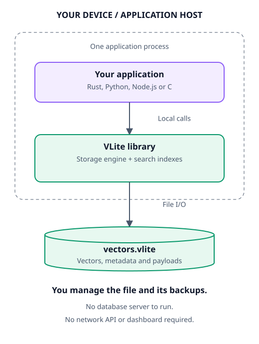
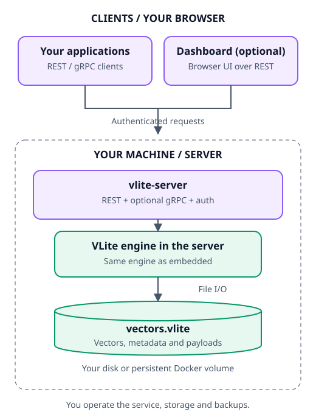
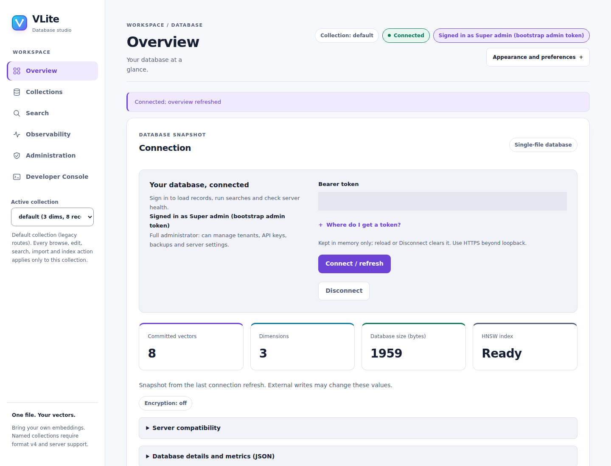

# VLite

**A single-file vector database for your applications, embedded or self-hosted.**

Durable vector storage, exact and HNSW search, and typed metadata in one file.
Embed with Rust or native bindings, or connect through REST and gRPC.
No external database required.

🌐 **Website:** [mahpate.github.io/Vlite](https://mahpate.github.io/Vlite/) ·
[features](https://mahpate.github.io/Vlite/features.html) ·
[dashboard](https://mahpate.github.io/Vlite/dashboard.html) ·
[CLI tools](https://mahpate.github.io/Vlite/docs/TOOLS.html) ·
[benchmarks](https://mahpate.github.io/Vlite/compare.html) ·
[multi-engine methodology and raw results](benchmarks/README.md#multi-engine-comparison)

> **Operating model:** the live dataset resides in memory, and the log is
> replayed on open. Each file permits one exclusive writer or multiple shared-lock
> read-only handles. The server allows concurrent read routes behind an RwLock.
> Size deployments for the full dataset and validate recovery and workload
> requirements before production use.

## Architecture at a glance

### Embedded or self-hosted?

**Embedded:** your application loads the VLite library and opens a local file.
No API service or dashboard is required.

<picture>
  <source media="(prefers-color-scheme: dark)" srcset="site/assets/diagrams/deployment-embedded-dark.svg">
  
</picture>

**Self-hosted:** you run `vlite-server` and provide persistent disk storage.
The service contains the same VLite engine, owns the database file and handles
authenticated REST requests and optional gRPC. No separate storage service is needed.

<picture>
  <source media="(prefers-color-scheme: dark)" srcset="site/assets/diagrams/deployment-self-hosted-dark.svg">
  
</picture>

The **dashboard is optional**: the API serves it at `/dashboard`, or a separate
frontend container proxies its requests to the API. Both use the same database.
You manage service uptime, storage, access, HTTPS, backups and upgrades.
See the [deployment guide](docs/DOCKER-OPERATIONS.md).

### Inside the engine

<picture>
  <source media="(prefers-color-scheme: dark)" srcset="site/assets/diagrams/layers-dark.svg">
  
</picture>

The website and this README share the same diagram images and color key:
**violet** interfaces, **cyan** search/indexes, **green** storage, **amber**
operations/decisions, and **red** errors. Boxes denote components, diamonds
decisions, and cylinders durable files. Solid arrows show calls/data flow;
dashed arrows show optional, conditional or return paths, labeled where needed.
See the [architecture guide](https://mahpate.github.io/Vlite/architecture.html)
for commit, recovery and query diagrams. Contributors can regenerate the light
and dark SVGs with `python scripts/build_site_diagrams.py` using the existing
[browser tooling](tests/requirements-dashboard.txt); colors come from
`site/assets/diagrams/palette.json`.

The dashboard uses the same visual language: a responsive
studio sidebar, clearer data cards and compact connection controls, with light
and dark themes. Raw diagnostics stay available in expandable panels.
See the [console guide](docs/CONSOLE.md#studio-workflow-improvements).

## Capabilities

See the [complete feature catalogue](https://mahpate.github.io/Vlite/features.html)
for supported capabilities, optional build features and requirements.

- **Single-file persistence:** versioned binary records, checksums, synchronous
  commits, exclusive writer/shared reader locking, and explicit interrupted-write recovery. Opt-in v5
  adds expiring records and compact metadata-only updates.
- **Atomic mutations:** vector/payload/metadata replacement and deletion,
  individually or in batches of up to 4,096 operations.
- **Exact search:** squared Euclidean, cosine and negative inner-product distance with f64 accumulation,
  deterministic distance/ID ordering, and bounded top-k candidate memory. Native
  scans use Rayon at ≥4,096 rows and ≥524,288 row-dimension components (not wasm32).
- **Metadata filters:** strict typed equality and inclusive numeric ranges,
  applied before exact top-k selection.
- **Approximate search:** deterministic, rebuildable HNSW with a bounded
  mutation buffer for small mixed read/write workloads, optional scalar-u8
  traversal and opt-in [restart snapshots](docs/ANN-SNAPSHOTS.md).
- **Advanced retrieval:** opt-in v4 collections and v5 record expiry, metadata-only
  updates, grouped/recommendation search, facets and geo filtering/ranking.
- **Embedded retrieval extensions:** opt-in v5 [named/sparse vectors, model history,
  resumable re-embedding](docs/VECTORS.md), pluggable embedding/reranking, and a
  read-only query language. Optional HTTP embeddings require `http-embedder`.
- **Deployment:** authenticated REST, OpenAPI, JSON metrics, redacted request
  logs, non-root Docker images, optional [gRPC](docs/GRPC.md), and an optional
  HTTPS reverse proxy.
- **Concurrent reads:** Rust `Database::open_read_only` (including encrypted opens),
  Python `open(path, read_only=True)` and Node `open(path, {readOnly: true})` share
  OS locks across processes. Readers exclude writers and see open-time snapshots;
  reopen to see later commits. Mutations return `Error::ReadOnly` without poisoning.
  In-memory ANN builds are allowed. Python C ABI calls remain serialized within
  one process; use multiple reader processes.
  See [locking contracts](docs/REFERENCE.md).
- **Observability and studio UX:** [dashboard](docs/CONSOLE.md) metric cards,
  sparklines, per-route latency, filtered live logs and JSONL export; Prometheus
  at `/metrics`, `/v1/admin/metrics/summary` and `/v1/admin/logs` (in-memory ring,
  `--log-buffer`, default 2000). Light/dark/system theme, collection review wizard,
  validated batched JSON writes with pause/progress, copy-as-code and bounded PCA.
- **Agent tooling:** [stdio MCP server](docs/MCP.md), read-only by default with
  opt-in write tools; [four agent skills](docs/AGENT-SKILLS.md) for RAG, MCP,
  operations and index tuning.
- **CLI tools:** [vlite-shell, vlite-maintain, vlite-import, vlite-tune and
  vlite-ann-compare](docs/TOOLS.md) for interactive/scripted queries, offline
  maintenance, validated imports and index evaluation.
- **Maintenance:** offline inspection, byte-preserving backup/restore, and
  no-clobber copy-out compaction.

Typed float32 inputs reduce JSON conversion: Python provides `search_f32` and
`batch_put_f32`; Node.js provides `searchF32`, `searchManyF32` and atomic
`batchPutF32`. Inputs are copied, not zero-copy; multi-query calls do not share a
transaction-wide snapshot. See the [Python](bindings/python/README.md) and
[Node.js](bindings/node/README.md) guides for limits and examples.

VLite servers can enable [durable group commit](docs/CONSOLE-ADMIN.md#opt-in-durable-group-commit)
with `--group-commit`: bounded concurrent record writes keep separate atomic
frames and share a filesystem sync before acknowledgement. It is off by default;
sequential workloads can be slower. Simple exact searches can scan bounded
immutable collection snapshots outside the writer lock; ANN, indexed filtering
and reranking retain their existing paths. No eventual-consistency mode or
weaker acknowledgement durability is required.
Embedded callers can also capture bounded [committed read snapshots](docs/read-snapshots.md)
for exact search, get and browse without holding the owner lock. Unquantized
background HNSW builds share immutable record generations instead of copying
vector bodies; the first later write can still copy the ID tree. Startup uses
compatible faster CRC validation and reusable replay buffers, not a new
checkpoint or storage format.

`--lock-held-reads` keeps exact scans under the owner read lock when snapshot
copying is a poor workload trade-off. Snapshot reads remain the default.
See the [operational guide](docs/CONSOLE-ADMIN.md) for metric semantics and limits.

VLite is licensed under the MIT License; see
[LICENSE](LICENSE). There is no inner-product ANN, networked
replication or approximate metadata filtering. Opt-in [storage features](docs/STORAGE-FEATURES.md) add encryption at
rest, point-in-time restore, a change feed, file-shipped read replicas, a
disk-based ANN sidecar, optional GPU exact search and a WebAssembly build.
See the [technical reference](docs/REFERENCE.md) for contracts and limits, and
[upgrade and rollback guidance](docs/RELEASE-0.4.1.md) before deployment.
See [offline command-line tools](docs/TOOLS.md) for the interactive shell,
CSV/JSONL/pgvector/FAISS and optional Parquet/Arrow imports, HNSW tuning, and
ANN quality/configuration comparisons.

## Command-line quickstart

From a source checkout with Rust 1.89 or later, build the offline tools:

```text
cargo build --locked --features tools --bins
cargo run --locked --features tools --bin vlite-shell -- --db example.vlite --create 3
```

The shell creates a **new** three-dimensional database and refuses an existing
path. Enter `help` for commands or `quit` to close it. For an existing database,
omit `--create 3`. These tools acquire an exclusive file lock: stop the server
and other owners before opening the same file, even with the shell's
`--read-only` safety guard. See the [CLI guide](docs/TOOLS.md) for scripted input,
imports, maintenance and optional Arrow/Parquet support.

## Choose how to use VLite

- **Python, embedded:** install a matching `vlite-embedded` platform wheel and
  open a `.vlite` file directly. No Rust, Docker or server is needed at runtime.
- **Node.js/TypeScript, embedded:** install a matching `@vlite/embedded` native
  tarball and call the engine asynchronously through a worker-backed addon.
  No HTTP service or Rust toolchain is needed at runtime.
- **Rust, embedded:** use the core crate directly in your application.
- **C/C++ and other native consumers:** use the versioned C ABI/shared library.
  Other languages can build bindings through their FFI; a dedicated SDK is
  not automatically provided for every language.
- **Python and TypeScript/JavaScript, REST:** use the first-party clients to
  connect to a self-hosted VLite service.
- **Other languages, REST:** call the documented HTTP/JSON API or generate a
  client from [OpenAPI](src/openapi.json). First-party Go and .NET clients are
  included; Java consumers can use HTTP or generate a gRPC client.
- **Other languages, gRPC:** generate a client from the versioned protobuf
  contract; enable the optional transport explicitly.

The engine's implementation language does not restrict the language of a
consuming application. Embedded packages must match their host's OS,
architecture and native runtime; REST clients only need network access to the
service. Embedded access permits one exclusive writer or multiple read-only
snapshots per file, not both at once. Use the service when applications need
concurrent reads alongside coordinated writes.

Use the [published Python packages](docs/INSTALL.md#pypi) or
[versioned release assets and installation instructions](docs/INSTALL.md) for
installation without cloning. See the [embedded deployment guide](bindings/README.md)
and [REST client guide](clients/README.md) for installation and examples.
Additional clients: [Go](clients/README.md#go), [.NET](clients/README.md#net),
[LangChain and LlamaIndex adapters](clients/README.md#langchain-and-llamaindex-integrations);
Kubernetes deployment: [Helm chart](deploy/helm/vlite/README.md).

## Quick start: embedded Python

Install the published [vlite-embedded](https://pypi.org/project/vlite-embedded/)
package with `python -m pip install vlite-embedded` (Python 3.11+), then:

```python
from vlite_embedded import NativeLibrary

native = NativeLibrary()
with native.create("documents.vlite", dimensions=3) as db:
    db.put("10", [1, 0, 0])
    print(db.search([0.9, 0.1, 0], 5))
```

Use `native.open("documents.vlite")` to reopen; creation never overwrites.
Use `read_only=True` for shared read-only opens.
See [Python installation and native platform support](bindings/README.md).

## Quick start: embedded Node.js / TypeScript

Install a matching native tarball using `npm install <tarball-path>`, then:

```javascript
import { NativeLibrary } from "@vlite/embedded";

const native = new NativeLibrary();
try {
  const db = await native.create("documents.vlite", 3);
  await db.put("10", [1, 0, 0]);
  console.log(await db.search([0.9, 0.1, 0], 5));
} finally {
  await native.close(); // Drains accepted work and closes owned databases.
}
```

These calls run native work in a dedicated worker thread. Node.js 22.9+ and
a matching native package are required; this is not a browser/edge SDK.
See [Node installation, TypeScript types and lifetime rules](bindings/node/README.md).

## Quick start: embedded Rust

Requires **Rust 1.89 or later**. The default library build has no HTTP runtime.
From a checkout:

```text
cargo run --locked --example basic -- demo.vlite
```

The example creates a new file and refuses to overwrite an existing one.
For another Rust project, use a local dependency:

```toml
[dependencies]
vlite = { path = "../VLite" }
```

```rust
use vlite::Database;

fn main() -> vlite::Result<()> {
    let mut db = Database::create("vectors.vlite", 3)?;
    db.put(10, &[1.0, 0.0, 0.0], b"document A")?;
    db.put(20, &[0.0, 1.0, 0.0], b"document B")?;

    let hits = db.search(&[0.9, 0.1, 0.0], 5)?;
    assert_eq!(hits[0].id, 10);
    db.close()
}
```

Use `Database::open` to reopen an existing file. Plain `put` replaces the
entire record and clears prior metadata. `put_with_metadata` replaces all
three components. IDs are u64; each legacy vector space has one fixed dimension. Opt-in v5
[named vectors](docs/VECTORS.md) add independent per-name dimensions and metrics.

## Quick start: Windows devbox (Docker in WSL)

On Windows 10 (build 19041+) or Windows 11, the script checks WSL 2, the
selected Ubuntu distribution (default `Ubuntu-24.04`), Docker and Compose.
Missing prerequisites are installed after confirmation; Windows may request
administrator approval and a restart. Save your work, restart if asked, then
run the same command again. Hardware virtualization and internet access are
required. No Git, Rust or Docker Desktop installation is needed.

From PowerShell, without cloning the repository:

```powershell
Invoke-WebRequest https://raw.githubusercontent.com/mahpate/Vlite/main/scripts/devbox.ps1 -OutFile devbox.ps1
powershell -NoProfile -ExecutionPolicy Bypass -File .\devbox.ps1
powershell -NoProfile -ExecutionPolicy Bypass -File .\devbox.ps1 -Token
```

Or, from an existing checkout:

```powershell
.\scripts\devbox.ps1           # start the API and dashboard
.\scripts\devbox.ps1 -Token    # copy the API token to the clipboard
```

Open **http://127.0.0.1:8082**, paste the token into the connection field and
select **Connect**. The REST API is at **http://127.0.0.1:18085**.

The script writes `compose.yaml`, `.env` and a randomly
generated token to `/root/vlite-deploy` inside WSL, then runs
`docker compose -f compose.yaml --profile dashboard up -d --no-build --wait`. Running it again
updates the deployment and keeps the existing token and data. Everything is
published on loopback only.

| Task | Command |
|---|---|
| Show container status | `.\scripts\devbox.ps1 -Status` |
| Stop (data kept) | `.\scripts\devbox.ps1 -Down` |
| Stop and delete the database volumes | `.\scripts\devbox.ps1 -Reset` |
| Print the token without the script | `wsl -d Ubuntu-24.04 -u root -e cat /root/vlite-deploy/.secrets/api-token` |
| Other ports, distro or version | `.\scripts\devbox.ps1 -ApiPort 18090 -DashboardPort 8090 -Distro Ubuntu -Version v0.4.1` |
| Database dimensions for a new volume | `.\scripts\devbox.ps1 -Dimensions 384` |

WSL shuts its VM down shortly after the last WSL process exits, which also
stops Docker. The script therefore starts a hidden `sleep infinity` keepalive
in the distro; `-Down` stops it. The keepalive does not survive sign-out or a
reboot, so rerun the script afterwards (the containers restart automatically
once WSL is running). If `localhost` is unreachable from the Windows browser,
check that WSL is running (`wsl -l -v`) and that the ports are not already used.
`-Dimensions` only applies when the data volume is first created.
Use `-Yes` to approve prerequisite installation noninteractively (Windows UAC
still applies). Management switches never install prerequisites; `-Reset`
always requires a separate typed deletion confirmation. Existing Docker or
containerd installations are not replaced: repair Compose or enable Docker
Desktop's WSL integration if the script reports a conflict. Automatic package
installation supports Ubuntu 22.04/24.04, not arbitrary distributions.

### Ubuntu: Docker and dashboard

From an Ubuntu 22.04/24.04 terminal:

```sh
sudo apt-get update && sudo apt-get install -y git
git clone https://github.com/mahpate/Vlite && cd Vlite
sudo sh scripts/docker-dashboard.sh
```

The script offers to install Docker Engine/Compose from Docker's official
Ubuntu repository, preserves existing tokens/volumes and starts published
images without a source build. Open **http://127.0.0.1:8081**; the script prints
how to read the token locally. Options include `--yes`, `--version`,
`--deploy-dir`, `--api-port`, `--dashboard-port` and `--dimensions`.
It does not add users to the privileged Docker group. Other Linux distributions
can use an existing working Docker/Compose installation, but automatic package
installation is Ubuntu-only. See [Docker operations](docs/DOCKER-OPERATIONS.md).

## Quick start: Docker REST service

Requires Docker Engine with **Linux containers**, Compose v2, and Python 3 for
secret generation. On Windows with Docker in WSL, run these commands inside WSL,
or use the [devbox script](#quick-start-windows-devbox-docker-in-wsl) above.
From the repository root:

```text
python3 -c "import pathlib,secrets; p=pathlib.Path('.secrets'); p.mkdir(mode=0o700,exist_ok=True); (p/'api-token').write_text(secrets.token_urlsafe(32),encoding='ascii')"
docker compose --profile api up --build -d api
```

Keep the secret directory private and allow the container's UID 10001 to read
the token file. The file is Git-ignored and excluded from image builds.
`VLITE_TOKEN_FILE` selects an existing secret; `VLITE_DIMENSIONS` defaults to 3.
The API is published only at **127.0.0.1:18084**. The named data volume survives
container removal and `docker compose down`.

PowerShell client example (run from the checkout containing the secret):

```powershell
$auth = @{ Authorization = "Bearer $((Get-Content .secrets\api-token -Raw).TrimEnd())" }
$base = 'http://127.0.0.1:18084'
Invoke-RestMethod "$base/ready" -Headers $auth
Invoke-RestMethod "$base/v1/vectors/10" -Headers $auth -Method Put -ContentType 'application/json' -Body '{"vector":[1,0,0]}'
Invoke-RestMethod "$base/v1/search" -Headers $auth -Method Post -ContentType 'application/json' -Body '{"vector":[0.9,0.1,0],"k":5}'
```

Use the same token value on the host where requests are sent; do not put tokens
in URLs or commit them. `/health` and the static dashboard assets are public;
data, metrics and OpenAPI routes require bearer
authentication. Native server usage supports token files/environment or an
explicit loopback-only `--insecure-local` development mode.

## Embedded deployment across languages

Deploy VLite inside your application without a server using the native shared
library and versioned C ABI. Python has an embedded ctypes binding,
Node.js/TypeScript has an asynchronous native addon, and C/C++ uses the supplied
header. Other languages can build bindings against the same ABI.
Build once for the target OS/architecture; Rust is not required at runtime.
The database retains its single-owner file-locking and durability contracts.

See [embedded installation, Python examples and the C ABI](bindings/README.md).
Platform-specific Python wheels bundle the native library and are published as
[vlite-embedded on PyPI](https://pypi.org/project/vlite-embedded/); install with
`python -m pip install vlite-embedded` and use `NativeLibrary()` without
supplying a DLL path. Wheels support Windows x64, macOS arm64 and
Linux x86_64/glibc 2.28+, including `read_only=True` and typed float32 inputs.
A dedicated audited manylinux wheel targets Linux x86_64/glibc 2.28+;
host-native wheels remain available for Windows and macOS.
The [embedded Node package](bindings/node/README.md) bundles its addon and
native library in host-specific, checksummed tarballs. Its Linux build is
host-specific, not covered by the Python wheel's manylinux certification.
The embedded binding supports atomic writes and bounded multi-record reads;
see [measured Python binding/batch performance](benchmarks/RESULTS.md#python-embedded-binding-and-batching-october-19-2026-utc).

## Python and TypeScript/JavaScript REST clients

First-party REST clients support vector CRUD, atomic batches, TTL and metadata
updates, grouped/recommendation/faceted retrieval, named/sparse vectors, query
language, text-embedding calls, change-feed browsing, webhook administration,
index maintenance and metrics. The server also provides HMAC-signed webhook
subscriptions; see [WEBHOOKS.md](docs/WEBHOOKS.md). Python 3.11+ uses the
standard library; the Node.js 22+ ESM client includes TypeScript types and has
no runtime dependencies. Both preserve full-width IDs as strings, expose
structured errors and never automatically retry writes.

See [client installation, examples and error handling](clients/README.md) and
the [REST API reference](docs/API.md).
The Python REST client is published as
[vlite-client on PyPI](https://pypi.org/project/vlite-client/); install it with
`python -m pip install vlite-client`.

## Browser dashboard

<picture>
  <source media="(prefers-color-scheme: dark)" srcset="site/assets/dashboard/current-overview-dark.png">
  
</picture>

Overview with sticky-header preferences and connection help. See
[screenshots and source-build setup](https://mahpate.github.io/Vlite/dashboard.html#screenshots)
for the interface shown above.

After starting the Docker API above, open **http://localhost:18084/dashboard**
and paste the existing `.secrets/api-token` value into the connection field.
This built-in option requires no separate frontend container. The native REST
binary includes the same dashboard.

For a separately containerized frontend that talks to the REST service over
the Compose network, build and start the API plus dashboard together:

```text
docker compose --profile dashboard up --build -d dashboard
```

Open **http://localhost:8081** and paste the same token. The static UI container
proxies `/api/*` to the authenticated API service; it does not embed credentials,
add browser CORS permission, or use a separate database. The REST API remains
available at **http://localhost:18084**. Override `VLITE_DASHBOARD_PORT` or
`VLITE_PORT` if those loopback ports are already in use. Stop both services with
`docker compose --profile dashboard stop dashboard api`.

The separate image is built from `Dockerfile` target `dashboard`; Compose builds
it locally rather than requiring a Node toolchain or an external UI service.
Both UI and API publish only on loopback by default. Use the documented HTTPS
deployment before accessing them from other machines.

The dashboard provides database information and metrics, paginated ID/metadata
browsing, click-to-inspect vector CRUD, payload/typed metadata editing, exact filters, all three search modes,
explicit HNSW builds, and a request/response inspector with browser-observed
latency. Put/delete/build operations require confirmation. It is a testing/admin
interface, not an embedding generator or production monitor.
Put replaces the entire record; no undo or automatic retries are provided.

**Observability** adds request/search rates, latency percentiles, sparklines,
route counters, live server logs, slow queries and recent audit activity to the
same dashboard. Connect using a bootstrap admin token, then select
**Observability** in the sidebar. Refresh every 2, 5 or 15 seconds, pause, or
switch to manual refresh; automatic polling stops while the section or tab is
hidden. Logs support severity/text/target filters, expandable structured fields,
auto-scroll and filtered JSONL download. The browser retains at most 5,000 log
entries and displays the newest 500; **Clear view** clears only the browser's
buffer. Logs are a bounded in-memory server ring, not a durable log archive;
the dropped count reports overwritten server entries. Metrics fall back to
Prometheus on older servers; missing measurements show a dash, and rates need
two samples. Unavailable admin endpoints are identified without breaking the
rest of the console.

The console groups tools into six focused workspaces, with
Records, Write, Search, Index and Settings tabs for collection work. A responsive
navigation drawer, keyboard-accessible tabs and advanced-panel disclosures keep
the interface usable on smaller screens. Navigation preserves in-page drafts;
it does not persist records or credentials. Snapshot cards show vector count,
dimensions, file bytes and index readiness. **Fill example** prepares a
dimension-matched vector and typed metadata without saving; choose an ID and
use **Put / replace** to commit it. **Use editor vector as query** makes a
self-match search easy. Select a browse or search result ID to inspect the
record in the editor. Mutation confirmations remain required. Each server owns
one database file; opt-in v4 files support named collections in that file.

The record inspector separates Payload, Metadata, Vector and Raw JSON, with
bounded readable previews and full raw record data. Search keeps the previous
successful results visible during refresh or failure and explicitly reports
errors; distances are labeled rather than presented as generic similarity.
Database workflows remain serialized, but navigation, help and appearance
controls stay usable while a request is pending. Stopping the browser wait does
not cancel server work or automatically retry it.

The expanded [testing console guide](docs/CONSOLE.md) covers guided demo data,
bounded JSON/CSV import and export, batch editing, a visual filter builder,
exact/ANN comparison, sampled metadata/quality analysis and PCA, a REST
playground, read-only scenario replay, health snapshots and safe payload previews.
Appearance preferences are stored only when explicitly enabled; database data
and tokens are never persisted by the console.
The browser also supports selectable metadata columns, current-page sorting,
inline record previews, a typed visual metadata draft editor, and downloadable
named query files for explicit replay. Sorting is not database-wide; neither
applying a metadata draft nor loading a query sends a write.

Browse pages are capped at 100 records and 1 MiB JSON and omit vectors/payloads.
They are live views, not stable snapshots. HNSW readiness and buffer usage are
visible without attempting a search; refresh status after writes or builds.

Tokens stay only in page memory (not browser storage, cookies or URLs); reload
or Disconnect clears them. Requests use the same-origin bearer-protected API.
The public page contains no database contents or credentials. Use the HTTPS
overlay beyond loopback and treat the token as full read/write/admin access.
The inspector displays record data, so do not share screenshots containing
private vectors or payloads. Explicit builds still block the single owner.

The binary serves plain HTTP. Use the supplied
[HTTPS deployment](docs/REFERENCE.md#https-observability-and-releases) before
exposing it beyond loopback. The bootstrap token grants full access; v4 files
can add expiring, collection- and operation-scoped
[credentials](docs/CAPABILITIES.md#rest-service-and-scoped-credentials). Read the
[REST contract](docs/REFERENCE.md#rest-service-optional) and
[OpenAPI specification](src/openapi.json) before integrating.

## Search and indexing

Exact search is the default. It evaluates eligible vectors and retains at most
`min(k, live records)` candidates. Filters support string, signed integer,
finite float, and boolean values without implicit type coercion.

HNSW is opt-in (`"mode":"approximate"` in REST). Small writes are merged through
a mutation buffer rather than forcing a complete rebuild on every write.
The buffer is capped at **256 distinct IDs / 8 MiB of vector bytes**. Overflow,
reopen, or changed index configuration causes a synchronous rebuild on the next
nonempty ANN query. It is approximate: recall and a full k results are not
guaranteed. Both ANN modes accept the same typed metadata filters as exact
search. Filter-aware traversal retains eligible candidates and can cross
nonmatching graph nodes; it does not filter an unfiltered top-k or fall back to
an exact scan. Selective filters can be expensive: `ef_search` controls candidate
retention, not a hard visit/time budget. Cosine excludes zero-norm records.

For latency-sensitive callers, `Database::search_approximate_ready` (REST
`"mode":"approximate_ready"`) never builds an index during the query. Missing
or invalidated indexes return `IndexNotReady` / HTTP 409 `index_not_ready`;
there is no silent exact fallback. Schedule `build_hnsw` or authenticated
`POST /v1/index/hnsw` with `{}` separately. Builds still block the single owner,
so this separates maintenance from queries rather than providing a latency SLA.

See [metadata and filters](docs/REFERENCE.md#typed-metadata-and-exact-filtered-search)
and [HNSW behavior](docs/REFERENCE.md#optional-hnsw-search).

## Exact-search metrics

Existing calls remain squared-L2. Rust callers can use
`db.search_with_metric(&query, k, vlite::DistanceMetric::Cosine)`.
Python embedded uses `db.search(query, k, metric="cosine")`; Node embedded uses
`await db.search(query, k, { metric: "cosine" })`. REST accepts the same metric
names in `/v1/search`: `squared_l2`, `cosine`, `inner_product`.
The dashboard offers all three in exact mode and L2/cosine in ANN modes.

Distances always sort lowest first: cosine returns 1 minus similarity, while
inner product returns negative dot product. Cosine rejects zero queries and
excludes zero-norm records. There is no silent metric fallback.
See [metric contracts](docs/REFERENCE.md#exact-distance-metrics-v011).

**Cosine ANN:** Rust provides
`build_hnsw_with_metric`, `search_approximate_with_metric` and
`search_approximate_ready_with_metric`, with `DistanceMetric::Cosine`.
Python uses `db.build_index(metric="cosine")` followed by
`db.search_approximate_ready(query, k, metric="cosine")`; Node uses
`await db.buildIndex({ metric: "cosine" })` and
`await db.searchApproximateReady(query, k, { metric: "cosine" })`.
REST builds accept `{"metric":"cosine"}` and searches use the same metric.
Only one graph is retained: ready-only queries reject a mismatched metric;
lazy queries rebuild synchronously. Inner-product ANN remains unsupported.
Use matching engine and SDK packages for cosine ANN.
No database format change is required.

## Performance

Performance numbers are workload-specific, not product rankings.

Current-source Rust callers can opt into
[bounded background HNSW rebuilds](docs/REFERENCE.md#background-hnsw-rebuilds-rust):
capture a committed generation, build on one worker, then explicitly poll to
publish with mutation catch-up. Ready-only queries never rebuild or fall back.
Catch-up overflow is explicit; sustained writes may make ANN temporarily
unavailable. Snapshot copying/publication still use the owner thread, so this
is not a hard latency guarantee. Synchronous APIs remain unchanged.
The caller-driven `maintain_hnsw` tick can start earlier at configurable
high-water marks (default 128 distinct IDs / 4 MiB), with read-only capacity,
processed-record progress and explicit pressure status. It does not run inside
writes or queries and cannot guarantee readiness when mutations outpace rebuilds.
The background lifecycle is Rust-only for now, not a REST/C/Python/Node API.

- [Benchmark methodology and reproducible runs](benchmarks/README.md)
- [Published measurements and raw results](benchmarks/RESULTS.md)
- [Native benchmark reference](docs/REFERENCE.md#reproducible-benchmark)

Exact search can reject a candidate early when its partial squared-L2 distance
already exceeds the current top-k cutoff. Vectors above 32 dimensions check
the cutoff in 32-component blocks; short vectors retain the full-distance path.
This preserves exact distances and deterministic ties, but benefits depend on
the data and scan order. See the published cutoff comparison for gains and
regressions on the measured synthetic workloads.

The native benchmark verifies every exact query against an independent oracle.
It accepts external vector/query/update files and can measure durable mixed updates/deletes,
ANN rebuild pauses, raw latency samples, measured file growth and whole-process
peak memory through the native campaign runner.
The [real GloVe campaign](benchmarks/README.md#real-glove-embeddings-and-mixed-deletions)
records licensed-data provenance and current-state recall after every mutation.
Measure embedded calls and REST requests separately; mixing in-process latency
with network calls would be misleading. Use identical inputs, resource limits,
warmups and correctness checks when comparing runs. Your own embeddings,
concurrency, larger dimensions and datasets, recall targets, storage, and memory
need their own measurements before making deployment decisions.

## Data safety and maintenance

Successful writes append a complete checksummed commit and synchronize the
file before acknowledgment. Hardware/filesystem sync behavior and parent
directory durability impose limitations; this is not a physical power-loss
guarantee. A failed commit poisons the handle because the outcome may be
indeterminate. Never blindly retry an uncertain write.

Corruption fails closed. Incomplete trailing writes require explicit repair;
opening a database never silently discards committed data.

```text
cargo run --locked --bin vlite-maintain -- inspect vectors.vlite
cargo run --locked --bin vlite-maintain -- backup vectors.vlite backup.vlite
cargo run --locked --bin vlite-maintain -- compact vectors.vlite compact.vlite
```

Stop the database owner before maintenance. Output paths must be new; existing
files are never overwritten. Default creation uses format v3; legacy v1/v2 files
remain readable, but metadata writes require explicit copy-out migration.
Opt-in format v4 adds named collections and durable import checkpoints. Upgrade
only to a new path, retain the original, and explicitly switch owners after
verification; older binaries cannot open v4. See
[collections and advanced retrieval](docs/CAPABILITIES.md) for record revisions,
metadata indexes/planning, hybrid search, quantized ANN and ingestion contracts.
See [maintenance](docs/REFERENCE.md#storage-maintenance),
[durability details](docs/REFERENCE.md), and the
[upgrade/rollback runbook](docs/REFERENCE.md#https-observability-and-releases).

## Development and validation

The pure graph engine lives in `src/property_graph/engine/` and is compiled by
the experimental, non-default `graph` feature (graph-enabled files, named
graphs, atomic node/edge/attachment write batches, paged reads and bounded
traversal/shortest paths, graph-aware maintenance and replica followers; not in
release artifacts, see
[graph-enabled files](docs/STORAGE-FEATURES.md#graph-enabled-files-experimental-graph-feature)).
`crates/vlite-graph` is an unpublished workspace harness that tests the same
engine source in isolation. Graph cost measurements and their scope are recorded
in the [benchmark report](docs/projects/feature-agent-graph/graph-measurements.md).

```text
cargo test --locked --all-targets --all-features
cargo test --locked -p vlite-graph
cargo test --locked --features graph --test graph_storage --test graph_compat --test graph_traversal --test graph_maintenance --test graph_recovery
cargo clippy --locked --all-targets --all-features -- -D warnings
cargo fmt --check
docker compose --profile test run --build --rm tests
python3 tests/rest_e2e.py
python3 tests/tls_e2e.py
```

Browser acceptance tests additionally need Playwright on the Docker execution
host (WSL when Docker lives there). Use a virtual environment, then:

```text
python3 -m pip install -r tests/requirements-dashboard.txt
python3 -m playwright install --with-deps chromium
python3 tests/dashboard_e2e.py
```

This creates isolated API and dashboard containers on a private Docker network
and exercises both the embedded and separate REST-backed UIs with real Chromium.
It removes the test containers/network and retains its explicitly named data
volume. The runtime image itself needs neither Python nor a browser.

The bounded reliability campaign runs with `cargo test --locked --test reliability`.
Four fixed seeds compare mixed CRUD/atomic batches and exact search with an
independent state model across reopen, backup and compaction. Subprocess tests
forcibly terminate an owner after acknowledged writes and around a subsequent
unacknowledged batch, checking acknowledged-data retention, batch atomicity,
lock release and continued writes. Incomplete tails require an explicit
backed-up repair in the test; normal open must not modify the file.
The crash fixture is marked ignored because its parent invokes it explicitly.
Kill timing does not guarantee every write boundary is hit; these process-crash
checks complement byte-prefix recovery and sync-failure tests, not hardware
power-loss certification.

`cargo test --locked --test ann_reliability` runs three seeded mixed ANN
histories with vector/payload/metadata replacement, deletion and rejected atomic
batches. An independent committed-state model checks candidate IDs, current
distances, ordering and fixed-workload recall. It covers the exact 256-ID buffer
boundary, overflow, explicit rebuilds, configuration mismatch, reopen and
empty-to-populated transitions. Ready-only queries must not build an index;
rebuilds must not change database bytes. The 95% recall threshold applies only
to this small fixed dataset with ef-search=1000, not arbitrary workloads.

CI covers Windows, Linux, and macOS on Rust minimum/stable, plus Linux Docker
REST persistence and verified HTTPS. Docker on a Windows/macOS host still
executes Linux code; it does not replace native filesystem testing. Linux arm64
native tests run in CI; arm64 archives and container images are available.

## Stable release criteria

When publishing features, update their corresponding website pages and package
README sections in the same change. Current installation examples and feature
availability must match the latest published release. Keep experimental source
features explicitly gated; do not present them as released. Historical raw
benchmark reports and release notes retain their original provenance rather
than being relabeled as new measurements. Run `python tests/release_docs.py`
to catch stale release versions in current product pages and package READMEs.
Keep product prose concise: omit capture dates, repeated release notes and
unnecessary version labels. Put benchmark build identities in measurement
details; retain version pins and compatibility requirements where needed.

VLite is pre-1.0: formats and APIs may still change. See
[releases](https://github.com/mahpate/Vlite/releases) for packages and images.
A stable release requires a verified
compatibility and operational baseline, not just a version or wording change:

1. **Freeze the supported contracts:** document the Rust API, REST/OpenAPI
   behavior, file-format compatibility, migration rules and support matrix.
   Define which changes require a major version increment.
2. **Pass release gates on the exact candidate:** run native minimum/stable Rust
   checks on Windows, Linux and macOS, plus Docker REST, HTTPS and browser
   acceptance. Verify each advertised image architecture before supporting it.
3. **Exercise recovery and upgrades:** verify acknowledged writes across
   restarts, interrupted-write and corruption handling, backup/restore,
   migration and rollback using retained compatibility fixtures.
4. **Set measured deployment limits:** run representative datasets and sustained
   mixed workloads; record latency tails, recall, memory, startup/replay time
   and file growth. Include index-buffer overflow and explicit rebuilds.
5. **Resolve distribution and security readiness:** verify license compliance, review
   dependencies and authentication/deployment configuration, and document
   supported versions and vulnerability reporting.
6. **Publish an immutable release:** update `Cargo.toml` and `Cargo.lock`
   together, record release notes and known limits, then tag the approved
   commit as `v<package-version>`. Use `v1.0.0` once the stable contracts above
   are satisfied; pin deployed images by digest.

The existing tag-triggered workflow builds native archives/checksums and
multi-architecture container images, with acceptance gates. A manual workflow
run can validate a candidate without publishing it. See
[installation](docs/INSTALL.md) for release archives and checksums.

## License

VLite is licensed under the [MIT License](LICENSE). You may use, modify,
redistribute and include it in commercial products, provided you retain the
copyright and license notice. Contributions are welcome under the same license.
