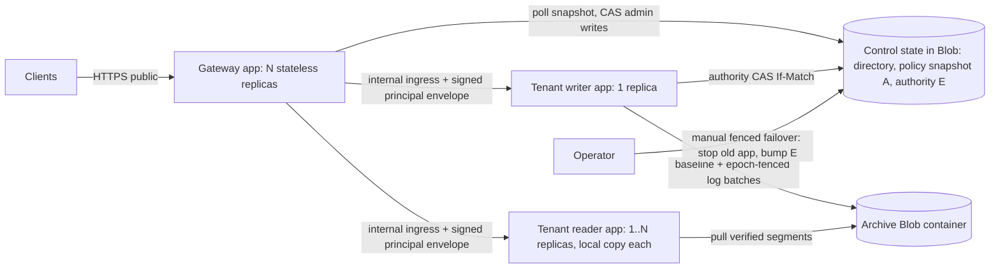

# Introduction

**Status: STAGED IMPLEMENTATION AUTHORIZED - NOT DEPLOYED.** On 2026-11-16 the user said "go ahead with next steps for HA". Start with the unblocked preparatory work below; this does not pass any acceptance gate or approve Azure provisioning, production access, a release, or a benchmark campaign. Authorization behavior stays unchanged: the gateway must enforce the existing route-to-permission map, every backend must enforce it again, and no new role or permission is introduced (see SEC-001).

**Current slice.** EPIC-001 ITEM-001's exported-segment first cut is implemented and verified on small synthetic local fixtures only; see `benchmarks/ha-reader-apply.md`. GATE-001's criteria were verified on merged tree `75df5738` and the owner's go-ahead was recorded as a narrow code-implementation go (section 14, EPIC-002). EPIC-002 backend serving modes (`standalone`/`writer`/`reader`, reader refusal, drain readiness, `GET /v1/admin/serve-status`) are delivered in code and tests only. Archive-backed measurements, a reader strategy/capacity qualification, reader catch-up, epochs/fencing and failover are not delivered. No production deployment, production HA enablement, Azure provisioning or separate test instance was performed or authorized by this slice.

**Relationship to the older backup/HA PRD.** `docs/projects/feature-backup-ha/feature-backup-ha.prd.md` (the "old PRD") holds a broad backup and HA design. Its backup half is implemented through the 0.7.8 release candidate (old PRD section 14.4 and 14.5); publication and deployment are separate from this work. Its HA epics were deliberately deferred. **Its 2026-11-13 approval text covered only the backup-only milestone and is NOT authority to implement HA** (old PRD Introduction; ITEM-002, authority/fencing, standby/replication were explicitly not approved). The new authorization above is for staged HA work, not a waiver of those safety gates. This PRD reuses and cites old-PRD sections instead of duplicating them: topology rejection of Azure Files (section 3.2, ALT-001, RISK-001), replication protocol (3.4), authority and fencing (3.5), access-policy generation (3.6), RD-009 (zone HA only; never geo-fail the authority witness), AZ-001/AZ-003 (section 14.2). Where this PRD departs from the old PRD, section 3.2 says so.

**Direction this plan encodes** (the user's design statements, treated as requirements): per-tenant individual VLite deployments; each tenant has one writer and many readers; writes are routed to the writer automatically; separate writer and reader ACA apps are acceptable; HA builds on Azure Blob with possible loss of the most recent sync data and eventual consistency for readers accepted; a shared **gateway** performs authentication, authorization, rate limiting, tenant lookup and routing; the gateway is **stateless in general and scales horizontally on ACA**. Everything I add beyond those statements is labelled "proposal".

The key words "MUST", "MUST NOT", "REQUIRED", "SHALL", "SHALL NOT", "SHOULD", "SHOULD NOT", "RECOMMENDED", "MAY", and "OPTIONAL" in this document are to be interpreted as described in RFC 2119.

**Cross-reference conventions**: `FR-` functional requirements; `NFR-` non-functional; `SEC-`/`CON-`/`GUD-`/`PAT-` security, constraint, guideline, pattern; `FM-` failure modes; `AC-` acceptance criteria; `RD-` proposal decisions; `OD-` open decisions needing the owner; `ASM-` assumptions; `ALT-` alternatives; `GATE-` go/no-go gates; `SRC-` repository evidence; `AZ-` Azure evidence; `EPIC-`/`ITEM-` delivery. "Old PRD" means the file named above. `EPIC-PITR-001` is the separate in-flight Blob archival work (specification `blob-pitr.prd.md`, held outside the repository by that session). No separate requirements artifact is needed.

# 1. Goals and Non-Goals

### In Scope

- **G-1 Opt-in topology.** A shared public gateway ACA app and, per tenant, a private writer app and a private reader app, all running the same VLite engine in different serving modes (not a code fork). The current single-database deployment, including the live production deployment, stays the default and is unchanged unless an operator opts in.
- **G-2 Stateless, horizontally scalable gateway.** Any gateway replica can serve any request. Gateway replicas share authoritative control state; no replica holds tenant, auth, session, policy or routing authority. Disposable caches only. Scale-out is by ACA HTTP-concurrency rules (section 3.4).
- **G-3 Read scale-out.** Readers hold their own local database copy, fed by baseline snapshots and committed log batches in Azure Blob. Readers are eventually consistent and report staleness.
- **G-4 Controlled writer failover.** Enforced fencing (monotonic epoch bound into archived history, checked by Blob conditional writes and by backend serve-time and startup checks), operator-driven first, automated only after fencing is proven.
- **G-5 Per-tenant deployment mapping and migration**, opt-in, with a tenant directory that can also point a tenant at today's shared database.
- **G-6 Staged, independently shippable delivery** with a go/no-go gate between stages (section 14).

### Out of Scope (deferred)

- Production deployment, any Azure provisioning, any benchmark campaign (this PRD plans measurements; it runs none).
- The memory dashboard, the query language, the graph store, dashboard asset changes (avoids tour recapture, SRC-019).
- Multi-writer, multi-region writers, synchronous replication, zero-RPO, automatic read-your-writes on readers.
- gRPC and embedded-writer HA (the old PRD requires unsupported mutation entry points to refuse HA mode; gRPC does not start with memory bindings, SRC-013).
- Re-planning EPIC-PITR-001 (section 6 lists only what HA needs from it).
- Qualifying Azure Files. The existing storage qualification gates are NOT superseded (old PRD Introduction; `deploy/azure-container-apps/README.md:18,27-29,110`).

### Consistency and durability contract (TARGETS TO BE VALIDATED, not guarantees)

| ID | Dimension | Target | Depends on | Validated by |
|---|---|---|---|---|
| C-01 | Writer reads | A read served by the tenant's writer sees every write the writer acknowledged (same as one database today). | Writer routing; backend serving modes | TEST-001, AC-001 |
| C-02 | Reader reads | Reader serves a consistent database state at an applied position (lineage, epoch, sequence), eventually consistent with the writer; every reader response reports applied position and age; a reader beyond the tenant's staleness bound fails its readiness and refuses reads. Bound value: proposal, unmeasured; set after EPIC-001. | EPIC-001, EPIC-005 | TEST-006, AC-006 |
| C-03 | Loss window (writer loss) | The user accepted losing the most recent unsynced writes. The window is the data acknowledged by the writer but not yet in the verified durable archive at failover. It is measured by ACTUAL durable archival position/time; a configured interval is not a bound; archive failures widen it. | EPIC-PITR-001, EPIC-006 | TEST-008, AC-009 |
| C-04 | Reader staleness | Staleness = writer commit to archive upload to reader apply. No number is promised. | EPIC-001 measurements | TEST-006 |
| C-05 | Failover | v1: operator-driven only; the old writer is infrastructure-fenced and epoch-fenced before the new writer serves; the operator must acknowledge a printed loss report. RTO: unmeasured, no number stated. Automatic promotion only after GATE-005. | EPIC-006, EPIC-010 | TEST-007, TEST-008 |
| C-06 | Revocation latency | Credential revocation, tenant suspension and memory-binding permission changes take effect at every gateway replica within a bounded interval S_ctl (versioned invalidation plus bounded polling) and are re-checked by backends through the principal envelope generation. S_ctl: proposal, owner decision OD-005; not eventually-consistent-without-bound. | EPIC-003, EPIC-004 | TEST-004, AC-004 |
| C-07 | Gateway availability | Loss of one gateway replica loses only its in-flight requests, never authority state. Control-state unavailability beyond S_ctl fails closed (503) for authentication decisions; never allow-by-default. | EPIC-004 | TEST-003, FM-004 |
| C-08 | Write throughput | Unchanged: one writer per tenant bounds write throughput. More readers or gateway replicas add no write capacity. | - | AC-011 |

### What this does NOT give you

- **No multi-writer.** One writer per tenant. Gateway scale-out is not writer HA: more gateway replicas add no write capacity, no tenant failover and no read-your-writes.
- **No automatic read-your-writes on readers.** Freshness-required reads route to the writer initially; a position-token scheme is a later option (OD-007).
- **No change to single-writer write throughput.**
- **Azure Files is not qualified** for HA or power-loss durability and this PRD does not supersede those gates.
- **The loss window is whatever actual archival achieved.** Blob geo-replication shrinks no loss window of the VLite archive by itself (section 3.10).
- **No zero-downtime guarantee.** Writer outage lasts until an operator (v1) or proven automation completes a fenced failover.
- **No change to the default.** An operator who does nothing keeps today's single deployment.

# 2. Terminology

| Term | Meaning |
|---|---|
| Gateway | The shared public ACA app: authentication, authorization/policy, rate limiting, tenant lookup, operation-based routing. Opens no database. |
| Writer app / reader app | Per-tenant private ACA apps running the VLite engine in `writer` / `reader` serving mode. Writer: 1 replica. Reader: 1..N replicas, each with its own local copy. |
| Standalone | Today's mode: one server, one database, tenants as namespaces. Remains the default. |
| Control state | Authoritative shared state: tenant directory, credential/policy snapshot, writer authority record, per-tenant routing record. |
| `A` (policy generation) | Monotonic number of the control-state snapshot; bumped by revocation, suspension, grant or binding changes (old PRD section 3.6 uses the same idea). |
| `E` (epoch) | Monotonic per-tenant writer generation, bound into archived history. |
| S_ctl | Bound on gateway control-state staleness (OD-005). |
| Archive | Azure Blob baseline snapshots plus contiguous verified committed log segments, produced by EPIC-PITR-001. |
| Principal envelope | Short-lived gateway-signed statement of the authenticated principal (grant data, tenant, audience, expiry, `A`) that a backend verifies. |
| Ambiguous write | A write whose request may have reached the writer but whose outcome is unknown to the gateway. |

# 3. Solution Architecture

## 3.1 Overview

Trust boundaries: client to gateway (public TLS, bearer credentials); gateway to backends (private environment network plus authenticated envelope, because internal ingress is not authentication, AZ-002); backends to Blob (managed identity, `AuthMode::ManagedIdentity` precedent, SRC-010); operator to control state (separate admin path, SEC-006).

## 3.2 Reconciliation with existing planning documents

| Document | What it says | This PRD |
|---|---|---|
| Old PRD sections 3.2, 3.4, 3.5, 3.6, RD-009, ALT-001, FM/AC/GATE sets | ACA plus Azure Files rejected as HA substrate; replication protocol; epoch `E`, lease plus CAS, `Uack`; access-policy generation; v1 prohibits nonzero-loss promotion; coordination store must not geo-fail. | Cited, not copied. **Departure:** the owner now accepts possible loss of the latest unarchived writes, so a failover with a disclosed loss report is allowed (operator-acknowledged). The old v1 prohibition is superseded only for that case and only with owner confirmation (OD-003). Zone-only HA and "never geo-fail the authority" are kept (RD-005). |
| `docs/projects/roadmap/scale-out.md` | Adopted order 2026-11-02: Gap 11 local forks, then Gap 10 object tier (Azure Blob first), then Gap 9 async read followers ("not zero-loss HA"), backlogged; only an explicit HA requirement reorders it; manual infrastructure fencing first; read-your-writes needs an explicit lineage/epoch/sequence token; an object replica is a pinned read generation, never a promotable writer. Its line references use an old base and are not reused here. | This design is Gap 9 async read followers plus the Gap 10 Blob tier plus a gateway and per-tenant deployments. It asks the owner to treat this as the explicit HA requirement and reorder (OD-001): async replication only, Gap 11 forks are not a prerequisite. Slices map: 10a/10b = EPIC-PITR-001 plus EPIC-005; 9a = EPIC-005; 9b = EPIC-006; 9c (synchronous ACK) stays out of scope. |
| `docs/projects/roadmap/next-major.md` (~24, 65-70) | Same decision record. | Same reconciliation; no conflict. |
| EPIC-PITR-001 (`blob-pitr.prd.md`) | Opt-in bounded restartable archival after a published baseline; contiguous verified prefix; honest progress; non-goals include gateway, reader fleet, auto-promotion, writer lease/fencing. | Phase-0 prerequisite (EPIC-000). Open interface questions in section 6. Not re-planned. |
| `docs/STORAGE-FEATURES.md` (PITR 56-74, read replicas 98-120, limitations 443-449) | PITR contract; read-replica semantics; limits. | Reused as-is; no contract change. |

## 3.3 Verified current-state evidence

| ID | Evidence (verified against the current worktree) |
|---|---|
| SRC-001 | Request pipeline: `src/server.rs:1398-1580` `observe`; public paths 1442-1465 (`/health`, `/dashboard*`, `/v1/auth/config`, `/v1/auth/login`); cookie used only when no Authorization header (1467-1476); 401 on auth error 1485-1510; `rate_limit(...).and_then(authorize(...))` 1511-1521; `guard::track_hidden(next.run(request))` 1523. Order holds: authentication, rate limit, authorization, guarded handler. |
| SRC-002 | `authenticate` `src/server.rs:1131` (static admin/read-only tokens, then `vlk_` credentials via `credentials::Store::authenticate`; tenant-bound grants consult `tenants.get(id)`, which rejects suspended/deleted); `permission` 1180 (deny-unmapped to admin; `Need::Op(op, Reach)`); `authorize` 1315-1352; `authorize_need` 1353. |
| SRC-003 | **Operation-versus-method precedent:** `authorize` treats a POST as a search for `/v1/search`, `/v1/collections/{c}/search*`, `recommend`, `facets`, `stats/numeric`, `query`, `embed`, `search/disk-ann`, `graph::read_post`, `memory::read_route` POSTs and `POST .../kv/entries/get` (`src/server.rs:1315-1352`); classifiers at `src/server/memory.rs:206-224` and `src/server/graph.rs:146-169`. |
| SRC-004 | Rate limiting is per process: `rate_limits: Arc<Mutex<BTreeMap<String,(f64,Instant)>>>` `src/server.rs:215` (init 317); `fn rate_limit` 3941-3978 (max 512 buckets, `429 rate_limited`, `503 busy`); `docs/SECURITY.md:419-454` states occupancy is process-local and resets full on restart, so quotas are per replica today. Vector quotas are enforced under the database owner lock. |
| SRC-005 | Guard: `src/server/guard.rs:1-29` check order (tenant qualification `t{tenant}__{name}`, credential name grant `forbidden_scope`, memory reservation answers like a missing name unless `raw_access`, lookup 404, credential lineage binding 403); `track_hidden` 60; `GuardedCollection` 377; `GuardedGraph` 439; `tests/server_name_lookup_scan.rs` enforces handlers do not look names up themselves. |
| SRC-006 | Tenants are collection-name namespaces `t<id>__*` inside ONE database: `src/server/tenants.rs:11-22,57-72`; file-backed `tenants.json`, `commit` 178-195 (tmp+fsync+rename under a process-local mutex); `get` rejects suspended/deleted; `delete` refuses `tenant_not_empty` (307-370); `qualify`/`unqualify` 502-520; recovery 95/102. `docs/SECURITY.md:555-620`: shared commit sequence, failure domain and admission limits. |
| SRC-007 | Credentials: `src/server/credentials.rs:1-8,21` file-backed `<admin dir>/credentials.json`, atomic replace, 1 MiB cap, `CAPACITY: 256` (18), token `vlk_<id>_<secret>`, SHA-256 stored; `Grant` 87+ (`requests_per_second`, `max_vectors`, `max_vectors_per_collection`, `tenant_id`, `lineage`); `authenticate` 532-583 against an in-memory list loaded at startup (`Store::load` 484); `recovery_inventory` 526 (rekey-only). |
| SRC-008 | Users and sessions: `src/server/users.rs:1-9,23` file-backed `users.json`; sessions in memory only (`Accounts.sessions` 261-264), restart signs everyone out; `Account.version` bump ends older sessions (~154); idle 30 min / lifetime 8 h defaults (33-34); per-process lockout. |
| SRC-009 | Replica engine: `src/replica.rs:1-7,28-32`; line 31: "one apply costs O(database size) and drops in-memory ANN indexes"; `apply` 144-163 (rejects another lineage / base mismatch); `sync_from_log` 172; writes return `ReadOnlyReplica` 183-193; **`promote(self) -> Database` at 198 only returns the database ("replication link must already be stopped; old primary must not be written again") and is NOT fencing.** `src/lib.rs`: `Error::ReadOnlyReplica` 411, `open_read_only` 1471, `export_log` 2577, `replica_extend` ~2602-2655 (append plus fsync plus full reload; truncates back on error). |
| SRC-010 | Reusable object-store CAS substrate: `src/server/cloud_backup.rs:1-21` (line 19: leases deliberately not used because CAS already gives exclusion); `MAX_DATABASE_BYTES = 1<<30` (43); `StoreError` 105 (`Unknown` = maybe applied); `Cond{Create(If-None-Match:*), Match(etag)}` 147; `trait ObjectStore` 161; `AuthMode{ManagedIdentity, EmulatorSharedKey}` 177; `Target` 189. Publication is an ETag CAS; records are never deleted. Also `cloud_recovery.rs:1-25`, `backup_policy.rs:1-21`, `recovery_bundle.rs:1-18`. |
| SRC-011 | `src/logops.rs`: `RestoreTarget{Sequence, TimestampMs}` 70, `restore_to` 99, `SEGMENT_MAGIC` 213, `LogSegment` 222 (SHA-256, "no transport security"), `export_log_segment` 430. |
| SRC-012 | Replication export is refused when memory bindings exist: `src/server/features.rs:51` (route), `796-826` (`forbidden_scope`; `max_bytes` 1..=16 MiB, default 1 MiB; base64 JSON). Memory tenants therefore cannot use the public export route as their shipping path. |
| SRC-013 | `/metrics` returns `forbidden_scope` when memory bindings exist: `src/server/observability.rs:189-195`; `src/server/admin.rs:132,394`; `docs/SECURITY.md:66-200` (opt-out `VLITE_METRICS_WITH_MEMORY=1`); `docs/CONSOLE-ADMIN.md:32,111-117`. Health must not depend on it. `/health` is public (`src/server.rs:884`); `/ready` (1051, handler 2304 does a `db.get(0)`). gRPC does not start with memory bindings. |
| SRC-014 | Server binary: `src/bin/vlite-server.rs` has no read-replica serving mode (the only `read_only` there is the read-only bearer token, 47 and 407-415); SIGTERM/Ctrl-C handling registered before listeners bind, 585-620, used at 692; `--durability periodic|full|none` default periodic (60 s flush; an OS crash can lose about 60 s); env `VLITE_ADMIN_DIR` (476), `VLITE_TRUSTED_PROXY`, `VLITE_SESSION_*`, `VLITE_MEMORY_BINDINGS_FILE` (bindings are startup-only; a changed binding needs a higher generation or startup refuses). |
| SRC-015 | Idempotency: memory remember/consolidate/forget and others take `idempotency_key` with receipts and `idempotency_conflict` 409 (`src/server/memory.rs:237,254,383,407,599`); the compaction jobs route and graph MCP edge create take optional keys. **No general idempotency exists for vector upserts or most writes.** |
| SRC-016 | Committed ACA deploy (HEAD, not the uncommitted edits): `deploy/azure-container-apps/README.md:18` evaluation option, not production qualification; 27-29 no cross-host locking or power-loss proof; 79 HTTPS ingress is public and authenticated; 101 single revision and min/max 1 are not a substitute for writer handoff; 110 no replication or zero-downtime HA. `deploy.ps1:65` `minReplicas=1; maxReplicas=1`, 67 `storageType='AzureFile'`, 18/163-164 `-AllowExperimentalAzureFiles`. |
| SRC-017 | Conventions (verified by reading): `site/api.html` `data-api="rest:METHOD /path"` rows checked by `tests/api_reference.py` against sources; `src/openapi.json` entries; `tests/api_route_inventory.py` `RESERVED_ROUTE_INVENTORY` classifies new routes under collection/vectors/graphs/imports/index/hnsw/admin/webhooks prefixes and an explicit set (including `/v1/changes`, replication export, `/metrics`); `tests/server_memory_reserved_as_missing.rs` `CASES` at 192 and coverage test `every_name_addressed_openapi_operation_has_a_differential_case` (~350) require a row for every OpenAPI path addressing `{c}|{collection}|{g}|{graph}`; memory REST expectations in `src/server/memory/pins_*.rs` and `tests/server_memory*.rs`. |
| SRC-018 | `docs/STORAGE-FEATURES.md`: read-only snapshots 9-23; PITR 56-74; change feed 76-96; read replicas 98-120; periodic durability 241-253; limitations 443-449. `docs/API.md:696-699` (Azure Files returns `unqualified_filesystem`). |
| SRC-019 | `tests/dashboard_tours.py` pins SHA-256s of `src/dashboard` assets; any dashboard asset change needs `scripts/capture_connected_dashboard.py` recapture. This plan avoids dashboard changes. |

**Key finding.** Credentials, users, tenants and memory bindings live in the admin directory, outside the database log (SRC-006/007/008). Shipped log segments therefore do NOT carry authentication or tenant state. A reader cannot authenticate anyone from the archive alone; it needs a gateway-signed envelope (RD-003) or separate admin-state distribution.

## 3.4 Shared gateway: stateless and horizontally scalable (user clarification)

### 3.4.1 Definition

"Stateless" here means any gateway replica can serve any request, and a replica can be added, removed, restarted or killed at any time without losing authority. It does not mean "no memory": a replica MAY hold **disposable caches** that can be rebuilt from shared control state. A gateway replica MUST NOT hold, even transiently, the only copy of tenant, credential, session, policy, routing or writer-authority decisions. Today those are file-backed or process-local (SRC-006/007/008, SRC-004), so the gateway cannot be a copy of `observe` over local files; it needs shared control state (section 3.5).

### 3.4.2 State classification (what is authoritative, cacheable or removed)

| State | Today | Gateway class | Staleness bound | Invalidation |
|---|---|---|---|---|
| Tenant directory (tenant, status, deployment record, `E`) | File-backed `tenants.json`, process-local mutex (SRC-006) | Authoritative shared; cache snapshot | S_ctl; suspension is not casually eventual | Snapshot generation `A`; poll plus versioned envelope |
| Credential/policy snapshot (hashes, grants, lineage bindings) | File-backed, loaded at startup (SRC-007) | Authoritative shared; cache snapshot | S_ctl; revocation bounded | `A`; backends reject envelopes below their minimum `A` |
| Memory bindings / reservations | Startup-only file (SRC-014) | Authoritative shared; backend-enforced | Binding change rolls the reader fleet; routing uses only readers whose binding generation equals the writer's | Binding generation in the routing record |
| Interactive sessions (dashboard users) | Process-local, restart logs out (SRC-008) | **Removed from the gateway MVP** (OD-004); later: signed stateless session token bound to `Account.version` and `A`, so no shared session store | Same as policy | Account version bump |
| Rate-limit buckets | Per-process token bucket (SRC-004) | Disposable per-replica; tenant-wide limit via static share (3.4.7) | Aggregate bounded within configured maximum replicas; temporary over-replication can overshoot | Share recomputed on config change |
| Writer authority / epoch `E` | Not present | Authoritative shared; CAS-only mutation | Verified fresh at fencing points (3.9) | Blob ETag CAS |
| Route-classification table | Compiled code (SRC-003) | Code, not state | - | Release |
| Idempotency/receipts | Memory API only (SRC-015) | Backend-owned; the gateway keeps none | - | - |

### 3.4.3 Boundary: scale-out gateway versus per-tenant writer and reader apps

| Concern | Gateway (scale-out, public) | Writer app (1 replica, private) | Reader app (1..N, private) |
|---|---|---|---|
| Authentication | Authenticates the bearer credential against the shared snapshot, mints the principal envelope. | Verifies envelope signature, audience, expiry, `A`; never trusts network position. | Same. |
| Authorization | Applies `permission()`-equivalent policy and operation classification before routing. | Re-applies `authorize` and `guard` independently (SRC-001/005); rejects forbidden operations itself. | Same, plus rejects every mutation (`reader` mode). |
| Tenant lookup / routing | Owns it via the directory; chooses writer, reader or refusal. | Does not route; knows its own tenant, lineage and epoch. | Same. |
| Rate limits | Edge limit per tenant (static share, 3.4.7). | Keeps the per-credential token bucket and authoritative vector/storage quotas under the owner lock (second line, SRC-004). | Keeps the token bucket and memory/resource guards. |
| Data | None. Opens no database. | Authoritative database, archive publisher, epoch holder. | Local copy applied from the archive; never promotable by itself. |
| Scaling | ACA HTTP-concurrency rule; many replicas. | Fixed at 1 active replica; revision overlap handled by fencing, not by replica count (AZ-004). | ACA rules; each new replica must obtain a baseline plus segments (capacity and apply cost: EPIC-001). |
| Failure | Replica loss: in-flight requests only. | Fenced failover (3.9). | Replica loss: other readers or the writer serve. |

The gateway never writes the VLite database and never holds writer authority. Gateway scale-out therefore raises request-handling capacity (TLS, authentication, routing, edge rate limiting) and nothing else; it MUST NOT be described or relied on as writer HA (FR-005, RISK-009).

### 3.4.4 Scaling (proposal; unmeasured)

- Scale on the ACA HTTP rule `concurrentRequests` (default 10, evaluated over request counts of the past 15 s, AZ-005). Any one scale rule triggers scale-out.
- **Proposal:** minimum 2 warm replicas (so one replica loss or one revision overlap never leaves zero), maximum an owner decision (OD-006). Neither number is measured. ACA default min is 0 and max 10 (AZ-005); scale-to-zero MUST NOT be used for the gateway.
- No sticky sessions (affinity is available on ACA ingress, AZ-002, and is not used). Session affinity would hide a state bug rather than fix it.
- ACA may temporarily run more replicas than expected during platform upgrades (AZ-005); the rate-limit share design (3.4.7) must tolerate that overshoot and say so.
- Environment-level core quotas apply to the sum of active replica cores (AZ-006). Exact limits are UNVERIFIED here; check current quota before sizing (section 3.13).

### 3.4.5 Readiness and startup

- A gateway replica is **ready only when** it has loaded a control-state snapshot whose age is within S_ctl and the snapshot's schema/generation is understood. Otherwise it reports not-ready and, if already serving, fails closed (503) for authentication decisions once the snapshot exceeds S_ctl (FM-004). It MUST NOT fall back to an empty policy or to allow-by-default.
- Use ACA startup/readiness probes with HTTP probes on dedicated unauthenticated paths (AZ-007). The default readiness probe is a TCP check on the ingress port and is too weak for this. `/health` (public, `src/server.rs:884`) is liveness only; `/ready` (`src/server.rs:2304`) probes a database and must not be reused as-is. The gateway needs its own readiness route that reports control-state age. **Neither may depend on `/metrics`** (blocked for super admin when memory bindings exist, SRC-013).

### 3.4.6 Draining and rolling update

- On SIGTERM: fail readiness first, stop accepting new connections, finish in-flight requests within `terminationGracePeriodSeconds` (default 30 s per the ARM model; maximum UNVERIFIED, AZ-009), keeping in mind the ACA ingress request timeout of 240 s (AZ-002). VLite already registers SIGTERM before listeners bind (`src/bin/vlite-server.rs:585-620,692`); the gateway mode reuses that hook.
- **Ambiguous writes are never auto-retried.** There is no general write idempotency (SRC-015). The gateway MAY retry only when the request provably never reached a backend (connection refused before any byte sent); every other failure is surfaced to the client as ambiguous (FR-007). Reads MAY be retried within the same eligibility rules.
- Revision overlap during a gateway deploy is harmless to correctness because no replica is an authority; it is harmful for backends, which is why backends are fenced (3.9).

### 3.4.7 Tenant-wide quotas across replicas

Today a limit is per process (SRC-004). With N replicas a per-process bucket silently multiplies the tenant limit. Proposal for the MVP:

- Each gateway replica enforces the fractional token-bucket rate `limit / gateway_max_replicas` locally, with the burst budget divided across replicas too. Do not round shares up: their sum would exceed the tenant limit. Within the configured maximum replica count, the aggregate rate stays within the limit but under-serves at low replica counts. The temporary ACA over-replication (3.4.4) can overshoot; document it. Any integer-only implementation must allocate conservative shares rather than silently rounding up.
- Authoritative quotas (`max_vectors`, per-collection vectors, storage) stay enforced at the single writer under the existing owner lock (SRC-004); gateway counters are advisory.
- Backends keep their own per-credential token bucket as a second line of defense.
- Later and only if measurements justify it: leased token budgets from a shared counter store (OD-008).

### 3.4.8 Consistency implications across gateway replicas

- All replicas converge on the same control-state generation `A` within S_ctl. Between a revocation commit and convergence, a request MAY be authenticated by a replica with an older snapshot. The bound is S_ctl plus clock error; the principal envelope carries `A` and the backend rejects an envelope whose `A` is below the minimum `A` the backend has seen or been told (RD-004). This makes revocation bounded and backend-checkable rather than "eventually, someday".
- Tenant suspension, credential revocation and memory-binding permission changes use the versioned path; low-risk metadata (display names) may use plain TTL caching.
- Two replicas can disagree briefly on routing (writer moved, epoch bumped). The writer stamps its epoch in responses; the gateway rejects a response from an epoch older than its fresh authority view and the old writer is also fenced by infrastructure and CAS (3.9). Residual window: OD-002.
- Admin mutations (create credential, suspend tenant) go through CAS on the snapshot object, so any replica can accept them and concurrent writers conflict safely (3.5).

## 3.5 Shared control state: options and recommendation

| Option | Description | Pros | Cons |
|---|---|---|---|
| A. Blob CAS control objects | Small versioned JSON objects (directory, policy snapshot with `A`, per-tenant authority) with ETag `If-Match` and `If-None-Match:*` writes, reusing the `cloud_backup.rs` substrate (SRC-010). | No new service; same identity and auth modes; CAS gives exclusion; low-churn state fits (CAPACITY 256 credentials, 1 MiB cap, SRC-007); matches old PRD coordination-container design. | Poll-based propagation (S_ctl); high-churn counters do not fit; a Blob account is a regional dependency; the geo-failover interaction is unverified (never geo-fail it, RD-005). |
| B. Table/Cosmos/Postgres | A managed database for control state. | Change feeds or transactions; fits counters. | New service, new auth path, new failure domain and cost; heavier than the problem for low-churn state. |
| C. Hybrid | Blob CAS for low-churn authority; a counter store only if shared rate limiting proves necessary. | Smallest first step; upgrade path. | Two stores if later adopted. |

**Recommendation: C, starting as A.** Blob CAS for tenant directory, credential/policy snapshot and writer authority. Sessions are stateless signed tokens later (OD-004), so no shared session store is needed. The high-churn counter store is an owner decision deferred until measurements show the static share is inadequate (OD-008).

Mutation path (proposal): any admin-capable gateway replica builds the next snapshot, bumps `A`, and writes with `If-Match` on the current ETag; a conflict re-reads and retries. Credential secrets stay SHA-256 hashes; the snapshot is as sensitive as `credentials.json` today (SEC-004). Recovery stays rekey-only for credentials, sessions and webhook secrets (SRC-007, `recovery_bundle.rs:1-18`).

## 3.6 Gateway-to-backend trust

Internal ingress limits reachability to the ACA environment but is not authentication, and environment-level HTTP route configuration can expose an internal-ingress app, so such routes MUST NOT target backends (AZ-002).

| Option | Description | Assessment |
|---|---|---|
| (i) Gateway-signed principal envelope (recommended) | Gateway signs {tenant, grant data, audience = backend deployment, expiry, `A`}; backend verifies in a new gateway-trusted auth mode and still runs `permission`/`authorize`/`guard` on it. | VLite-native, testable offline, no dependency on platform features; needs signing-key distribution and rotation (OD-009). |
| (ii) Pass-through bearer plus separate admin-state distribution | Backend holds its own credential store, replicated from control state. | Reuses `authenticate`, but admin files are outside the log (SRC-007) so a second distribution channel is required; revocation latency doubles. |
| (iii) Platform options (ACA built-in auth, Entra, mTLS) | Platform authenticates the gateway. | UNVERIFIED for this use; may complement (i), not replace it. |

Backends MUST also keep resource, memory and guard checks independent of the gateway (SEC-002). A request that arrives without a valid envelope is refused with `401`, even from inside the environment.

## 3.7 Request flows

**Read (eligible reader).** Client sends a request with a bearer credential. The gateway authenticates against the snapshot, classifies the operation (3.4 and FR-002), checks tenant status, applies edge rate limit, and, if the tenant allows reader routing and the operation is staleness-tolerant, forwards to the tenant reader app with an envelope. ACA load-balances across ready readers; a reader that exceeds the staleness bound is not ready. The reader re-authorizes, serves from its local copy and returns applied position and age headers (proposal, OD-007).

**Write.** Gateway authenticates and authorizes, classifies as a mutation, verifies the tenant's routing record names a writer whose epoch matches, and forwards to the writer app. No retry of an ambiguous write (3.4.6). The writer acknowledges after its local commit (existing durability mode, SRC-014); archival to Blob is asynchronous (C-03).

**Freshness-required read (read-your-writes).** Routed to the writer. Default policy per tenant is `writer_only`; reader routing is opt-in per tenant (RD-007). A request-level override header and a position token are proposals (OD-007), not MVP.

**Failover (manual, v1).** (1) Operator reads the printed loss report (last verified archived position/time versus last observed writer position). (2) Operator stops or deactivates the old writer app (infrastructure fence) and confirms replicas are zero. (3) Operator bumps `E` by CAS on the authority object naming the new writer. (4) New writer starts from the archive's verified head (not from stale local state), verifies `E`, and begins serving. (5) Gateway replicas pick up the new routing record within S_ctl; the old writer is also CAS-fenced if it is still alive (3.9). Planned handoff (old writer alive and quiesced) proves the target head before switching.

## 3.8 Backend serving modes and reader apply

- **Modes (proposal):** `standalone` (today, default), `writer`, `reader`. Same binary and engine. `reader` opens read-only (`open_read_only`, SRC-009), refuses all mutations at the route layer with a stable error, and never opens the archive for write. `writer` refuses `reader`-only configuration and additionally runs the archive publisher and epoch checks. Mutating admin routes (credentials, tenants, backups) are refused in `reader` mode and in gateway-fronted deployments unless explicitly routed (FR-006). New routes follow repository conventions (SRC-017, section 7).
- **Reader apply cost is a material limitation.** `ReplicaFollower::apply` does fsync plus a full database replay and drops in-memory ANN indexes (`src/replica.rs:28-32,144-163`; `lib.rs` `replica_extend` ~2602-2655). A continuously serving reader would rebuild indexes on every apply. EPIC-001 measures it and chooses among: (a) periodic snapshot-refresh readers, (b) incremental apply, (c) reader replacement from a new baseline. No numbers are assumed here.
- **Capacity.** Blob is not a mounted database (ACA cannot mount Blob as a file share, AZ-001). Each replica needs its local copy on container-local storage, which is ephemeral and sized by vCPU (about 8 GiB for more than 1 vCPU, AZ-001). Database size, baseline plus segment staging and compaction headroom must fit; the existing cloud backup limit is 1 GiB (`MAX_DATABASE_BYTES`, SRC-010). Qualification of these limits is part of EPIC-001.
- **Memory tenants.** The public replication export is refused when bindings exist (SRC-012), so memory tenants ship through the in-process archiver of EPIC-PITR-001 (open interface question Q-5). Readers load the same binding file; bindings are startup-only, so a binding change rolls the reader fleet and routing considers only readers whose binding generation equals the writer's. Memory reservations answer like a missing name (SRC-005) and MUST do so on readers and through the gateway.

## 3.9 Writer fencing design

Facts the design must not exceed: a Blob lease is finite (15-60 s or infinite) and expiry does not stop the holder's local writes; a lease can be renewed after expiry if the blob was not modified or re-leased (AZ-010, old PRD AZ-001). ACA single-revision mode keeps the old revision until the new is ready, so old and new replicas overlap (AZ-004). A process pause can outlast any timer. `ReplicaFollower::promote` returns the database and fences nothing (`src/replica.rs:198`).

| Option | Mechanism | Verdict |
|---|---|---|
| F1. Epoch in archived history plus CAS head plus serve-time and startup checks (recommended path) | Per-tenant authority object `{E, writer id, base}` and per-epoch head object. Archiver publishes segments only with `If-None-Match:*` and advances the head with `If-Match`; a former owner's head CAS fails once `E` moved. Backend verifies its `E` is current at startup, before each batch ack (cost versus window, OD-002) and on a short periodic recheck. Gateway rejects responses stamped with an older `E`. Operator also infrastructure-fences the old app. | Prevents publication of history by the former owner (CAS) and bounds acknowledgements. **Cannot by itself prove no client-visible ack from a paused zombie between a check and its ack.** Residual window is an explicit open decision (OD-002), not assumed zero. |
| F2. Lease only | Blob lease as ownership. | Rejected: expiry does not stop local writes; renewal-after-expiry nuance; pauses (AZ-010). The code deliberately avoids leases (`cloud_backup.rs:19`). |
| F3. Replica count 1 / single revision | Rely on ACA. | Rejected: revision overlap, zombies, pauses (AZ-004, `deploy/azure-container-apps/README.md:101`). |
| F4. Synchronous acknowledgement | Writer acks only after archive commit. | Out of scope (scale-out.md Gap 9c); would close the window at a latency and availability cost. Owner approval required. |

**Proof obligations (GATE-004/005):** (1) a fenced former owner cannot advance the head or publish referenced segments; (2) a fenced former owner stops acknowledging within a measured bound after observing a higher `E`; (3) the new writer starts only from a verified head and never from stale local files; (4) readers never apply history beyond the verified head and never diverge across an epoch change; (5) an infrastructure fence plus `E` bump ordering is enforced by tooling, not by a runbook note. **Anything not proven is an open decision, not a fallback.** Never geo-fail the authority object (RD-005; the interaction of account failover with ETags and conditional writes is UNVERIFIED, AZ-011).

## 3.10 What Azure Blob replication gives (and does not give)

- GRS/GZRS copy asynchronously to a secondary region; on unplanned failover, data not yet in the secondary is lost permanently; the Last Sync Time property estimates the loss; after unplanned failover the account becomes LRS (AZ-012). Failover is account-level and planned failover is not supported when Last Sync Time is more than 2 hours (AZ-013). A "typically under 15 minutes, no SLA" RPO appears only in non-official pages and is NOT cited here (AZ-014).
- Object replication is asynchronous, block blobs only, needs versioning on both accounts and change feed on the source, does not support customer-managed failover for either account in a policy, and locks the destination container; version-level immutability at the destination can make replication of a source change fail (AZ-015).
- **Therefore:** replication may improve archive durability against regional loss and may simplify disaster recovery of the archive, but it does not elect VLite writers, does not keep VLite readers current, does not fence anything, and gives no VLite-level RPO. Zone-redundant storage (synchronous across zones in a region) is the intended zone-HA posture (old PRD RD-009, AZ-003). Any geo option is a DR decision (OD-010), separate from this PRD's HA path. Interaction between geo-replication/immutability and the CAS control objects is UNVERIFIED.

## 3.11 Per-tenant deployment mapping and migration

Today tenants are namespaces in one database with credentials, users and bindings in the admin directory (SRC-006/007/008, SRC-014). "Every tenant gets its own deployment" therefore needs a mapping and migration story.

- **Tenant directory record (proposal):** `{tenant id, status, deployment kind: shared-pool | dedicated, writer endpoint, reader endpoint, lineage, `E`, binding generation, read-routing policy}`. A `shared-pool` record points at today's single database; the gateway can front it unchanged. This is what keeps the default and the live deployment valid (RD-001).
- **Migration of one tenant (proposal, offline-first):** (1) freeze or quiesce writes for the tenant; (2) export its namespace data (`t<id>__*` collections, via existing export and restore primitives, `logops.rs` SRC-011); (3) carry grants, credentials (rekey-only: new secrets are issued, old ones retired, per the recovery model), users and memory bindings including reserved prefixes and orphans into the dedicated deployment's admin state (memory handling reuses `recovery_bundle` memory binding rules); (4) restore into a staging deployment with a new lineage; (5) verify counts and a sample of reads; (6) flip the directory record; (7) retain the source copy under the existing retention until the owner releases it. Credential lineage bindings change with the new lineage, which is why credentials are re-issued (SRC-007).
- Existing single-database deployments need no migration and no config change. Wire compatibility (routes, tokens, errors) is preserved by default (FR-001, AC-010).
- **Cost note:** one writer plus one reader app per tenant is linear in tenant count. The directory's `shared-pool` kind exists so small tenants can stay shared until the owner decides otherwise (OD-011).

## 3.12 Observability without `/metrics`

Gateway and backends expose `/health`, a readiness route, and a new status route (proposal) that reports mode, lineage, epoch `E`, applied/archived positions, staleness age and control-state age. The status route is an admin route outside the classified reserved set, so it needs an `api.html` row and an OpenAPI entry but no reserved-route classification (SRC-017). It must not leak memory content and must work when bindings exist (SRC-013). Existing `/metrics` behavior is unchanged.

## 3.13 Capacity, cost and ACA limits

| Item | Value | Source |
|---|---|---|
| Ephemeral storage per replica | about 1/2/4/8 GiB by vCPU (<=0.25, <=0.5, <=1, >1) | AZ-001 |
| Min/max replicas | min default 0 (0-1000); max default 10 (1-1000) | AZ-005 |
| HTTP rule | `concurrentRequests` default 10 | AZ-005 |
| Ingress request timeout | 240 s | AZ-002 |
| Environment cores and environment count quotas | UNVERIFIED (varies by subscription type; check current quota) | AZ-006 |
| Apps per environment | UNVERIFIED | - |
| Per-tenant footprint | 1 always-on writer replica plus at least 1 reader replica (proposal) plus archive storage; cost linear in tenants | proposal |
| Billing of idle replicas | Scale-to-zero is not billed; min >= 1 keeps an instance running | AZ-005 |

# 4. Requirements

### Summary

Opt-in only; gateway is a stateless scale-out edge over shared authoritative control state; backends are private, authenticated, fenced and independently guarded; readers are eventually consistent and honest about staleness; failover is manual first; nothing weakens existing authorization, tenant, memory or storage-qualification contracts.

### Items

| ID | Requirement |
|---|---|
| FR-001 | Every capability MUST be opt-in. Default `standalone` behavior, routes, tokens, errors, on-disk formats and the live single-database deployment MUST be unchanged. |
| FR-002 | The gateway MUST classify requests by operation, not HTTP method, reusing the `authorize` precedent (SRC-003). Unknown routes MUST be refused (deny-unmapped, SRC-002), never forwarded as reads. |
| FR-003 | Gateway replicas MUST share authoritative control state; no replica-local tenant, auth, session, policy, routing or writer-authority state is authoritative (3.4.1-3.4.2). Only disposable caches are allowed. |
| FR-004 | The gateway MUST scale horizontally on ACA concurrency rules with no sticky sessions, minimum replicas of at least 2 (proposal, unmeasured), and no scale-to-zero. |
| FR-005 | Gateway scale-out MUST NOT be presented or relied on as writer HA; docs, status output and runbooks MUST state it adds no write capacity, failover or read-your-writes. |
| FR-006 | Backends MUST support `standalone`/`writer`/`reader` modes; `reader` MUST refuse every mutation and every writer-only admin route; mode MUST be fixed at startup. |
| FR-007 | The gateway MUST NOT retry an ambiguous write. It MAY retry only when delivery provably did not occur, and MUST surface ambiguity otherwise. |
| FR-008 | Gateway readiness MUST require a control-state snapshot within S_ctl; beyond it the gateway MUST fail closed (503) for authentication decisions. |
| FR-009 | On SIGTERM a gateway replica MUST fail readiness, stop accepting, and drain in-flight requests within the configured grace period. |
| FR-010 | Freshness-required reads and any read needing read-your-writes MUST route to the writer. Reader routing MUST be per-tenant opt-in. |
| FR-011 | Reader responses MUST report applied position and age; a reader beyond its staleness bound MUST fail readiness and refuse reads. |
| FR-012 | Revocation, tenant suspension and memory-binding permission changes MUST propagate within S_ctl and be re-checked by backends via the envelope generation `A`. |
| FR-013 | Each writer epoch `E` MUST be bound into archived history; the archive head MUST advance only by `If-Match` CAS; a former owner MUST be unable to publish history. |
| FR-014 | Failover v1 MUST be operator-driven, MUST require infrastructure fencing of the old writer and an acknowledged loss report; automation MUST NOT ship before GATE-005. |
| FR-015 | Per-tenant migration MUST be opt-in, reversible until source release, and re-issue credentials (rekey-only). |
| FR-016 | Memory reservations and bindings MUST be honored by gateway routing and reader replicas; reservation checks MUST answer like a missing name. |
| FR-017 | New public routes MUST satisfy repository conventions: `site/api.html` rows with `data-api` keys, `src/openapi.json`, route inventory classification where applicable, and `tests/server_memory_reserved_as_missing.rs` rows for new mutating or name-addressed REST routes. |
| NFR-001 | No invented numbers: every starting value (replica counts, S_ctl, staleness bounds, intervals) is labelled "proposal, unmeasured" until EPIC-001/EPIC-009 measure it. |
| NFR-002 | Health, readiness and status MUST NOT depend on `/metrics`. |
| NFR-003 | A stage MUST be independently valuable and shippable and MUST NOT make the next stage mandatory. |
| NFR-004 | Same engine in different modes; no code fork. Gateway SHOULD reuse `authenticate`/`permission`/`authorize` logic instead of re-implementing it. |
| SEC-001 | The plan MUST NOT expand authorization: no new role or permission; gateway policy equals the existing map; backends enforce it again. |
| SEC-002 | Backends MUST authenticate the gateway principal envelope (signature, audience, expiry, `A`); internal ingress alone MUST NOT be accepted as authentication. |
| SEC-003 | Backends MUST be internal-ingress only; environment-level HTTP routes MUST NOT target them. |
| SEC-004 | The credential/policy snapshot is as sensitive as `credentials.json`; it MUST be stored with managed identity access, least privilege, no secrets in logs or images. |
| SEC-005 | Signing keys MUST be rotatable without downtime and never stored in the repository. |
| SEC-006 | Control-plane mutation MUST be authenticated and audited through the existing admin path semantics; no new unauthenticated route. |
| CON-001 | One writer per tenant; no multi-writer. |
| CON-002 | Azure Files single-file deployment is not qualified; existing gates unchanged. |
| CON-003 | Blob is not a mounted database; each replica owns a local copy; local storage is ephemeral and size-limited (AZ-001). |
| CON-004 | The archive substrate is EPIC-PITR-001; HA MUST NOT fork its archive format. |
| GUD-001 | Prefer the smallest stage that delivers value; split any epic over about 7 files or 2 weeks. |
| PAT-001 | Reuse `ObjectStore`/`Cond` CAS, `logops` restore, `replica.rs` follower, `cloud_backup` auth modes before adding abstractions. |

# 5. Risk Classification

| ID | Level | Risk | Mitigation |
|---|---|---|---|
| RISK-001 | 🔴 | Zombie or paused former writer acknowledges writes after promotion (divergence, not just loss). | F1 fencing plus infrastructure fence; proof obligations in 3.9; explicit OD-002; manual failover only until GATE-005. |
| RISK-002 | 🔴 | Reader apply rebuilds the full database and ANN indexes on every apply, making readers unusable or expensive. | EPIC-001 measurement and a/b/c choice before building the reader fleet. |
| RISK-003 | 🔴 | Revocation/suspension served from stale gateway snapshots. | Versioned `A`, bounded S_ctl, backend minimum-`A` check, fail-closed beyond S_ctl, TEST-004. |
| RISK-004 | 🟡 | EPIC-PITR-001 lacks epoch metadata, a reader consumption API, pins for readers or an actual-progress feed. | Phase-0 interface questions (section 6); EPIC-000 gate before EPIC-005/006. |
| RISK-005 | 🟡 | Admin state (credentials, users, bindings) is outside the log, so readers cannot authenticate from the archive. | Signed envelope (RD-003); no admin-state replication in MVP. |
| RISK-006 | 🟡 | Per-replica rate limits multiply the tenant limit by replica count; ACA may over-replicate transiently. | Static share, advisory gateway counters, writer-side authoritative quotas, documented overshoot. |
| RISK-007 | 🟡 | Per-tenant apps make cost and ACA environment quotas scale linearly with tenants. | Directory supports `shared-pool`; verify quotas before sizing (UNVERIFIED); OD-011. |
| RISK-008 | 🟡 | Local ephemeral storage (about 8 GiB for more than 1 vCPU) is too small for some tenants or for baseline plus segments. | Capacity qualification in EPIC-001; refuse enrollment above the qualified size. |
| RISK-009 | 🟡 | "Scalable gateway" is mistaken for HA. | FR-005; explicit statements in docs and status output; TEST-012. |
| RISK-010 | 🟡 | Blob/geo-replication semantics for conditional writes and failover are not verified, so the authority object could roll back. | Never geo-fail the authority object (RD-005); keep it zone-redundant; UNVERIFIED stated. |
| RISK-011 | 🟡 | Backend exposed through environment-level HTTP routes or lacking envelope verification. | SEC-002/003, deploy-time check in IaC (EPIC-008), TEST-010. |
| RISK-012 | 🟡 | Memory binding changes need a fleet roll; mismatched readers serve different reservations. | Routing uses only readers whose binding generation matches the writer; TEST-011. |
| RISK-013 | 🟡 | Gateway control-state outage takes the whole edge down (fail closed). | Blob control state redundancy (zone), S_ctl sized from measurements, runbook; documented trade-off. |
| RISK-014 | 🟢 | Existing single-database users regress. | FR-001; compatibility suite (TEST-013); opt-in only. |
| ASM-001 | - | The user's accepted loss of the most recent sync data and reader eventual consistency is a requirement, not a temporary compromise. | Reconfirm in OD-003. |
| ASM-002 | - | The ACA gateway can reach backends over internal ingress in one environment. | Verify in EPIC-004/008 spike (UNVERIFIED beyond docs). |
| ASM-003 | - | EPIC-PITR-001 ships the archival substrate roughly as specified. | Gate EPIC-000. |
| ASM-004 | - | Low-churn control state fits Blob CAS; credential count stays small (256). | Revisit if counts grow. |

# 6. Dependencies

| ID | Dependency | Notes |
|---|---|---|
| DEP-001 | **EPIC-PITR-001** (Phase 0, in flight, separate session): baseline-first opt-in bounded restartable archival of complete committed log segments, contiguous verified prefix, last durable archived position/time and failures reported, gap/floor/divergence detection, pins, recovery to staging with rekey-only admin state. | HA consumes it; does not re-plan it. Its stated non-goals (gateway, reader fleet, auto-promotion, writer lease/fencing, live replication server, replay rewrite) are exactly this PRD's scope. |
| DEP-002 | Existing log shipping and restore substrate: `src/logops.rs`, `src/replica.rs`, `src/server/cloud_backup.rs`, `cloud_recovery.rs`, `backup_policy.rs`, `recovery_bundle.rs`. | Reuse; not rebuild. |
| DEP-003 | Existing REST/gRPC route inventory, `docs/STORAGE-FEATURES.md` (PITR contract), `docs/SECURITY.md` (tenant auth), `docs/CONSOLE-ADMIN.md`. | Authoritative contracts; unchanged. |
| DEP-004 | Azure Container Apps platform behavior (scale rules, probes, revisions, ingress, storage) per AZ-001..009. | Verified from Learn pages; items marked UNVERIFIED remain open. |
| DEP-005 | Owner decisions OD-001..OD-011 (section 10). | Block the epics named there. |

**Open interface questions for EPIC-PITR-001 (HA needs these; it may not yet provide them):**

| ID | Question | Owner disposition |
|---|---|---|
| Q-1 | Writer epoch/fencing metadata: can archived segment and head objects carry `E` and a writer id, and can the head advance only by `If-Match` CAS bound to `E`? | Accepted 2026-11-16: require writer ID and epoch on archive metadata, with epoch-bound `If-Match` CAS for authoritative head advancement. |
| Q-2 | A reader consumption API: how does a reader list, fetch and verify contiguous segments after a baseline, and detect a gap/floor/divergence requiring a new baseline? | Accepted 2026-11-16: require contiguous verification and fail closed on gaps, compaction-floor changes, or divergence; require a new baseline to recover. |
| Q-3 | Retention pins for reader consumers: can a reader pin its applied position so the baseline and segments it still needs are not removed? | Accepted 2026-11-16: require retention pins to protect each reader's baseline and needed segments until its position advances or it is safely replaced. |
| Q-4 | An actual-progress feed: last durable archived position/time, observed source position and failures, consumable by the status route and the failover loss report. | Accepted 2026-11-16: require actual durable/source positions and explicit failures for status and failover-loss reporting; never infer progress from the configured interval. |
| Q-5 | Memory-bound tenants: the public export route is refused with bindings (SRC-012); confirm the in-process archiver path and that reserved frames are never exposed to readers or public endpoints beyond what the backend guards allow. | Accepted 2026-11-16: use the protected in-process archiver for memory-bound tenants; never expose reserved frames to readers or public endpoints. |
| Q-6 | Baseline refresh cadence and reader replacement from a new baseline (EPIC-001 option c). | Accepted 2026-11-16: allow replacement from a new verified baseline when required; determine refresh cadence from measurements. |

# 7. Quality & Testing

### Test items

| ID | Test |
|---|---|
| TEST-001 | **Compatibility:** with no HA flags, the server behaves identically (routes, tokens, errors, formats). The existing suites pass unchanged; a standalone deployment behind a gateway `shared-pool` record behaves identically to direct access. |
| TEST-002 | **Operation classification:** table-driven test over the full route inventory proves every route is classified; POST search routes (SRC-003) are reads; unknown routes are refused; classifier matches `authorize` for all inventoried routes. |
| TEST-003 | **Gateway statelessness and scale:** two or more gateway replicas; kill, restart and add replicas during load; a request authenticated on replica A and continued on replica B behaves identically; no sticky-session dependence; no authority loss. |
| TEST-004 | **Revocation/suspension staleness:** revoke a credential and suspend a tenant while gateways hold older snapshots; assert effect within S_ctl on all replicas and rejection by backends via minimum `A`; assert fail-closed when control state is unreachable beyond S_ctl. |
| TEST-005 | **Gateway drain:** SIGTERM during in-flight reads and writes; readiness fails first; in-flight completes within grace; ambiguous writes are surfaced, not retried; no duplicate effect without backend dedup. |
| TEST-006 | **Reader staleness:** measure commit-to-reader-visible age; assert a reader past its bound fails readiness and refuses reads; responses carry position and age. |
| TEST-007 | **Fencing:** double-writer attempts (two writers, same tenant) cannot both advance the head; former owner head CAS fails; former owner acknowledgements stop within the measured bound; new writer starts from the verified head. |
| TEST-008 | **Failover drills:** manual failover reports a loss report that matches actual archived position; loss is no larger than reported. |
| TEST-009 | **Blob faults:** timeout/`Unknown` (maybe-applied) outcomes, partial uploads, mid-batch failures, throttling, 412 on CAS, lost leases; archive failures widen the reported loss window; no gap is published. |
| TEST-010 | **Backend trust:** requests without or with expired, wrong-audience, wrong-signature or stale-`A` envelopes are refused (401); internal network position alone is not accepted; no environment-level route reaches backends. |
| TEST-011 | **Memory:** reservations answer like a missing name through gateway and readers; binding generation mismatch removes a reader from routing; `/metrics` 403 with bindings does not affect health or status. |
| TEST-012 | **Docs/status:** status output and docs state gateway scale-out is not writer HA. |
| TEST-013 | **Migration:** a seeded tenant moved to a dedicated deployment preserves collection data, counts and a read sample; credentials re-issued; users and bindings carried; source untouched; rollback by flipping the directory record. |
| TEST-014 | **Clock skew and pause:** skewed gateway/backend clocks around envelope expiry and S_ctl; a paused writer process (SIGSTOP-style) resumed after promotion cannot publish or (within the measured bound) acknowledge. |
| TEST-015 | **Replica churn during deploy:** ACA revision overlap on gateway, reader and writer; writer overlap never yields two acknowledging writers. |
| TEST-016 | **Conventions:** `tests/api_reference.py`, `tests/api_route_inventory.py`, `tests/server_memory_reserved_as_missing.rs` (rows for any new mutating or name-addressed REST route) and memory suites (`src/server/memory/pins_*.rs`, `tests/server_memory*.rs`) pass; no dashboard asset changes (SRC-019). |

### Measurement plans (planned, not run; no numbers invented)

| ID | Measurement | Output |
|---|---|---|
| MEAS-001 | Reader apply cost (replay time, ANN index rebuild, fsync) versus database size, for options (a)/(b)/(c). | Decision record RD for the reader strategy. |
| MEAS-002 | Staleness distribution: writer commit to archive upload to reader apply, under write load. | Staleness bound proposal. |
| MEAS-003 | Archive failure behavior and actual loss window under injected faults. | Loss-window reporting validation. |
| MEAS-004 | Gateway throughput and latency overhead per replica; ACA scale-out reaction time under the `concurrentRequests` rule. | Min/max replica proposal (OD-006). |
| MEAS-005 | Control-state propagation time and Blob read cost versus poll interval. | S_ctl proposal (OD-005). |
| MEAS-006 | Fencing check overhead (CAS read per batch) and zombie window. | OD-002 input. |
| MEAS-007 | Local ephemeral storage headroom per vCPU tier for baseline plus segments plus compaction. | Qualified tenant size ceiling. |

### Acceptance Criteria

| ID | Criterion | Verification | Traces To |
|---|---|---|---|
| AC-001 | Writer reads see the writer's acknowledged writes. | TEST-001 | C-01, FR-010 |
| AC-002 | Every route is classified by operation; unknown routes refused. | TEST-002 | FR-002 |
| AC-003 | Gateway replicas can be killed, restarted and added with no authority loss and no sticky sessions. | TEST-003 | FR-003, FR-004 |
| AC-004 | Revocation and suspension take effect within S_ctl everywhere and backends re-check `A`; fail closed beyond S_ctl. | TEST-004 | FR-008, FR-012, C-06 |
| AC-005 | Gateway drains on SIGTERM; ambiguous writes are never retried. | TEST-005 | FR-007, FR-009 |
| AC-006 | Readers report position and age and fail readiness beyond the bound. | TEST-006 | FR-011, C-02 |
| AC-007 | A former writer cannot publish history; no two writers both acknowledge after the epoch bump within the proven bound. | TEST-007, TEST-014, TEST-015 | FR-013, GATE-004 |
| AC-008 | A backend refuses requests lacking a valid envelope. | TEST-010 | SEC-002 |
| AC-009 | The failover loss report equals the actual archived position and never understates loss. | TEST-008, TEST-009 | C-03, C-05 |
| AC-010 | With HA off, behavior and wire format are identical to the baseline release. | TEST-001 | FR-001 |
| AC-011 | Docs and status output state that more readers or gateway replicas add no write capacity. | TEST-012 | FR-005, C-08 |
| AC-012 | Memory reservations and bindings hold through gateway and readers. | TEST-011 | FR-016 |
| AC-013 | Tenant migration preserves data; rollback works until source release. | TEST-013 | FR-015 |
| AC-014 | Repository conventions satisfied for every new public route. | TEST-016 | FR-017 |

### Failure modes

| ID | Failure | Expected behavior |
|---|---|---|
| FM-001 | Writer process paused then resumed after promotion (zombie). | Head CAS fails; backend stops acknowledging after observing higher `E`; residual window per OD-002; gateway rejects stale-epoch responses. |
| FM-002 | Two writers started for one tenant (revision overlap, operator error). | Only one advances the head; the other refuses to serve (startup and serve-time epoch check). |
| FM-003 | Blob unavailable or throttled during archival. | Archival lag grows; actual loss window reported wider; no gap published; writer keeps serving per durability mode. |
| FM-004 | Control state unreachable at a gateway. | Serve from cache up to S_ctl; then 503 for authentication decisions; never allow-by-default. |
| FM-005 | Partial or unknown-outcome upload. | Treated as maybe-applied (`StoreError::Unknown`, SRC-010); verified by re-read before progress is recorded. |
| FM-006 | Reader beyond staleness bound or on a diverged lineage. | Fails readiness; removed from rotation; replaced from a new baseline. |
| FM-007 | Gateway replica killed mid-request. | In-flight request fails; write outcome ambiguous and surfaced; no authority lost. |
| FM-008 | Clock skew around envelope expiry. | Bounded skew tolerance; expiry refused otherwise; skew documented in S_ctl budget. |
| FM-009 | Memory binding generation mismatch between writer and a reader. | Reader excluded from routing until rolled. |
| FM-010 | Backend envelope signing key rotation in progress. | Old and new keys accepted for an overlap window; refusals on unknown keys. |

# 8. Security Considerations

- **No authorization expansion (SEC-001).** The gateway applies the same route-to-permission map and operation classes (SRC-002/003); backends apply it again and keep `guard` checks (SRC-005).
- **Backends are not trusted by network position** (SEC-002/003, AZ-002). Envelopes are signed, audience-bound, short-lived and carry `A`.
- **Credentials.** The snapshot holds SHA-256 credential hashes and grants (SRC-007). Storage uses managed identity with least privilege; secrets never enter logs, images or this repository.
- **Memory.** Reservations answer like a missing name (SRC-005); memory-bound frames are not exposed by public export routes (SRC-012); `/metrics` stays 403 with bindings (SRC-013) and health does not rely on it.
- **Recovery** remains rekey-only for credentials, sessions and webhook secrets (`recovery_bundle.rs:1-18`, SRC-007/008).
- **Public surface.** Only the gateway has external ingress; TLS terminates at ACA ingress; `X-Forwarded-For` uses the rightmost address (AZ-002) and `VLITE_TRUSTED_PROXY` semantics (`docs/SECURITY.md:42`) must be re-verified for gateway deployment.
- **Audit.** Control-plane mutations and failovers are logged with operator identity, `A`/`E` transitions and loss reports.
- **Dashboard sessions** are deferred (OD-004) to avoid process-local session state and dashboard asset changes.

# 9. Deployment & Rollback

| Gate | Stage transition | Go/no-go criterion |
|---|---|---|
| GATE-001 | Phase 0 to EPIC-001/002 | EPIC-PITR-001 delivered baseline-first archival with honest progress; Q-1..Q-6 answered or explicitly deferred; owner confirms OD-001 and OD-003. |
| GATE-002 | EPIC-001 to EPIC-005 | Reader strategy chosen from MEAS-001/007 with recorded numbers; local capacity ceiling set. |
| GATE-003 | EPIC-002/003/004 (gateway MVP) to production use | TEST-001..005, TEST-010 green; `shared-pool` gateway behaves identically to direct access; S_ctl and replica counts proposed from MEAS-004/005; owner approves a deployment separately. |
| GATE-004 | EPIC-005 to EPIC-006 | Readers apply only verified history; staleness reporting validated (TEST-006). |
| GATE-005 | EPIC-006 to EPIC-010 | Fencing proof obligations 1-5 (3.9) demonstrated by TEST-007/008/014/015; OD-002 decided; manual failover drilled. Automation does not ship without this gate. |
| GATE-006 | EPIC-007 to EPIC-008 | Migration TEST-013 green on a copy; rollback proven; owner approves any target tenant. |
| GATE-007 | EPIC-009 to production claims | SLOs defined from measurements; chaos suite green; runbooks reviewed. |

**Rollback.** Everything is opt-in; rollback is "turn the feature off" for that tenant or deployment: point the directory record back to `shared-pool` or remove the gateway and expose the original app. No stage alters the on-disk format of a standalone database. Migration retains the source until release. Reader fleets can be deleted without data loss (the writer and archive are the source of truth).

**Deployment is not in this PRD's scope.** The live single-database deployment (graph.asendme.com) is referenced only as "the existing live single-database deployment" and remains unchanged. Provisioning automation (EPIC-008) is designed here and executed only after separate approval.

# 10. Resolved Decisions

### Proposal decisions (labelled as such; owner may overrule)

| ID | Decision | Rationale |
|---|---|---|
| RD-001 | Strictly opt-in: `standalone` stays default; the tenant directory can point a tenant at `shared-pool`. | Preserves the live deployment and wire compatibility. |
| RD-002 | One engine, three serving modes (`standalone`/`writer`/`reader`); the gateway is a mode of the same binary (separate binary is OD-012). | No fork; reuses `authenticate`/`authorize` and signal handling (SRC-014). |
| RD-003 | Gateway-signed principal envelope verified by backends (option (i), 3.6). | Admin state is not in the log; works without platform features. |
| RD-004 | Versioned policy generation `A` plus bounded polling; backends reject envelopes below minimum `A`. | Bounded revocation instead of casual eventual consistency. |
| RD-005 | Control state and authority objects use zone-redundant Blob with CAS; never geo-fail them. | Old PRD RD-009; failover semantics for conditional writes UNVERIFIED. |
| RD-006 | Epoch fencing via F1 plus infrastructure fence; F2/F3 rejected; F4 out of scope. | Section 3.9. |
| RD-007 | Reader routing is per-tenant opt-in; default `writer_only`; position token and request override deferred (OD-007). | Keeps current read-your-writes semantics by default. |
| RD-008 | Manual operator-driven failover before any automation. | Matches scale-out.md "manual infrastructure fencing first" and the old PRD staging. |
| RD-009 | Gateway MVP authenticates `vlk_` credentials only; users, sessions and dashboard are deferred (OD-004). | Avoids shared session state and dashboard recapture. |
| RD-010 | Gateway never retries ambiguous writes. | No general write idempotency (SRC-015). |

### Owner decisions (resolved status explicit; other recommendations remain proposals)

| ID | Decision needed | Recommendation | Blocks |
|---|---|---|---|
| OD-001 | Treat this as the explicit HA requirement that reorders the scale-out.md backlog (async replication only; Gap 11 forks not a prerequisite)? | Resolved 2026-11-16: the user's go-ahead starts staged HA as the next scale-out workstream, building on the existing PITR work. | No longer blocks prioritization; technical gates remain |
| OD-002 | Acceptable residual zombie window: verify epoch before every batch ack (latency cost) versus periodic recheck plus infrastructure fence plus gateway epoch stamp? | Start with per-batch verification and measure (MEAS-006); decide before GATE-005. If unprovable, no automation. | EPIC-006, EPIC-010 |
| OD-003 | Confirm that failover with a disclosed loss report (operator-acknowledged) supersedes the old PRD v1 prohibition on nonzero-loss promotion. | Resolved 2026-11-16: accepted manual, operator-acknowledged failover with a disclosed loss report and possible loss of the latest writes. Automated failover and production rollout are not authorized. | EPIC-006 |
| OD-004 | Defer dashboard users, sessions and interactive login through the gateway; later stateless signed session tokens? | Defer; later signed tokens bound to `Account.version` and `A`. | EPIC-004 scope |
| OD-005 | S_ctl and the poll interval. | Decide from MEAS-005; no default until measured. | EPIC-004 |
| OD-006 | Gateway min (proposal 2) and max replicas; ACA environment sizing. | Min 2 warm; max from MEAS-004 and quota check. | EPIC-004, EPIC-008 |
| OD-007 | Position token and `X-` header names for staleness and read-your-writes. | Report position/age only in MVP; token later. | EPIC-005 |
| OD-008 | Shared counter store for tenant-wide rate limits. | Defer; static share first. | Post-MVP |
| OD-009 | Signing-key custody and rotation for envelopes (platform secret store versus control state). | Selected by the agent under the owner's temporary approval delegation on 2026-11-17: platform secret store, with explicit active-key identity and old/new verification overlap. Key material is not stored in control-state objects or logs; code uses injected test keys until platform delivery is verified. The agent also selected Ed25519 envelopes, so backends hold only verification keys. Delivery design and live gates G1–G8 are in the note below. Platform integration remains UNVERIFIED. | Unblocks local EPIC-003 implementation; platform verification remains required before deployment |
| OD-010 | Any geo-redundant or object-replication posture for the archive (DR, separate from HA). | Defer; ZRS for HA. | Separate DR plan |
| OD-011 | Dedicated deployment for every tenant versus `shared-pool` for small tenants. | Support both; dedicate by need until cost is measured. | EPIC-007 |
| OD-012 | Gateway as a mode of `vlite-server` or a separate binary. | Mode of the same binary initially. | EPIC-004 |

**Temporary decision delegation (2026-11-17).** The owner said, "take your best judgement for next approvals I am going offline for next 10 hours" at 06:20:50 UTC. Until 16:20:50 UTC, the agent may select conservative implementation decisions and must record them as delegated decisions, not direct owner confirmations. This does not turn unmeasured values into qualified limits, pass technical gates, authorize production changes, or alter the no-main-push/no-PR boundary. OD-009 above is the first such decision; other unresolved decisions retain their existing status until needed.

**OD-009 key-delivery evidence (2026-11-17, documentation only).** A worker-pool research report (plan `a0a1939f31d340ec81a49fb7231f8ede`, commit `694a239b`) reviewed Azure Container Apps (ACA) and Key Vault secret delivery. The agent checked its central claims against [Manage secrets in Azure Container Apps](https://learn.microsoft.com/en-us/azure/container-apps/manage-secrets):

- Secrets belong to the app, not to a revision.
- An updated or deleted secret does not affect existing revisions until a new revision is deployed or the existing revision is restarted.
- A Key Vault reference without a version picks up the latest version within 30 minutes and restarts every active revision that consumes the secret through an environment variable. A versioned reference gives full control.
- The app's managed identity needs the Key Vault Secrets User role.

ACA documents neither cross-app ordering nor a convergence bound. A versionless reference therefore cannot serve as an atomic key switch.

Delegated design, selected by the agent and not confirmed by the owner:

- **Signing algorithm.** Envelopes use Ed25519 through `ring`, which is already in the server build. Backends receive public verification keys only.
- **Key IDs.** The key ID (`kid`) is inside the signed bytes. The verifier looks it up in a local allowlist and rejects unknown or retired IDs. It never falls back to another key, an unsigned identity or a test key.
- **Verification checks.** The verifier checks the audience, tenant, expiry, future issue time within a skew budget, maximum lifetime and policy generation `A`.
- **Key generation.** Key generation is separate from policy generation `A`.
- **Key bundle.**
  - Each role loads a validated bundle at startup. The bundle contains a schema version, delivery generation and `kid`-to-key map. The gateway bundle also names the active `kid` and holds its signing key.
  - Missing material, a malformed bundle, a duplicate `kid` or an active ID without a signing key fails startup.
  - There is no hot reload.
  - Material never appears in logs, debug output, errors or control-state objects.
- **Platform delivery.** Pin the Key Vault version and use a new ACA secret name for each generation. Roll out a new revision to switch generations.
- **Rotation order.**
  1. Prepare key B.
  2. Roll every backend to accept A and B. Confirm through each replica's reported loaded generation.
  3. Switch gateways to B.
  4. Stop all A signers. Record that time as `Tstop`.
  5. Retire A only after `Tstop` plus maximum lifetime, skew budget and in-flight allowance.
  6. Remove A from consumers, then revoke access to A.

  A rollback that resumes A signing resets `Tstop`.

Live platform gates G1–G8 are **NOT RUN**:

| Gate | What it verifies |
|---|---|
| G1 | Delivery through managed identity and the network. |
| G2 | The difference between defining a secret and a revision consuming it. |
| G3 | Old/new key overlap across independent replicas. |
| G4 | Envelope lifetime and key retirement timing. |
| G5 | Failure handling and recovery. |
| G6 | Rollback. |
| G7 | The optional volume-mount path. |
| G8 | Confidentiality of the drill's evidence. |

They require a separately authorized non-production environment and are prerequisites for any deployment that uses envelopes.
# 11. Alternatives Considered

| ID | Alternative | Why not (or when) |
|---|---|---|
| ALT-001 | Single ACA app with read replicas inside the same app. | Writer and readers share one revision, ingress and scale rule; a scale-out would add writers, not readers; cannot enforce single-writer. Kept only as a reference for what the gateway avoids. |
| ALT-002 | Gateway only (no reader apps). | Delivers edge consolidation and per-tenant routing, no read scale-out or failover. This is stage EPIC-004, so it is kept as a first shippable stage, not as the end state. |
| ALT-003 | Sticky sessions on the gateway. | Hides state bugs; fails on replica loss; contradicts statelessness. |
| ALT-004 | Shared mounted database (Azure Files/NFS) for writer and readers. | ACA cannot mount Blob (AZ-001); Azure Files is not qualified and multi-mount is a hazard, not a fence (old PRD 3.2/ALT-001/RISK-001). |
| ALT-005 | Lease-only fencing. | Expiry does not stop local writes (AZ-010). |
| ALT-006 | Synchronous replication/acknowledgement. | Out of scope (scale-out.md 9c); latency and availability cost. |
| ALT-007 | Pass-through bearer with replicated admin state to every backend (option (ii)). | Needs a second distribution path and doubles revocation latency. |
| ALT-008 | Shared session store (Redis-class) for gateway sessions. | Adds a service; signed stateless tokens avoid it. |
| ALT-009 | Replace the single DB with a distributed database. | Out of scope; different product. |
| ALT-010 | Build HA before PITR is shipped. | HA must sit on the archive substrate; rebuilding it would duplicate and fork EPIC-PITR-001. |

# 12. Files

Planned changes (proposed; marked new where a file does not exist). No file is changed by this planning task other than creating this document.

| ID | File | Change | Epic |
|---|---|---|---|
| FILE-001 | `docs/projects/feature-aca-ha/feature-aca-ha.prd.md` | This PRD (the only file this task creates). | - |
| FILE-002 | `src/server/gateway.rs` (new) | Operation classification, directory lookup, routing, envelope minting, readiness/drain. | EPIC-004 |
| FILE-003 | `src/server/control_state.rs` (new) | Snapshot load/poll/CAS write over the `ObjectStore` substrate. | EPIC-003 |
| FILE-004 | `src/server/principal_envelope.rs` (new) | Envelope sign/verify, key rotation, minimum-`A` check. | EPIC-003 |
| FILE-005 | `src/server/serve_mode.rs` (new) and `src/bin/vlite-server.rs`, `src/server.rs` | `standalone`/`writer`/`reader` modes; reader refusal; status route; SIGTERM reuse. | EPIC-002 |
| FILE-006 | `src/server/authority.rs` (new), `src/replica.rs`, `src/server/cloud_backup.rs` | Epoch `E`, head CAS, serve-time/startup checks; promotion only through fencing. | EPIC-006 |
| FILE-007 | `src/server/reader_apply.rs` (new) or changes in `src/replica.rs`, `src/lib.rs` | Reader strategy chosen by EPIC-001; archive consumption. | EPIC-005 |
| FILE-008 | `src/server/tenants.rs`, `credentials.rs`, `recovery_bundle.rs`, `cloud_recovery.rs` | Tenant export/import for migration; re-issue path. | EPIC-007 |
| FILE-009 | `deploy/azure-container-apps/` (new subdirectory for HA IaC; protected existing files untouched) | Gateway/writer/reader templates. | EPIC-008 |
| FILE-010 | `docs/DOCKER-OPERATIONS.md`, `docs/STORAGE-FEATURES.md`, `docs/SECURITY.md`, `docs/CONSOLE-ADMIN.md`, new `docs/HA-ACA.md` | Operator docs, runbooks, SLOs. | EPIC-009 |
| FILE-011 | `site/api.html`, `src/openapi.json`, `tests/api_route_inventory.py`, `tests/server_memory_reserved_as_missing.rs` | Rows for new public routes per conventions (SRC-017). | all with routes |
| FILE-012 | `benchmarks/` (new HA harness) | MEAS-001..007 harnesses (design only here; no campaign). | EPIC-001, EPIC-009 |
| FILE-013 | `tests/` (new HA, gateway, fencing, fault-injection suites) | TEST-001..016. | all |

Protected and unchanged by this task: `deploy/azure-container-apps/README.md`, `deploy.ps1`, `test.ps1`.

# 13. Simplicity Rationale

**Scope justification.** The user asked for a gateway, per-tenant writer and reader apps, and Blob-based replication. Each element answers a stated need: the gateway gives routing and scale-out of authentication; the writer app gives a single fenced authority; the reader app gives read capacity; Blob log shipping (EPIC-PITR-001) gives the replication substrate without a mounted database.

**Abstractions check.** New abstractions are limited to: serving modes, control state (over the existing `ObjectStore`/`Cond` CAS), the principal envelope, and the epoch authority. Everything else reuses `logops`, `replica`, `cloud_backup`, `guard`, `authorize`.

**Configuration check.** Defaults are unchanged (`standalone`). New configuration appears only when HA is opted in: mode, control-state target, envelope keys, gateway scale parameters, tenant read-routing policy. No numeric value is hard-coded before measurement.

**Could this be simpler?**

- A single ACA app with read replicas (ALT-001) is simpler to deploy but cannot separate writer authority from read scale and cannot enforce one writer; rejected.
- A gateway only (ALT-002) is the simplest useful stage and is the first shippable stage (EPIC-004); it is kept as a stage, not the end state, because it adds no read capacity or failover.
- Per-tenant apps cost more than shared pools; the directory's `shared-pool` kind keeps the simpler option available (OD-011).
- Staging is the simplification: each stage ships alone and is gated, so effort stops at the first stage that meets the need (for example, reader replacement from new baselines without any failover automation).

# 14. Implementation Plan

Estimates are planning estimates, not measurements. Statuses below track delivery, not approval. Only EPIC-001 ITEM-001's preparatory first cut and EPIC-002 (code and tests only) are complete; EPIC-001 is not complete and other stages retain their dependencies and gates in section 9.

### EPIC-000: Phase 0 archival substrate (EPIC-PITR-001, external, in flight)
**Requirements**: DEP-001, CON-004. **Dependencies**: none. **Deliverable**: baseline-first bounded archival with honest progress and answers to Q-1..Q-6. HA does not re-plan it.

### EPIC-001: Reader-apply spike and measurements - 5 person-days
**Requirements**: NFR-001, MEAS-001/002/007, RISK-002/008. **Dependencies**: EPIC-000 interfaces (or the existing `ReplicaFollower` on exported segments for a first cut). **Deliverable**: decision record choosing (a) snapshot-refresh readers, (b) incremental apply, or (c) replacement from a new baseline, with measured apply cost, staleness and ephemeral-storage ceiling.

| Task | Description | Status | Relevant Files |
|---|---|---|---|
| ITEM-001 | Define measurement protocol and harness for MEAS-001/002/007. First cut uses existing exported segments; local correctness smoke is not archive/ACA qualification. | Done (exported-segment preparatory first cut only) | `benchmarks/ha_reader_apply.rs`, `benchmarks/ha_reader_apply_tests.rs`, `benchmarks/ha-reader-apply.md`, `Cargo.toml` |
| ITEM-002 | Run on a non-production fixture only after owner approval; record results and the strategy decision. | Done (local evidence; reader design confirmed by owner) | `benchmarks/ha_reader_strategies.rs`, `benchmarks/ha_reader_apply.rs`, `benchmarks/ha_reader_apply_tests.rs`, `benchmarks/ha-reader-apply.md`, `docs/projects/feature-aca-ha/` |
| ITEM-003 | Define the reader capacity ceiling and enrollment refusal. | Blocked on qualification evidence; runtime refusal awaits the enrollment path | `src/server/cloud_backup.rs` |

**ITEM-002 authorization (2026-11-16).** The owner approved reader measurements on existing local/non-production fixtures only. No Azure provisioning, production access, deployment, or failover is authorized. The local measurement run was completed under this authorization (see the ITEM-002 result note).

**Isolated HA test deployment authorization (2026-11-16).** The owner authorized deploying a separate VLite instance for HA testing if required, while keeping the current production instance unchanged. This does not authorize replacing, updating, or enabling HA on production. No test instance has been provisioned.

**ITEM-001 implementation note (2026-11-16).** Based on `b23c57fb5da181b804504fca3def3e5e675c9947` with no base divergence. The frozen draft was copied byte-for-byte before updating this worktree's copy (original SHA-256 `DC614AECD4D1BC955149F4D73BFB24C3B6550B3DBB85760461A30450EBB606C7`). No engine, server, public API, deployment or archive-publication behavior changed. At ITEM-001 the `ha-reader-apply` Cargo example accepted only `--smoke` (ITEM-002 later added `--measure`); the smoke mode creates and cleans up two deterministic synthetic fixtures (8/32 records, 8 dimensions, three update/delete/insert rounds), validates data/revisions/sequence/lineage, file shipping, reopen/resume, rejected continuity/envelope faults, empty tails and final byte-identical verified logs. Tests were written and failed against stubs before implementation.

The local Windows x86_64 debug smoke captured actual raw export/save/load/apply/reopen/detached-index-build and oldest-ack-to-visible intervals, plus baseline/segment/follower file lengths. These are uncontrolled-cache shared-host diagnostics, not representative throughput or an ACA SLO. Baselines were 1,216/4,768 bytes; each three-commit delta had 348 frame bytes and a 464-byte serialized file; final follower lengths were 2,260/5,812 bytes and retained baseline-plus-delta staging 2,608/6,160 bytes. Inclusive apply contains fsync and replay, which are not separately instrumented. Index build uses a separately reopened read-only handle, not a mutable or continuously serving follower. The protocol defines all overlapping and inclusive boundaries.

**ITEM-002 result note (2026-11-17).** The `ha-reader-apply` example gained a `--measure` mode in `benchmarks/ha_reader_strategies.rs`. It prototypes (a) snapshot refresh, (b) incremental apply and (c) baseline replacement on local synthetic fixtures. The fixtures are 64-dimension vectors with 64-byte payloads, at 1,000/10,000/100,000 records with 100/1,000 mixed update/delete/insert deltas. Each cell ran 5 interleaved reps, and HNSW used m 16, ef_construction 64. Tests were written first and failed against a stub. No `src/` change and no new dependency were made.

The release run used source `607f9b22590e55a72bc95933776a0411c842f438`. The tree was dirty only from the owner's three protected `deploy/azure-container-apps` edits. The host was Windows x86_64 with 16 logical CPUs and rustc 1.99.1, shared and with an uncontrolled warm cache. The run took 266.7 s and verified every rep. The artifact is `C:\Users\mahpate\.copilot\session-state\53d6b337-fd4c-4687-94a7-8e2a27d67b53\files\ha-item002-measure-20261117T051850Z.json`. Full tables are in `benchmarks/ha-reader-apply.md`.

Key medians in ms (min–max), at 100,000 records with a 100-mutation delta:

| Strategy | Cost | Median ms (min–max) |
|---|---|---|
| (a) | refresh | 5,979.1 (5,696.1–6,347.2), of which `build_hnsw` 5,275.1 |
| (b) | exact-visible | 145.4 (143.4–159.4) |
| (b) | index-ready (full detached rebuild) | 5,390.9 (5,259.8–5,493.6) |
| (c) | refresh | 5,892.2 (5,678.7–6,013.9) |

At 10,000/100 the corresponding values were (a) 648.2, (b) exact-visible 17.6, (b) index-ready 588.6 and (c) 634.4.

MEAS-002 was local only, for (b), at 199.9 achieved commits/s with Full durability over 3,001 commits. Ack-to-exact-visible was:
- 250 ms ship interval: p50 152.3, p90 252.1, p99 272.7, max 287.3 ms.
- 1,000 ms ship interval: p50 528.7, p90 928.8, p99 1,017.9, max 1,025.9 ms.

These figures exclude Blob, the durable head, ACA and network, and they are not an SLO.

Staleness for (a) and (c) is UNMEASURED; no bound is claimed.

**Erratum (post-review).** The saved artifact's `unmeasured.staleness_for_a_and_c` annotation, and an earlier version of the protocol doc, stated that staleness was at least "refresh interval + refresh cost". That is not a valid per-commit lower bound: a commit just before a snapshot cutoff waits almost no interval time. The annotation is superseded by the statement above. The artifact (SHA-256 `C285130DF3B807D5559E002C0BEAABA3BA5F217735D984816EF8FB63A6CE9D04`) is preserved unchanged, and its measured values stand.

MEAS-007 sampled reader high-water ÷ reader file (derived) was:
- (a): 1.559–1.999, plus a separate ship snapshot of 1.0× the file, so about 3× when colocated (derived).
- (b): 1.001–1.441.
- (c): 2.000.

Compaction peak ÷ input (derived) was 1.647, 2.073 and 2.148 at 1,000, 10,000 and 100,000 records. At 100,000 records, input was 33,870,672 B, output 38,900,116 B and the sampled peak 72,770,788 B; the output was larger than the input.

Deviations from the brief:
- `maintenance::backup` stands in for reader-side restore, because `restore` assigns a new lineage.
- The (a) source backup requires the writer to be closed, because of its exclusive lock.
- The verification query uses ef_search 512. The first run at `3cc29131` failed ANN verification at 100,000 records with ef 128, and its numbers are unused.

**Owner-confirmed reader-strategy decision (ITEM-002; 2026-11-17; does not pass GATE-002).**

*Selected:* (b) incremental apply as the steady-state reader path, with (c) baseline replacement as the bounded re-seed and fallback path. Re-seeding applies after lineage change, a long or missing tail, compaction or a verification failure.

The owner explicitly approved this design after being told that ANN indexes still need a full rebuild, capacity qualification and GATE-002 remain open, and production stays unchanged. This confirms the implementation direction, not a capacity limit, staleness SLO or deployment.

*Rationale from the measured numbers:*
- (b) makes exact reads visible at a small cost that depends on size: a median of 4.5, 17.6 and 145.4 ms for 100-mutation deltas at 1,000, 10,000 and 100,000 records. A full refresh at 100,000 records costs about 5.9–6.0 s, so (b) is about 41× cheaper than (a) there (derived from 5,979.1 / 145.4).
- (b) has the lowest sampled disk high-water mark: 1.001–1.441× the reader file, against 2.0× for (c) and up to about 3× colocated for (a), as measured at 100,000/100.
- Local ack-to-visible for (b) stayed at most about 23 ms above the ship interval at p99 (derived from 272.7 − 250 and 1,017.9 − 1,000; local only).
- (c) costs about the same as (a): 5,892.2 versus 5,979.1 ms at 100,000/100. It does not need a source-side exclusive backup, because it uses an existing baseline plus tail. This makes it the better re-seed mechanism.

*Rejected:*
- (a) snapshot refresh as the steady state. Every refresh pays a full source backup, copy and HNSW build: 5,979.1 ms median at 100,000/100. The source writer must be closed for `maintenance::backup`, and it needs the largest disk headroom (about 3× colocated, derived).
- (c) as the steady state. Its per-refresh cost matches (a) and it needs 2.0× disk, with no freshness benefit over (b).

*Caveats:*
- These are local synthetic fixtures on a shared host, with no Azure, Blob or ACA. ACA is unqualified, and Blob upload, the durable head and ACA staleness are UNMEASURED.
- In-place incremental index maintenance does not exist. `ReplicaFollower` drops indexes and exposes only `&Database`. ANN readiness under every option is therefore bounded by a full `build_hnsw`, a median of about 5.1–5.3 s at 100,000 records. Under (b), ANN serving would need a periodic detached rebuild or a future engine change.
- Process memory, allocated blocks, fsync/replay split and sizes above 100,000 are UNMEASURED.
- ITEM-003 (capacity ceiling and enrollment refusal) is Blocked (see the ITEM-003 blocker note), so GATE-002 remains open.

**Remaining measurement gates.** ITEM-002 measured the three reader strategies, a local-only (b) staleness distribution and local sampled file-length high-water and compaction headroom on synthetic fixtures (above). The following remain explicitly UNMEASURED:
- Blob upload and durable-head latency.
- ACA staleness, capacity and vCPU/storage tiers.
- Individual fsync/replay apply phases.
- Process peak memory and allocated-block peaks.
- An online (live-writer) baseline.
- In-place incremental index maintenance, which is unavailable in the engine.

Archive consumer/progress/baseline interfaces and Q-1..Q-6 remain dependencies. Sampled file lengths are not a qualified enrollment ceiling. GATE-002 remains open (GATE-001's code-implementation go is recorded under EPIC-002): the reader design is owner-confirmed, but ITEM-003 (capacity ceiling) is Blocked on technical qualification.

**ITEM-003 blocker note (2026-11-17; Blocked, not Done).** No capacity ceiling is set and no enrollment refusal is implemented. The owner has confirmed (b) incremental apply with (c) re-seed. Qualification can now proceed for that design, but these technical limitations remain:
- *Qualification evidence missing.* MEAS-007 evidence is only sampled logical file lengths at phase boundaries on a shared Windows host with synthetic fixtures (largest database 33,870,672 B). Allocated-block and transient peaks, process RSS and index memory, the target ACA vCPU/ephemeral-storage tier (AZ-001: about 1/2/4/8 GiB), a representative tenant workload and sizes above 100,000 records are UNMEASURED. A sampled high-water is not a guaranteed bound, and no multiplier or ACA-tier extrapolation is applied.
- *No enrollment path exists.* Reader serve mode (EPIC-002) admission checks only for a read-only database; there is no archive bootstrap or reader enrollment, which EPIC-005 delivers. A refusal check now would be unwired or invent new enrollment API, CLI or configuration, which is out of scope.

The existing `MAX_DATABASE_BYTES` (1 GiB) and restore free-space check in `src/server/cloud_backup.rs` qualify standalone cloud backup/restore only. They are not an HA reader ceiling and are unchanged; standalone wire behavior is unchanged.

*Next unblock actions, in order:*
1. Define an explicit non-production qualification profile for the confirmed design; keep selected test inputs distinct from measured capacity.
2. Run MEAS-007 qualification for that profile on the target ACA vCPU/storage tier, using the separately authorized HA test instance (not yet provisioned) or a documented equivalent non-production host. Record allocated-block and transient disk peaks, process memory and workload coverage, including re-seed and compaction. Local-only observations must not be presented as ACA qualification.
3. Define the ceiling and refusal contract from the qualified evidence. Wire and test enforcement in the EPIC-005 enrollment/bootstrap path before any download or apply; do not make that later integration a circular prerequisite for defining the contract.

To reproduce:
- Bounded checks: `cargo test --locked --features json --example ha-reader-apply --test replica`.
- Smoke observations: `cargo run --quiet --locked --features json --example ha-reader-apply -- --smoke`.
- ITEM-002 measurements: `cargo run --quiet --release --locked --features json --example ha-reader-apply -- --measure`.

### EPIC-002: Backend serving modes - 8 person-days
**Requirements**: FR-006, NFR-004, SEC-003. **Dependencies**: none beyond existing code; may start in parallel with EPIC-001. **Deliverable**: `standalone`/`writer`/`reader` modes; `reader` refuses mutations; mode fixed at startup; status route; SIGTERM-driven readiness failure. Standalone is byte-for-byte unchanged by default.

| Task | Description | Status | Relevant Files |
|---|---|---|---|
| ITEM-004 | Add mode flag/env and startup validation; default `standalone`. | Done | `src/bin/vlite-server.rs`, `src/server/serve_mode.rs` |
| ITEM-005 | Route-layer refusal of mutations and writer-only admin routes in `reader`. | Done | `src/server.rs`, `src/server/serve_mode.rs` |
| ITEM-006 | Status route with mode, lineage, `E`, positions, ages; independent of `/metrics`. | Done (`epoch` reported as `null` until EPIC-006) | `src/server/serve_mode.rs`, `src/server/backup_policy.rs`, `site/api.html`, `src/openapi.json`, `tests/admin_route_coverage.py` |
| ITEM-007 | Tests: refusal matrix, default-unchanged, route conventions (TEST-001, TEST-016). | Done | `tests/server_serve_mode.rs`, `tests/server_cli.rs`, `tests/server_memory_guards.rs`, `Cargo.toml` |

**GATE-001 code-implementation decision (2026-11-16).** Verified on merged tree `75df5738` (after merging `origin/main`): EPIC-PITR-001 baseline-first archival with progress reporting is present and `cargo test --locked --features server --lib server::backup_policy` passed 43/43; Q-1..Q-6 are resolved; OD-001 and OD-003 are confirmed. On the owner's explicit go-ahead this is recorded as GO for EPIC-002 code implementation only. It is NOT a go for production deployment, production HA enablement, Azure provisioning or automated failover. No separate HA test instance was needed or provisioned; production is unchanged.

**EPIC-002 implementation note (2026-11-16).** Tests were written first and observed failing before implementation. `--serve-mode` (wins over `VLITE_SERVE_MODE`) accepts `standalone` (default; no behavior change), `writer` (requires a writable database) or `reader`. A reader opens the existing file with the shared read-only lock and refuses at startup `--create`/format, durability/flush interval, group commit, ANN snapshot, gRPC and `VLITE_ADMIN_DIR`. At the route layer, after rate-limit and authentication, a reader refuses every non-read request with 403 `reader_mode`; public health/login/dashboard paths are unaffected and admin-only reads stay admin-only. On SIGTERM/Ctrl-C, writer/reader mark draining before graceful shutdown so `/ready` returns 503 `draining`; standalone ignores drain. `GET /v1/admin/serve-status` (admin, backend-only, no `/metrics` dependency) reports mode, draining, read_only, lineage, format_version, sequence, `epoch: null`, archive progress (baseline/checkpoint counts, failures, last checkpoint sequence/time/age; no error text) and uptime; the sequence values are withheld while memory bindings refuse `/metrics`.

**EPIC-002 caveats.** Axum graceful shutdown closes the listener immediately, so `draining` is observable only to in-flight/keep-alive connections; there is no pre-stop delay. A reader serves the snapshot it opened and does not catch up (EPIC-001 strategy and later epics). Drain is covered by library tests, not a process-signal test. There is no dashboard panel for serve-status.

**EPIC-002 validation.** `cargo test --locked --features server --test server_serve_mode` 6/6 (including scoped and tenant keys refused on serve-status); `server_cli` serve-mode tests 3/3; `server_memory_guards` 20/20; `server_ops` 17/17; `rest`, `server_guard_differential`, `server_memory_reserved_as_missing` passed; `--lib server::backup_policy` 43/43; `tests/admin_route_coverage.py`, `tests/api_route_inventory.py`, API reference check passed; `cargo fmt --check` and `cargo clippy --locked --features server --all-targets -- -D warnings` clean.

### EPIC-003: Shared control state and principal envelope - 8 person-days
**Requirements**: FR-003, FR-012, SEC-002/004/005, OD-009. **Dependencies**: none (uses `cloud_backup.rs` substrate). **Deliverable**: versioned control-state objects (directory, policy snapshot `A`) with CAS mutation and poll; envelope sign/verify with key rotation overlap; backend verification mode. Ships a library and tests; no gateway yet.

| Task | Description | Status | Relevant Files |
|---|---|---|---|
| ITEM-008 | Snapshot schema, CAS write, poll loader, generation `A`. | Not Started | `src/server/control_state.rs` |
| ITEM-009 | Envelope format (audience, expiry, `A`), sign/verify, rotation overlap. | Not Started | `src/server/principal_envelope.rs` |
| ITEM-010 | Backend gateway-trusted auth mode reusing `permission`/`authorize`/`guard`. | Not Started | `src/server.rs` |
| ITEM-011 | Import current credentials/tenants into a snapshot (rekey-aware). | Not Started | `src/server/credentials.rs`, `src/server/tenants.rs` |
| ITEM-012 | Tests TEST-004/010/014 for envelope and staleness. | Not Started | `tests/` |

### EPIC-004: Stateless gateway MVP (auth and routing; writer-only routing) - 10 person-days
**Requirements**: FR-002..FR-005, FR-007..FR-009, FR-012, NFR-002, OD-004/005/006/012. **Dependencies**: EPIC-002, EPIC-003. **Deliverable**: gateway mode that authenticates `vlk_` credentials from the shared snapshot, classifies operations, applies edge rate-limit shares, routes to the tenant's backend (a dedicated writer app or a `shared-pool` standalone) with an envelope, is ready only with a fresh snapshot, drains on SIGTERM, scales on ACA rules, retries nothing ambiguous. Independently valuable as a stateless public edge; does not claim HA.

| Task | Description | Status | Relevant Files |
|---|---|---|---|
| ITEM-013 | Operation classifier over the route inventory; deny-unmapped (TEST-002). | Not Started | `src/server/gateway.rs` |
| ITEM-014 | Directory lookup, envelope minting, routing to writer/`shared-pool`; no retry of ambiguous writes. | Not Started | `src/server/gateway.rs` |
| ITEM-015 | Readiness (snapshot age), startup and drain behavior; no `/metrics` dependency. | Not Started | `src/server/gateway.rs`, `src/bin/vlite-server.rs` |
| ITEM-016 | Static per-replica rate-limit share and documented overshoot. | Not Started | `src/server/gateway.rs` |
| ITEM-017 | Scale/readiness/drain test plan: multi-replica, kill/add, revocation staleness (TEST-003/004/005). | Not Started | `tests/` |
| ITEM-018 | Docs: gateway is not writer HA; state classification and boundary tables. | Not Started | `docs/` |

### EPIC-005: Reader fleet (archive consumption and reader routing) - 8 person-days
**Requirements**: FR-010, FR-011, FR-016, C-02/C-04. **Dependencies**: EPIC-000, EPIC-001 decision, EPIC-002, EPIC-004. **Deliverable**: reader apps apply verified history by the chosen strategy, report position/age, self-gate readiness on staleness; gateway routes eligible reads when a tenant opts in; freshness-required reads stay on the writer.

| Task | Description | Status | Relevant Files |
|---|---|---|---|
| ITEM-019 | Reader apply per EPIC-001 strategy; never apply beyond the verified head. | Not Started | `src/server/reader_apply.rs`, `src/replica.rs` |
| ITEM-020 | Staleness-gated readiness; position/age response reporting. | Not Started | `src/server/serve_mode.rs` |
| ITEM-021 | Gateway reader routing, per-tenant opt-in, binding-generation eligibility. | Not Started | `src/server/gateway.rs` |
| ITEM-022 | Tests TEST-006/011; memory reservations and binding mismatch. | Not Started | `tests/`, `src/server/memory/` |

### EPIC-006: Epoch fencing and manual controlled failover - 10 person-days
**Requirements**: FR-013, FR-014, OD-002/003, RISK-001. **Dependencies**: EPIC-000 (Q-1), EPIC-002, EPIC-004. **Deliverable**: epoch `E` bound into archived history; head advances by `If-Match` CAS; serve-time and startup checks; operator failover tool printing a loss report from actual archive progress; infrastructure-fence confirmation enforced before the `E` bump; proof obligations 1-5.

| Task | Description | Status | Relevant Files |
|---|---|---|---|
| ITEM-023 | Authority object and head CAS schema; epoch in archived metadata (needs Q-1). | Not Started | `src/server/authority.rs`, `src/server/cloud_backup.rs` |
| ITEM-024 | Backend startup/serve-time epoch checks; fenced self-stop. | Not Started | `src/server/authority.rs`, `src/server.rs` |
| ITEM-025 | Operator failover command and loss report; refuse without infrastructure-fence confirmation. | Not Started | `src/bin/vlite-server.rs` |
| ITEM-026 | Fault-injection: pause/zombie, double writer, CAS 412, partial uploads, skew (TEST-007/008/009/014/015). | Not Started | `tests/` |

### EPIC-007: Per-tenant deployment mapping and migration - 8 person-days
**Requirements**: FR-015, G-5, OD-011. **Dependencies**: EPIC-003, EPIC-004; EPIC-006 for writer/reader migration targets. **Deliverable**: tenant export/import tooling moving namespace data, grants, memory bindings and credentials (re-issued) to a dedicated deployment; directory flip; rollback until source release.

| Task | Description | Status | Relevant Files |
|---|---|---|---|
| ITEM-027 | Tenant export (`t<id>__*` data) via existing log/restore primitives. | Not Started | `src/logops.rs`, `src/server/tenants.rs` |
| ITEM-028 | Carry grants, bindings (reserved prefixes/orphans), users; re-issue credentials. | Not Started | `src/server/recovery_bundle.rs`, `src/server/credentials.rs` |
| ITEM-029 | Verification, directory flip and rollback procedure (TEST-013). | Not Started | `src/server/cloud_recovery.rs`, `tests/` |

### EPIC-008: Provisioning automation (IaC) - 5 person-days
**Requirements**: SEC-003, RISK-011, OD-006. **Dependencies**: EPIC-004; EPIC-005/006 as targets exist. **Deliverable**: templates creating gateway (external ingress, min 2, HTTP rule, readiness/startup probes, termination grace), per-tenant writer (1 replica, internal ingress) and reader (internal ingress, scale rule) apps; a deploy-time check that backends are internal-only and no environment-level HTTP route targets them. Existing ACA deploy files are not modified. Execution requires separate approval.

| Task | Description | Status | Relevant Files |
|---|---|---|---|
| ITEM-030 | Gateway/writer/reader app templates (format per owner). | Not Started | `deploy/azure-container-apps/` (new subdirectory) |
| ITEM-031 | Deploy-time internal-ingress and route checks. | Not Started | `deploy/azure-container-apps/` (new subdirectory) |
| ITEM-032 | Verify ACA quotas and apps-per-environment limits against current docs; record. | Not Started | `docs/` |

### EPIC-009: Observability, SLOs, runbooks, chaos testing - 8 person-days
**Requirements**: NFR-002, FR-005, TEST-003..015, MEAS-003/004/005/006. **Dependencies**: EPIC-004, EPIC-005, EPIC-006. **Deliverable**: SLOs from measurements; status-based dashboards/alerts not dependent on `/metrics`; runbooks (failover, reader replacement, control-state outage, key rotation); chaos/fault-injection suite wired into a repeatable job.

| Task | Description | Status | Relevant Files |
|---|---|---|---|
| ITEM-033 | Measurement runs (after owner approval) and SLO proposal. | Not Started | `benchmarks/`, `docs/` |
| ITEM-034 | Runbooks and operator docs. | Not Started | `docs/HA-ACA.md`, `docs/DOCKER-OPERATIONS.md` |
| ITEM-035 | Repeatable chaos suite. | Not Started | `tests/` |

### EPIC-010: Automated failover (only after fencing is proven) - 8 person-days
**Requirements**: FR-014, GATE-005, OD-002. **Dependencies**: EPIC-006, EPIC-009. **Deliverable**: automatic promotion triggers bounded by the proven fencing guarantees and the owner-approved residual window; abort to manual if any proof obligation is unmet. Not started until GATE-005 passes.

| Task | Description | Status | Relevant Files |
|---|---|---|---|
| ITEM-036 | Failure detector and trigger policy; human-override and kill switch. | Not Started | `src/server/authority.rs` |
| ITEM-037 | Drill suite and loss-report validation for unplanned failover. | Not Started | `tests/` |

### Stage order and value

`EPIC-000 -> (EPIC-001 || EPIC-002 || EPIC-003) -> EPIC-004 -> EPIC-005 -> EPIC-006 -> EPIC-007 -> EPIC-008 -> EPIC-009 -> EPIC-010`. EPIC-004 delivers value alone (stateless edge, per-tenant routing). EPIC-005 adds read scale-out. EPIC-006 adds controlled recovery. EPIC-007/008 add tenant isolation and repeatable provisioning. EPIC-010 is optional and gated.

### Azure and external evidence (Microsoft Learn pages fetched during planning; AZ-003 is carried from old PRD AZ-003 and was not re-fetched; UNVERIFIED items are marked)

| ID | Claim | URL |
|---|---|---|
| AZ-001 | ACA storage: container and replica storage is ephemeral; ephemeral size by vCPU (<=0.25 = 1 GiB, <=0.5 = 2, <=1 = 4, >1 = 8 GiB); ACA does not support mounting file shares from Azure NetApp Files or Azure Blob Storage; Azure Files shares can be mounted by multiple replicas. | https://learn.microsoft.com/en-us/azure/container-apps/storage-mounts |
| AZ-002 | Ingress: internal ingress reachable only within the environment but can still be exposed through environment-level HTTP route configuration; supports IP restrictions, auth, session affinity; request timeout 240 s; TLS terminates at ingress; `X-Forwarded-For` rightmost IP only. Internal ingress is not authentication. | https://learn.microsoft.com/en-us/azure/container-apps/ingress-overview |
| AZ-003 | Blob redundancy (zone redundant synchronous within region; geo asynchronous) - used as in old PRD AZ-003. | https://learn.microsoft.com/en-us/azure/storage/common/storage-redundancy |
| AZ-004 | Revisions: single mode keeps the old revision until the new is ready, so replicas overlap; replica count 1 is not a fence. | https://learn.microsoft.com/en-us/azure/container-apps/revisions |
| AZ-005 | Scale: min default 0 (0-1000), max default 10 (1-1000); HTTP rule `concurrentRequests` default 10 over the past 15 s; any rule triggers scale-out; temporary extra replicas during upgrades; min >= 1 keeps an instance running; scale-to-zero not billed. | https://learn.microsoft.com/en-us/azure/container-apps/scale-app |
| AZ-006 | Quotas apply per subscription/region and per environment (sum of active replica cores). Exact defaults UNVERIFIED (vary by subscription type). | https://learn.microsoft.com/en-us/azure/container-apps/quotas |
| AZ-007 | Health probes: liveness, readiness, startup (HTTP or TCP); default readiness is a TCP check on the ingress target port. | https://learn.microsoft.com/en-us/azure/container-apps/health-probes |
| AZ-008 | Conditional headers: `If-Match` (ETag) and `If-None-Match: *` (create-only). | https://learn.microsoft.com/en-us/rest/api/storageservices/specifying-conditional-headers-for-blob-service-operations |
| AZ-009 | `terminationGracePeriodSeconds`: optional, default 30 s, 0 stops immediately; maximum value UNVERIFIED. | https://learn.microsoft.com/en-us/dotnet/api/azure.resourcemanager.appcontainers.models.containerapptemplate.terminationgraceperiodseconds?view=azure-dotnet |
| AZ-010 | Lease Blob: finite lease 15-60 s or infinite; can be renewed after expiry if the blob was not modified or re-leased; any authorized request can break a lease. | https://learn.microsoft.com/en-us/rest/api/storageservices/lease-blob |
| AZ-011 | Behavior of ETags, leases and conditional writes after an account failover: UNVERIFIED; design assumes none and never geo-fails the authority object. | - |
| AZ-012 | Geo-redundant copies are asynchronous; unplanned failover loses data not yet in the secondary permanently; Last Sync Time estimates loss; account becomes LRS after unplanned failover. | https://learn.microsoft.com/en-us/azure/storage/common/storage-disaster-recovery-guidance |
| AZ-013 | Failover is account-level; planned failover not supported when Last Sync Time exceeds 2 hours. | https://learn.microsoft.com/en-us/azure/storage/common/storage-failover-faq |
| AZ-014 | A "typically under 15 minutes, no SLA" RPO appears only in non-official pages (Microsoft Q&A and a blog); NOT verified against the official redundancy page and not relied on. | UNVERIFIED |
| AZ-015 | Object replication: asynchronous, block blobs only, versioning on both accounts and change feed on the source, no customer-managed failover for either account in a policy, destination container locked, optional priority replication SLA, destination immutability can make replication fail. | https://learn.microsoft.com/en-us/azure/storage/blobs/object-replication-overview |

**UNVERIFIED items (explicit):** exact ACA quota numbers and apps-per-environment limit; maximum termination grace period; ACA built-in auth, Entra and mTLS options for gateway-to-backend authentication; Blob ETag/lease/conditional-write behavior across account failover; official RPO figure; the interaction of geo-replication/immutability with CAS control objects.

# 15. Change Log

| Date | Change |
|---|---|
| 2026-11-17 | Owner confirmed reader design (b) incremental apply with (c) baseline-plus-tail recovery; full ANN rebuild and open capacity/deployment gates were disclosed. Owner delegated the next design approvals until 16:20:50 UTC; agent selected platform-secret-store key custody with rotation overlap (OD-009) for local EPIC-003 implementation. Platform verification and technical capacity qualification remain open; no production, push or PR action. |
| 2026-11-17 | Recorded documentation-verified ACA/Key Vault secret delivery behavior for OD-009. Under the owner's delegation, the agent selected Ed25519 envelopes, version-pinned per-generation bundles and a fenced rotation order. Live platform gates G1–G8 were not run. |
| 2026-11-17 | EPIC-001 ITEM-003 recorded as Blocked, not Done: no ceiling set and no refusal implemented. Blockers are owner confirmation of the proposed reader strategy, unmeasured MEAS-007 qualification evidence (allocated/transient peaks, memory, target ACA tier, representative workload), and no reader enrollment path before EPIC-005. Docs only; no code, measurement or backup-limit change. GATE-002 remains open. |
| 2026-11-17 | EPIC-001 ITEM-002 local measurements recorded (`--measure` harness at `607f9b22`; synthetic local fixtures only): MEAS-001 per-strategy costs, local (b) MEAS-002 percentiles, MEAS-007 sampled high-water and compaction. PROPOSED reader strategy (b) incremental apply with (c) re-seed, pending owner confirmation. GATE-002 remains open; ITEM-003 Not Started. |
| 2026-11-16 | GATE-001 criteria verified on merged tree `75df5738`; owner go-ahead recorded as code-implementation go only. EPIC-002 serving modes, reader refusal, drain readiness and serve-status delivered with tests. No deployment, HA enablement or Azure provisioning. |
| 2026-11-16 | EPIC-001 ITEM-001 exported-segment preparatory harness/protocol and focused tests delivered; small local correctness smoke only. Whole epic, ITEM-002/003, archive/ACA qualification and gates remain open. |
| 2026-11-16 | Initial design proposal for an ACA gateway plus per-tenant writer/reader topology on Azure Blob log shipping, including the stateless horizontally scalable gateway clarification (3.4), fencing options, staged epics and gates. Planning only. |
| 2026-11-16 | Owner confirmed OD-003: manual failover may proceed with operator acknowledgment and a disclosed possible loss of the latest writes. Automated failover and production rollout remain unauthorized. |
| 2026-11-16 | Owner authorized ITEM-002 reader measurements on existing local/non-production fixtures only; no Azure provisioning, production access, deployment, or failover. |
| 2026-11-16 | Owner resolved Q-1..Q-6: require epoch-bound archive fencing, fail-closed reader consumption, retention pins, actual progress, protected memory archival, and measured-cadence replacement from verified baselines. |
| 2026-11-16 | Owner authorized a separate VLite instance for HA testing if required; the current production instance must remain unchanged. No test instance has been provisioned. |