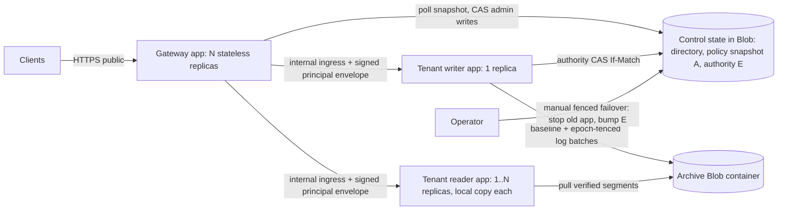

# Introduction

**Status: STAGED IMPLEMENTATION AUTHORIZED - NOT DEPLOYED.** On 2026-11-16 the user said "go ahead with next steps for HA". Start with the unblocked preparatory work below; this does not pass any acceptance gate or approve Azure provisioning, production access, a release, or a benchmark campaign. Authorization behavior stays unchanged: the gateway must enforce the existing route-to-permission map, every backend must enforce it again, and no new role or permission is introduced (see SEC-001).

**Current slice.** EPIC-001 ITEM-001's exported-segment first cut is implemented and verified on small synthetic local fixtures only; see `benchmarks/ha-reader-apply.md`. GATE-001's criteria were verified on merged tree `75df5738` and the owner's go-ahead was recorded as a narrow code-implementation go (section 14, EPIC-002). EPIC-002 backend serving modes (`standalone`/`writer`/`reader`, reader refusal, drain readiness, `GET /v1/admin/serve-status`) are delivered in code and tests only. The EPIC-004 gateway MVP (DB-free `vlite-server gateway` plus gateway-trusted backends, section 14 EPIC-004 wiring) is wired as an opt-in mode and tested locally against an Azurite emulator only; it has no ACA run, measurements, fencing or failover. Archive-backed measurements, a reader strategy/capacity qualification, reader catch-up, epochs/fencing and failover are not delivered. No production deployment, production HA enablement, Azure provisioning or separate test instance was performed or authorized by this slice.

**Relationship to the older backup/HA PRD.** `docs/projects/feature-backup-ha/feature-backup-ha.prd.md` (the "old PRD") holds a broad backup and HA design. Its backup half is implemented through the 0.7.8 release candidate (old PRD section 14.4 and 14.5); publication and deployment are separate from this work. Its HA epics were deliberately deferred. **Its 2026-11-13 approval text covered only the backup-only milestone and is NOT authority to implement HA** (old PRD Introduction; ITEM-002, authority/fencing, standby/replication were explicitly not approved). The new authorization above is for staged HA work, not a waiver of those safety gates. This PRD reuses and cites old-PRD sections instead of duplicating them: topology rejection of Azure Files (section 3.2, ALT-001, RISK-001), replication protocol (3.4), authority and fencing (3.5), access-policy generation (3.6), RD-009 (zone HA only; never geo-fail the authority witness), AZ-001/AZ-003 (section 14.2). Where this PRD departs from the old PRD, section 3.2 says so.

**Direction this plan encodes** (the user's design statements, treated as requirements): per-tenant individual VLite deployments; each tenant has one writer and many readers; writes are routed to the writer automatically; separate writer and reader ACA apps are acceptable; HA builds on Azure Blob with possible loss of the most recent sync data and eventual consistency for readers accepted; a shared **gateway** performs authentication, authorization, rate limiting, tenant lookup and routing; the gateway is **stateless in general and scales horizontally on ACA**. Everything I add beyond those statements is labelled "proposal".

The key words "MUST", "MUST NOT", "REQUIRED", "SHALL", "SHALL NOT", "SHOULD", "SHOULD NOT", "RECOMMENDED", "MAY", and "OPTIONAL" in this document are to be interpreted as described in RFC 2119.

**Cross-reference conventions**: `FR-` functional requirements; `NFR-` non-functional; `SEC-`/`CON-`/`GUD-`/`PAT-` security, constraint, guideline, pattern; `FM-` failure modes; `AC-` acceptance criteria; `RD-` proposal decisions; `OD-` open decisions needing the owner; `ASM-` assumptions; `ALT-` alternatives; `GATE-` go/no-go gates; `SRC-` repository evidence; `AZ-` Azure evidence; `EPIC-`/`ITEM-` delivery. "Old PRD" means the file named above. `EPIC-PITR-001` is the separate in-flight Blob archival work (specification `blob-pitr.prd.md`, held outside the repository by that session). No separate requirements artifact is needed.

# 1. Goals and Non-Goals

### In Scope

- **G-1 Opt-in topology.** A shared public gateway ACA app and, per tenant, a private writer app and a private reader app, all running the same VLite engine in different serving modes (not a code fork). The current single-database deployment, including the live production deployment, stays the default and is unchanged unless an operator opts in.
- **G-2 Stateless, horizontally scalable gateway.** Any gateway replica can serve any request. Gateway replicas share authoritative control state; no replica holds tenant, auth, session, policy or routing authority. Disposable caches only. Scale-out is by ACA HTTP-concurrency rules (section 3.4).
- **G-3 Read scale-out.** Readers hold their own local database copy, fed by baseline snapshots and committed log batches in Azure Blob. Readers are eventually consistent and report staleness.
- **G-4 Controlled writer failover.** Enforced fencing (monotonic epoch bound into archived history, checked by Blob conditional writes and by backend serve-time and startup checks), operator-driven first, automated only after fencing is proven.
- **G-5 Per-tenant deployment mapping and migration**, opt-in, with a tenant directory that can also point a tenant at today's shared database.
- **G-6 Staged, independently shippable delivery** with a go/no-go gate between stages (section 14).

### Out of Scope (deferred)

- Production deployment, any Azure provisioning, any benchmark campaign (this PRD plans measurements; it runs none).
- The memory dashboard, the query language, the graph store, dashboard asset changes (avoids tour recapture, SRC-019).
- Multi-writer, multi-region writers, synchronous replication, zero-RPO, automatic read-your-writes on readers.
- gRPC and embedded-writer HA (the old PRD requires unsupported mutation entry points to refuse HA mode; gRPC does not start with memory bindings, SRC-013).
- Re-planning EPIC-PITR-001 (section 6 lists only what HA needs from it).
- Qualifying Azure Files. The existing storage qualification gates are NOT superseded (old PRD Introduction; `deploy/azure-container-apps/README.md:18,27-29,110`).

### Consistency and durability contract (TARGETS TO BE VALIDATED, not guarantees)

| ID | Dimension | Target | Depends on | Validated by |
|---|---|---|---|---|
| C-01 | Writer reads | A read served by the tenant's writer sees every write the writer acknowledged (same as one database today). | Writer routing; backend serving modes | TEST-001, AC-001 |
| C-02 | Reader reads | Reader serves a consistent database state at an applied position (lineage, epoch, sequence), eventually consistent with the writer; every reader response reports applied position and age; a reader beyond the tenant's staleness bound fails its readiness and refuses reads. Bound value: proposal, unmeasured; set after EPIC-001. | EPIC-001, EPIC-005 | TEST-006, AC-006 |
| C-03 | Loss window (writer loss) | The user accepted losing the most recent unsynced writes. The window is the data acknowledged by the writer but not yet in the verified durable archive at failover. It is measured by ACTUAL durable archival position/time; a configured interval is not a bound; archive failures widen it. | EPIC-PITR-001, EPIC-006 | TEST-008, AC-009 |
| C-04 | Reader staleness | Staleness = writer commit to archive upload to reader apply. No number is promised. | EPIC-001 measurements | TEST-006 |
| C-05 | Failover | v1: operator-driven only; the old writer is infrastructure-fenced and epoch-fenced before the new writer serves; the operator must acknowledge a printed loss report. RTO: unmeasured, no number stated. Automatic promotion only after GATE-005. | EPIC-006, EPIC-010 | TEST-007, TEST-008 |
| C-06 | Revocation latency | Credential revocation, tenant suspension and memory-binding permission changes take effect at every gateway replica within a bounded interval S_ctl (versioned invalidation plus bounded polling) and are re-checked by backends through the principal envelope generation. S_ctl: proposal, owner decision OD-005; not eventually-consistent-without-bound. | EPIC-003, EPIC-004 | TEST-004, AC-004 |
| C-07 | Gateway availability | Loss of one gateway replica loses only its in-flight requests, never authority state. Control-state unavailability beyond S_ctl fails closed (503) for authentication decisions; never allow-by-default. | EPIC-004 | TEST-003, FM-004 |
| C-08 | Write throughput | Unchanged: one writer per tenant bounds write throughput. More readers or gateway replicas add no write capacity. | - | AC-011 |

### What this does NOT give you

- **No multi-writer.** One writer per tenant. Gateway scale-out is not writer HA: more gateway replicas add no write capacity, no tenant failover and no read-your-writes.
- **No automatic read-your-writes on readers.** Freshness-required reads route to the writer initially; a position-token scheme is a later option (OD-007).
- **No change to single-writer write throughput.**
- **Azure Files is not qualified** for HA or power-loss durability and this PRD does not supersede those gates.
- **The loss window is whatever actual archival achieved.** Blob geo-replication shrinks no loss window of the VLite archive by itself (section 3.10).
- **No zero-downtime guarantee.** Writer outage lasts until an operator (v1) or proven automation completes a fenced failover.
- **No change to the default.** An operator who does nothing keeps today's single deployment.

# 2. Terminology

| Term | Meaning |
|---|---|
| Gateway | The shared public ACA app: authentication, authorization/policy, rate limiting, tenant lookup, operation-based routing. Opens no database. |
| Writer app / reader app | Per-tenant private ACA apps running the VLite engine in `writer` / `reader` serving mode. Writer: 1 replica. Reader: 1..N replicas, each with its own local copy. |
| Standalone | Today's mode: one server, one database, tenants as namespaces. Remains the default. |
| Control state | Authoritative shared state: tenant directory, credential/policy snapshot, writer authority record, per-tenant routing record. |
| `A` (policy generation) | Monotonic number of the control-state snapshot; bumped by revocation, suspension, grant or binding changes (old PRD section 3.6 uses the same idea). |
| `E` (epoch) | Monotonic per-tenant writer generation, bound into archived history. |
| S_ctl | Bound on gateway control-state staleness (OD-005). |
| Archive | Azure Blob baseline snapshots plus contiguous verified committed log segments, produced by EPIC-PITR-001. |
| Principal envelope | Short-lived gateway-signed statement of the authenticated principal (grant data, tenant, audience, expiry, `A`) that a backend verifies. |
| Ambiguous write | A write whose request may have reached the writer but whose outcome is unknown to the gateway. |

# 3. Solution Architecture

## 3.1 Overview

Trust boundaries: client to gateway (public TLS, bearer credentials); gateway to backends (private environment network plus authenticated envelope, because internal ingress is not authentication, AZ-002); backends to Blob (managed identity, `AuthMode::ManagedIdentity` precedent, SRC-010); operator to control state (separate admin path, SEC-006).

## 3.2 Reconciliation with existing planning documents

| Document | What it says | This PRD |
|---|---|---|
| Old PRD sections 3.2, 3.4, 3.5, 3.6, RD-009, ALT-001, FM/AC/GATE sets | ACA plus Azure Files rejected as HA substrate; replication protocol; epoch `E`, lease plus CAS, `Uack`; access-policy generation; v1 prohibits nonzero-loss promotion; coordination store must not geo-fail. | Cited, not copied. **Departure:** the owner now accepts possible loss of the latest unarchived writes, so a failover with a disclosed loss report is allowed (operator-acknowledged). The old v1 prohibition is superseded only for that case and only with owner confirmation (OD-003). Zone-only HA and "never geo-fail the authority" are kept (RD-005). |
| `docs/projects/roadmap/scale-out.md` | Adopted order 2026-11-02: Gap 11 local forks, then Gap 10 object tier (Azure Blob first), then Gap 9 async read followers ("not zero-loss HA"), backlogged; only an explicit HA requirement reorders it; manual infrastructure fencing first; read-your-writes needs an explicit lineage/epoch/sequence token; an object replica is a pinned read generation, never a promotable writer. Its line references use an old base and are not reused here. | This design is Gap 9 async read followers plus the Gap 10 Blob tier plus a gateway and per-tenant deployments. It asks the owner to treat this as the explicit HA requirement and reorder (OD-001): async replication only, Gap 11 forks are not a prerequisite. Slices map: 10a/10b = EPIC-PITR-001 plus EPIC-005; 9a = EPIC-005; 9b = EPIC-006; 9c (synchronous ACK) stays out of scope. |
| `docs/projects/roadmap/next-major.md` (~24, 65-70) | Same decision record. | Same reconciliation; no conflict. |
| EPIC-PITR-001 (`blob-pitr.prd.md`) | Opt-in bounded restartable archival after a published baseline; contiguous verified prefix; honest progress; non-goals include gateway, reader fleet, auto-promotion, writer lease/fencing. | Phase-0 prerequisite (EPIC-000). Open interface questions in section 6. Not re-planned. |
| `docs/STORAGE-FEATURES.md` (PITR 56-74, read replicas 98-120, limitations 443-449) | PITR contract; read-replica semantics; limits. | Reused as-is; no contract change. |

## 3.3 Verified current-state evidence

| ID | Evidence (verified against the current worktree) |
|---|---|
| SRC-001 | Request pipeline: `src/server.rs:1398-1580` `observe`; public paths 1442-1465 (`/health`, `/dashboard*`, `/v1/auth/config`, `/v1/auth/login`); cookie used only when no Authorization header (1467-1476); 401 on auth error 1485-1510; `rate_limit(...).and_then(authorize(...))` 1511-1521; `guard::track_hidden(next.run(request))` 1523. Order holds: authentication, rate limit, authorization, guarded handler. |
| SRC-002 | `authenticate` `src/server.rs:1131` (static admin/read-only tokens, then `vlk_` credentials via `credentials::Store::authenticate`; tenant-bound grants consult `tenants.get(id)`, which rejects suspended/deleted); `permission` 1180 (deny-unmapped to admin; `Need::Op(op, Reach)`); `authorize` 1315-1352; `authorize_need` 1353. |
| SRC-003 | **Operation-versus-method precedent:** `authorize` treats a POST as a search for `/v1/search`, `/v1/collections/{c}/search*`, `recommend`, `facets`, `stats/numeric`, `query`, `embed`, `search/disk-ann`, `graph::read_post`, `memory::read_route` POSTs and `POST .../kv/entries/get` (`src/server.rs:1315-1352`); classifiers at `src/server/memory.rs:206-224` and `src/server/graph.rs:146-169`. |
| SRC-004 | Rate limiting is per process: `rate_limits: Arc<Mutex<BTreeMap<String,(f64,Instant)>>>` `src/server.rs:215` (init 317); `fn rate_limit` 3941-3978 (max 512 buckets, `429 rate_limited`, `503 busy`); `docs/SECURITY.md:419-454` states occupancy is process-local and resets full on restart, so quotas are per replica today. Vector quotas are enforced under the database owner lock. |
| SRC-005 | Guard: `src/server/guard.rs:1-29` check order (tenant qualification `t{tenant}__{name}`, credential name grant `forbidden_scope`, memory reservation answers like a missing name unless `raw_access`, lookup 404, credential lineage binding 403); `track_hidden` 60; `GuardedCollection` 377; `GuardedGraph` 439; `tests/server_name_lookup_scan.rs` enforces handlers do not look names up themselves. |
| SRC-006 | Tenants are collection-name namespaces `t<id>__*` inside ONE database: `src/server/tenants.rs:11-22,57-72`; file-backed `tenants.json`, `commit` 178-195 (tmp+fsync+rename under a process-local mutex); `get` rejects suspended/deleted; `delete` refuses `tenant_not_empty` (307-370); `qualify`/`unqualify` 502-520; recovery 95/102. `docs/SECURITY.md:555-620`: shared commit sequence, failure domain and admission limits. |
| SRC-007 | Credentials: `src/server/credentials.rs:1-8,21` file-backed `<admin dir>/credentials.json`, atomic replace, 1 MiB cap, `CAPACITY: 256` (18), token `vlk_<id>_<secret>`, SHA-256 stored; `Grant` 87+ (`requests_per_second`, `max_vectors`, `max_vectors_per_collection`, `tenant_id`, `lineage`); `authenticate` 532-583 against an in-memory list loaded at startup (`Store::load` 484); `recovery_inventory` 526 (rekey-only). |
| SRC-008 | Users and sessions: `src/server/users.rs:1-9,23` file-backed `users.json`; sessions in memory only (`Accounts.sessions` 261-264), restart signs everyone out; `Account.version` bump ends older sessions (~154); idle 30 min / lifetime 8 h defaults (33-34); per-process lockout. |
| SRC-009 | Replica engine: `src/replica.rs:1-7,28-32`; line 31: "one apply costs O(database size) and drops in-memory ANN indexes"; `apply` 144-163 (rejects another lineage / base mismatch); `sync_from_log` 172; writes return `ReadOnlyReplica` 183-193; **`promote(self) -> Database` at 198 only returns the database ("replication link must already be stopped; old primary must not be written again") and is NOT fencing.** `src/lib.rs`: `Error::ReadOnlyReplica` 411, `open_read_only` 1471, `export_log` 2577, `replica_extend` ~2602-2655 (append plus fsync plus full reload; truncates back on error). |
| SRC-010 | Reusable object-store CAS substrate: `src/server/cloud_backup.rs:1-21` (line 19: leases deliberately not used because CAS already gives exclusion); `MAX_DATABASE_BYTES = 1<<30` (43); `StoreError` 105 (`Unknown` = maybe applied); `Cond{Create(If-None-Match:*), Match(etag)}` 147; `trait ObjectStore` 161; `AuthMode{ManagedIdentity, EmulatorSharedKey}` 177; `Target` 189. Publication is an ETag CAS; records are never deleted. Also `cloud_recovery.rs:1-25`, `backup_policy.rs:1-21`, `recovery_bundle.rs:1-18`. |
| SRC-011 | `src/logops.rs`: `RestoreTarget{Sequence, TimestampMs}` 70, `restore_to` 99, `SEGMENT_MAGIC` 213, `LogSegment` 222 (SHA-256, "no transport security"), `export_log_segment` 430. |
| SRC-012 | Replication export is refused when memory bindings exist: `src/server/features.rs:51` (route), `796-826` (`forbidden_scope`; `max_bytes` 1..=16 MiB, default 1 MiB; base64 JSON). Memory tenants therefore cannot use the public export route as their shipping path. |
| SRC-013 | `/metrics` returns `forbidden_scope` when memory bindings exist: `src/server/observability.rs:189-195`; `src/server/admin.rs:132,394`; `docs/SECURITY.md:66-200` (opt-out `VLITE_METRICS_WITH_MEMORY=1`); `docs/CONSOLE-ADMIN.md:32,111-117`. Health must not depend on it. `/health` is public (`src/server.rs:884`); `/ready` (1051, handler 2304 does a `db.get(0)`). gRPC does not start with memory bindings. |
| SRC-014 | Server binary: `src/bin/vlite-server.rs` has no read-replica serving mode (the only `read_only` there is the read-only bearer token, 47 and 407-415); SIGTERM/Ctrl-C handling registered before listeners bind, 585-620, used at 692; `--durability periodic|full|none` default periodic (60 s flush; an OS crash can lose about 60 s); env `VLITE_ADMIN_DIR` (476), `VLITE_TRUSTED_PROXY`, `VLITE_SESSION_*`, `VLITE_MEMORY_BINDINGS_FILE` (bindings are startup-only; a changed binding needs a higher generation or startup refuses). |
| SRC-015 | Idempotency: memory remember/consolidate/forget and others take `idempotency_key` with receipts and `idempotency_conflict` 409 (`src/server/memory.rs:237,254,383,407,599`); the compaction jobs route and graph MCP edge create take optional keys. **No general idempotency exists for vector upserts or most writes.** |
| SRC-016 | Committed ACA deploy (HEAD, not the uncommitted edits): `deploy/azure-container-apps/README.md:18` evaluation option, not production qualification; 27-29 no cross-host locking or power-loss proof; 79 HTTPS ingress is public and authenticated; 101 single revision and min/max 1 are not a substitute for writer handoff; 110 no replication or zero-downtime HA. `deploy.ps1:65` `minReplicas=1; maxReplicas=1`, 67 `storageType='AzureFile'`, 18/163-164 `-AllowExperimentalAzureFiles`. |
| SRC-017 | Conventions (verified by reading): `site/api.html` `data-api="rest:METHOD /path"` rows checked by `tests/api_reference.py` against sources; `src/openapi.json` entries; `tests/api_route_inventory.py` `RESERVED_ROUTE_INVENTORY` classifies new routes under collection/vectors/graphs/imports/index/hnsw/admin/webhooks prefixes and an explicit set (including `/v1/changes`, replication export, `/metrics`); `tests/server_memory_reserved_as_missing.rs` `CASES` at 192 and coverage test `every_name_addressed_openapi_operation_has_a_differential_case` (~350) require a row for every OpenAPI path addressing `{c}|{collection}|{g}|{graph}`; memory REST expectations in `src/server/memory/pins_*.rs` and `tests/server_memory*.rs`. |
| SRC-018 | `docs/STORAGE-FEATURES.md`: read-only snapshots 9-23; PITR 56-74; change feed 76-96; read replicas 98-120; periodic durability 241-253; limitations 443-449. `docs/API.md:696-699` (Azure Files returns `unqualified_filesystem`). |
| SRC-019 | `tests/dashboard_tours.py` pins SHA-256s of `src/dashboard` assets; any dashboard asset change needs `scripts/capture_connected_dashboard.py` recapture. This plan avoids dashboard changes. |

**Key finding.** Credentials, users, tenants and memory bindings live in the admin directory, outside the database log (SRC-006/007/008). Shipped log segments therefore do NOT carry authentication or tenant state. A reader cannot authenticate anyone from the archive alone; it needs a gateway-signed envelope (RD-003) or separate admin-state distribution.

## 3.4 Shared gateway: stateless and horizontally scalable (user clarification)

### 3.4.1 Definition

"Stateless" here means any gateway replica can serve any request, and a replica can be added, removed, restarted or killed at any time without losing authority. It does not mean "no memory": a replica MAY hold **disposable caches** that can be rebuilt from shared control state. A gateway replica MUST NOT hold, even transiently, the only copy of tenant, credential, session, policy, routing or writer-authority decisions. Today those are file-backed or process-local (SRC-006/007/008, SRC-004), so the gateway cannot be a copy of `observe` over local files; it needs shared control state (section 3.5).

### 3.4.2 State classification (what is authoritative, cacheable or removed)

| State | Today | Gateway class | Staleness bound | Invalidation |
|---|---|---|---|---|
| Tenant directory (tenant, status, deployment record, `E`) | File-backed `tenants.json`, process-local mutex (SRC-006) | Authoritative shared; cache snapshot | S_ctl; suspension is not casually eventual | Snapshot generation `A`; poll plus versioned envelope |
| Credential/policy snapshot (hashes, grants, lineage bindings) | File-backed, loaded at startup (SRC-007) | Authoritative shared; cache snapshot | S_ctl; revocation bounded | `A`; backends reject envelopes below their minimum `A` |
| Memory bindings / reservations | Startup-only file (SRC-014) | Authoritative shared; backend-enforced | Binding change rolls the reader fleet; routing uses only readers whose binding generation equals the writer's | Binding generation in the routing record |
| Interactive sessions (dashboard users) | Process-local, restart logs out (SRC-008) | **Removed from the gateway MVP** (OD-004); later: signed stateless session token bound to `Account.version` and `A`, so no shared session store | Same as policy | Account version bump |
| Rate-limit buckets | Per-process token bucket (SRC-004) | Disposable per-replica; tenant-wide limit via static share (3.4.7) | Aggregate bounded within configured maximum replicas; temporary over-replication can overshoot | Share recomputed on config change |
| Writer authority / epoch `E` | Not present | Authoritative shared; CAS-only mutation | Verified fresh at fencing points (3.9) | Blob ETag CAS |
| Route-classification table | Compiled code (SRC-003) | Code, not state | - | Release |
| Idempotency/receipts | Memory API only (SRC-015) | Backend-owned; the gateway keeps none | - | - |

### 3.4.3 Boundary: scale-out gateway versus per-tenant writer and reader apps

| Concern | Gateway (scale-out, public) | Writer app (1 replica, private) | Reader app (1..N, private) |
|---|---|---|---|
| Authentication | Authenticates the bearer credential against the shared snapshot, mints the principal envelope. | Verifies envelope signature, audience, expiry, `A`; never trusts network position. | Same. |
| Authorization | Applies `permission()`-equivalent policy and operation classification before routing. | Re-applies `authorize` and `guard` independently (SRC-001/005); rejects forbidden operations itself. | Same, plus rejects every mutation (`reader` mode). |
| Tenant lookup / routing | Owns it via the directory; chooses writer, reader or refusal. | Does not route; knows its own tenant, lineage and epoch. | Same. |
| Rate limits | Edge limit per tenant (static share, 3.4.7). | Keeps the per-credential token bucket and authoritative vector/storage quotas under the owner lock (second line, SRC-004). | Keeps the token bucket and memory/resource guards. |
| Data | None. Opens no database. | Authoritative database, archive publisher, epoch holder. | Local copy applied from the archive; never promotable by itself. |
| Scaling | ACA HTTP-concurrency rule; many replicas. | Fixed at 1 active replica; revision overlap handled by fencing, not by replica count (AZ-004). | ACA rules; each new replica must obtain a baseline plus segments (capacity and apply cost: EPIC-001). |
| Failure | Replica loss: in-flight requests only. | Fenced failover (3.9). | Replica loss: other readers or the writer serve. |

The gateway never writes the VLite database and never holds writer authority. Gateway scale-out therefore raises request-handling capacity (TLS, authentication, routing, edge rate limiting) and nothing else; it MUST NOT be described or relied on as writer HA (FR-005, RISK-009).

### 3.4.4 Scaling (proposal; unmeasured)

- Scale on the ACA HTTP rule `concurrentRequests` (default 10, evaluated over request counts of the past 15 s, AZ-005). Any one scale rule triggers scale-out.
- **Proposal:** minimum 2 warm replicas (so one replica loss or one revision overlap never leaves zero), maximum an owner decision (OD-006). Neither number is measured. ACA default min is 0 and max 10 (AZ-005); scale-to-zero MUST NOT be used for the gateway.
- No sticky sessions (affinity is available on ACA ingress, AZ-002, and is not used). Session affinity would hide a state bug rather than fix it.
- ACA may temporarily run more replicas than expected during platform upgrades (AZ-005); the rate-limit share design (3.4.7) must tolerate that overshoot and say so.
- Environment-level core quotas apply to the sum of active replica cores (AZ-006). Platform defaults are unpublished; the owner's subscription currently allows 500 Consumption cores per environment (AZ-016). Check current quota before sizing (section 3.13).

### 3.4.5 Readiness and startup

- A gateway replica is **ready only when** it has loaded a control-state snapshot whose age is within S_ctl and the snapshot's schema/generation is understood. Otherwise it reports not-ready and, if already serving, fails closed (503) for authentication decisions once the snapshot exceeds S_ctl (FM-004). It MUST NOT fall back to an empty policy or to allow-by-default.
- Use ACA startup/readiness probes with HTTP probes on dedicated unauthenticated paths (AZ-007). The default readiness probe is a TCP check on the ingress port and is too weak for this. `/health` (public, `src/server.rs:884`) is liveness only; `/ready` (`src/server.rs:2304`) probes a database and must not be reused as-is. The gateway needs its own readiness route that reports control-state age. **Neither may depend on `/metrics`** (blocked for super admin when memory bindings exist, SRC-013).

### 3.4.6 Draining and rolling update

- On SIGTERM: fail readiness first, stop accepting new connections, finish in-flight requests within `terminationGracePeriodSeconds` (default 30 s per the ARM model; maximum UNVERIFIED, AZ-009), keeping in mind the ACA ingress request timeout of 240 s (AZ-002). VLite already registers SIGTERM before listeners bind (`src/bin/vlite-server.rs:585-620,692`); the gateway mode reuses that hook.
- **Ambiguous writes are never auto-retried.** There is no general write idempotency (SRC-015). The gateway MAY retry only when the request provably never reached a backend (connection refused before any byte sent); every other failure is surfaced to the client as ambiguous (FR-007). Reads MAY be retried within the same eligibility rules.
- Revision overlap during a gateway deploy is harmless to correctness because no replica is an authority; it is harmful for backends, which is why backends are fenced (3.9).

### 3.4.7 Tenant-wide quotas across replicas

Today a limit is per process (SRC-004). With N replicas a per-process bucket silently multiplies the tenant limit. Proposal for the MVP:

- Each gateway replica enforces the fractional token-bucket rate `limit / gateway_max_replicas` locally, with the burst budget divided across replicas too. Do not round shares up: their sum would exceed the tenant limit. Within the configured maximum replica count, the aggregate rate stays within the limit but under-serves at low replica counts. The temporary ACA over-replication (3.4.4) can overshoot; document it. Any integer-only implementation must allocate conservative shares rather than silently rounding up.
- Authoritative quotas (`max_vectors`, per-collection vectors, storage) stay enforced at the single writer under the existing owner lock (SRC-004); gateway counters are advisory.
- Backends keep their own per-credential token bucket as a second line of defense.
- Later and only if measurements justify it: leased token budgets from a shared counter store (OD-008).

### 3.4.8 Consistency implications across gateway replicas

- All replicas converge on the same control-state generation `A` within S_ctl. Between a revocation commit and convergence, a request MAY be authenticated by a replica with an older snapshot. The bound is S_ctl plus clock error; the principal envelope carries `A` and the backend rejects an envelope whose `A` is below the minimum `A` the backend has seen or been told (RD-004). This makes revocation bounded and backend-checkable rather than "eventually, someday".
- Tenant suspension, credential revocation and memory-binding permission changes use the versioned path; low-risk metadata (display names) may use plain TTL caching.
- Two replicas can disagree briefly on routing (writer moved, epoch bumped). The writer stamps its epoch in responses; the gateway rejects a response from an epoch older than its fresh authority view and the old writer is also fenced by infrastructure and CAS (3.9). Residual window: OD-002. An HA reader stamps the epoch of the archived head it follows; with `readers` routing the gateway treats a reader whose stamp is missing, malformed or older as ineligible and serves the read from the writer, whose stamp is still checked (ITEM-021).
- Admin mutations (create credential, suspend tenant) go through CAS on the snapshot object, so any replica can accept them and concurrent writers conflict safely (3.5).

## 3.5 Shared control state: options and recommendation

| Option | Description | Pros | Cons |
|---|---|---|---|
| A. Blob CAS control objects | Small versioned JSON objects (directory, policy snapshot with `A`, per-tenant authority) with ETag `If-Match` and `If-None-Match:*` writes, reusing the `cloud_backup.rs` substrate (SRC-010). | No new service; same identity and auth modes; CAS gives exclusion; low-churn state fits (CAPACITY 256 credentials, 1 MiB cap, SRC-007); matches old PRD coordination-container design. | Poll-based propagation (S_ctl); high-churn counters do not fit; a Blob account is a regional dependency; the geo-failover interaction is unverified (never geo-fail it, RD-005). |
| B. Table/Cosmos/Postgres | A managed database for control state. | Change feeds or transactions; fits counters. | New service, new auth path, new failure domain and cost; heavier than the problem for low-churn state. |
| C. Hybrid | Blob CAS for low-churn authority; a counter store only if shared rate limiting proves necessary. | Smallest first step; upgrade path. | Two stores if later adopted. |

**Recommendation: C, starting as A.** Blob CAS for tenant directory, credential/policy snapshot and writer authority. Sessions are stateless signed tokens later (OD-004), so no shared session store is needed. The high-churn counter store is an owner decision deferred until measurements show the static share is inadequate (OD-008).

Mutation path (proposal): any admin-capable gateway replica builds the next snapshot, bumps `A`, and writes with `If-Match` on the current ETag; a conflict re-reads and retries. Credential secrets stay SHA-256 hashes; the snapshot is as sensitive as `credentials.json` today (SEC-004). Recovery stays rekey-only for credentials, sessions and webhook secrets (SRC-007, `recovery_bundle.rs:1-18`).

## 3.6 Gateway-to-backend trust

Internal ingress limits reachability to the ACA environment but is not authentication, and environment-level HTTP route configuration can expose an internal-ingress app, so such routes MUST NOT target backends (AZ-002).

| Option | Description | Assessment |
|---|---|---|
| (i) Gateway-signed principal envelope (recommended) | Gateway signs {tenant, grant data, audience = backend deployment, expiry, `A`}; backend verifies in a new gateway-trusted auth mode and still runs `permission`/`authorize`/`guard` on it. | VLite-native, testable offline, no dependency on platform features; needs signing-key distribution and rotation (OD-009). |
| (ii) Pass-through bearer plus separate admin-state distribution | Backend holds its own credential store, replicated from control state. | Reuses `authenticate`, but admin files are outside the log (SRC-007) so a second distribution channel is required; revocation latency doubles. |
| (iii) Platform options (ACA built-in auth, Entra, mTLS) | Platform authenticates the gateway. | UNVERIFIED for this use; may complement (i), not replace it. |

Backends MUST also keep resource, memory and guard checks independent of the gateway (SEC-002). A request that arrives without a valid envelope is refused with `401`, even from inside the environment.

## 3.7 Request flows

**Read (eligible reader).** Client sends a request with a bearer credential. The gateway authenticates against the snapshot, classifies the operation (3.4 and FR-002), checks tenant status, applies edge rate limit, and, if the tenant allows reader routing and the operation is staleness-tolerant, forwards to the tenant reader app with an envelope. ACA load-balances across ready readers; a reader that exceeds the staleness bound is not ready. The reader re-authorizes, serves from its local copy and returns applied position and age headers (proposal, OD-007).

**Write.** Gateway authenticates and authorizes, classifies as a mutation, verifies the tenant's routing record names a writer whose epoch matches, and forwards to the writer app. No retry of an ambiguous write (3.4.6). The writer acknowledges after its local commit (existing durability mode, SRC-014); archival to Blob is asynchronous (C-03).

**Freshness-required read (read-your-writes).** Routed to the writer. Default policy per tenant is `writer_only`; reader routing is opt-in per tenant (RD-007). A request-level override header and a position token are proposals (OD-007), not MVP.

**Failover (manual, v1).** (1) Operator reads the printed loss report (last verified archived position/time versus last observed writer position). (2) Operator stops or deactivates the old writer app (infrastructure fence) and confirms replicas are zero. (3) Operator bumps `E` by CAS on the authority object naming the new writer. (4) New writer starts from the archive's verified head (not from stale local state), verifies `E`, and begins serving. (5) Gateway replicas pick up the new routing record within S_ctl; the old writer is also CAS-fenced if it is still alive (3.9). Planned handoff (old writer alive and quiesced) proves the target head before switching.

## 3.8 Backend serving modes and reader apply

- **Modes (proposal):** `standalone` (today, default), `writer`, `reader`. Same binary and engine. `reader` opens read-only (`open_read_only`, SRC-009), refuses all mutations at the route layer with a stable error, and never opens the archive for write. `writer` refuses `reader`-only configuration and additionally runs the archive publisher and epoch checks. Mutating admin routes (credentials, tenants, backups) are refused in `reader` mode and in gateway-fronted deployments unless explicitly routed (FR-006). New routes follow repository conventions (SRC-017, section 7).
- **Reader apply cost is a material limitation.** `ReplicaFollower::apply` does fsync plus a full database replay and drops in-memory ANN indexes (`src/replica.rs:28-32,144-163`; `lib.rs` `replica_extend` ~2602-2655). A continuously serving reader would rebuild indexes on every apply. EPIC-001 measures it and chooses among: (a) periodic snapshot-refresh readers, (b) incremental apply, (c) reader replacement from a new baseline. No numbers are assumed here.
- **Capacity.** Blob is not a mounted database (ACA cannot mount Blob as a file share, AZ-001). Each replica needs its local copy on container-local storage, which is ephemeral and sized by vCPU (about 8 GiB for more than 1 vCPU, AZ-001). Database size, baseline plus segment staging and compaction headroom must fit; the existing cloud backup limit is 1 GiB (`MAX_DATABASE_BYTES`, SRC-010). Qualification of these limits is part of EPIC-001.
- **Memory tenants.** The public replication export is refused when bindings exist (SRC-012), so memory tenants ship through the in-process archiver of EPIC-PITR-001 (open interface question Q-5). Readers load the same binding file; bindings are startup-only, so a binding change rolls the reader fleet and routing considers only readers whose binding generation equals the writer's. Memory reservations answer like a missing name (SRC-005) and MUST do so on readers and through the gateway.

## 3.9 Writer fencing design

Facts the design must not exceed: a Blob lease is finite (15-60 s or infinite) and expiry does not stop the holder's local writes; a lease can be renewed after expiry if the blob was not modified or re-leased (AZ-010, old PRD AZ-001). ACA single-revision mode keeps the old revision until the new is ready, so old and new replicas overlap (AZ-004). A process pause can outlast any timer. `ReplicaFollower::promote` returns the database and fences nothing (`src/replica.rs:198`).

| Option | Mechanism | Verdict |
|---|---|---|
| F1. Epoch in archived history plus CAS head plus serve-time and startup checks (recommended path) | Per-tenant authority object `{E, writer id, base}` and per-epoch head object. Archiver publishes segments only with `If-None-Match:*` and advances the head with `If-Match`; a former owner's head CAS fails once `E` moved. Backend verifies its `E` is current at startup, before each batch ack (cost versus window, OD-002) and on a short periodic recheck. Gateway rejects responses stamped with an older `E`. Operator also infrastructure-fences the old app. | Prevents publication of history by the former owner (CAS) and bounds acknowledgements. **Cannot by itself prove no client-visible ack from a paused zombie between a check and its ack.** Residual window is an explicit open decision (OD-002), not assumed zero. |
| F2. Lease only | Blob lease as ownership. | Rejected: expiry does not stop local writes; renewal-after-expiry nuance; pauses (AZ-010). The code deliberately avoids leases (`cloud_backup.rs:19`). |
| F3. Replica count 1 / single revision | Rely on ACA. | Rejected: revision overlap, zombies, pauses (AZ-004, `deploy/azure-container-apps/README.md:101`). |
| F4. Synchronous acknowledgement | Writer acks only after archive commit. | Out of scope (scale-out.md Gap 9c); would close the window at a latency and availability cost. Owner approval required. |

**Proof obligations (GATE-004/005):** (1) a fenced former owner cannot advance the head or publish referenced segments; (2) a fenced former owner stops acknowledging within a measured bound after observing a higher `E`; (3) the new writer starts only from a verified head and never from stale local files; (4) readers never apply history beyond the verified head and never diverge across an epoch change; (5) an infrastructure fence plus `E` bump ordering is enforced by tooling, not by a runbook note. **Anything not proven is an open decision, not a fallback.** Never geo-fail the authority object (RD-005; the interaction of account failover with ETags and conditional writes is UNVERIFIED, AZ-011).

## 3.10 What Azure Blob replication gives (and does not give)

- GRS/GZRS copy asynchronously to a secondary region; on unplanned failover, data not yet in the secondary is lost permanently; the Last Sync Time property estimates the loss; after unplanned failover the account becomes LRS (AZ-012). Failover is account-level and planned failover is not supported when Last Sync Time is more than 2 hours (AZ-013). A "typically under 15 minutes, no SLA" RPO appears only in non-official pages and is NOT cited here (AZ-014).
- Object replication is asynchronous, block blobs only, needs versioning on both accounts and change feed on the source, does not support customer-managed failover for either account in a policy, and locks the destination container; version-level immutability at the destination can make replication of a source change fail (AZ-015).
- **Therefore:** replication may improve archive durability against regional loss and may simplify disaster recovery of the archive, but it does not elect VLite writers, does not keep VLite readers current, does not fence anything, and gives no VLite-level RPO. Zone-redundant storage (synchronous across zones in a region) is the intended zone-HA posture (old PRD RD-009, AZ-003). Any geo option is a DR decision (OD-010), separate from this PRD's HA path. Interaction between geo-replication/immutability and the CAS control objects is UNVERIFIED.

## 3.11 Per-tenant deployment mapping and migration

Today tenants are namespaces in one database with credentials, users and bindings in the admin directory (SRC-006/007/008, SRC-014). "Every tenant gets its own deployment" therefore needs a mapping and migration story.

- **Tenant directory record (proposal):** `{tenant id, status, deployment kind: shared-pool | dedicated, writer endpoint, reader endpoint, lineage, `E`, binding generation, read-routing policy}`. A `shared-pool` record points at today's single database; the gateway can front it unchanged. This is what keeps the default and the live deployment valid (RD-001).
- **Migration of one tenant (proposal, offline-first):** (1) freeze or quiesce writes for the tenant; (2) export its namespace data (`t<id>__*` collections, via existing export and restore primitives, `logops.rs` SRC-011); (3) carry grants, credentials (rekey-only: new secrets are issued, old ones retired, per the recovery model), users and memory bindings including reserved prefixes and orphans into the dedicated deployment's admin state (memory handling reuses `recovery_bundle` memory binding rules); (4) restore into a staging deployment with a new lineage; (5) verify counts and a sample of reads; (6) flip the directory record; (7) retain the source copy under the existing retention until the owner releases it. Credential lineage bindings change with the new lineage, which is why credentials are re-issued (SRC-007).
- Existing single-database deployments need no migration and no config change. Wire compatibility (routes, tokens, errors) is preserved by default (FR-001, AC-010).
- **Cost note:** one writer plus one reader app per tenant is linear in tenant count. The directory's `shared-pool` kind exists so small tenants can stay shared until the owner decides otherwise (OD-011).

## 3.12 Observability without `/metrics`

Gateway and backends expose `/health`, a readiness route, and a new status route (proposal) that reports mode, lineage, epoch `E`, applied/archived positions, staleness age and control-state age. The status route is an admin route outside the classified reserved set, so it needs an `api.html` row and an OpenAPI entry but no reserved-route classification (SRC-017). It must not leak memory content and must work when bindings exist (SRC-013). Existing `/metrics` behavior is unchanged.

## 3.13 Capacity, cost and ACA limits

| Item | Value | Source |
|---|---|---|
| Ephemeral storage per replica | about 1/2/4/8 GiB by vCPU (<=0.25, <=0.5, <=1, >1) | AZ-001 |
| Min/max replicas | min default 0 (0-1000); max default 10 (1-1000) | AZ-005 |
| HTTP rule | `concurrentRequests` default 10 | AZ-005 |
| Ingress request timeout | 240 s | AZ-002 |
| Environment cores and environment count quotas | Managed Environment Count is a requestable per-subscription, per-region quota. Consumption cores are a separately requestable per-environment quota: the sum of cores requested by each active replica across all apps. General-purpose and memory-optimized profile core quotas are separate per-environment pools. Learn publishes no numeric defaults (they depend on subscription age, type and usage). Observed read-only on the owner's subscription in West US 2 on 2026-11-18 (`az containerapp list-usages`, `az containerapp env list-usages`): 50 managed environments per region (3 in use); 500 Consumption, 500 general-purpose and 500 memory-optimized cores per environment (the live single-app environment uses 4.25 Consumption cores). These are that subscription's current allocations, not platform defaults; re-check before sizing elsewhere. | AZ-006, AZ-016 |
| Apps per environment | UNVERIFIED: no numeric default, maximum, adjustability or profile-specific app-count limit is published, and the usage APIs do not report one. Unknown is not unlimited. Dedicated tenants need 2N+1 apps (one writer and one reader app each, plus the shared gateway). | AZ-006 |
| Tenant capacity formula | With gateway CPU `g` and minimum replicas `Gmin`, writer CPU `w` (one replica), reader CPU `r` and minimum replicas `Rmin`, and environment Consumption-core quota `C`: cores(N) = g*Gmin + N*(w + r*Rmin), so N <= floor((C - g*Gmin)/(w + r*Rmin)), further capped by the app-count limit. Example with the observed C = 500, g = r = 0.5, w = 1, Gmin = 2, Rmin = 1: N <= 332 by cores. This is a steady-state upper bound, not an admission limit: revisions overlap during rollout and maintenance can add replicas, so reserve measured headroom (ITEM-033). Role sizes are not selected yet. | ITEM-032 report |
| Per-tenant footprint | 1 always-on writer replica plus at least 1 reader replica (proposal) plus archive storage; cost linear in tenants | proposal |
| Billing of idle replicas | Scale-to-zero is not billed; min >= 1 keeps an instance running | AZ-005 |

# 4. Requirements

### Summary

Opt-in only; gateway is a stateless scale-out edge over shared authoritative control state; backends are private, authenticated, fenced and independently guarded; readers are eventually consistent and honest about staleness; failover is manual first; nothing weakens existing authorization, tenant, memory or storage-qualification contracts.

### Items

| ID | Requirement |
|---|---|
| FR-001 | Every capability MUST be opt-in. Default `standalone` behavior, routes, tokens, errors, on-disk formats and the live single-database deployment MUST be unchanged. |
| FR-002 | The gateway MUST classify requests by operation, not HTTP method, reusing the `authorize` precedent (SRC-003). Unknown routes MUST be refused (deny-unmapped, SRC-002), never forwarded as reads. |
| FR-003 | Gateway replicas MUST share authoritative control state; no replica-local tenant, auth, session, policy, routing or writer-authority state is authoritative (3.4.1-3.4.2). Only disposable caches are allowed. |
| FR-004 | The gateway MUST scale horizontally on ACA concurrency rules with no sticky sessions, minimum replicas of at least 2 (proposal, unmeasured), and no scale-to-zero. |
| FR-005 | Gateway scale-out MUST NOT be presented or relied on as writer HA; docs, status output and runbooks MUST state it adds no write capacity, failover or read-your-writes. |
| FR-006 | Backends MUST support `standalone`/`writer`/`reader` modes; `reader` MUST refuse every mutation and every writer-only admin route; mode MUST be fixed at startup. |
| FR-007 | The gateway MUST NOT retry an ambiguous write. It MAY retry only when delivery provably did not occur, and MUST surface ambiguity otherwise. |
| FR-008 | Gateway readiness MUST require a control-state snapshot within S_ctl; beyond it the gateway MUST fail closed (503) for authentication decisions. |
| FR-009 | On SIGTERM a gateway replica MUST fail readiness, stop accepting, and drain in-flight requests within the configured grace period. |
| FR-010 | Freshness-required reads and any read needing read-your-writes MUST route to the writer. Reader routing MUST be per-tenant opt-in. |
| FR-011 | Reader responses MUST report applied position and age; a reader beyond its staleness bound MUST fail readiness and refuse reads. |
| FR-012 | Revocation, tenant suspension and memory-binding permission changes MUST propagate within S_ctl and be re-checked by backends via the envelope generation `A`. |
| FR-013 | Each writer epoch `E` MUST be bound into archived history; the archive head MUST advance only by `If-Match` CAS; a former owner MUST be unable to publish history. |
| FR-014 | Failover v1 MUST be operator-driven, MUST require infrastructure fencing of the old writer and an acknowledged loss report; automation MUST NOT ship before GATE-005. |
| FR-015 | Per-tenant migration MUST be opt-in, reversible until source release, and re-issue credentials (rekey-only). |
| FR-016 | Memory reservations and bindings MUST be honored by gateway routing and reader replicas; reservation checks MUST answer like a missing name. |
| FR-017 | New public routes MUST satisfy repository conventions: `site/api.html` rows with `data-api` keys, `src/openapi.json`, route inventory classification where applicable, and `tests/server_memory_reserved_as_missing.rs` rows for new mutating or name-addressed REST routes. |
| NFR-001 | No invented numbers: every starting value (replica counts, S_ctl, staleness bounds, intervals) is labelled "proposal, unmeasured" until EPIC-001/EPIC-009 measure it. |
| NFR-002 | Health, readiness and status MUST NOT depend on `/metrics`. |
| NFR-003 | A stage MUST be independently valuable and shippable and MUST NOT make the next stage mandatory. |
| NFR-004 | Same engine in different modes; no code fork. Gateway SHOULD reuse `authenticate`/`permission`/`authorize` logic instead of re-implementing it. |
| SEC-001 | The plan MUST NOT expand authorization: no new role or permission; gateway policy equals the existing map; backends enforce it again. |
| SEC-002 | Backends MUST authenticate the gateway principal envelope (signature, audience, expiry, `A`); internal ingress alone MUST NOT be accepted as authentication. |
| SEC-003 | Backends MUST be internal-ingress only; environment-level HTTP routes MUST NOT target them. |
| SEC-004 | The credential/policy snapshot is as sensitive as `credentials.json`; it MUST be stored with managed identity access, least privilege, no secrets in logs or images. |
| SEC-005 | Signing keys MUST be rotatable without downtime and never stored in the repository. |
| SEC-006 | Control-plane mutation MUST be authenticated and audited through the existing admin path semantics; no new unauthenticated route. |
| CON-001 | One writer per tenant; no multi-writer. |
| CON-002 | Azure Files single-file deployment is not qualified; existing gates unchanged. |
| CON-003 | Blob is not a mounted database; each replica owns a local copy; local storage is ephemeral and size-limited (AZ-001). |
| CON-004 | The archive substrate is EPIC-PITR-001; HA MUST NOT fork its archive format. |
| GUD-001 | Prefer the smallest stage that delivers value; split any epic over about 7 files or 2 weeks. |
| PAT-001 | Reuse `ObjectStore`/`Cond` CAS, `logops` restore, `replica.rs` follower, `cloud_backup` auth modes before adding abstractions. |

# 5. Risk Classification

| ID | Level | Risk | Mitigation |
|---|---|---|---|
| RISK-001 | 🔴 | Zombie or paused former writer acknowledges writes after promotion (divergence, not just loss). | F1 fencing plus infrastructure fence; proof obligations in 3.9; explicit OD-002; manual failover only until GATE-005. |
| RISK-002 | 🔴 | Reader apply rebuilds the full database and ANN indexes on every apply, making readers unusable or expensive. | EPIC-001 measurement and a/b/c choice before building the reader fleet. |
| RISK-003 | 🔴 | Revocation/suspension served from stale gateway snapshots. | Versioned `A`, bounded S_ctl, backend minimum-`A` check, fail-closed beyond S_ctl, TEST-004. |
| RISK-004 | 🟡 | EPIC-PITR-001 lacks epoch metadata, a reader consumption API, pins for readers or an actual-progress feed. | Phase-0 interface questions (section 6); EPIC-000 gate before EPIC-005/006. |
| RISK-005 | 🟡 | Admin state (credentials, users, bindings) is outside the log, so readers cannot authenticate from the archive. | Signed envelope (RD-003); no admin-state replication in MVP. |
| RISK-006 | 🟡 | Per-replica rate limits multiply the tenant limit by replica count; ACA may over-replicate transiently. | Static share, advisory gateway counters, writer-side authoritative quotas, documented overshoot. |
| RISK-007 | 🟡 | Per-tenant apps make cost and ACA environment quotas scale linearly with tenants. | Directory supports `shared-pool`; verify quotas before sizing (UNVERIFIED); OD-011. |
| RISK-008 | 🟡 | Local ephemeral storage (about 8 GiB for more than 1 vCPU) is too small for some tenants or for baseline plus segments. | Capacity qualification in EPIC-001; refuse enrollment above the qualified size. |
| RISK-009 | 🟡 | "Scalable gateway" is mistaken for HA. | FR-005; explicit statements in docs and status output; TEST-012. |
| RISK-010 | 🟡 | Blob/geo-replication semantics for conditional writes and failover are not verified, so the authority object could roll back. | Never geo-fail the authority object (RD-005); keep it zone-redundant; UNVERIFIED stated. |
| RISK-011 | 🟡 | Backend exposed through environment-level HTTP routes or lacking envelope verification. | SEC-002/003, deploy-time check in IaC (EPIC-008), TEST-010. |
| RISK-012 | 🟡 | Memory binding changes need a fleet roll; mismatched readers serve different reservations. | Routing uses only readers whose binding generation matches the writer; TEST-011. |
| RISK-013 | 🟡 | Gateway control-state outage takes the whole edge down (fail closed). | Blob control state redundancy (zone), S_ctl sized from measurements, runbook; documented trade-off. |
| RISK-014 | 🟢 | Existing single-database users regress. | FR-001; compatibility suite (TEST-013); opt-in only. |
| ASM-001 | - | The user's accepted loss of the most recent sync data and reader eventual consistency is a requirement, not a temporary compromise. | Reconfirm in OD-003. |
| ASM-002 | - | The ACA gateway can reach backends over internal ingress in one environment. | Verify in EPIC-004/008 spike (UNVERIFIED beyond docs). |
| ASM-003 | - | EPIC-PITR-001 ships the archival substrate roughly as specified. | Gate EPIC-000. |
| ASM-004 | - | Low-churn control state fits Blob CAS; credential count stays small (256). | Revisit if counts grow. |

# 6. Dependencies

| ID | Dependency | Notes |
|---|---|---|
| DEP-001 | **EPIC-PITR-001** (Phase 0, in flight, separate session): baseline-first opt-in bounded restartable archival of complete committed log segments, contiguous verified prefix, last durable archived position/time and failures reported, gap/floor/divergence detection, pins, recovery to staging with rekey-only admin state. | HA consumes it; does not re-plan it. Its stated non-goals (gateway, reader fleet, auto-promotion, writer lease/fencing, live replication server, replay rewrite) are exactly this PRD's scope. |
| DEP-002 | Existing log shipping and restore substrate: `src/logops.rs`, `src/replica.rs`, `src/server/cloud_backup.rs`, `cloud_recovery.rs`, `backup_policy.rs`, `recovery_bundle.rs`. | Reuse; not rebuild. |
| DEP-003 | Existing REST/gRPC route inventory, `docs/STORAGE-FEATURES.md` (PITR contract), `docs/SECURITY.md` (tenant auth), `docs/CONSOLE-ADMIN.md`. | Authoritative contracts; unchanged. |
| DEP-004 | Azure Container Apps platform behavior (scale rules, probes, revisions, ingress, storage) per AZ-001..009. | Verified from Learn pages; items marked UNVERIFIED remain open. |
| DEP-005 | Owner decisions OD-001..OD-011 (section 10). | Block the epics named there. |

**Open interface questions for EPIC-PITR-001 (HA needs these; it may not yet provide them):**

| ID | Question | Owner disposition |
|---|---|---|
| Q-1 | Writer epoch/fencing metadata: can archived segment and head objects carry `E` and a writer id, and can the head advance only by `If-Match` CAS bound to `E`? | Accepted 2026-11-16: require writer ID and epoch on archive metadata, with epoch-bound `If-Match` CAS for authoritative head advancement. |
| Q-2 | A reader consumption API: how does a reader list, fetch and verify contiguous segments after a baseline, and detect a gap/floor/divergence requiring a new baseline? | Accepted 2026-11-16: require contiguous verification and fail closed on gaps, compaction-floor changes, or divergence; require a new baseline to recover. |
| Q-3 | Retention pins for reader consumers: can a reader pin its applied position so the baseline and segments it still needs are not removed? | Accepted 2026-11-16: require retention pins to protect each reader's baseline and needed segments until its position advances or it is safely replaced. |
| Q-4 | An actual-progress feed: last durable archived position/time, observed source position and failures, consumable by the status route and the failover loss report. | Accepted 2026-11-16: require actual durable/source positions and explicit failures for status and failover-loss reporting; never infer progress from the configured interval. |
| Q-5 | Memory-bound tenants: the public export route is refused with bindings (SRC-012); confirm the in-process archiver path and that reserved frames are never exposed to readers or public endpoints beyond what the backend guards allow. | Accepted 2026-11-16: use the protected in-process archiver for memory-bound tenants; never expose reserved frames to readers or public endpoints. |
| Q-6 | Baseline refresh cadence and reader replacement from a new baseline (EPIC-001 option c). | Accepted 2026-11-16: allow replacement from a new verified baseline when required; determine refresh cadence from measurements. |

# 7. Quality & Testing

### Test items

| ID | Test |
|---|---|
| TEST-001 | **Compatibility:** with no HA flags, the server behaves identically (routes, tokens, errors, formats). The existing suites pass unchanged; a standalone deployment behind a gateway `shared-pool` record behaves identically to direct access. |
| TEST-002 | **Operation classification:** table-driven test over the full route inventory proves every route is classified; POST search routes (SRC-003) are reads; unknown routes are refused; classifier matches `authorize` for all inventoried routes. |
| TEST-003 | **Gateway statelessness and scale:** two or more gateway replicas; kill, restart and add replicas during load; a request authenticated on replica A and continued on replica B behaves identically; no sticky-session dependence; no authority loss. |
| TEST-004 | **Revocation/suspension staleness:** revoke a credential and suspend a tenant while gateways hold older snapshots; assert effect within S_ctl on all replicas and rejection by backends via minimum `A`; assert fail-closed when control state is unreachable beyond S_ctl. |
| TEST-005 | **Gateway drain:** SIGTERM during in-flight reads and writes; readiness fails first; in-flight completes within grace; ambiguous writes are surfaced, not retried; no duplicate effect without backend dedup. |
| TEST-006 | **Reader staleness:** measure commit-to-reader-visible age; assert a reader past its bound fails readiness and refuses reads; responses carry position and age. |
| TEST-007 | **Fencing:** double-writer attempts (two writers, same tenant) cannot both advance the head; former owner head CAS fails; former owner acknowledgements stop within the measured bound; new writer starts from the verified head. |
| TEST-008 | **Failover drills:** manual failover reports a loss report that matches actual archived position; loss is no larger than reported. |
| TEST-009 | **Blob faults:** timeout/`Unknown` (maybe-applied) outcomes, partial uploads, mid-batch failures, throttling, 412 on CAS, lost leases; archive failures widen the reported loss window; no gap is published. |
| TEST-010 | **Backend trust:** requests without or with expired, wrong-audience, wrong-signature or stale-`A` envelopes are refused (401); internal network position alone is not accepted; no environment-level route reaches backends. |
| TEST-011 | **Memory:** reservations answer like a missing name through gateway and readers; binding generation mismatch removes a reader from routing; `/metrics` 403 with bindings does not affect health or status. |
| TEST-012 | **Docs/status:** status output and docs state gateway scale-out is not writer HA. |
| TEST-013 | **Migration:** a seeded tenant moved to a dedicated deployment preserves collection data, counts and a read sample; credentials re-issued; users and bindings carried; source untouched; rollback by flipping the directory record. |
| TEST-014 | **Clock skew and pause:** skewed gateway/backend clocks around envelope expiry and S_ctl; a paused writer process (SIGSTOP-style) resumed after promotion cannot publish or (within the measured bound) acknowledge. |
| TEST-015 | **Replica churn during deploy:** ACA revision overlap on gateway, reader and writer; writer overlap never yields two acknowledging writers. |
| TEST-016 | **Conventions:** `tests/api_reference.py`, `tests/api_route_inventory.py`, `tests/server_memory_reserved_as_missing.rs` (rows for any new mutating or name-addressed REST route) and memory suites (`src/server/memory/pins_*.rs`, `tests/server_memory*.rs`) pass; no dashboard asset changes (SRC-019). |

### Measurement plans (qualification remains gated)

| ID | Measurement | Output |
|---|---|---|
| MEAS-001 | Reader apply cost (replay time, ANN index rebuild, fsync) versus database size, for options (a)/(b)/(c). | Decision record RD for the reader strategy. |
| MEAS-002 | Staleness distribution: writer commit to archive upload to reader apply, under write load. | Staleness bound proposal. |
| MEAS-003 | Archive failure behavior and actual loss window under injected faults. | Loss-window reporting validation. |
| MEAS-004 | Gateway throughput and latency overhead per replica; ACA scale-out reaction time under the `concurrentRequests` rule. | Min/max replica proposal (OD-006). |
| MEAS-005 | Control-state propagation time and Blob read cost versus poll interval. | S_ctl proposal (OD-005). |
| MEAS-006 | Fencing check overhead (CAS read per batch) and zombie window. | OD-002 input. |
| MEAS-007 | Local ephemeral storage headroom per vCPU tier for baseline plus segments plus compaction. | Qualified tenant size ceiling. |

**MEAS-006 local probe (2026-11-19; development evidence, NOT ACA qualification).** `src/server/writer_fence_bench.rs` (pool T29, plan `d87d5968`) adds two ignored tests, `writer_fence_gate_measurements` and `writer_fence_detection_measurements`, which run only with `VLITE_MEAS006=1`. They time the writer fence against an in-memory fake authority store. They make no Blob or network request: the optional `VLITE_MEAS006_AZURITE` setting accepts only a loopback URL, and that run is then skipped. Run `VLITE_MEAS006=1 cargo test --locked --features server --lib writer_fence_bench -- --ignored --nocapture`. Three settings tune it: `VLITE_MEAS006_SAMPLES` (1–100,000, default 2,000), `VLITE_MEAS006_REPETITIONS` (1–100, default 20) and `VLITE_MEAS006_INTERVAL_MS` (5–5,000, default 50). Out-of-range values fail. Each result is printed as a `MEAS006 {json}` line labelled `local-fake`.

| Metric (p50 / p95 / max) | Windows pool worker | WSL, Linux |
|---|---|---|
| `verify_before_commit`, 2,000 checks (µs) | 11.7 / 12.6 / 58.2 | 10.4 / 11.4 / 86.6 |
| `verify_before_ack`, 2,000 checks (µs) | 11.7 / 11.9 / 53.8 | 10.4 / 10.7 / 69.9 |
| `commit_then_ack`, 2,000 pairs (µs) | 23.4 / 24.6 / 83.8 | 20.7 / 36.7 / 307.8 |
| Transfer to observed fenced, 50 ms recheck, 20 runs (ms) | 64.9 / 78.8 / 79.0 | 52.2 / 54.1 / 54.4 |
| Transfer to observed fenced, 200 ms recheck, 20 runs (ms) | not run | 202.2 / 204.7 / 204.9 |

- **Check cost.** The check figures are only the in-process cost of each check: lock, counters and sample bookkeeping over an in-memory store. On ACA each check also needs a Blob read round trip, which this probe does not measure. `verify` has no cache, so every check reads the store.
- **Detection timing.** Detection is phase-aligned: the transfer starts just as the recheck task begins. Each result is therefore about one full recheck interval plus scheduling delay, which is the worst case for an idle writer rather than an average.
- **Windows versus Linux.** On Linux the result stays within about 2–5 ms of the interval. The higher Windows worker figures fit coarse Windows timer resolution (inference).
- **Run-to-run variation.** Medians repeat closely between runs on the same host, but single-sample maximums vary widely. Do not treat a maximum as a bound.
- **Production default.** The server default `--authority-recheck-ms` is 5,000, so an idle former writer may need about 5 s plus a Blob read to notice a transfer. A former writer that is still acknowledging writes is refused at its next acknowledgment, because each acknowledgment is verified first (OD-002).
- **Not covered.** This probe does not measure the stale-acknowledgment window, clock skew or ACA latency. No gate, SLO or OD-002 setting changes.

**MEAS-002 ACA run `meas002a` (2026-11-19; proposal evidence only, NOT an SLO).** The `measure.ps1` MEAS-002 mode (T30, commit `09c5d870`) ran the `benchmarks/ha_meas002.rs` driver as one ACA job in the temporary resource group `vlite-ha-meas-meas002a`, from clean source `09c5d8702c6f45573a633039f77e717e362b27a2`. The job used the c1 tier (1 vCPU / 2 GiB), which is not a target tier, and reported `available_parallelism` 1. The driver starts a writer and a reader `vlite-server` in the same job, over a fresh prefix in a temporary Standard_LRS StorageV2 account reached with the job's managed identity. Settings: 360 s at 20 commits/s, a 60 s archive interval, a 1,000 ms reader head poll, a 100 ms observer, a 300,000 ms staleness bound and a 1 GiB capacity.

| Metric (ms) | p50 | p90 | p95 | p99 | max |
|---|---|---|---|---|---|
| Writer acknowledgment | 14.22 | 17.03 | 19.16 | 31.16 | 134.72 |
| Acknowledgment to visible on the reader | 30,690 | 54,690 | 57,691 | 60,079 | 60,888 |
| `x-vlite-applied-age-ms` (4,198 reader responses) | 548 | 961 | 1,013 | 1,058 | 1,490 |

- **Commits.** All 7,200 commits were acknowledged and became visible: none failed, none missed the deadline and the applied sequence never went backwards. Every reader response was 200. The largest schedule lag was 84.8 ms, and the run took 423.2 s.
- **Visibility follows the archive.** The archive head advanced seven times, about 60 s apart (sequences 1,189, 2,390, 3,590, 4,791, 5,987, 7,188 and 7,200). Acknowledgment-to-visible is therefore dominated by the archive interval.
- **Head publication to reader visibility** (7 heads): p50 54.1 ms, max 315.0 ms, min −256.5 ms. Both ends are observation instants, so the reader can show a commit before the 1 Hz head poll sees its publication, which gives negative values.
- **Applied age** is the time since the reader last confirmed the archived head, not the age of the newest commit.
- **Reading.** Under this setup, staleness is about the archive interval plus about 1 s. This is MEAS-002 proposal input only: one non-target tier, LRS storage, a single job with colocated processes and no tenant workload. No SLO, staleness bound or gate is set.
- **Run outcome.** The measurement completed. The harness summary records `Failed` only because its 600 s wait for resource-group deletion expired (`failedStep: null`, `cleanupFailedStep: WaitDeleted`), as with `meas007c`. File SHA-256 of `MEAS-002-c1.json`: `036B81777702D0696FF5FD4C055E871C77FFD28363D5E5B022584E001FC96473`. The summary records the SHA-256 of the gzip-compressed log payload: `8356193da6294b9bf08725cd168cd1b240ac52c968edbec57ae445985e2bae86`.
- An earlier local check of the same driver against Azurite on Windows (300/300 commits visible, acknowledgment p50 7.38 ms) is emulator evidence only.

### Acceptance Criteria

| ID | Criterion | Verification | Traces To |
|---|---|---|---|
| AC-001 | Writer reads see the writer's acknowledged writes. | TEST-001 | C-01, FR-010 |
| AC-002 | Every route is classified by operation; unknown routes refused. | TEST-002 | FR-002 |
| AC-003 | Gateway replicas can be killed, restarted and added with no authority loss and no sticky sessions. | TEST-003 | FR-003, FR-004 |
| AC-004 | Revocation and suspension take effect within S_ctl everywhere and backends re-check `A`; fail closed beyond S_ctl. | TEST-004 | FR-008, FR-012, C-06 |
| AC-005 | Gateway drains on SIGTERM; ambiguous writes are never retried. | TEST-005 | FR-007, FR-009 |
| AC-006 | Readers report position and age and fail readiness beyond the bound. | TEST-006 | FR-011, C-02 |
| AC-007 | A former writer cannot publish history; no two writers both acknowledge after the epoch bump within the proven bound. | TEST-007, TEST-014, TEST-015 | FR-013, GATE-004 |
| AC-008 | A backend refuses requests lacking a valid envelope. | TEST-010 | SEC-002 |
| AC-009 | The failover loss report equals the actual archived position and never understates loss. | TEST-008, TEST-009 | C-03, C-05 |
| AC-010 | With HA off, behavior and wire format are identical to the baseline release. | TEST-001 | FR-001 |
| AC-011 | Docs and status output state that more readers or gateway replicas add no write capacity. | TEST-012 | FR-005, C-08 |
| AC-012 | Memory reservations and bindings hold through gateway and readers. | TEST-011 | FR-016 |
| AC-013 | Tenant migration preserves data; rollback works until source release. | TEST-013 | FR-015 |
| AC-014 | Repository conventions satisfied for every new public route. | TEST-016 | FR-017 |

### Failure modes

| ID | Failure | Expected behavior |
|---|---|---|
| FM-001 | Writer process paused then resumed after promotion (zombie). | Head CAS fails; backend stops acknowledging after observing higher `E`; residual window per OD-002; gateway rejects stale-epoch responses. |
| FM-002 | Two writers started for one tenant (revision overlap, operator error). | Only one advances the head; the other refuses to serve (startup and serve-time epoch check). |
| FM-003 | Blob unavailable or throttled during archival. | Archival lag grows; actual loss window reported wider; no gap published; writer keeps serving per durability mode. |
| FM-004 | Control state unreachable at a gateway. | Serve from cache up to S_ctl; then 503 for authentication decisions; never allow-by-default. |
| FM-005 | Partial or unknown-outcome upload. | Treated as maybe-applied (`StoreError::Unknown`, SRC-010); verified by re-read before progress is recorded. |
| FM-006 | Reader beyond staleness bound or on a diverged lineage. | Fails readiness; removed from rotation; replaced from a new baseline. |
| FM-007 | Gateway replica killed mid-request. | In-flight request fails; write outcome ambiguous and surfaced; no authority lost. |
| FM-008 | Clock skew around envelope expiry. | Bounded skew tolerance; expiry refused otherwise; skew documented in S_ctl budget. |
| FM-009 | Memory binding generation mismatch between writer and a reader. | Reader excluded from routing until rolled. |
| FM-010 | Backend envelope signing key rotation in progress. | Old and new keys accepted for an overlap window; refusals on unknown keys. |

# 8. Security Considerations

- **No authorization expansion (SEC-001).** The gateway applies the same route-to-permission map and operation classes (SRC-002/003); backends apply it again and keep `guard` checks (SRC-005).
- **Backends are not trusted by network position** (SEC-002/003, AZ-002). Envelopes are signed, audience-bound, short-lived and carry `A`.
- **Credentials.** The snapshot holds SHA-256 credential hashes and grants (SRC-007). Storage uses managed identity with least privilege; secrets never enter logs, images or this repository.
- **Memory.** Reservations answer like a missing name (SRC-005); memory-bound frames are not exposed by public export routes (SRC-012); `/metrics` stays 403 with bindings (SRC-013) and health does not rely on it.
- **Recovery** remains rekey-only for credentials, sessions and webhook secrets (`recovery_bundle.rs:1-18`, SRC-007/008).
- **Public surface.** Only the gateway has external ingress; TLS terminates at ACA ingress; `X-Forwarded-For` uses the rightmost address (AZ-002) and `VLITE_TRUSTED_PROXY` semantics (`docs/SECURITY.md:42`) must be re-verified for gateway deployment.
- **Audit.** Control-plane mutations and failovers are logged with operator identity, `A`/`E` transitions and loss reports.
- **Dashboard sessions** are deferred (OD-004) to avoid process-local session state and dashboard asset changes.

# 9. Deployment & Rollback

| Gate | Stage transition | Go/no-go criterion |
|---|---|---|
| GATE-001 | Phase 0 to EPIC-001/002 | EPIC-PITR-001 delivered baseline-first archival with honest progress; Q-1..Q-6 answered or explicitly deferred; owner confirms OD-001 and OD-003. |
| GATE-002 | EPIC-001 to EPIC-005 | Reader strategy chosen from MEAS-001/007 with recorded numbers; local capacity ceiling set. |
| GATE-003 | EPIC-002/003/004 (gateway MVP) to production use | TEST-001..005, TEST-010 green; `shared-pool` gateway behaves identically to direct access; S_ctl and replica counts proposed from MEAS-004/005; owner approves a deployment separately. |
| GATE-004 | EPIC-005 to EPIC-006 | Readers apply only verified history; staleness reporting validated (TEST-006). |
| GATE-005 | EPIC-006 to EPIC-010 | Fencing proof obligations 1-5 (3.9) demonstrated by TEST-007/008/014/015; OD-002 decided; manual failover drilled. Automation does not ship without this gate. |
| GATE-006 | EPIC-007 to EPIC-008 | Migration TEST-013 green on a copy; rollback proven; owner approves any target tenant. |
| GATE-007 | EPIC-009 to production claims | SLOs defined from measurements; chaos suite green; runbooks reviewed. |

**Rollback.** Everything is opt-in; rollback is "turn the feature off" for that tenant or deployment: point the directory record back to `shared-pool` or remove the gateway and expose the original app. No stage alters the on-disk format of a standalone database. Migration retains the source until release. Reader fleets can be deleted without data loss (the writer and archive are the source of truth).

**Deployment is not in this PRD's scope.** The live single-database deployment (graph.asendme.com) is referenced only as "the existing live single-database deployment" and remains unchanged. Provisioning automation (EPIC-008) is designed here and executed only after separate approval.

# 10. Resolved Decisions

### Proposal decisions (labelled as such; owner may overrule)

| ID | Decision | Rationale |
|---|---|---|
| RD-001 | Strictly opt-in: `standalone` stays default; the tenant directory can point a tenant at `shared-pool`. | Preserves the live deployment and wire compatibility. |
| RD-002 | One engine, three serving modes (`standalone`/`writer`/`reader`); the gateway is a mode of the same binary (separate binary is OD-012). | No fork; reuses `authenticate`/`authorize` and signal handling (SRC-014). |
| RD-003 | Gateway-signed principal envelope verified by backends (option (i), 3.6). | Admin state is not in the log; works without platform features. |
| RD-004 | Versioned policy generation `A` plus bounded polling; backends reject envelopes below minimum `A`. | Bounded revocation instead of casual eventual consistency. |
| RD-005 | Control state and authority objects use zone-redundant Blob with CAS; never geo-fail them. | Old PRD RD-009; failover semantics for conditional writes UNVERIFIED. |
| RD-006 | Epoch fencing via F1 plus infrastructure fence; F2/F3 rejected; F4 out of scope. | Section 3.9. |
| RD-007 | Reader routing is per-tenant opt-in; default `writer_only`; position token and request override deferred (OD-007). | Keeps current read-your-writes semantics by default. |
| RD-008 | Manual operator-driven failover before any automation. | Matches scale-out.md "manual infrastructure fencing first" and the old PRD staging. |
| RD-009 | Gateway MVP authenticates `vlk_` credentials only; users, sessions and dashboard are deferred (OD-004). | Avoids shared session state and dashboard recapture. |
| RD-010 | Gateway never retries ambiguous writes. | No general write idempotency (SRC-015). |

### Owner decisions (resolved status explicit; other recommendations remain proposals)

| ID | Decision needed | Recommendation | Blocks |
|---|---|---|---|
| OD-001 | Treat this as the explicit HA requirement that reorders the scale-out.md backlog (async replication only; Gap 11 forks not a prerequisite)? | Resolved 2026-11-16: the user's go-ahead starts staged HA as the next scale-out workstream, building on the existing PITR work. | No longer blocks prioritization; technical gates remain |
| OD-002 | Acceptable residual zombie window: verify epoch before every batch ack (latency cost) versus periodic recheck plus infrastructure fence plus gateway epoch stamp? | **Agent-decided 2026-11-18 under delegation:** a writer with an authority configured verifies its epoch and writer id against the authority object before acknowledging each write batch, and refuses the acknowledgment when either has moved; measure the cost locally (MEAS-006). Automation (EPIC-010) is not in this release whatever the result. | EPIC-006, EPIC-010 |
| OD-003 | Confirm that failover with a disclosed loss report (operator-acknowledged) supersedes the old PRD v1 prohibition on nonzero-loss promotion. | Resolved 2026-11-16: accepted manual, operator-acknowledged failover with a disclosed loss report and possible loss of the latest writes. Automated failover and production rollout are not authorized. | EPIC-006 |
| OD-004 | Defer dashboard users, sessions and interactive login through the gateway; later stateless signed session tokens? | **Agent-decided 2026-11-18 under delegation:** deferred for this release. The dashboard keeps talking to a writer or standalone server directly; signed session tokens bound to `Account.version` and `A` remain a later option. | EPIC-004 scope |
| OD-005 | S_ctl and the poll interval. | **Agent-decided 2026-11-18 under delegation:** both stay required configuration fields with no shipped default. The operator chooses them; they are unmeasured (MEAS-005 NOT RUN) and are not qualified limits. | EPIC-004 |
| OD-006 | Gateway min (proposal 2) and max replicas; ACA environment sizing. | **Agent-decided 2026-11-18 under delegation:** `max_replicas` stays a required configuration field with no default; the minimum stays an ACA setting (proposal 2 warm) with no runtime effect. Both are unmeasured (MEAS-004 NOT RUN) and are not qualified limits. | EPIC-004, EPIC-008 |
| OD-007 | Position token and `X-` header names for staleness and read-your-writes. | **Agent-decided 2026-11-18 under delegation:** a reader reports its position and age only, in `X-VLite-Applied-Sequence`, `X-VLite-Lineage` and `X-VLite-Applied-Age-Ms`. No position token or read-your-writes request override in this release. | EPIC-005 |
| OD-008 | Shared counter store for tenant-wide rate limits. | **Agent-decided 2026-11-18 under delegation:** deferred; the static per-replica share stays, so no new shared store is added. | Post-MVP |
| OD-009 | Signing-key custody and rotation for envelopes (platform secret store versus control state). | **Owner-confirmed store (2026-11-17):** ACA app secrets, the same store that already holds the admin token ("currently ACA also have the credentials for admin token etc. we should use in same way."); Key Vault is not used. The key files are mounted read-only through an ACA secret volume, so no code change is needed. Selected earlier by the agent under the temporary delegation and still in force: explicit active-key identity, old/new verification overlap and Ed25519 envelopes, so backends hold only verification keys. Key material is not stored in control-state objects or logs. Delivery design and live gates G1–G8 are in the note below. Platform integration remains UNVERIFIED. | Unblocks local EPIC-003 implementation; platform verification remains required before deployment |
| OD-010 | Any geo-redundant or object-replication posture for the archive (DR, separate from HA). | **Agent-decided 2026-11-18 under delegation:** deferred; zone-redundant storage (ZRS) for HA, no geo or object replication in this release. | Separate DR plan |
| OD-011 | Dedicated deployment for every tenant versus `shared-pool` for small tenants. | **Agent-decided 2026-11-18 under delegation:** support both; `shared-pool` stays the default target and a tenant is dedicated by need until cost is measured. | EPIC-007 |
| OD-012 | Gateway as a mode of `vlite-server` or a separate binary. | Mode of the same binary initially. Implemented that way (`vlite-server gateway`) as a coordinator implementation decision under the 2026-11-17 continuation request ("make good decisions and keep working"). That is not owner approval and not an extension of the expired delegation window below; a separate binary remains possible. | EPIC-004 |

**Temporary decision delegation (2026-11-17).** The owner said, "take your best judgement for next approvals I am going offline for next 10 hours" at 06:20:50 UTC. Until 16:20:50 UTC, the agent may select conservative implementation decisions and must record them as delegated decisions, not direct owner confirmations. This does not turn unmeasured values into qualified limits, pass technical gates, authorize production changes, or alter the no-main-push/no-PR boundary. OD-009 above is the first such decision; other unresolved decisions retain their existing status until needed.

**Decision delegation (2026-11-18).** The owner said, "Finish the HA work in local branch don't merge in the main yet, once HA worsk finish please take my ack before merge to main, I am thinking to create new version 0.7.\*", then "take you best judgement for the next any pending approvals for HA, and don't add new dependancies like keyvault and stuff, make use of existing ways." The agent records the decisions below as delegated decisions, not owner confirmations. Bounds:
- No new dependency or service. Only existing mechanisms: ACA app secrets, files in `VLITE_ADMIN_DIR` and the existing Blob store (archive and control state). No Key Vault.
- Local branch only. No push or merge to main, pull request, deployment, release or change to the live single-database ACA app without the owner's ack.
- `standalone` stays the default; the single-ACA setup must keep working unchanged.
- Unmeasured values do not become qualified limits, and local evidence is not ACA qualification. GATE-003 and GATE-007 (production use and production claims) are not passed by this delegation.

Decisions:
- **OD-002, OD-004, OD-005, OD-006, OD-007, OD-008, OD-010, OD-011:** as recorded in the table above.
- **GATE-002 and ITEM-003 (local implementation go, not ACA qualification).** The reader capacity ceiling is a required reader setting with no default, hard-capped by the existing `MAX_DATABASE_BYTES` (1 GiB). Enrollment and every re-seed refuse, before any download, a baseline whose recorded database size exceeds the ceiling or that fails the existing restore free-space check. The MEAS-007 local probe above is the development envelope; it does not qualify an ACA tier, and target-tier qualification stays a prerequisite for GATE-003.
- **Q-3 retention pins.** Whole-set pins only: a reader pins the baseline set it enrolls on, with a pin id and reason naming the reader, and releases its pins on older sets after it has re-seeded onto a newer one. Per-segment or cursor pins are deferred.
- **Q-4 progress.** `/v1/admin/serve-status` adds the archive `last_error` (code and message). The message can name log positions, so it is null while memory bindings withhold positions; the code is always shown. The reported checkpoint time stays a capture time, not a commit time.
- **Q-1 epoch.** EPIC-006 adds an explicit writer id and epoch to the authority object and archived metadata. The existing ETag CAS on the archive index is not described as fencing.
- **ITEM-019 reader apply mechanism.** A reader is enrolled with a reader-apply file (`--reader-apply-file`, only with `--serve-mode reader`) naming the existing cloud-backup target, a required capacity ceiling and a required staleness bound, neither with a default. It follows the newest Published set of that target and applies only archive segments that pass the same checks as an archive restore (segment hash, contiguity, chain, lineage, header and the checkpoint's recovery bundle); it never applies past the verified archive head. It keeps two private follower files: one is served read-only while the other is extended with the verified segments, closed, verified with `maintenance::verify` and opened read-only, then swapped in under the service's database write lock. The swap is refused unless lineage, format version and graph setting are unchanged. A newer Published set, a lineage change, a missing or non-contiguous archive tail or a failed verification needs a re-seed; the first cut fails readiness and stops applying until a restart re-enrolls. The space check counts the two follower files (about twice the database size). Encrypted databases are refused. Pins follow Q-3 and are released on shutdown and after a re-seed, because a set holds at most 16 pins.

**OD-009 key-delivery evidence (2026-11-17, documentation only).** A worker-pool research report (plan `a0a1939f31d340ec81a49fb7231f8ede`, commit `694a239b`) reviewed Azure Container Apps (ACA) and Key Vault secret delivery. The agent checked its central claims against [Manage secrets in Azure Container Apps](https://learn.microsoft.com/en-us/azure/container-apps/manage-secrets):

- Secrets belong to the app, not to a revision.
- An updated or deleted secret does not affect existing revisions until a new revision is deployed or the existing revision is restarted.
- A Key Vault reference without a version picks up the latest version within 30 minutes and restarts every active revision that consumes the secret through an environment variable. A versioned reference gives full control.
- The app's managed identity needs the Key Vault Secrets User role.

ACA documents neither cross-app ordering nor a convergence bound. A versionless reference therefore cannot serve as an atomic key switch.

Delegated design, selected by the agent and not confirmed by the owner:

- **Signing algorithm.** Envelopes use Ed25519 through `ring`, which is already in the server build. Backends receive public verification keys only.
- **Key IDs.** The key ID (`kid`) is inside the signed bytes. The verifier looks it up in a local allowlist and rejects unknown or retired IDs. It never falls back to another key, an unsigned identity or a test key.
- **Verification checks.** The verifier checks the audience, tenant, expiry, future issue time within a skew budget, maximum lifetime and policy generation `A`.
- **Key generation.** Key generation is separate from policy generation `A`.
- **Key bundle.**
  - Each role loads a validated bundle at startup. The bundle contains a schema version, delivery generation and `kid`-to-key map. The gateway bundle also names the active `kid` and holds its signing key.
  - Missing material, a malformed bundle, a duplicate `kid` or an active ID without a signing key fails startup.
  - There is no hot reload.
  - Material never appears in logs, debug output, errors or control-state objects.
- **Platform delivery (owner decision, superseding Key Vault).** Store each role's key files as ACA app secrets, the same store as the `admin-token` secret behind `VLITE_AUTH_TOKEN`. The signing seed is 43 base64url characters and the bundle is JSON, so both fit string secrets. Mount them read-only with an ACA secret volume (`storageType: Secret`) that lists only the key secrets by `secretRef` and `path`. Do not mount every app secret, because that would also expose `admin-token` as a file. Point `signing_key_file` (gateway) and `public_key_bundle_file` (gateway and backends) at the mounted paths. Use a new secret name for each generation and roll out a new revision to switch generations, because a changed secret reaches a running revision only after a new revision or a restart. Consequences of not using Key Vault: there is no managed-identity role or central secret audit log; rotation across apps is a manual, ordered procedure; and anyone who can edit the app can read its secrets.
- **Rotation order.**
  1. Prepare key B.
  2. Roll every backend to accept A and B. Confirm through each replica's reported loaded generation.
  3. Switch gateways to B.
  4. Stop all A signers. Record that time as `Tstop`.
  5. Retire A only after `Tstop` plus maximum lifetime, skew budget and in-flight allowance.
  6. Remove A from consumers, then revoke access to A.

  A rollback that resumes A signing resets `Tstop`.

Live platform gates G1–G8 are **NOT RUN**:

| Gate | What it verifies |
|---|---|
| G1 | ACA app-secret delivery to each replica: the mounted files exist, are read-only and contain only the listed key secrets. |
| G2 | The difference between defining a secret and a revision consuming it. |
| G3 | Old/new key overlap across independent replicas. |
| G4 | Envelope lifetime and key retirement timing. |
| G5 | Failure handling and recovery. |
| G6 | Rollback. |
| G7 | The secret-volume mount path (now the primary delivery path), including startup refusal when a file is missing. |
| G8 | Confidentiality of the drill's evidence. |

They require a separately authorized non-production environment and are prerequisites for any deployment that uses envelopes.
# 11. Alternatives Considered

| ID | Alternative | Why not (or when) |
|---|---|---|
| ALT-001 | Single ACA app with read replicas inside the same app. | Writer and readers share one revision, ingress and scale rule; a scale-out would add writers, not readers; cannot enforce single-writer. Kept only as a reference for what the gateway avoids. |
| ALT-002 | Gateway only (no reader apps). | Delivers edge consolidation and per-tenant routing, no read scale-out or failover. This is stage EPIC-004, so it is kept as a first shippable stage, not as the end state. |
| ALT-003 | Sticky sessions on the gateway. | Hides state bugs; fails on replica loss; contradicts statelessness. |
| ALT-004 | Shared mounted database (Azure Files/NFS) for writer and readers. | ACA cannot mount Blob (AZ-001); Azure Files is not qualified and multi-mount is a hazard, not a fence (old PRD 3.2/ALT-001/RISK-001). |
| ALT-005 | Lease-only fencing. | Expiry does not stop local writes (AZ-010). |
| ALT-006 | Synchronous replication/acknowledgement. | Out of scope (scale-out.md 9c); latency and availability cost. |
| ALT-007 | Pass-through bearer with replicated admin state to every backend (option (ii)). | Needs a second distribution path and doubles revocation latency. |
| ALT-008 | Shared session store (Redis-class) for gateway sessions. | Adds a service; signed stateless tokens avoid it. |
| ALT-009 | Replace the single DB with a distributed database. | Out of scope; different product. |
| ALT-010 | Build HA before PITR is shipped. | HA must sit on the archive substrate; rebuilding it would duplicate and fork EPIC-PITR-001. |

# 12. Files

Planned changes (proposed; marked new where a file does not exist). No file is changed by this planning task other than creating this document.

| ID | File | Change | Epic |
|---|---|---|---|
| FILE-001 | `docs/projects/feature-aca-ha/feature-aca-ha.prd.md` | This PRD (the only file this task creates). | - |
| FILE-002 | `src/server/gateway.rs` (new) | Operation classification, directory lookup, routing, envelope minting, readiness/drain. | EPIC-004 |
| FILE-003 | `src/server/control_state.rs` (new) | Snapshot load/poll/CAS write over the `ObjectStore` substrate. | EPIC-003 |
| FILE-004 | `src/server/principal_envelope.rs` (new) | Envelope sign/verify, key rotation, minimum-`A` check. | EPIC-003 |
| FILE-005 | `src/server/serve_mode.rs` (new) and `src/bin/vlite-server.rs`, `src/server.rs` | `standalone`/`writer`/`reader` modes; reader refusal; status route; SIGTERM reuse. | EPIC-002 |
| FILE-006 | `src/server/authority.rs` (new), `src/replica.rs`, `src/server/cloud_backup.rs` | Epoch `E`, head CAS, serve-time/startup checks; promotion only through fencing. | EPIC-006 |
| FILE-007 | `src/server/reader_apply.rs` (new) or changes in `src/replica.rs`, `src/lib.rs` | Reader strategy chosen by EPIC-001; archive consumption. | EPIC-005 |
| FILE-008 | `src/server/tenants.rs`, `credentials.rs`, `recovery_bundle.rs`, `cloud_recovery.rs` | Tenant export/import for migration; re-issue path. | EPIC-007 |
| FILE-009 | `deploy/azure-container-apps/` (new subdirectory for HA IaC; protected existing files untouched) | Gateway/writer/reader templates. | EPIC-008 |
| FILE-010 | `docs/DOCKER-OPERATIONS.md`, `docs/STORAGE-FEATURES.md`, `docs/SECURITY.md`, `docs/CONSOLE-ADMIN.md`, new `docs/HA-ACA.md` | Operator docs, runbooks, SLOs. | EPIC-009 |
| FILE-011 | `site/api.html`, `src/openapi.json`, `tests/api_route_inventory.py`, `tests/server_memory_reserved_as_missing.rs` | Rows for new public routes per conventions (SRC-017). | all with routes |
| FILE-012 | `benchmarks/` (new HA harness) | MEAS-001..007 harnesses (design only here; no campaign). | EPIC-001, EPIC-009 |
| FILE-013 | `tests/` (new HA, gateway, fencing, fault-injection suites) | TEST-001..016. | all |

Protected and unchanged by this task: `deploy/azure-container-apps/README.md`, `deploy.ps1`, `test.ps1`.

# 13. Simplicity Rationale

**Scope justification.** The user asked for a gateway, per-tenant writer and reader apps, and Blob-based replication. Each element answers a stated need: the gateway gives routing and scale-out of authentication; the writer app gives a single fenced authority; the reader app gives read capacity; Blob log shipping (EPIC-PITR-001) gives the replication substrate without a mounted database.

**Abstractions check.** New abstractions are limited to: serving modes, control state (over the existing `ObjectStore`/`Cond` CAS), the principal envelope, and the epoch authority. Everything else reuses `logops`, `replica`, `cloud_backup`, `guard`, `authorize`.

**Configuration check.** Defaults are unchanged (`standalone`). New configuration appears only when HA is opted in: mode, control-state target, envelope keys, gateway scale parameters, tenant read-routing policy. No numeric value is hard-coded before measurement.

**Could this be simpler?**

- A single ACA app with read replicas (ALT-001) is simpler to deploy but cannot separate writer authority from read scale and cannot enforce one writer; rejected.
- A gateway only (ALT-002) is the simplest useful stage and is the first shippable stage (EPIC-004); it is kept as a stage, not the end state, because it adds no read capacity or failover.
- Per-tenant apps cost more than shared pools; the directory's `shared-pool` kind keeps the simpler option available (OD-011).
- Staging is the simplification: each stage ships alone and is gated, so effort stops at the first stage that meets the need (for example, reader replacement from new baselines without any failover automation).

# 14. Implementation Plan

Estimates are planning estimates, not measurements. Statuses below track delivery, not approval. Only EPIC-001 ITEM-001's preparatory first cut and EPIC-002 (code and tests only) are complete; EPIC-001 is not complete and other stages retain their dependencies and gates in section 9.

### EPIC-000: Phase 0 archival substrate (EPIC-PITR-001, external, in flight)
**Requirements**: DEP-001, CON-004. **Dependencies**: none. **Deliverable**: baseline-first bounded archival with honest progress and answers to Q-1..Q-6. HA does not re-plan it.

### EPIC-001: Reader-apply spike and measurements - 5 person-days
**Requirements**: NFR-001, MEAS-001/002/007, RISK-002/008. **Dependencies**: EPIC-000 interfaces (or the existing `ReplicaFollower` on exported segments for a first cut). **Deliverable**: decision record choosing (a) snapshot-refresh readers, (b) incremental apply, or (c) replacement from a new baseline, with measured apply cost, staleness and ephemeral-storage ceiling.

| Task | Description | Status | Relevant Files |
|---|---|---|---|
| ITEM-001 | Define measurement protocol and harness for MEAS-001/002/007. First cut uses existing exported segments; local correctness smoke is not archive/ACA qualification. | Done (exported-segment preparatory first cut only) | `benchmarks/ha_reader_apply.rs`, `benchmarks/ha_reader_apply_tests.rs`, `benchmarks/ha-reader-apply.md`, `Cargo.toml` |
| ITEM-002 | Run on a non-production fixture only after owner approval; record results and the strategy decision. | Done (local evidence; reader design confirmed by owner) | `benchmarks/ha_reader_strategies.rs`, `benchmarks/ha_reader_apply.rs`, `benchmarks/ha_reader_apply_tests.rs`, `benchmarks/ha-reader-apply.md`, `docs/projects/feature-aca-ha/` |
| ITEM-003 | Define the reader capacity ceiling and enrollment refusal. | Decided for local implementation (agent, 2026-11-18): required ceiling with no default, capped at 1 GiB, refused before download; enforced with ITEM-019. ACA qualification NOT RUN. Groundwork (2026-11-20): the resource probe takes the profile from `VLITE_RESOURCE_RECORDS`/`DELTA`/`DIMENSIONS`, reads cgroup v2 or v1 limits and labels an ACA job run `azure_container_apps_job`, so the MEAS-007 tier runs can use it unchanged. The `meas007c` cgroup CPU quota does not reflect the requested vCPU (see ITEM-033), so the ceiling must not be derived from it. ACA fixture run `meas007d` (2026-11-19, clean `5f4909e2`; see *ACA fixture run `meas007d`* in the blocker note): a 500,000-record, 64-dimension operator-selected fixture verified on c2 (2 vCPU / 4Gi) and c1 (1 vCPU / 2Gi) with a sampled RSS peak of about 1.65 GB on both, and readiness dominated by the HNSW rebuild (index-ready 171.0 s and 323.0 s). The c05 job (0.5 vCPU / 1Gi) exited with code 137 14 s after starting, so 1 GiB is below this fixture's need. This is fixture evidence, not tenant-workload qualification; the ceiling stays the local fail-closed contract | `src/server/cloud_backup.rs`, `benchmarks/ha_reader_resource.rs` |

**ITEM-002 authorization (2026-11-16).** The owner approved reader measurements on existing local/non-production fixtures only. No Azure provisioning, production access, deployment, or failover is authorized. The local measurement run was completed under this authorization (see the ITEM-002 result note).

**Isolated HA test deployment authorization (2026-11-16).** The owner authorized deploying a separate VLite instance for HA testing if required, while keeping the current production instance unchanged. This does not authorize replacing, updating, or enabling HA on production. No test instance has been provisioned.

**ITEM-001 implementation note (2026-11-16).** Based on `b23c57fb5da181b804504fca3def3e5e675c9947` with no base divergence. The frozen draft was copied byte-for-byte before updating this worktree's copy (original SHA-256 `DC614AECD4D1BC955149F4D73BFB24C3B6550B3DBB85760461A30450EBB606C7`). No engine, server, public API, deployment or archive-publication behavior changed. At ITEM-001 the `ha-reader-apply` Cargo example accepted only `--smoke` (ITEM-002 later added `--measure`); the smoke mode creates and cleans up two deterministic synthetic fixtures (8/32 records, 8 dimensions, three update/delete/insert rounds), validates data/revisions/sequence/lineage, file shipping, reopen/resume, rejected continuity/envelope faults, empty tails and final byte-identical verified logs. Tests were written and failed against stubs before implementation.

The local Windows x86_64 debug smoke captured actual raw export/save/load/apply/reopen/detached-index-build and oldest-ack-to-visible intervals, plus baseline/segment/follower file lengths. These are uncontrolled-cache shared-host diagnostics, not representative throughput or an ACA SLO. Baselines were 1,216/4,768 bytes; each three-commit delta had 348 frame bytes and a 464-byte serialized file; final follower lengths were 2,260/5,812 bytes and retained baseline-plus-delta staging 2,608/6,160 bytes. Inclusive apply contains fsync and replay, which are not separately instrumented. Index build uses a separately reopened read-only handle, not a mutable or continuously serving follower. The protocol defines all overlapping and inclusive boundaries.

**ITEM-002 result note (2026-11-17).** The `ha-reader-apply` example gained a `--measure` mode in `benchmarks/ha_reader_strategies.rs`. It prototypes (a) snapshot refresh, (b) incremental apply and (c) baseline replacement on local synthetic fixtures. The fixtures are 64-dimension vectors with 64-byte payloads, at 1,000/10,000/100,000 records with 100/1,000 mixed update/delete/insert deltas. Each cell ran 5 interleaved reps, and HNSW used m 16, ef_construction 64. Tests were written first and failed against a stub. No `src/` change and no new dependency were made.

The release run used source `607f9b22590e55a72bc95933776a0411c842f438`. The tree was dirty only from the owner's three protected `deploy/azure-container-apps` edits. The host was Windows x86_64 with 16 logical CPUs and rustc 1.99.1, shared and with an uncontrolled warm cache. The run took 266.7 s and verified every rep. The artifact is `C:\Users\mahpate\.copilot\session-state\53d6b337-fd4c-4687-94a7-8e2a27d67b53\files\ha-item002-measure-20261117T051850Z.json`. Full tables are in `benchmarks/ha-reader-apply.md`.

Key medians in ms (min–max), at 100,000 records with a 100-mutation delta:

| Strategy | Cost | Median ms (min–max) |
|---|---|---|
| (a) | refresh | 5,979.1 (5,696.1–6,347.2), of which `build_hnsw` 5,275.1 |
| (b) | exact-visible | 145.4 (143.4–159.4) |
| (b) | index-ready (full detached rebuild) | 5,390.9 (5,259.8–5,493.6) |
| (c) | refresh | 5,892.2 (5,678.7–6,013.9) |

At 10,000/100 the corresponding values were (a) 648.2, (b) exact-visible 17.6, (b) index-ready 588.6 and (c) 634.4.

MEAS-002 was local only, for (b), at 199.9 achieved commits/s with Full durability over 3,001 commits. Ack-to-exact-visible was:
- 250 ms ship interval: p50 152.3, p90 252.1, p99 272.7, max 287.3 ms.
- 1,000 ms ship interval: p50 528.7, p90 928.8, p99 1,017.9, max 1,025.9 ms.

These figures exclude Blob, the durable head, ACA and network, and they are not an SLO.

Staleness for (a) and (c) is UNMEASURED; no bound is claimed.

**Erratum (post-review).** The saved artifact's `unmeasured.staleness_for_a_and_c` annotation, and an earlier version of the protocol doc, stated that staleness was at least "refresh interval + refresh cost". That is not a valid per-commit lower bound: a commit just before a snapshot cutoff waits almost no interval time. The annotation is superseded by the statement above. The artifact (SHA-256 `C285130DF3B807D5559E002C0BEAABA3BA5F217735D984816EF8FB63A6CE9D04`) is preserved unchanged, and its measured values stand.

MEAS-007 sampled reader high-water ÷ reader file (derived) was:
- (a): 1.559–1.999, plus a separate ship snapshot of 1.0× the file, so about 3× when colocated (derived).
- (b): 1.001–1.441.
- (c): 2.000.

Compaction peak ÷ input (derived) was 1.647, 2.073 and 2.148 at 1,000, 10,000 and 100,000 records. At 100,000 records, input was 33,870,672 B, output 38,900,116 B and the sampled peak 72,770,788 B; the output was larger than the input.

Deviations from the brief:
- `maintenance::backup` stands in for reader-side restore, because `restore` assigns a new lineage.
- The (a) source backup requires the writer to be closed, because of its exclusive lock.
- The verification query uses ef_search 512. The first run at `3cc29131` failed ANN verification at 100,000 records with ef 128, and its numbers are unused.

**Owner-confirmed reader-strategy decision (ITEM-002; 2026-11-17; does not pass GATE-002).**

*Selected:* (b) incremental apply as the steady-state reader path, with (c) baseline replacement as the bounded re-seed and fallback path. Re-seeding applies after lineage change, a long or missing tail, compaction or a verification failure.

The owner explicitly approved this design after being told that ANN indexes still need a full rebuild, capacity qualification and GATE-002 remain open, and production stays unchanged. This confirms the implementation direction, not a capacity limit, staleness SLO or deployment.

*Rationale from the measured numbers:*
- (b) makes exact reads visible at a small cost that depends on size: a median of 4.5, 17.6 and 145.4 ms for 100-mutation deltas at 1,000, 10,000 and 100,000 records. A full refresh at 100,000 records costs about 5.9–6.0 s, so (b) is about 41× cheaper than (a) there (derived from 5,979.1 / 145.4).
- (b) has the lowest sampled disk high-water mark: 1.001–1.441× the reader file, against 2.0× for (c) and up to about 3× colocated for (a), as measured at 100,000/100.
- Local ack-to-visible for (b) stayed at most about 23 ms above the ship interval at p99 (derived from 272.7 − 250 and 1,017.9 − 1,000; local only).
- (c) costs about the same as (a): 5,892.2 versus 5,979.1 ms at 100,000/100. It does not need a source-side exclusive backup, because it uses an existing baseline plus tail. This makes it the better re-seed mechanism.

*Rejected:*
- (a) snapshot refresh as the steady state. Every refresh pays a full source backup, copy and HNSW build: 5,979.1 ms median at 100,000/100. The source writer must be closed for `maintenance::backup`, and it needs the largest disk headroom (about 3× colocated, derived).
- (c) as the steady state. Its per-refresh cost matches (a) and it needs 2.0× disk, with no freshness benefit over (b).

*Caveats:*
- These are local synthetic fixtures on a shared host, with no Azure, Blob or ACA. ACA is unqualified, and Blob upload, the durable head and ACA staleness are UNMEASURED.
- In-place incremental index maintenance does not exist. `ReplicaFollower` drops indexes and exposes only `&Database`. ANN readiness under every option is therefore bounded by a full `build_hnsw`, a median of about 5.1–5.3 s at 100,000 records. Under (b), ANN serving would need a periodic detached rebuild or a future engine change.
- Process memory, allocated blocks, fsync/replay split and sizes above 100,000 are UNMEASURED.
- When this was recorded, ITEM-003 (capacity ceiling and enrollment refusal) was Blocked (see the ITEM-003 blocker note). Since the 2026-11-18 delegation it is decided and enforced for local implementation (ITEM-019), but ACA qualification is NOT RUN, so GATE-002 is a local implementation go only.

**Remaining measurement gates.** ITEM-002 measured the three reader strategies, a local-only (b) staleness distribution and local sampled file-length high-water and compaction headroom on synthetic fixtures (above). The following remain explicitly UNMEASURED:
- Blob upload and durable-head latency.
- ACA staleness, capacity and vCPU/storage tiers.
- Individual fsync/replay apply phases.
- Process peak memory and allocated-block peaks.
- An online (live-writer) baseline.
- In-place incremental index maintenance, which is unavailable in the engine.

Archive consumer/progress/baseline interfaces and Q-1..Q-6 remain dependencies. Sampled file lengths are not a qualified enrollment ceiling. GATE-002 remained open at that point (GATE-001's code-implementation go is recorded under EPIC-002): the reader design was owner-confirmed, but ITEM-003 (capacity ceiling) was Blocked on technical qualification. The 2026-11-18 delegation later gave GATE-002 and ITEM-003 a local implementation go; target-tier qualification is still NOT RUN.

**ITEM-003 blocker note (2026-11-17; Blocked, not Done).** No capacity ceiling is set and no enrollment refusal is implemented. The owner has confirmed (b) incremental apply with (c) re-seed. Qualification can now proceed for that design, but these technical limitations remain:
- *Qualification evidence missing.* ITEM-002 MEAS-007 evidence is only sampled logical file lengths at phase boundaries on a shared Windows host with synthetic fixtures (largest database 33,870,672 B). The local resource probe below adds sampled allocated blocks and process RSS for one synthetic development fixture in a capped Linux container. The target ACA vCPU/ephemeral-storage tier (AZ-001: about 1/2/4/8 GiB), a representative tenant workload, larger sizes, concurrency and isolated reader/index memory remain UNMEASURED. A sampled high-water is not a guaranteed bound, and no multiplier or ACA-tier extrapolation is applied.
- *No enrollment path exists.* Reader serve mode (EPIC-002) admission checks only for a read-only database; there is no archive bootstrap or reader enrollment, which EPIC-005 delivers. A refusal check now would be unwired or invent new enrollment API, CLI or configuration, which is out of scope.

**MEAS-007 local resource probe (2026-11-17; development evidence, NOT ACA qualification).** The Linux-only `--resource-evidence` mode of the `ha-reader-apply` example (protocol in `benchmarks/ha-reader-apply.md`) ran a release build at source `c06eddb39ef48c41b357595683154fcafb471d83` (integrated here as `69741afe`) with no dirty paths, rustc 1.89.0, in a WSL Docker container capped by cgroup v2 at 2.0 CPUs and 2 GiB. Inputs were selected development values, not limits: a 110,000-record, 64-dimensional baseline, a 300-mutation tail and 64-byte payloads. Reader data, position, ANN results and compaction output (110,000 records in and out) verified. The artifact is preserved outside the repository at `C:\Users\mahpate\.copilot\session-state\53d6b337-fd4c-4687-94a7-8e2a27d67b53\files\ha-item003-resource-c06eddb3.json` (SHA-256 `3F203886CD02245A7553F49569953401D20DCBB7A19272C4AD39FB38566416A5`).

| Phase (10 ms sampler) | Allocated peak (B) | Allocated final (B) | Sampled RSS peak (B) | Max sample gap |
|---|---|---|---|---|
| (b) baseline plus tail apply | 111,173,632 | 111,091,712 | 279,318,528 | 18.8 ms |
| (c) fresh baseline-plus-tail recovery | 148,140,032 | 111,091,712 | 369,303,552 | 19.3 ms |
| Compaction | 153,882,624 | 153,882,624 | 316,878,848 | 11.7 ms |

Process `VmHWM` was 368,488,448 B, slightly below the sampled RSS peak; both are kept as raw telemetry, not a strict ceiling. Sample gaps up to 19.3 ms mean brief transient peaks may be missed. Memory includes harness, fixture and ANN state and is not isolated reader memory. For this fixture, (c) needed about 37 MB more transient disk and about 90 MB more sampled RSS than (b). This does not qualify any ACA tier, workload or ceiling, so ITEM-003 stays Blocked and GATE-002 stays open. Proposed follow-up: repeat on the target tier with representative non-production workloads, then derive the ceiling and refusal threshold, then enforce it in the EPIC-005 enrollment path.

The existing `MAX_DATABASE_BYTES` (1 GiB) and restore free-space check in `src/server/cloud_backup.rs` qualify standalone cloud backup/restore only. They are not an HA reader ceiling and are unchanged; standalone wire behavior is unchanged.

**Update (2026-11-18).** Under the owner's 2026-11-18 delegation, the agent set a local, fail-closed ceiling contract for implementation (see *Decision delegation (2026-11-18)* under the open decisions). It is not ACA qualification: steps 1-2 below still gate GATE-003, and step 3's contract is now the delegated one. The second limitation above (no enrollment path) is resolved: ITEM-019 enrollment and every re-seed refuse an over-ceiling baseline with `reader_capacity_exceeded` before any payload download.

**ACA fixture run `meas007d` (2026-11-19; development evidence, NOT qualification).** The `measure.ps1` MEAS-007 harness (ITEM-033) ran the resource probe as ACA jobs in the temporary resource group `vlite-ha-meas-meas007d`, from clean source `5f4909e2ef59c5b9d2d6064ed2d1387cb9b5225c` (package 0.7.8, report schema 2, rustc 1.89.0). The fixture is the probe's deterministic splitmix64 fixture: 500,000 records, 64 dimensions, 64-byte payloads and 300 single-commit mutations cycling update, delete and insert. The index is HNSW (m 16, ef_construction 64, squared L2, seed 42, no quantization), and the file is single-file V5, unencrypted, with Full durability. The report labels these inputs "operator-selected …, not qualified limits or a representative tenant workload". Data, position, ANN results and compaction output verified on both tiers that completed. Both kernels reported a cgroup v1 quota of 4 cores, `available_parallelism` 4 and affinity 0-3, with memory limits of 4 GiB and 2 GiB.

| Metric (10 ms sampler) | c2 (2 vCPU / 4Gi) | c1 (1 vCPU / 2Gi) |
|---|---|---|
| (b) apply / exact-visible, inclusive | 0.526 s / 0.682 s | 0.452 s / 0.600 s |
| (b) `build_hnsw` / index-ready, inclusive | 169.92 s / 171.00 s | 321.98 s / 323.02 s |
| (b) sampled RSS peak / allocated-block peak (B) | 1,249,386,496 / 504,348,672 | 1,249,198,080 / 504,348,672 |
| (c) baseline restore / apply | 1.048 s / 0.434 s | 1.124 s / 0.521 s |
| (c) `build_hnsw` / refresh, inclusive | 169.87 s / 172.22 s | 315.95 s / 318.84 s |
| (c) sampled RSS peak / allocated-block peak (B) | 1,652,842,496 / 672,378,880 | 1,650,085,888 / 672,374,784 |
| Compaction duration | 2.285 s | 2.518 s |
| Compaction sampled RSS peak / allocated-block peak (B) | 1,415,454,720 / 698,769,408 | 1,405,915,136 / 698,773,504 |
| Process cores, (b) / (c) / compaction | 1.913 / 1.908 / 1.023 | 0.988 / 0.988 / 0.972 |
| Throttled-period fraction, (b) / (c) / compaction | 0.042 / 0.043 / 0.0 | 0.069 / 0.073 / 0.265 |
| Max sample gap, (b) / (c) | 34.5 ms / 14.8 ms | 43.5 ms / 47.5 ms |
| Process `VmHWM` (B) | 1,652,400,128 | 1,649,758,208 |
| Job elapsed | 361.2 s | 661.0 s |

- **Disk.** The reader file was 168,105,632 B. Path (b) peaked at 1.0005× the file and path (c) at 2.000×. Compaction read 168,105,632 B and wrote 194,500,116 B of 500,000 live records; with both files present the peak was 362,605,748 B (2.157×).
- **CPU.** Process CPU tracked the requested vCPU (about 1.9 cores on c2 and 1.0 on c1) although the visible quota stayed at 4 cores. This corroborates the `meas007c` inference that ACA enforces the requested vCPU outside the container cgroup. Mean cgroup cores read 0 and are uninformative. These are kernel observations, not an attestation of the allocation.
- **Readiness.** The HNSW rebuild dominates readiness in (b) and (c) and was about 1.9× slower on c1. Apply and restore stayed between 0.4 and 1.1 s.
- **c05 (0.5 vCPU / 1Gi).** The job started at 20:14:53Z and ended at 20:15:07Z with exit code 137 (reason `ProcessExited`) and no evidence file. The sampled RSS of about 1.65 GB on the other tiers exceeds 1 GiB, so 1 GiB is below this fixture's need. The platform log does not name an out-of-memory kill; that cause is inferred. It was not rerun.
- **Run outcome.** The harness summary records `Failed` with `failedStep: ReadLogs` (c05 produced no result) and `RetainedOnFailure`, because the run used `-KeepOnFailure`. The outer wrapper then requested deletion of the tagged group. Its 10-minute wait expired while ACA was still deleting the managed environment, so `recovery.json` records `cleanupStatus: Failed`. A separate `cleanup-followup.json` records the later deletion check. The original files are unchanged. File SHA-256 of the decompressed evidence: `MEAS-007-c2.json` `8C86943621BE4B37FAC73A1385500CC59A5592C3569610F7BD19D64CA7C463B9`, `MEAS-007-c1.json` `3622168B3CC71DA1A391A32A3B3821DBB7B49B989D2D7010B5F14B92164B0334`. The summary records SHA-256 of the gzip-compressed log payloads instead: c2 `a34c4cbe7feb6ca191348113f683ab23c7e547eaf4c8197a2dad53b229e60bac`, c1 `c85ee2dabcbf3db7302ad722cacf1ae892da0f12c4a6019ef050b2ede8ca5212`.
- **Still unqualified** (from the report): serving load, restart and re-seed behavior on the measured tier; the effective vCPU allocation; real tenant workload distribution and concurrency; reader-only memory separate from harness and model memory; and ANN serving readiness during ReplicaFollower apply. No ceiling, gate or SLO changes.

*Next unblock actions, in order:*
1. Define an explicit non-production qualification profile for the confirmed design; keep selected test inputs distinct from measured capacity.
2. Run MEAS-007 qualification for that profile on the target ACA vCPU/storage tier, using the separately authorized HA test instance (not yet provisioned) or a documented equivalent non-production host. Record allocated-block and transient disk peaks, process memory and workload coverage, including re-seed and compaction. Local-only observations must not be presented as ACA qualification.
3. Define the ceiling and refusal contract from the qualified evidence. Wire and test enforcement in the EPIC-005 enrollment/bootstrap path before any download or apply; do not make that later integration a circular prerequisite for defining the contract.

*Status (2026-11-19).* `meas007d` gives steps 1-2 labelled fixture evidence on the c2 and c1 tiers, including (c) re-seed and compaction. It does not complete them: no representative tenant profile, serving load or reader-only memory has been measured, and AZ-001's larger tiers were not run. GATE-003 stays open.

To reproduce:
- Bounded checks: `cargo test --locked --features json --example ha-reader-apply --test replica`.
- Smoke observations: `cargo run --quiet --locked --features json --example ha-reader-apply -- --smoke`.
- ITEM-002 measurements: `cargo run --quiet --release --locked --features json --example ha-reader-apply -- --measure`.

### EPIC-002: Backend serving modes - 8 person-days
**Requirements**: FR-006, NFR-004, SEC-003. **Dependencies**: none beyond existing code; may start in parallel with EPIC-001. **Deliverable**: `standalone`/`writer`/`reader` modes; `reader` refuses mutations; mode fixed at startup; status route; SIGTERM-driven readiness failure. Standalone is byte-for-byte unchanged by default.

| Task | Description | Status | Relevant Files |
|---|---|---|---|
| ITEM-004 | Add mode flag/env and startup validation; default `standalone`. | Done | `src/bin/vlite-server.rs`, `src/server/serve_mode.rs` |
| ITEM-005 | Route-layer refusal of mutations and writer-only admin routes in `reader`. | Done | `src/server.rs`, `src/server/serve_mode.rs` |
| ITEM-006 | Status route with mode, lineage, `E`, positions, ages; independent of `/metrics`. | Done (`epoch` reported as `null` until EPIC-006) | `src/server/serve_mode.rs`, `src/server/backup_policy.rs`, `site/api.html`, `src/openapi.json`, `tests/admin_route_coverage.py` |
| ITEM-007 | Tests: refusal matrix, default-unchanged, route conventions (TEST-001, TEST-016). | Done | `tests/server_serve_mode.rs`, `tests/server_cli.rs`, `tests/server_memory_guards.rs`, `Cargo.toml` |

**GATE-001 code-implementation decision (2026-11-16).** Verified on merged tree `75df5738` (after merging `origin/main`): EPIC-PITR-001 baseline-first archival with progress reporting is present and `cargo test --locked --features server --lib server::backup_policy` passed 43/43; Q-1..Q-6 are resolved; OD-001 and OD-003 are confirmed. On the owner's explicit go-ahead this is recorded as GO for EPIC-002 code implementation only. It is NOT a go for production deployment, production HA enablement, Azure provisioning or automated failover. No separate HA test instance was needed or provisioned; production is unchanged.

**EPIC-002 implementation note (2026-11-16).** Tests were written first and observed failing before implementation. `--serve-mode` (wins over `VLITE_SERVE_MODE`) accepts `standalone` (default; no behavior change), `writer` (requires a writable database) or `reader`. A reader opens the existing file with the shared read-only lock and refuses at startup `--create`/format, durability/flush interval, group commit, ANN snapshot, gRPC and `VLITE_ADMIN_DIR`. At the route layer, after rate-limit and authentication, a reader refuses every non-read request with 403 `reader_mode`; public health/login/dashboard paths are unaffected and admin-only reads stay admin-only. On SIGTERM/Ctrl-C, writer/reader mark draining before graceful shutdown so `/ready` returns 503 `draining`; standalone ignores drain. `GET /v1/admin/serve-status` (admin, backend-only, no `/metrics` dependency) reports mode, draining, read_only, lineage, format_version, sequence, `epoch: null`, archive progress (baseline/checkpoint counts, failures, last checkpoint sequence/time/age; no error text) and uptime; the sequence values are withheld while memory bindings refuse `/metrics`. (Superseded 2026-11-18 by Q-4: archive progress now includes `last_error`.)

**EPIC-002 caveats.** Axum graceful shutdown closes the listener immediately, so `draining` is observable only to in-flight/keep-alive connections; there is no pre-stop delay. A reader serves the snapshot it opened and does not catch up (EPIC-001 strategy and later epics). Drain is covered by library tests, not a process-signal test. There is no dashboard panel for serve-status.

**EPIC-002 validation.** `cargo test --locked --features server --test server_serve_mode` 6/6 (including scoped and tenant keys refused on serve-status); `server_cli` serve-mode tests 3/3; `server_memory_guards` 20/20; `server_ops` 17/17; `rest`, `server_guard_differential`, `server_memory_reserved_as_missing` passed; `--lib server::backup_policy` 43/43; `tests/admin_route_coverage.py`, `tests/api_route_inventory.py`, API reference check passed; `cargo fmt --check` and `cargo clippy --locked --features server --all-targets -- -D warnings` clean.

### EPIC-003: Shared control state and principal envelope - 8 person-days
**Requirements**: FR-003, FR-012, SEC-002/004/005, OD-009. **Dependencies**: none (uses `cloud_backup.rs` substrate). **Deliverable**: versioned control-state objects (directory, policy snapshot `A`) with CAS mutation and poll; envelope sign/verify with key rotation overlap; backend verification mode. Ships a library and tests; no gateway yet.

| Task | Description | Status | Relevant Files |
|---|---|---|---|
| ITEM-008 | Snapshot schema, CAS write, poll loader, generation `A`. | Done (library) | `src/server/control_state.rs` |
| ITEM-009 | Envelope format (audience, expiry, `A`), sign/verify, rotation overlap. | Done (library; validated startup bundle; test keys test-only) | `src/server/principal_envelope.rs` |
| ITEM-010 | Backend gateway-trusted auth mode reusing `permission`/`authorize`/`guard`. | Done (opt-in `--gateway-trust-file` since the EPIC-004 wiring) | `src/server.rs`, `src/server/gateway_trust.rs` |
| ITEM-011 | Import current credentials/tenants into a snapshot (rekey-aware). | Done | `src/server/credentials.rs`, `src/server/tenants.rs` |
| ITEM-012 | Tests TEST-004/010/014 for envelope and staleness. | Done (library/router level) | `src/server/principal_envelope.rs`, `src/server/control_state.rs`, `src/server/gateway_trust_tests.rs` |

**EPIC-003 implementation note (2026-11-17).** Local library work only; tests were written first and observed failing (envelope 11/11, control state 9/9, trusted router 4/4) before implementation. `control_state.rs`: a `vlite.control-state/1` JSON object (unknown fields refused; 1 MiB bound) holds generation `A` (1 on first publish, +1 per accepted write), credential entries verbatim (secret hashes, lineage, expiry, revocation) and tenant status. Create uses `If-None-Match: *` (409 `control_state_exists`); updates use `If-Match` on the read ETag, re-read and re-apply after a lost race up to 4 attempts (then 409 `control_state_conflict`), and report an unknown store outcome as 503 `control_state_indeterminate` without retrying. A poller keeps a disposable cache served for at most an injected S_ctl (no default; 0 refused) after the last confirming read, then fails closed with 503 `control_state_stale`; no read yet is 503 `control_state_unavailable`, a failed read never refreshes the age, a backwards clock is stale, and a lower or equal generation under a new ETag is refused as `control_state_regressed` without replacing the cache. Snapshot authentication reuses the standalone constant-time credential check and tenant admission (`tenant_unavailable`/`tenant_suspended`). `principal_envelope.rs`: header `x-vlite-principal`, token `vle1.<kid>.<b64url claims>.<b64url Ed25519 signature>` (ring) over `vle1.<kid>.<claims>`; claims `aud`, `iat`, `exp`, generation `A` and the scoped principal without any secret (unknown fields refused). A verifier holds one key, or two distinct key identities during rotation overlap; unknown key identities, bad signatures, wrong audience, wrong tenant binding, `iat` beyond skew, `now >= exp + skew`, lifetime 0 or above the injected maximum, an expired credential and `A` below the highest generation accepted or announced are each refused with 401 (`envelope_invalid`, `envelope_expired`, `credential_expired` or `envelope_stale`). Skew, lifetime and minimum `A` are injected with no defaults. Keys are injected `[u8; 32]` values (local test keys); the signer has no `Debug`, and no key material appears in envelopes, errors or control-state objects. `server.rs`: a crate-private `with_gateway_trust` makes `authenticate` accept only one valid envelope; bearer, read-only and scoped tokens, sessions, open development mode and network position grant nothing (missing envelope 401 `unauthorized`); the resulting scoped grant goes through the existing `permission`/`authorize`/guard path, so scope, admin-only routes and lineage binding are enforced as for a `vlk_` credential. Standalone behavior is unchanged and no public endpoint, flag or environment variable was added.

**Agent-delegated OD-009 implementation decisions.** Ed25519 uses `ring` 0.17 as a direct optional dependency of `server`; version 0.17.14 was already locked transitively, and `--locked` validation succeeds without adding a crate. The versioned public bundle lists `kid`/public-key pairs and a delivery generation distinct from policy generation `A`; backend verification receives only public keys. The gateway startup constructor additionally requires an explicit active `kid` and separately supplied signing material, rejects missing/malformed/duplicate/unknown/mismatched material, and exposes only generation, active `kid` and key identities. Bundles are immutable after construction (no hot reload); retired keys are rejected by removing them from the verifier allowlist, with no alternate-key fallback. `kid` is part of the signed bytes; the envelope fixes Ed25519 and has no algorithm negotiation. The test seed constructor is compiled only in tests; there is no production default key. Signing material is not serialized, debug-printable, logged, or included in errors, envelopes or control-state snapshots. New focused bundle tests were first run against the absent loader API (compile-time failures), then passed after implementation.

**EPIC-003 caveats.** *Update: the EPIC-004 wiring below supplies the CLI configuration, file-based key loading, backend polling that raises minimum `A`, and the directory fields; the rest of this paragraph is unchanged.* Not reachable in a running server: there is no CLI or environment configuration, actual platform secret-store loading, backend polling of control state, or announcement of `A` to backends (EPIC-004 wiring). The ACA app-secret integration (OD-009) and platform drill are **NOT RUN**; platform verification remains incomplete. Skew, lifetime and S_ctl values (OD-005) are unmeasured. The snapshot carries the credential and tenant policy only; the tenant directory/routing fields named in the deliverable (deployment kind, endpoints, `E`) and memory-binding permissions (FR-012) are not yet in it. Admin and read-only principals are not carried by envelopes. In trusted mode the public `/v1/auth/config` and capabilities still describe the local token configuration. TEST-004/010/014 are covered at library and in-process router level (in-crate tests rather than `tests/`, because the APIs are crate-private), not end to end through a gateway or ACA.

**EPIC-003 validation.** `cargo test --locked --features server --lib` for `server::principal_envelope` 14/14, `server::control_state` 9/9, `server::gateway_trust_tests` 4/4 and all `server::` 606 passed (3 ignored); `--test server_serve_mode` 6/6, `rest` 13/13, `server_guard_differential` 23/23, `server_memory_reserved_as_missing` 18/18; `tests/api_route_inventory.py`, `tests/admin_route_coverage.py`, `tests/api_reference.py` and `tests/openapi_contract.py` passed; `cargo fmt --check` and `cargo clippy --locked --features server --all-targets -- -D warnings` (also with `server,grpc`) clean. No deployment, Azure resource, gateway or production change.

### EPIC-004: Stateless gateway MVP (auth and routing; writer-only routing) - 10 person-days
**Requirements**: FR-002..FR-005, FR-007..FR-009, FR-012, NFR-002, OD-004/005/006/012. **Dependencies**: EPIC-002, EPIC-003. **Deliverable**: gateway mode that authenticates `vlk_` credentials from the shared snapshot, classifies operations, applies edge rate-limit shares, routes to the tenant's backend (a dedicated writer app or a `shared-pool` standalone) with an envelope, is ready only with a fresh snapshot, drains on SIGTERM, scales on ACA rules, retries nothing ambiguous. Independently valuable as a stateless public edge; does not claim HA.

| Task | Description | Status | Relevant Files |
|---|---|---|---|
| ITEM-013 | Operation classifier over the route inventory; deny-unmapped (TEST-002). | Done | `src/server/gateway.rs`, `tests/api_route_inventory.py` |
| ITEM-014 | Directory lookup, envelope minting, routing to writer/`shared-pool`; no retry of ambiguous writes. | Implemented locally, opt-in (`vlite-server gateway` and `--gateway-trust-file`); not deployed. Proposed Done after review. Zero retries; response epochs not checked (OD-002) | `src/server/gateway.rs`, `src/server/gateway_mode.rs`, `src/server/gateway_trust.rs`, `src/server/control_state.rs`, `src/server/tenants.rs`, `src/bin/vlite-server.rs` |
| ITEM-015 | Readiness (snapshot age), startup and drain behavior; no `/metrics` dependency. | Implemented locally, opt-in; not deployed. Proposed Done after review. S_ctl, poll interval and readiness-propagation window are required inputs (OD-005 open) | `src/server/gateway_mode.rs`, `src/server/gateway_trust.rs`, `src/bin/vlite-server.rs` |
| ITEM-016 | Static per-replica rate-limit share and documented overshoot. | Implemented locally, opt-in; not deployed. Proposed Done after review. `max_replicas` is a required input (OD-006 open); overshoot is unqualified | `src/server/gateway.rs`, `src/server/gateway_mode.rs` |
| ITEM-017 | Scale/readiness/drain test plan: multi-replica, kill/add, revocation staleness (TEST-003/004/005). | In Progress: plan Done ([gateway-test-plan.md](gateway-test-plan.md)); local tier (b) executed for the steps mapped there (`tests/gateway_azurite.rs`); ACA tier (c) NOT RUN | `tests/gateway_azurite.rs`, `tests/server_cli.rs` |
| ITEM-018 | Docs: gateway is not writer HA; state classification and boundary tables. | Done (project doc; public `docs/HA-ACA.md` added by ITEM-034) | `docs/projects/feature-aca-ha/gateway.md` |

**ITEM-013 validation.** `src/server/gateway.rs` classifies a request by method and path against the 179 registered REST routes: the path picks the template (a literal segment beats a parameter at the first differing position), then the method is checked (HEAD served by GET routes); operation (read/write) comes from the existing `read_request` rule, scoped-credential need from `permission`, and the 21 unauthenticated paths from the same list `observe` uses. Unregistered paths and methods are refused (`UnknownRoute`, `MethodNotAllowed`), never forwarded as reads. Library code when recorded; gateway mode now calls it (EPIC-004 wiring below). Tests: `server::gateway::` 6/6, including agreement with `authorize`/reader admission for every route (TEST-002) and a drift guard against the real router (memory routes, registered only with bindings, covered by the table tests); all `server::` 615 passed (3 ignored); `--test server_name_lookup_scan` 22/22, `server_memory_guards` 20/20, `server_serve_mode` 6/6; `tests/api_route_inventory.py` (new check that the classifier's route and public lists equal the router's) 11 OK, `admin_route_coverage`, `api_reference` (REST 179) and `openapi_contract` passed; `cargo fmt --check` and `cargo clippy --locked --workspace --all-targets -- -D warnings` with `--all-features`, `server` and `server,grpc` clean. OD-004/005/006/012 remain open; no deployment, Azure resource or production change.

**ITEM-016 validation.** `replica_share(requests_per_second, max_replicas)` in `src/server/gateway.rs` returns each replica's share of a credential limit, used as both refill rate and bucket capacity (the backend bucket holds one second of requests, so the burst budget is divided too, 3.4.7): the largest `f64` whose `max_replicas` multiples stay within the limit, never rounded up. It refuses zero replicas (`NoReplicas`) and shares under one request a second (`BelowOneRequest`), because the backend bucket admits a request only with a whole token and rounding up would let the replicas together exceed the limit; how the gateway handles a refused credential is decided with ITEM-014 and OD-006. Over-replication beyond the maximum overshoots by the replica ratio, documented in the function and `gateway.md`; backends keep their own bucket. Library code when recorded; gateway mode now enforces it (EPIC-004 wiring below). Tests: `server::gateway::` 8/8 with `--features server`, including an exact integer check (`share * replicas <= limit` and the next representable value exceeds it) for limits 1..=3000, 777777, 999983 and 1000000 against 1..=100 replicas, plus fixed cases; `tests/api_route_inventory.py` 11 OK; `cargo fmt --check` and `cargo clippy --locked --workspace --all-targets -- -D warnings` with `--all-features`, `server` and `server,grpc` clean. OD-006 remains open; no deployment or production change.

**ITEM-014 validation.** The control-state snapshot now carries the tenant directory (`Route` in `src/server/control_state.rs`, section 3.11): one record per tenant with kind (`shared-pool` or `dedicated`), writer URL, optional reader URL, envelope audience, lineage, epoch `E` (required and positive for `dedicated`, absent for `shared-pool`), binding generation and read routing (`writer_only` by default; `readers` needs a reader URL and is not acted on until ITEM-021). Publishing or reading a snapshot fails with `control_state_invalid` when a record names a missing or deleted tenant (`tenants::routable`), repeats a tenant, has the wrong shape for its kind, or holds empty, over-long or control-character text; objects written before the directory existed parse with none. `reimport` keeps the directory when credentials and tenants are re-imported, and `Snapshot::authenticate` applies the standalone credential and tenant admission rules. In `src/server/gateway.rs`, `route_target` sends every request of an authenticated tenant to its writer (reads too, until ITEM-021) and refuses a credential without a tenant (403 `gateway_tenant_required`) or a tenant without a record (503 `tenant_not_routed`); `mint` signs the target's envelope with control-state generation `A`; `Delivery::may_retry` allows a retry only for a write that was never sent, or for any read; `check_epoch` refuses a response whose epoch stamp is missing or older than the record's (write: 502 `write_outcome_unknown`, the ambiguous-write answer; read: 503 `backend_epoch_stale`) and accepts a newer one. Agent design choices, not owner decisions: the residual window of a deposed writer answering is OD-002; one `shared-pool` backend serving several tenants (a backend verifies one envelope tenant) needs OD-011/OD-012 work (resolved by the wiring below: a backend accepts any tenant whose record names its audience and lineage); untenanted and super-admin requests have no route (OD-004/OD-012); the epoch response header is named when the mode is wired (still unnamed: OD-002). Library code when recorded; gateway mode now routes and mints (EPIC-004 wiring below). Tests: `server::gateway::` 13/13 (five new `routing` tests) and `server::control_state::` 11/11 with `--features server`; all `server::` 624 passed (3 ignored); `tests/api_route_inventory.py`, `admin_route_coverage`, `api_reference` and `openapi_contract` passed; `cargo fmt --check` and `cargo clippy --locked --workspace --all-targets -- -D warnings` with `--all-features`, `server` and `server,grpc` clean. No deployment, Azure resource or production change.

**EPIC-004 wiring (ITEM-014/015/016, 2026-11-17).** Local, opt-in, not deployed. Commands, schemas and errors are in [API.md](../../API.md#gateway-mode-and-gateway-trusted-backends-experimental-opt-in-off-by-default); the design status is in [gateway.md](gateway.md). With no new flag, `vlite-server` behaves as before.

- *Gateway* (`vlite-server gateway --config <json>`, `src/server/gateway_mode.rs`). It opens no database, loads and validates every input before listening (unknown fields refused, configuration files bounded to 64 KiB), and reads the control state once before it listens.
  - For each request it uses one fresh snapshot to do the following, in order:
    - authenticate a `vlk_` tenant credential (any other bearer is 401);
    - classify the route (unmapped paths 404, unsafe paths 400, public login/dashboard paths not served);
    - apply the scoped-credential rule against the routed record's lineage;
    - take one token from this replica's per-credential bucket;
    - forward to the tenant's writer with an envelope signed for that writer's audience at generation `A`.
  - Forwarding keeps the method, path, query, body and status. It drops the caller's `Authorization`, `Cookie`, principal, proxy, forwarding and hop-by-hop headers (and those `Connection` nominates). Request bodies are bounded, responses streamed; there is no redirect following and no proxy. The upstream URL is the record's origin plus the caller's validated path.
  - Retries are zero. A failed write that may have been sent is 502 `write_outcome_unknown`; a connect failure is 502 `backend_unavailable`.
  - `/health` needs nothing; `/ready` answers only with a fresh snapshot.
  - On SIGTERM or Ctrl-Break, `/ready` turns 503 `draining` for `readiness_propagation_ms` before the listener closes. In-flight requests then get at most `drain_timeout_ms`, and the poll thread is stopped.
  - The edge bucket for a credential with `requests_per_second` holds `replica_share(rps, max_replicas)` as both capacity and refill (429 `rate_limited` with `Retry-After: 1`; 503 `rate_limit_capacity` when the table is full of active credentials). A share below one request a second fails closed with 503 `rate_limit_share_below_one`. The bucket table is bounded (`max_buckets`), and backends keep their own buckets and vector quotas.
  - The `gateway_started` status line says gateway replicas add no write capacity and are not writer HA (AC-011 status output).
- *Gateway-trusted backend* (`vlite-server <db> --gateway-trust-file <json>`, `src/server/gateway_trust.rs`).
  - Startup and refusals: it needs a confirmed control-state read before the database opens. It refuses `--insecure-local`, `--grpc-bind`, `--serve-mode reader`, `--durability none` and `VLITE_ADMIN_DIR`.
  - Authentication: only an envelope authenticates. It is verified independently (signature, key identity, audience, lifetime, skew, minimum `A`), and the envelope's tenant must have a record naming this backend's audience and database lineage and be admitted. So one `shared-pool` backend serves each tenant routed to it, confined by the credential scope, and a dedicated backend serves only its tenant.
  - Polling: its own poll thread raises minimum `A` to each generation it confirms, independently of requests. It fails closed after S_ctl and refuses a generation regression. `/ready` is unauthenticated and reports `generation` and `minimum_generation`.
  - Quotas and admission: tenant quotas and admission come from the snapshot. The existing scoped `permission`/`authorize`/guard path is unchanged.
- *Inputs and control state.*
  - `vlite-server gateway-keygen` writes a signing seed file and a public-key bundle, refuses to overwrite, and prints neither key.
  - `vlite-server control-state publish|update` builds the snapshot from an existing admin directory (credentials and tenants via the EPIC-003 import) plus a directory file, using the EPIC-003 create and CAS-update semantics. `update` makes exactly one change: it revokes a credential or suspends or resumes a tenant (the same audited admin-directory mutation, then only that id in the published state), re-imports the admin directory only at an expected generation (`--reimport-if-generation`), or replaces the routes.
  - The control-state object is located with the cloud-backup target schema and `ObjectStore` (Azure managed identity, or a shared-key file for a loopback emulator only).
- *Configuration has no defaults.* S_ctl, poll interval, `max_replicas`, envelope lifetime and maximum lifetime, skew, readiness propagation and drain timeout are required configuration fields, validated but not measured. OD-005 and OD-006 stay open.

**EPIC-004 caveats.**
- *Not fencing.* A static directory epoch is not fencing: no backend stamps responses, so the gateway does not check an epoch per response (OD-002).
- *No automatic behavior.* There is no failover, reader routing (ITEM-021), automatic scaling or capacity claim.
- *Rate-limit overshoot.* Replicas above `max_replicas` and rollout overlap overshoot the credential limit by the replica ratio; this is unqualified production behavior.
- *Propagation window.* Until every gateway has polled a new generation, a backend that has already polled answers 401 `envelope_stale` for requests minted at the older generation.
- *Truncation.* A response cut short after its status was sent, or that stalls for longer than `upstream_timeout_ms` between pieces, reaches the client truncated (logged as `response_cut_short`). A long stream is not cut off while data keeps arriving.
- *Backend administration.*
  - The trusted backend has no admin directory: issuing credentials or tenants needs the admin directory managed offline, then `control-state update --reimport-if-generation <A>`.
  - Two `control-state` commands on one admin directory exclude each other (`control-state.lock`, else `admin_dir_busy`). A standalone server does not take that lock, so the command must not run beside a server using the same directory.
  - It applies a revoke or suspend locally before the CAS write, so a failed publish leaves the change applied and unpublished. Repeating the command is safe: it publishes it.
  - Revoke, suspend and resume change only that id in the published state. A re-import publishes only at the expected generation and keeps published restrictions, so an older copy cannot publish older state over newer changes (security review finding 1, fixed 2026-11-18). It can still publish an older copy's other fields, such as a scope or rate limit changed elsewhere; keep one admin directory as the source.
  - In trusted mode `/v1/auth/config` still describes the local token configuration.
- *Deferred.* Login, the dashboard, super-admin operations and memory-binding propagation do not go through a gateway. `/ready` fails when the snapshot is older than S_ctl but reports only the generation, not the snapshot age.
- *Not run.* Keys come from files; ACA app-secret volume delivery (OD-009) and any ACA run are NOT RUN. MEAS-004/005/007 and GATE-003 remain open.

### EPIC-005: Reader fleet (archive consumption and reader routing) - 8 person-days
**Requirements**: FR-010, FR-011, FR-016, C-02/C-04. **Dependencies**: EPIC-000, EPIC-001 decision, EPIC-002, EPIC-004. **Deliverable**: reader apps apply verified history by the chosen strategy, report position/age, self-gate readiness on staleness; gateway routes eligible reads when a tenant opts in; freshness-required reads stay on the writer.

| Task | Description | Status | Relevant Files |
|---|---|---|---|
| ITEM-019 | Reader apply per EPIC-001 strategy; never apply beyond the verified head. | Done (local): `follow_archive` on a verified copy, generation swap, failed-reader readiness, and step 3 enrollment, follower loop and `--reader-apply-file` CLI wiring (pool T15, c29747ea). ACA qualification and MEAS-001/002 NOT RUN. | `src/server/reader_apply.rs`, `src/server/reader_apply/follower.rs`, `src/replica.rs` |
| ITEM-020 | Staleness-gated readiness; position/age response reporting. | Done: staleness bound, position/age headers on authenticated responses only, binding generation. | `src/server/serve_mode.rs` |
| ITEM-021 | Gateway reader routing, per-tenant opt-in, binding-generation eligibility. | Done locally: per-tenant opt-in with writer fallback. HA readers stamp `X-VLite-Epoch` with the epoch of the head they follow (a reader during a prepared transfer stamps the older base epoch); a missing, malformed or older reader stamp makes the reader ineligible and the read falls back to the writer, whose stamp is still checked. `shared-pool` records have no reader. No real-process or ACA reader qualification yet; keep `writer_only` (RD-007) and the template gate. | `src/server/gateway.rs`, `src/server/gateway_mode.rs`, `src/server/reader_apply.rs`, `src/server/reader_apply/follower.rs`, `src/server/reader_staleness.rs` |
| ITEM-022 | Tests TEST-006/011; memory reservations and binding mismatch. | Done (local emulator): TEST-011 memory isolation done; TEST-006 live over Azurite passed 3/3 (pool T20; insert-to-reader-visible about 60 s per run, set by the test's 60 s archive interval, within its 100 s wait; local emulator, not an ACA staleness number). The `gateway_azurite` 502 that run found was a fixture gap and is fixed: the dedicated backend now claims the writer authority at epoch 1, and the test passes live. The ACA staleness number is MEAS-002 (ITEM-033); first run `meas002a` is proposal evidence only. | `tests/`, `src/server/memory/` |
| ITEM-039 | Readers follow an authority-bound archive: fetch accepts HA manifests, enrollment and follow use the authority head and its HA index, and retention never deletes the head or base set. | Done (pool T25, `1a95ad20`): fetch accepts HA manifests; enrollment uses the authority head (the base during a transfer) and refuses a non-HA or mismatched manifest (`reader_apply_reseed_required`) or an authority with neither head nor base (`reader_apply_no_set`); follow applies only checkpoints the head committed, a frozen base is not a freshness confirmation, a transient authority failure retries, and a removed, replaced or regressed head fails closed until re-enrollment; HA checkpoint restore stops only at committed targets (`pitr_target_unsupported`); retention never condemns the head or base set and, with the authority unreadable, condemns no Published set. Validated locally: fmt, clippy, 872 server library tests, `writer_authority_azurite` 2/2, `reader_apply_azurite` 2/2 and `gateway_azurite` 1/1 over Azurite. Without an authority object the reader path is unchanged. Operator text in `docs/HA-ACA.md`. | `src/server/cloud_backup.rs`, `src/server/cloud_backup/archive.rs`, `src/server/reader_apply/follower.rs` |

### EPIC-006: Epoch fencing and manual controlled failover - 10 person-days
**Requirements**: FR-013, FR-014, OD-002/003, RISK-001. **Dependencies**: EPIC-000 (Q-1), EPIC-002, EPIC-004. **Deliverable**: epoch `E` bound into archived history; head advances by `If-Match` CAS; serve-time and startup checks; operator failover tool printing a loss report from actual archive progress; infrastructure-fence confirmation enforced before the `E` bump; proof obligations 1-5.

| Task | Description | Status | Relevant Files |
|---|---|---|---|
| ITEM-023 | Authority object and head CAS schema; epoch in archived metadata (needs Q-1). | Done at library level: authority object store, authority-bound baseline publication and checkpoint archive (`publish_ha`, `append_checkpoint_ha`), gateway epoch enforcement before streaming. The runtime backup loop calls them when an authority is claimed (ITEM-038). | `src/server/authority.rs`, `src/server/cloud_backup.rs` |
| ITEM-038 | Runtime HA archive: with a claimed writer authority, the backup loop publishes authority-bound sets and checkpoints that advance the head by CAS, and every archive commit re-verifies the epoch. | Done (pool T24, `07b71f9e`): with an authority the snapshot publishes an HA manifest through `publish_ha` (abandoning any pending legacy set) and checkpoints advance the head through `append_checkpoint_ha`; every archive commit and authorized write re-verifies the epoch; a target or installation mismatch refuses (409 `writer_authority_target_mismatch` / `writer_authority_installation_mismatch`), and a moved baseline refuses with 409 `writer_rebase_required`. Validated locally: fmt, clippy, 861 server library tests, `writer_authority_azurite` 2/2 live over Azurite (runtime archive advances the head; failover refuses the unverified base). Authority off: the publish and checkpoint path is unchanged. The startup refusal of an archived `base` stays; restoring that base is ITEM-040. | `src/server/backup_policy.rs`, `src/server/writer_fence.rs` |
| ITEM-040 | Startup restore from the verified base: when the authority is Recovering with no writer and an archived `base`, the new writer verifies that archive (record, manifest, epoch, index chain, lineage), rebuilds the database to exactly `base.sequence` in a staging directory, replaces only the database file, then claims with the same observed record. Any mismatch refuses with `writer_authority_base_mismatch` and changes nothing. | Done (pool T24b, `0682aac2`): a Recovering record with no writer and an archived `base` restores exactly that base before the database opens, then claims with the same observed record; a mismatch refuses with `writer_authority_base_mismatch` and changes nothing; durability none, a selected candidate, encryption, recovery mode, an existing superseded file and a non-regular destination refuse with `writer_authority_base_unverified` before any download; a revision race refuses with `writer_authority_conflict`. Validated locally: fmt, clippy (server, gRPC, all features), 878 server library tests, `server_writer_authority_cli` (its `--durability none` case now expects `writer_authority_base_unverified`), `server_failover_cli` and `writer_authority_azurite` over Azurite (failover from a stale and from an absent database file, then a fresh publish at epoch 2). | `src/server/writer_authority.rs`, `src/bin/vlite-server.rs`, `src/server/reader_apply/follower.rs` |
| ITEM-024 | Backend startup/serve-time epoch checks; fenced self-stop. | Done: writer fence library; serving and self-stop wired (pool T17, `86530220`); explicit `authority init`, startup claim through `--authority-target-file` and periodic recheck (pool T22, `ba55f42a`); `writer_authority_azurite` and `gateway_azurite` pass live over Azurite. Process-level double-writer, pause and loss-report drills belong to ITEM-035. Not enabled by any deployment. | `src/server/authority.rs`, `src/server/writer_fence.rs`, `src/server.rs`, `src/bin/vlite-server.rs` |
| ITEM-025 | Operator failover command and loss report; refuse without infrastructure-fence confirmation. | Done: library and loss report, plus `vlite-server failover report\|execute`. Execute rebuilds the report and refuses unless the report id, expected epoch and revision match and the operator confirms zero old replicas. | `src/server/failover.rs`, `src/bin/vlite-server.rs` |
| ITEM-026 | Fault-injection: pause/zombie, double writer, CAS 412, partial uploads, skew (TEST-007/008/009/014/015). | Done at library level: 14 deterministic fake-store tests (faults before and after each write, refusals, stale claims after transfer, unknown outcomes). Process-level zombie and clock-skew drills belong to ITEM-035 and MEAS-006. | `src/server/fencing_fault_tests.rs` |

### EPIC-007: Per-tenant deployment mapping and migration - 8 person-days
**Requirements**: FR-015, G-5, OD-011. **Dependencies**: EPIC-003, EPIC-004; EPIC-006 for writer/reader migration targets. **Deliverable**: tenant export/import tooling moving namespace data, grants, memory bindings and credentials (re-issued) to a dedicated deployment; directory flip; rollback until source release.

| Task | Description | Status | Relevant Files |
|---|---|---|---|
| ITEM-027 | Tenant export (`t<id>__*` data) via existing log/restore primitives. | Done: tenant log projector. | `src/logops.rs`, `src/server/tenants.rs` |
| ITEM-028 | Carry grants, bindings (reserved prefixes/orphans), users; re-issue credentials. | Done: tenant migration state and rekey. | `src/server/recovery_bundle.rs`, `src/server/credentials.rs` |
| ITEM-029 | Verification, directory flip and rollback procedure (TEST-013). | Done: cutover and rollback. | `src/server/cloud_recovery.rs`, `tests/` |

### EPIC-008: Provisioning automation (IaC) - 5 person-days
**Requirements**: SEC-003, RISK-011, OD-006. **Dependencies**: EPIC-004; EPIC-005/006 as targets exist. **Deliverable**: templates creating gateway (external ingress, min 2, HTTP rule, readiness/startup probes, termination grace), per-tenant writer (1 replica, internal ingress) and reader (internal ingress, scale rule) apps; a deploy-time check that backends are internal-only and no environment-level HTTP route targets them. Existing ACA deploy files are not modified. Execution requires separate approval.

| Task | Description | Status | Relevant Files |
|---|---|---|---|
| ITEM-030 | Gateway/writer/reader app templates (format per owner). | Done locally (2026-11-20, with ITEM-041): gateway, writer and reader templates have mocked tests in `deploy/azure-container-apps/ha/` (PowerShell plus `az`); the writer now passes `--authority-target-file` and `--archive-policy-file`. Deployment stays refused by the qualification check until the open gates pass. History: reopened as Partial on 2026-11-20 because the writer template did not yet pass `--authority-target-file` or configure its archive. Under gateway trust the writer has no admin directory and no admin role, so `PUT /v1/admin/cloud-backup` cannot set the archive policy and the installation id cannot be set to match the authority record. Decision (agent, 2026-11-20, owner delegation): add a writer-only `--archive-policy-file <json>`, allowed only with `--serve-mode writer` and `--authority-target-file`. It is projected from an ACA secret like the existing files, keeps its backup state in a private directory beside the database, adopts the installation id from the authority record (refusing a different stored id) and is configured at startup. Rejected: allowing `VLITE_ADMIN_DIR` under gateway trust, because that widens the credential surface. Follows as ITEM-041. | `deploy/azure-container-apps/ha/` |
| ITEM-041 | Writer archive wiring: `--archive-policy-file` in the server, and writer template projections for `archive-target`, `authority-target` and `archive-policy` plus `--authority-target-file`. | Done locally (pool T27, 2026-11-20). The writer-only `--archive-policy-file` is refused without `--serve-mode writer` and `--authority-target-file`, and with `VLITE_ADMIN_DIR`. The policy target must match the authority target, and the policy must enable backup and archive (64 KiB cap). Backup state lives in a private `<db>.cloud-backup/` directory. The installation id is adopted from the authority record, and a different stored id is refused as `writer_authority_installation_mismatch`. After startup the writer publishes a first archive base if none exists; on failure it records the error and keeps serving. The writer template projects `archive-target`, `authority-target` and `archive-policy` from ACA secrets, like the admin token, and adds no new dependency. Deployment stays refused by the qualification check. | `src/bin/vlite-server.rs`, `src/server/backup_policy.rs`, `deploy/azure-container-apps/ha/` |
| ITEM-031 | Deploy-time internal-ingress and route checks. | Done with mocked tests, in the same scripts. | `deploy/azure-container-apps/ha/` |
| ITEM-032 | Verify ACA quotas and apps-per-environment limits against current docs; record. | Done (2026-11-18): section 3.13, AZ-006, AZ-009 and AZ-016. Numeric platform defaults, the apps-per-environment limit and the template-level grace maximum remain UNVERIFIED because Learn does not publish them. | `docs/` |

### EPIC-009: Observability, SLOs, runbooks, chaos testing - 8 person-days
**Requirements**: NFR-002, FR-005, TEST-003..015, MEAS-003/004/005/006. **Dependencies**: EPIC-004, EPIC-005, EPIC-006. **Deliverable**: SLOs from measurements; status-based dashboards/alerts not dependent on `/metrics`; runbooks (failover, reader replacement, control-state outage, key rotation); chaos/fault-injection suite wired into a repeatable job.

| Task | Description | Status | Relevant Files |
|---|---|---|---|
| ITEM-033 | Measurement runs (after owner approval) and SLO proposal. | In Progress: owner approved on 2026-11-18 measurement apps on separate, temporary, tagged ACA apps in their own resource group and environment, cleaned up afterwards. The live app, environment and share are not touched. MEAS-004/005/007 first; MEAS-002 after ITEM-019 step 3; MEAS-006 after writer fence wiring; MEAS-003 after archive fault paths. The MEAS-007 tier harness `deploy/azure-container-apps/ha/measure.ps1` (pool T26, protocol in `measure.md`) creates its own tagged resource group, refuses the live app, environment and share names, accepts only MEAS-007 and requests resource-group deletion in a `finally`. First Azure attempt `meas007` at `9f5de535` failed during setup before any job result; its summary records `Failed`, `Deleted` cleanup and an empty result list, without a failure step. The harness now records `failedStep` and `cleanupFailedStep` independently without native diagnostics. Diagnostic rerun `meas007b` at `22d13f2f` passed image build and identity creation but failed at `GrantPull`; its recovery record confirms resource-group deletion. Reproduced offline: the role-assignment command replaced the principal placeholder with an empty value instead of the created identity's principal ID. Fixed by explicitly passing that ID, with a regression assertion on the actual command arguments. Post-fix `meas007c` at clean source `2f094c2b` produced successful c05/c1/c2 jobs with verified incremental apply, baseline-plus-tail and compaction outputs. The command still exited 1: the harness and outer recovery both timed out waiting for resource-group deletion (`failedStep: null`, `cleanupFailedStep: WaitDeleted`). Azure continued deleting the remaining managed environment; a read-only follow-up confirmed the group absent at 2026-11-19T17:48:59Z. Original summary, recovery and probe files remain unchanged; `cleanup-followup.json` separately records deletion and their file hashes. These are development-fixture resource observations, not qualified capacity or SLOs. In particular, all jobs report a cgroup CPU quota equivalent to 4 cores despite requests of 0.5/1/2 vCPU. Timing interpretation (agent, 2026-11-19, inference only): the parallel `build_hnsw` phase scaled roughly with requested vCPU (incremental path 117.1/53.2/28.2 s, baseline-plus-tail path 137.9/64.8/32.8 s for c05/c1/c2), while I/O-bound apply stayed near 0.1 s on every tier. The visible quota is therefore not the effective entitlement; ACA appears to enforce the requested vCPU outside the container cgroup. Tier reasoning must use the requested vCPU, never the cgroup quota. Since schema 2, the resource probe records effective-CPU signals: affinity and online CPUs, available parallelism, CPU weight or shares, per-phase `cpu.stat` deltas including throttling, and process CPU time. These signals label a run but do not attest its allocation. Fixture run `meas007d` at clean source `5f4909e2` was the first ACA run to record them: c2 and c1 completed and verified, process CPU tracked the requested vCPU (about 1.9 and 1.0 cores) under a visible 4-core quota, and c05 (0.5 vCPU / 1Gi) exited with code 137 without evidence (see *ACA fixture run `meas007d`* in the ITEM-003 blocker note). That corroborates the interpretation above but remains a kernel observation, not qualification. The MEAS-002 harness mode (T30, `09c5d870`) and its first ACA run `meas002a` then completed on the non-target c1 tier: 7,200 of 7,200 commits visible, with staleness about the archive interval plus about 1 s (see *MEAS-002 ACA run `meas002a`* under the measurement plans). Neither `Failed` harness summary invalidates the completed measurements: `meas007d` failed because c05 produced no evidence, and kept its group because it ran with `-KeepOnFailure`; `meas002a` failed only because its deletion wait expired. In both, the outer wrapper requested deletion of the tagged group and timed out after 10 minutes while ACA deleted the managed environment; each run's `cleanup-followup.json` records the later deletion check, and the original files remain unchanged. MEAS-006 has only a local in-memory probe so far (pool T29; see *MEAS-006 local probe* under the measurement plans); its ACA run and clock-skew evidence remain open. Serving load, restart/re-seed, representative tenant workloads and ANN serving readiness remain unqualified. | `benchmarks/`, `docs/`, `deploy/azure-container-apps/ha/measure.ps1`, `src/server/writer_fence_bench.rs` |
| ITEM-034 | Runbooks and operator docs. | Done locally (pool T19): `docs/HA-ACA.md` covers manual failover preparation, reader replacement, control-state recovery, signing-key rotation and checkpoint restore; linked from Docker operations and the site docs. Pool T28 desk review found seven source mismatches; all were source-verified and corrected (2026-11-20 change log), including recording two gaps on gateway-trusted backends: no admin routes for evidence and no forced pin removal. Not reviewed against a live drill; GATE-007 runbook review remains open. | `docs/HA-ACA.md`, `docs/DOCKER-OPERATIONS.md` |
| ITEM-035 | Repeatable chaos suite. | In Progress: `tests/ha_chaos_azurite.rs` (pool T21) adds four ignored process-level drills over Azurite with a TCP fault proxy (reader killed mid-apply restarts from its verified position; blob outage fails the reader closed and it recovers; writer killed during archive never publishes a gap; failover report refuses without an authority), covering TEST-006/008/009/015; verified locally 4/4 with `VLITE_CHAOS_ITERATIONS=2` in about 488 s. Pool T23a (`2bc89843`) adds `chaos_double_writer_claims_exactly_once` (TEST-007: two writers race one authority and exactly one claims) and `chaos_paused_writer_after_promotion_never_acknowledges` (TEST-014: a writer paused across a failover never acknowledges a write after the promotion), for six drills; the pool worker passed all six under several seeds, and local validation of the integrated branch passed 6/6 drills for each of seeds 7101 and 7202 with `VLITE_CHAOS_ITERATIONS=3` (about 762 s per seed). The former owner's head CAS refusal (rest of TEST-007) and TEST-008's loss-report match landed as pool T23b (`0bc480b1`, drills D7/D8), for eight drills; with ITEM-040 present, local validation passed 8/8 over Azurite in about 188 s. Still open: MEAS-006 clock-skew evidence and the live ACA drills. | `tests/` |

### EPIC-010: Automated failover (only after fencing is proven) - 8 person-days
**Requirements**: FR-014, GATE-005, OD-002. **Dependencies**: EPIC-006, EPIC-009. **Deliverable**: automatic promotion triggers bounded by the proven fencing guarantees and the owner-approved residual window; abort to manual if any proof obligation is unmet. Not started until GATE-005 passes.

| Task | Description | Status | Relevant Files |
|---|---|---|---|
| ITEM-036 | Failure detector and trigger policy; human-override and kill switch. | Not Started | `src/server/authority.rs` |
| ITEM-037 | Drill suite and loss-report validation for unplanned failover. | Not Started | `tests/` |

### Stage order and value

`EPIC-000 -> (EPIC-001 || EPIC-002 || EPIC-003) -> EPIC-004 -> EPIC-005 -> EPIC-006 -> EPIC-007 -> EPIC-008 -> EPIC-009 -> EPIC-010`. EPIC-004 delivers value alone (stateless edge, per-tenant routing). EPIC-005 adds read scale-out. EPIC-006 adds controlled recovery. EPIC-007/008 add tenant isolation and repeatable provisioning. EPIC-010 is optional and gated.

### Azure and external evidence (Microsoft Learn pages fetched during planning; AZ-003 is carried from old PRD AZ-003 and was not re-fetched; UNVERIFIED items are marked)

| ID | Claim | URL |
|---|---|---|
| AZ-001 | ACA storage: container and replica storage is ephemeral; ephemeral size by vCPU (<=0.25 = 1 GiB, <=0.5 = 2, <=1 = 4, >1 = 8 GiB); ACA does not support mounting file shares from Azure NetApp Files or Azure Blob Storage; Azure Files shares can be mounted by multiple replicas. | https://learn.microsoft.com/en-us/azure/container-apps/storage-mounts |
| AZ-002 | Ingress: internal ingress reachable only within the environment but can still be exposed through environment-level HTTP route configuration; supports IP restrictions, auth, session affinity; request timeout 240 s; TLS terminates at ingress; `X-Forwarded-For` rightmost IP only. Internal ingress is not authentication. | https://learn.microsoft.com/en-us/azure/container-apps/ingress-overview |
| AZ-003 | Blob redundancy (zone redundant synchronous within region; geo asynchronous) - used as in old PRD AZ-003. | https://learn.microsoft.com/en-us/azure/storage/common/storage-redundancy |
| AZ-004 | Revisions: single mode keeps the old revision until the new is ready, so replicas overlap; replica count 1 is not a fence. | https://learn.microsoft.com/en-us/azure/container-apps/revisions |
| AZ-005 | Scale: min default 0 (0-1000), max default 10 (1-1000); HTTP rule `concurrentRequests` default 10 over the past 15 s; any rule triggers scale-out; temporary extra replicas during upgrades; min >= 1 keeps an instance running; scale-to-zero not billed. | https://learn.microsoft.com/en-us/azure/container-apps/scale-app |
| AZ-006 | Learn fetched 2026-11-18: environment-count quota is per subscription/region; Consumption, general-purpose and memory-optimized core quotas are per environment and requestable. Consumption cores equal the sum requested by each active replica across all apps; a revision at zero running replicas contributes zero. Numeric defaults, plus apps-per-environment default, maximum, adjustability and profile-specific app-count limits, are not documented. Environment-count changes are requested through the quota system; core changes through the environment's Settings > Quota page. | https://learn.microsoft.com/en-us/azure/container-apps/quotas ; https://learn.microsoft.com/en-us/azure/container-apps/quota-requests ; https://learn.microsoft.com/en-us/azure/container-apps/revisions#running-status |
| AZ-007 | Health probes: liveness, readiness, startup (HTTP or TCP); default readiness is a TCP check on the ingress target port. | https://learn.microsoft.com/en-us/azure/container-apps/health-probes |
| AZ-008 | Conditional headers: `If-Match` (ETag) and `If-None-Match: *` (create-only). | https://learn.microsoft.com/en-us/rest/api/storageservices/specifying-conditional-headers-for-blob-service-operations |
| AZ-009 | `terminationGracePeriodSeconds` (template level): optional, nonnegative, default 30 s, 0 stops immediately; maximum UNVERIFIED (re-checked 2026-11-18; not in the property reference or the Template schema). The probe-level 3600 s maximum is a different field and does not set the template-level maximum. | https://learn.microsoft.com/en-us/dotnet/api/azure.resourcemanager.appcontainers.models.containerapptemplate.terminationgraceperiodseconds?view=azure-dotnet ; https://learn.microsoft.com/en-us/azure/templates/microsoft.app/containerapps#template |
| AZ-010 | Lease Blob: finite lease 15-60 s or infinite; can be renewed after expiry if the blob was not modified or re-leased; any authorized request can break a lease. | https://learn.microsoft.com/en-us/rest/api/storageservices/lease-blob |
| AZ-011 | Behavior of ETags, leases and conditional writes after an account failover: UNVERIFIED; design assumes none and never geo-fails the authority object. | - |
| AZ-012 | Geo-redundant copies are asynchronous; unplanned failover loses data not yet in the secondary permanently; Last Sync Time estimates loss; account becomes LRS after unplanned failover. | https://learn.microsoft.com/en-us/azure/storage/common/storage-disaster-recovery-guidance |
| AZ-013 | Failover is account-level; planned failover not supported when Last Sync Time exceeds 2 hours. | https://learn.microsoft.com/en-us/azure/storage/common/storage-failover-faq |
| AZ-014 | A "typically under 15 minutes, no SLA" RPO appears only in non-official pages (Microsoft Q&A and a blog); NOT verified against the official redundancy page and not relied on. | UNVERIFIED |
| AZ-015 | Object replication: asynchronous, block blobs only, versioning on both accounts and change feed on the source, no customer-managed failover for either account in a policy, destination container locked, optional priority replication SLA, destination immutability can make replication fail. | https://learn.microsoft.com/en-us/azure/storage/blobs/object-replication-overview |

| AZ-016 | Read-only quota observation, 2026-11-18, owner's subscription (ID not recorded), West US 2: `az containerapp list-usages` reported ManagedEnvironmentCount limit 50 (3 in use); `az containerapp env list-usages` on the live environment reported 500 cores each for Consumption, general-purpose and memory-optimized (4.25 Consumption cores in use). Subscription-specific current allocations, not platform defaults. No resource was changed. | Azure CLI containerapp extension 1.3.0b5 |

**UNVERIFIED items (explicit):** platform default ACA quota numbers (only one subscription's allocations were observed, AZ-016) and the apps-per-environment limit; maximum template-level termination grace period; ACA built-in auth, Entra and mTLS options for gateway-to-backend authentication; Blob ETag/lease/conditional-write behavior across account failover; official RPO figure; the interaction of geo-replication/immutability with CAS control objects.

# 15. Change Log

| Date | Change |
|---|---|
| 2026-11-19 | MEAS-002 ACA harness and first run (ITEM-033). T30 (`09c5d870`, worker-pool plan `fd423075`) adds the `benchmarks/ha_meas002.rs` driver and a MEAS-002 mode in `measure.ps1`. That mode creates a temporary Standard_LRS StorageV2 account with shared keys and public access disabled, which the job reaches with its managed identity. Run `meas002a` from that clean source completed on the non-target c1 tier: 7,200 of 7,200 commits visible, acknowledgment p50 14.2 ms, acknowledgment-to-visible p50 30.7 s and max 60.9 s with a 60 s archive interval, applied age p99 1.06 s. Staleness is about the archive interval plus about 1 s. The harness summary records `Failed` only for its expired deletion wait. Results are in *MEAS-002 ACA run `meas002a`*. Proposal evidence only; no SLO, staleness bound or gate changes, and no deployment changed. |
| 2026-11-19 | ITEM-003 ACA fixture run `meas007d` recorded (ITEM-033), from clean source `5f4909e2` with report schema 2. A 500,000-record, 64-dimension operator-selected fixture verified on c2 and c1, with a sampled RSS peak of about 1.65 GB on both. The HNSW rebuild dominated readiness (index-ready 171.0 s on c2, 323.0 s on c1). Process CPU tracked the requested vCPU under a visible 4-core quota, corroborating the `meas007c` inference. The c05 job (0.5 vCPU / 1Gi) exited with code 137 without evidence; an out-of-memory kill is inferred, not logged. The run used `-KeepOnFailure`, so the harness kept the group; the outer wrapper then requested its deletion. Results are in the ITEM-003 blocker note. Fixture evidence only: the ceiling stays the local fail-closed contract, GATE-003 stays open and no deployment changed. |
| 2026-11-19 | ITEM-003 wording reconciled: the ITEM-002 caveat and the remaining-gates paragraph now date their "Blocked" status to 2026-11-17 and point to the 2026-11-18 local implementation go, and the blocker note's update records that ITEM-019 enrollment refuses over-ceiling baselines before download. No status change: target-tier qualification (steps 1-2) is still NOT RUN and still gates GATE-003. Documentation only. |
| 2026-11-19 | ITEM-021 reader epoch stamp. An HA reader's follower records the epoch of the archived head it confirms or swaps to (`reader_apply::Progress`), and authenticated reader responses carry `x-vlite-epoch` once it is known; non-HA followers never stamp. With `read_routing: readers`, the gateway now treats a reader answer whose stamp is missing, malformed or older than the dispatched and current record epochs as `reader_ineligible` and retries the read on the writer, whose stamp is still checked finally (`backend_epoch_stale` on failure). A reader following a prepared transfer stamps the older base epoch, so reads fall back to the writer. Two new gateway tests cover the fallback and the final writer check; follower and staleness tests cover the stamp. Local validation: fmt; `reader_staleness` 6, `reader_apply` 30, `writer_fence` 29 and `serve_mode` 3 unit tests in WSL; gateway tests 50/50 natively on Windows; clippy with `--all-features`, `server` and `server,grpc`; and the ignored Azurite HA suites against local Azurite (`gateway_azurite` 1/1, `ha_chaos_azurite` 8/8, `reader_apply_azurite` 2/2, `writer_authority_azurite` 4/4). These are local results, not ACA evidence. `writer_only` stays the default (RD-007) and the HA template still refuses `readers` until real-process and ACA reader qualification. No deployment changed. |
| 2026-11-19 | Pool T29 integrated (ITEM-033, MEAS-006 local probe only). The earlier T29 dispatch was blocked at validation because the pool operator permits no validation commands, not by a code failure. It was redispatched once as plan `d87d5968`, with no operator-run validation, and it succeeded. `src/server/writer_fence_bench.rs` adds two opt-in ignored tests (`VLITE_MEAS006=1`) timing the writer fence checks and the time to observe a transfer over an in-memory authority store. Test-only access in `writer_authority.rs` exposes `claim` and a measurement wrapper around `recheck`; runtime behavior is unchanged. Local validation in WSL passed: fmt; default run (2 ignored); a missing opt-in, an out-of-range interval and a non-loopback Azurite URL each fail; the opt-in run passed 2/2; `writer_authority` 13/13; and workspace clippy with all targets and features. Results are in the MEAS-006 section: each check costs about 10–12 µs in-process at p50, and detection tracks the recheck interval (Linux 53 ms at 50 ms, 203 ms at 200 ms). No Blob latency, stale-acknowledgment window, clock skew or ACA run was measured; no gate, SLO or deployment changes. |
| 2026-11-19 | ITEM-033/ITEM-003: the `--resource-evidence` probe now records effective-CPU signals (report `schema_version` 2). Each phase's `telemetry.cpu` records raw `cpu.stat` deltas (cgroup v2, else v1), mean cgroup cores, the throttled-period fraction when a CFS quota exists, and the process's own CPU time. `source.effective_cpu_signals` records affinity and online CPUs, `available_parallelism`, the process cgroup line and v2 weight or v1 shares. Missing, unreadable or reset counters stay null. The ACA report keeps the effective vCPU allocation unqualified. Local validation passed: 17 example tests in WSL, fmt and workspace clippy (all targets and features). A small WSL smoke run filled in every field the host exposes; v1 shares and the throttled fraction stayed null because the host has no CFS quota. Its cgroup counters (about 13–14 cores) covered an ancestor cgroup busy with other work, while the probe itself used 1–2 cores; this shows why the process and cgroup figures must be compared. No ACA run has used the signals yet; no gate, capacity or SLO changes. |
| 2026-11-19 | MEAS-007 `meas007c` CPU interpretation recorded (ITEM-033, ITEM-003), read-only from the existing job outputs. Every tier reports a cgroup v1 quota equal to 4 cores, but the parallel `build_hnsw` phase scaled roughly with the requested vCPU: 2.1–2.2× faster from 0.5 to 1 vCPU and 1.9–2.0× from 1 to 2 vCPU. Apply stayed near 0.1 s. Compaction improved 2.35× from 0.5 to 1 vCPU but only 1.03× from 1 to 2. Peak RSS was about 368 MB on every tier. Conclusion: tier reasoning uses the requested vCPU, not the cgroup quota. This is an inference without a direct effective-CPU signal; ITEM-003 capacity and all SLOs stay unqualified, and no gate changes. |
| 2026-11-20 | Pool T28 runbook desk review applied (ITEM-034; GATE-007 stays open). All seven findings were checked against the source and corrected in `docs/API.md`, `docs/HA-ACA.md`, `deploy/azure-container-apps/ha/README.md` and `gateway.md`: serve-status reports the epoch only with authority and is unavailable on gateway-trusted backends; the gateway MVP status now lists opt-in authority, epoch fencing, the response-epoch check and manually prepared failover, with no zero-window guarantee; `readers` routing is unusable for `dedicated` records, so keep `writer_only`; trusted backends have no admin routes and no forced pin removal (recorded as qualification gaps); re-enrolled readers on a frozen base stay out of routing until transfer completes; checkpoint sequences come from a retained report or archive status, not `cloud-sets`. The HA templates and `deploy.ps1` now refuse `CreateFormat` outside 4–5, because writer authority needs a format-4+ lineage; `ha/test.ps1` adds two format-3 refusal checks and fails without the fix. Pool T29 (live fencing probe) ended validation-blocked and was not retried. Local evidence only; no deployment changed. |
| 2026-11-20 | Pool plan `5ac4b28c` integrated, 2/2 tasks. T26 (`054b4f82`, ITEM-033) adds the MEAS-007 harness `deploy/azure-container-apps/ha/measure.ps1`. It refuses the live app's names and builds in a temporary Basic ACR. It runs the measurement as an ACA job in its own `vlite-ha-meas-<id>` resource group and always deletes that group afterwards. It is tested offline only and has not yet run against Azure. T27 (`74880079`, ITEM-041 Done; ITEM-030 Done locally) adds the writer-only `--archive-policy-file`. It requires `--authority-target-file`, is refused with `VLITE_ADMIN_DIR`, and must name the same target as the authority. Its private runtime directory adopts the authority installation. The writer template now mounts the authority target, archive target and archive policy from ACA app secrets, stored the same way as the admin token, so no new dependency is added. Local validation passed: `ha/test.ps1`; `ha/measure.test.ps1`; `api_reference` (942 items); fmt; clippy (server, gRPC, all features); 881 server library tests; the writer-authority CLI tests; and, over Azurite, `writer_authority_azurite` 4/4, `gateway_azurite`, `reader_apply_azurite` 2/2 and the 8 chaos drills. Local evidence only; no deployment changed. |
| 2026-11-20 | Pool T23b integrated (`0bc480b1`, ITEM-035): two new process drills. `chaos_former_owner_head_cas_fails_and_new_writer_starts_from_verified_head` covers the rest of TEST-007: the former owner's head CAS fails, and the new writer starts from the verified head. `chaos_failover_loss_report_matches_archived_position` covers TEST-008: the printed loss report matches the archived position and never understates loss. On the integrated branch with ITEM-040 present, all 8 chaos drills passed over Azurite in 188 s with the default iterations. fmt and clippy (server, all features) are clean. Pool T26 (MEAS-007 harness) and T27 (ITEM-041 plus writer template wiring) were dispatched as plan `5ac4b28c`. Local emulator evidence only; no deployment changed. |
| 2026-11-20 | Pool T24b integrated (`0682aac2`, ITEM-040 Done): the writer restores the verified archived base before claiming a Recovering authority. `server_writer_authority_cli` now expects `writer_authority_base_unverified` for `--durability none`. Local validation passed: fmt; clippy (server, gRPC, all features); 878 server library tests; the writer-authority and failover CLI tests; `writer_authority_azurite` 2/2 over Azurite; `api_reference` (942 items); and the Docker build-input checks. The ITEM-003 resource probe can now run as an ACA job with a configurable profile; ITEM-003 is still not ACA-qualified. ITEM-030 is reopened as Partial: under gateway trust the writer cannot configure its archive. The agent decided on a writer-only `--archive-policy-file` (ITEM-041) rather than an admin directory under trust. Local evidence only. |
| 2026-11-19 | Pools T25 and T23a integrated. T25 (`1a95ad20`, ITEM-039 Done): readers enroll and follow only the authority-bound archive, fetch accepts HA manifests, HA restore stops only at committed checkpoints and retention protects the head and base sets; local validation passed (fmt, clippy, 872 server library tests, `writer_authority_azurite`, `reader_apply_azurite` and `gateway_azurite` over Azurite), and `docs/HA-ACA.md` documents the reader, restore and retention behaviour. T23a (`2bc89843`, ITEM-035) adds the TEST-007 double-writer and TEST-014 paused-writer process drills. Found while planning ITEM-040: the HA writer template (ITEM-030) still keeps writer archive and authority wiring blocked, as its README states, so a templated writer runs without the authority even though `--authority-target-file` now exists (pool T22). Cloud backup is still configured only through `PUT /v1/admin/cloud-backup`. Wiring both into the writer template is a follow-up under ITEM-030 before GATE-005; it changes no deployment. Local emulator evidence only. |
| 2026-11-19 | Pool T24 integrated (`07b71f9e`, ITEM-038 runtime HA archive): with a claimed authority the backup loop publishes only authority-bound sets and checkpoints, advances the head by CAS and re-verifies the epoch before every archive commit; the authority target and installation are bound to the fence and checked on each commit. Validated locally: fmt, clippy, 861 server library tests and `writer_authority_azurite` 2/2 live over Azurite. ITEM-039 (T25) and ITEM-040 (T24b) are still open, so a failover after archive progress still refuses with `writer_authority_base_unverified`. Local emulator evidence only; no deployment or production change. |
| 2026-11-19 | Coupling found while planning T24 and decided (agent decision under the owner's 2026-11-18 delegation): once the runtime archive advances the head, `prepare_transfer` moves it into `base`, and the new writer's startup claim refuses an archived `base`. The new writer cannot check its local file against that base, because archiving is asynchronous (the shared file is usually ahead of the archived sequence) and the archive chain needs the segment bytes; `cloud-restore` creates a new lineage, so it cannot be reused. Decision: T24 keeps the fail-closed refusal, and a new ITEM-040 (pool T24b, after T24 and T25) restores the database from the verified archive to exactly `base.sequence` before claiming, discarding unarchived commits of the old epoch, which is the loss the acknowledged failover report already discloses. T24, T25 and T24b ship together; the intermediate branch state refuses rather than serving stale data. No new dependency, deployment or production change. |
| 2026-11-19 | Gap found while planning T23 and recorded: ITEM-023 is library-level only. At runtime the backup loop still calls the legacy `publish` and `append_checkpoint`, and its commit check covers only the shutdown fence. A claimed authority therefore stays Recovering with no head, `failover report` never reflects runtime archive progress, and a former owner can append legacy checkpoints until its fence stops the process (recheck interval plus 5 s). Readers fetch only legacy manifests and follow only the legacy archive. Agent decisions under the owner's 2026-11-18 delegation: with an authority, the writer publishes and archives only through the authority-bound path and verifies the epoch before every archive commit (ITEM-038; no dual legacy writes). Readers find the authority through the same target's coordination store, so no new reader setting is added (ITEM-039). The chaos drills split into T23a (TEST-007/014, now) and T23b (head CAS and TEST-008, after ITEM-038). Without an authority, existing deployments are unchanged. No new dependency, deployment or production change. |
| 2026-11-19 | Pool T22 integrated (`ba55f42a`, ITEM-024 startup claim): full local validation passed (fmt, clippy for server, gRPC and all features, 855 library tests, every integration binary, the API reference and Docker build inputs), and `writer_authority_azurite` passed live. The `gateway_azurite` 502 was a fixture gap, not a regression on main: the gateway and that test exist only on this branch, and before `86530220` no backend stamped `x-vlite-epoch`, so the `epoch: 1` dedicated route could never pass. The fixture now runs the dedicated backend as a writer that claims the writer authority (`authority init` at epoch 1 in a separate coordination container, then `--authority-target-file`), and the test passed live against Azurite. The gateway's fail-closed epoch check is unchanged. Local emulator evidence only; no deployment or production change. |
| 2026-11-19 | Pool T20/T21 results. T20 live Azurite: TEST-006 reader apply passed 3/3 (about 60 s visibility, matching the configured 60 s archive interval), cloud backup/restore and 11 offline regression tests passed; `gateway_azurite` fails with 502 on the dedicated tenant's first write because the record's `epoch` requires an `x-vlite-epoch` stamp that no backend emits until T22. The gateway check stays fail-closed; the fixture will claim authority at epoch 1 after T22. T21 (ITEM-035) process-level chaos drills added and verified locally 4/4. Local emulator evidence only; no deployment or production change. |
| 2026-11-19 | ITEM-024 decisions for the startup path (pool T22), agent decisions under the owner's 2026-11-18 delegation: the authority object is created only by an explicit `vlite-server authority init` (installation, scope and the database lineage from serve-status); a writer claims it only through explicit `--authority-target-file` options and fails closed when the record is missing, unreadable, unresolved, bound to another lineage, already claimed or carries an archived `base` (verifying local state against an archived head needs the HA archive binding, not in this release). A writer restart is therefore an operator failover (`failover report\|execute`) in v1; there is no automatic re-claim or election. A periodic recheck (default 5 s, 0.5 to 60 s) lets an idle fenced writer stop itself and an unavailable authority recover without a write; gRPC and `--durability none` are refused with an authority. No new dependency; existing deployments are unchanged. |
| 2026-11-19 | ITEM-024 serving wiring integrated (pool T17, `86530220`): with a writer fence configured, requests are admitted only while serving; each mutation re-verifies the epoch and writer id before commit and, without a commit receipt, before acknowledgment, otherwise it answers 502 `write_outcome_unknown`; responses carry `x-vlite-epoch`, the header the gateway already checks; a fenced writer drains and exits with code 1. Default (no fence) behaviour is unchanged. Library 848 tests and every integration binary passed. Nothing creates or claims the authority at runtime yet (T22). No deployment or production change. |
| 2026-11-19 | ITEM-034 done locally (pool T19): public `docs/HA-ACA.md` runbook (manual failover preparation, reader replacement, control-state recovery, signing-key rotation, checkpoint restore), linked from `docs/DOCKER-OPERATIONS.md` and the site docs Operations group. It states that gateway/reader scale-out is not writer HA, that failover is manual and that Azure Files is not power-loss qualified. Docker build contexts now copy the `ha-reader-apply` example's `#[path]` benchmark modules, and `tests/docker_build_inputs.py` checks the `.dockerignore` allowlist. No live drill; GATE-007 runbook review remains open. |
| 2026-11-18 | ITEM-019 done locally: step 3 adds reader enrollment from `--reader-apply-file` (reader mode only; required `capacity_bytes` up to 1 GiB, `staleness_bound_ms` and a `poll_interval_ms` below it; encrypted databases refused), the follower loop over the two private slots and the serve wiring (pool T15). The HA reader template mounts the apply file. ACA qualification and MEAS-001/002 NOT RUN; no deployment or production change. |
| 2026-11-18 | ITEM-025 done: `vlite-server failover report\|execute` (pool T16) reuses the report and execute safeguards, caps the archive-status file at 64 KiB and prints JSON. Status rows for ITEM-019..031 now match the delivered commits. No deployment or production change. |
| 2026-11-18 | Owner approved ITEM-033 measurements: "measurements and SLO's you can deploy on the saperate apps if those required and clean them up after measurements." Scope: separate, temporary, tagged ACA apps in a dedicated resource group and environment, deleted afterwards. A temporary container registry in that resource group holds the branch image and is deleted with it; it is not a runtime dependency. The live app, its environment and share are not touched, and the subscription ID is not recorded. |
| 2026-11-18 | ITEM-032 done: Learn re-checked (AZ-006, AZ-009) and quotas observed read-only (AZ-016: 50 environments per region, 500 cores per environment per pool on the owner's subscription). Section 3.13 gains the tenant-capacity formula. Platform default numbers, the apps-per-environment limit and the template-level grace maximum stay UNVERIFIED. ITEM-029 tenant migration cutover and rollback integrated (pool T11). No deployment or production change. |
| 2026-11-18 | ITEM-019 mechanism decided under the owner's 2026-11-18 delegation: readers follow the newest Published set, apply only verified archive segments into two private follower files, verify, then swap the read-only generation; a re-seed fails readiness until restart in the first cut; required capacity ceiling and staleness bound with no defaults; encrypted databases refused. Delegated decision, not an owner confirmation; no new dependency, deployment or production change. |
| 2026-11-18 | Q-4 delivered: `GET /v1/admin/serve-status` archive progress adds `last_error` (`code`, `message`), cleared by the next verified checkpoint. While memory bindings withhold positions, `message` is null because archive errors can name log positions; `code` stays. Unit tests written first and observed failing; OpenAPI, the reg008 approved line, the API reference and operations guide updated. No deployment or production change. |
| 2026-11-18 | Recorded the owner's 2026-11-18 delegation ("take you best judgement for the next any pending approvals for HA, and don't add new dependancies") and the agent's decisions under it: OD-002 per-batch epoch verification, OD-004 and OD-008 deferred, OD-005 and OD-006 required settings with no defaults, OD-007 position and age headers only, OD-010 ZRS, OD-011 both targets, a local fail-closed reader ceiling for GATE-002/ITEM-003, whole-set reader pins, `last_error` in serve-status and an explicit epoch. Delegated decisions, not owner confirmations; no new dependency, deployment or production change. ACA qualification, GATE-003 and GATE-007 remain open. |
| 2026-11-18 | Security review finding 1 fixed (HIGH: concurrent or stale `control-state update` could republish older credentials or tenants under a higher generation). Revoke, suspend and resume now change only that id in the published state through CAS and never republish the admin directory; publishing new credentials or tenants needs `--reimport-if-generation <A>`, refused with 409 `control_state_generation_mismatch` unless the published generation is still `A`; a re-import keeps published revocations, earlier expiries, suspensions and deletions; a bare `update` is refused; `control-state.lock` gives a second command on one admin directory `admin_dir_busy` and is recognized by the recovery bundle. Agent decision under the owner's 2026-11-18 delegation; no new dependency. Unit and CLI regression tests; no deployment or production change. |
| 2026-11-18 | OD-009 delivery store confirmed by the owner: ACA app secrets (the same store as the admin token), mounted read-only as files through an ACA secret volume that lists only the key secrets. Key Vault is no longer the planned path; the older Key Vault rows below are history. No code change: the gateway and backends already read the key files at startup. G1 and G7 are reworded; G1–G8 and ITEM-017 tier (c) remain NOT RUN. |
| 2026-11-17 | EPIC-004 wiring (ITEM-014/015/016 and local ITEM-017 tier (b)). Opt-in `vlite-server gateway --config` (no database) and gateway-trusted backend (`--gateway-trust-file`), plus `gateway-keygen` and `control-state publish|update`. The gateway authenticates `vlk_` tenant credentials against a fresh control-state snapshot, classifies, authorizes, applies a per-replica edge bucket (`replica_share` as capacity and refill; shares below one fail closed), routes to the tenant's writer, signs with current `A` and streams with zero retries. The trusted backend verifies envelopes and tenant routing, polls to raise minimum `A` independently of requests and fails closed when stale. Signal drain fails readiness for a configured window before the listener closes. The `gateway_started` status line covers AC-011 status output. Real multi-process Azurite test plus unit and CLI tests; supersedes the "not wired" notes in older rows. Implementation decisions were made by the coordinator under the 2026-11-17 continuation request, not owner approval. Standalone default unchanged. OD-002/005/006, MEAS-004/005/007, GATE-003 and ITEM-017 tier (c) remain open; no deployment or production change. |
| 2026-11-17 | EPIC-004 ITEM-014 routing as library code: the control-state snapshot carries a validated tenant directory (`shared-pool` or `dedicated` records with writer, optional reader, audience, lineage, epoch, binding generation and read routing), kept across re-imports; `src/server/gateway.rs` routes every tenant request to its writer, mints the target's envelope with generation `A`, retries only unsent writes (reads after any failure) and refuses responses from an older epoch. Ambiguous writes answer 502 `write_outcome_unknown`. Not wired: no serving mode routes yet (OD-012); reader routing is ITEM-021; OD-002/004/011 remain open. No deployment or production change. |
| 2026-11-17 | EPIC-004 ITEM-016 share computation as library code (`replica_share` in `src/server/gateway.rs`): each replica's refill rate and bucket capacity is the largest value whose `max_replicas` multiples stay within the credential limit, never rounded up; zero replicas and shares under one request a second are refused. Exhaustive exact-arithmetic test over limits and replica counts. Not wired: no gateway rate limiting yet; wiring waits for ITEM-014 (OD-012) and OD-006. No deployment or production change. |
| 2026-11-17 | EPIC-004 ITEM-017: added `docs/projects/feature-aca-ha/gateway-test-plan.md`, the TEST-003/004/005 plan (scale and statelessness, revocation and suspension staleness, drain). It maps every step to AC-003/004/005, C-06/C-07, FM-004, RD-004/010 and GATE-003, lists the existing tests that already cover parts of each, and treats S_ctl, replica counts and grace period as inputs. NOT RUN: execution waits for ITEM-014/015/016 (OD-012/005/006). Records that today's signal path fails readiness and stops accepting at the same moment, so ITEM-015 needs a readiness-propagation window. No code or deployment change. |
| 2026-11-17 | EPIC-004 ITEM-018: added `docs/projects/feature-aca-ha/gateway.md` stating that gateway and reader scale-out add no write capacity and are not writer HA (TEST-012/AC-011 for docs), with the state classification and gateway/writer/reader boundary tables, implemented-versus-proposed status and open OD-004/005/006/012. Kept under the project folder so the public site does not describe an unwired gateway; the operator doc `docs/HA-ACA.md` remains ITEM-034. Status output for AC-011 waits for a gateway mode (ITEM-015). |
| 2026-11-17 | EPIC-004 ITEM-013 operation classifier implemented as library code (`src/server/gateway.rs`): route-template matching over the 179 REST routes, read/write from the existing read rule, scoped need from `permission`, deny-unmapped refusals, and a route-inventory sync check. Not wired into serving; ITEM-014..018 and OD-004/005/006/012 remain open. No deployment or production change. |
| 2026-11-17 | EPIC-003 ITEM-008..012 implemented as local library code: control-state snapshot with CAS writes, bounded retry, fail-closed polling and generation `A`; Ed25519 principal envelope with audience/tenant/expiry/skew/lifetime/`A` checks and two-key rotation overlap; crate-private backend gateway-trusted authentication reusing existing authorization; rekey-aware credential/tenant import. Uses injected local test keys; platform key delivery, OD-005 values, gateway wiring, directory routing fields and deployment remain open. |
| 2026-11-17 | EPIC-003 OD-009 follow-up: added validated immutable public-key startup bundles with separate key-delivery generation, explicit active key and externally supplied signing material; test seed construction is test-only. Ed25519/ring is fixed, key identities are signed and allowlisted without fallback, and metadata contains no key bytes. ACA/Key Vault integration and platform drill are NOT RUN; platform verification remains incomplete. |
| 2026-11-17 | EPIC-001 ITEM-003: added the Linux-only `--resource-evidence` probe and recorded its local MEAS-007 development evidence (source `c06eddb3`; 2-CPU/2-GiB container; sampled allocated blocks and RSS for (b), (c) and compaction). Not ACA qualification: no ceiling set, no refusal implemented, ITEM-003 stays Blocked and GATE-002 stays open. |
| 2026-11-17 | Owner confirmed reader design (b) incremental apply with (c) baseline-plus-tail recovery; full ANN rebuild and open capacity/deployment gates were disclosed. Owner delegated the next design approvals until 16:20:50 UTC; agent selected platform-secret-store key custody with rotation overlap (OD-009) for local EPIC-003 implementation. Platform verification and technical capacity qualification remain open; no production, push or PR action. |
| 2026-11-17 | Recorded documentation-verified ACA/Key Vault secret delivery behavior for OD-009. Under the owner's delegation, the agent selected Ed25519 envelopes, version-pinned per-generation bundles and a fenced rotation order. Live platform gates G1–G8 were not run. |
| 2026-11-17 | EPIC-001 ITEM-003 recorded as Blocked, not Done: no ceiling set and no refusal implemented. Blockers are owner confirmation of the proposed reader strategy, unmeasured MEAS-007 qualification evidence (allocated/transient peaks, memory, target ACA tier, representative workload), and no reader enrollment path before EPIC-005. Docs only; no code, measurement or backup-limit change. GATE-002 remains open. |
| 2026-11-17 | EPIC-001 ITEM-002 local measurements recorded (`--measure` harness at `607f9b22`; synthetic local fixtures only): MEAS-001 per-strategy costs, local (b) MEAS-002 percentiles, MEAS-007 sampled high-water and compaction. PROPOSED reader strategy (b) incremental apply with (c) re-seed, pending owner confirmation. GATE-002 remains open; ITEM-003 Not Started. |
| 2026-11-16 | GATE-001 criteria verified on merged tree `75df5738`; owner go-ahead recorded as code-implementation go only. EPIC-002 serving modes, reader refusal, drain readiness and serve-status delivered with tests. No deployment, HA enablement or Azure provisioning. |
| 2026-11-16 | EPIC-001 ITEM-001 exported-segment preparatory harness/protocol and focused tests delivered; small local correctness smoke only. Whole epic, ITEM-002/003, archive/ACA qualification and gates remain open. |
| 2026-11-16 | Initial design proposal for an ACA gateway plus per-tenant writer/reader topology on Azure Blob log shipping, including the stateless horizontally scalable gateway clarification (3.4), fencing options, staged epics and gates. Planning only. |
| 2026-11-16 | Owner confirmed OD-003: manual failover may proceed with operator acknowledgment and a disclosed possible loss of the latest writes. Automated failover and production rollout remain unauthorized. |
| 2026-11-16 | Owner authorized ITEM-002 reader measurements on existing local/non-production fixtures only; no Azure provisioning, production access, deployment, or failover. |
| 2026-11-16 | Owner resolved Q-1..Q-6: require epoch-bound archive fencing, fail-closed reader consumption, retention pins, actual progress, protected memory archival, and measured-cadence replacement from verified baselines. |
| 2026-11-16 | Owner authorized a separate VLite instance for HA testing if required; the current production instance must remain unchanged. No test instance has been provisioned. |