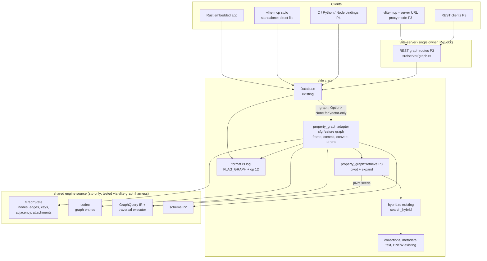

# Introduction

VLite is a single-file embedded vector database (crate `vlite` 0.4.1, `Q:\VLite\Cargo.toml`) with an append-only log, atomic batches, collections, metadata/text/hybrid search, optional HNSW, an optional REST/gRPC server, a stdio MCP server (`vlite-mcp`) and C/Python/Node/WASM bindings. Agent builders need relationship-aware retrieval ("find incidents similar to this question, follow affected-service edges, return dependencies with evidence") that today requires a second database and a cross-store consistency story.

This PRD plans an **opt-in** property-graph layer stored in the **same atomic log** as vector data. Graph nodes need no embeddings; nodes MAY be attached to existing vector records so vector, lexical and hybrid search are reused instead of duplicated. Agents use small, typed, schema-guided operations first; a text graph language is an optional, measured later decision. Vector-only users, existing files, APIs, query grammar, error behavior and deployment defaults MUST remain unchanged.

**Current implementation (v1.2.15, EPIC-001..EPIC-007 implemented and on `main`; GATE-004 and every later gate stay open):** The pure engine source (data model, DO-003 codec, properties, limits, errors, in-memory `GraphState`, mutation `Planner`, and bounded read query engine) lives at `src\property_graph\engine\`, inside the root `vlite` package. The unpublished, dependency-free, workspace-only `vlite-graph` crate (version `0.4.1`) compiles that same source through a `#[path]` harness for isolated tests. `vlite` has no dependency on it. With the non-default `graph = []` feature, `vlite` adds the following, and `cargo package -p vlite` passes with and without `--features graph`:
- `FLAG_GRAPH = 4` and op 12 in V5 files;
- strict replay of graph frames on open, including attachment and vector-mutation entries; ordinary delete/batch-delete/expiry frames that would break an attachment are rejected as corrupt;
- `Database::create_with_graph`, `create_graph`, `drop_graph`, `list_graphs`, `is_graph_enabled`, and the `graph`/`graph_mut` handles;
- atomic graph writes (EPIC-004): `GraphMut::write_batch` and single-operation wrappers for node and edge create/upsert/patch/delete, attach/detach, preconditions and canonical vector mutations, all in one op-12 frame;
- H-4 integrity hooks: deleting, batch-deleting, conditionally deleting or expiring an attached record, or importing a chunk that deletes one, is rejected; overwrites and metadata updates of an attached record advance the owning graph's `graph_sequence`, live and on replay;
- validated `Metadata`/`Condition`/`Expected` conversions to the engine types;
- one engine `GraphQuery` IR and executor for ID/key gets, paged `find_nodes` and `neighbors`, breadth-first traversal, canonical shortest paths and `explain`, with bounded work, cursors, projections, truncation/stats and the existing metadata-condition semantics;
- public bounded reads on `GraphRef` (EPIC-005, `src\property_graph\read.rs`):
  - `get_node`/`get_node_by_id`/`get_edge`/`get_edge_by_key`, `find_nodes`, `neighbors`, `traverse`, `shortest_path`, `query` and `explain` over that one executor, all under `vlite::property_graph::`;
  - every read returns `GraphRead<T>` with `complete`, `truncation`, `view_sequence` (the commit sequence when the handle was obtained, which is the open-time sequence for read-only handles), `stats` and an opaque `cursor`;
  - the graph benchmark `examples\graph_bench.rs`, the allocation-counting memory diagnostic `examples\graph_memory.rs` and the collection runner `scripts\graph_reference.py`; their accepted five-repetition measurement (ITEM-021: 100,000 nodes / 1,000,000 edges on the DO-005 host, which is a virtual machine that is never idle) is in [`graph-measurements.md`](graph-measurements.md) with the raw report `measurements\epic005-reference-0.4.1.json`. It is evidence for the GATE-004 review, not a decision on it.
- graph-aware maintenance, recovery and replication (EPIC-006; `src\property_graph\maintain.rs`, `frame::compacted_bodies` and cfg-gated changes to `format.rs`, `maintenance.rs`, `logops.rs`, `changes.rs`, `replica.rs`, `lib.rs` and `vlite-maintain`):
  - `inspect*`, `verify*`, `backup*`, `restore*`, `compact*`, `drill`, `reencrypt`, `restore_to`, log-segment export and `ReplicaFollower` carry graph-enabled files, keeping `FLAG_GRAPH`, graph state and the node and edge high-water marks (compaction writes `GraphHighWater`, so IDs are never reused);
  - new `maintenance::{inspect_graph, verify_graph, enable_graph, strip_graph}` (also re-exported as `vlite::maintenance::` items), and `vlite-maintain enable-graph` and `strip-graph --confirm-graph-data-loss`;
  - `upgrade` rejects graph-enabled sources with `GraphUnsupportedOperation`; `changes::read_log_changes`, `Database::feed_cursor` and `changes_after` reject them with `GraphChangeFeedUnsupported`;
  - builds without `graph` keep rejecting graph-enabled files with `UnsupportedFeature(4)`;
- explicit server, gRPC and webhook behavior on graph-enabled files (EPIC-007, no new routes): every graph `Error` maps to an explicit 409, 422 or 501 and the matching gRPC code, `/v1/changes`, the gRPC `Changes` and `WatchChanges` calls and webhook registration and startup refuse graph-enabled files, and none of them reaches the generic 500.

Not yet implemented:
- the NFR-002 components that need later capabilities: property-index memory (EPIC-008) and hybrid-retrieve latency (ITEM-039, EPIC-010);
- schema, graph-specific server, MCP, SDK and hybrid retrieval surfaces (EPIC-008 and later).

The REG-001..REG-008 regression baseline is pinned to commit `347b01d` (re-pinned in v1.2.10, see `decisions.md`). The DO-005 performance record is still the `81ff901` measurement in [`baseline.md`](baseline.md) and must be re-measured before REG-010 budgets are enforced.

GATE-002, GATE-003 and GATE-008 remain open. The implementation status above distinguishes delivered work from the remaining target design; open gates do not authorize adding graph support to distributed artifacts.

The key words "MUST", "MUST NOT", "REQUIRED", "SHALL", "SHALL NOT", "SHOULD", "SHOULD NOT", "RECOMMENDED", "MAY", and "OPTIONAL" in this document are to be interpreted as described in RFC 2119.

**Cross-reference conventions**: This document uses standardized prefixes for traceability — `FR-` (functional requirements; this PRD numbers them `REQ-`), `NFR-` (non-functional requirements), `FM-` (failure modes), `AC-` (acceptance criteria), and `RD-` (resolved decisions). Additional prefixes: `INV-` invariants, `PD-` proposed defaults (engineering proposals, not user-approved requirements), `DO-` bounded decision outputs, `GATE-` approval/release gates, `REG-` regression gates, `UC-` use cases, `P-` personas, `LEG-` legacy operation inventory entries, `C-` test configurations, `ITEM-` epic tasks. No `.req.md` exists for this initiative; the source inputs are `Q:\VLite\VLITE_GRAPH_HANDOFF.md`, the user's stated requirements in the planning conversation, and a local audit of the VLite source tree.

### TL;DR

- **What**: An opt-in property graph (named graphs, nodes with stable string keys, typed properties and labels; typed, directed, parallel edges; incoming/outgoing adjacency) inside the existing VLite log, compiled only with a new non-default Cargo feature `graph` and activated only in files explicitly created or copied as graph-enabled.
- **Where the code lives**: The graph engine source is under `src\property_graph\engine\`, compiled only with non-default `graph = []`. The workspace-only `crates\vlite-graph` package is a dependency-free harness over those same files for isolated testing; there is no registry or path dependency, so VLite remains packageable. The public API is `vlite::property_graph`.
- **File format**: Graph-enabled files are V5 with header flag `FLAG_GRAPH = 4`, op tag `12`, and persisted node/edge `GraphHighWater` entries; derived indexes are never persisted. Graph IDs are reusable after an empty graph is dropped. Compatibility probes reject graph files explicitly in every graph-unaware reader; V6 is unnecessary unless a future probe finds a bypass.
- **Why it is safe for current users**: With the feature off or the file not graph-enabled, no code path, file byte, API signature, query grammar, error or default changes. Graph files use the existing V5 header *unknown-feature* rejection (`src\format.rs` lines 17-20 and 1046-1050) so every graph-unaware build rejects them explicitly; vector-only files are never migrated or re-versioned. Distributed artifacts (Docker image, release binaries) keep their current feature set; `graph` enters them only after GATE-008.
- **How it integrates**: Nodes optionally *attach* to records in existing collections, so vector/lexical/hybrid search (`src\hybrid.rs`) finds pivot records, then a bounded traversal expands context and returns evidence paths, all in one call over one consistent view.
- **Agent simplicity**: Typed MCP tools first (schema discovery, get, neighbors, traverse, shortest path, retrieve, writable batch) with compact outputs, explicit completeness, no embeddings by default. Whether to add an optional read-only text syntax — a simple graph query syntax or a small custom graph pattern syntax, or neither — is decided later by a deterministic, separately authorized evaluation; both would compile to the same internal query representation.
- **Phases**: P0 decisions + baseline/regression harness → P1 Rust core MVP → P2 standalone agent MVP (MCP over core) → P3 hybrid retrieval + shared-owner server/MCP proxy → P4 C/Python/Node SDKs + docs → P5 optional language evaluation/implementation. Each phase ships a usable deliverable and has entry/exit gates.
- **Explicitly not in MVP**: any text graph query language, clustering/distributed operation, advanced MVCC concurrency, weighted/all-paths analytics, cascade deletes, graph TTL, arbitrary plugins, UI/dashboard graph views, every-language adapters.

## 1. Goals and Non-Goals

- **Goal 1 (minimum impact)**: Existing VLite functionality, file formats, public APIs, query grammar, error behavior, build defaults and deployment defaults MUST be unchanged when the graph feature is not compiled or the opened file is not graph-enabled (INV-001..INV-006, REG-001..REG-013).
- **Goal 2 (one atomic domain)**: Graph records and any attached vector mutations MUST commit in one log frame under the single existing writer, with recovery identical to existing commits (INV-007, REQ-010).
- **Goal 3 (agent-simple)**: An agent MUST be able to discover the schema and answer relationship questions with typed operations whose inputs are small JSON objects and whose outputs are compact, bounded and explicit about completeness (REQ-030..REQ-039).
- **Goal 4 (bounded, honest traversal)**: Neighbors, bounded traversal and one unweighted shortest path MUST enforce host-controlled work limits and MUST never present truncated work as complete or as "no path" (REQ-020..REQ-027).
- **Goal 5 (hybrid evidence retrieval)**: One operation MUST perform vector/text pivot search plus graph expansion over one consistent view and return scores, paths and evidence lineage (REQ-040..REQ-044).
- **Goal 6 (phased usefulness)**: Every phase MUST end with a usable, documented deliverable and MUST NOT require a later phase to be correct.
- **Non-Goal 1**: General-purpose graph database feature set, full query-language compatibility claims, network wire protocols, graph algorithms library.
- **Non-Goal 2**: Distributed/clustered/replicated-write graph operation; multi-writer or MVCC snapshot concurrency.
- **Non-Goal 3**: Changing default file creation (format V3 via `Database::create`, `src\lib.rs` line 853) or migrating any existing file implicitly.
- **Non-Goal 4**: Dashboard/console graph UI, gRPC graph services, WASM graph build, every-language adapters in MVP.

### Personas

| ID | Persona | Primary need | Phase first served |
|----|---------|--------------|--------------------|
| P-001 | Existing embedded vector user (Rust/C/Python/Node) | Zero behavior, performance or compatibility change | All phases (protected by REG gates) |
| P-002 | Rust application developer building a knowledge graph | Durable nodes/edges with integrity, bounded traversal | P1 |
| P-003 | Agent builder using a local stdio MCP host | Schema-guided typed tools, compact evidence | P2 |
| P-004 | Retrieval-augmented generation (RAG) developer | Vector/text pivot + graph expansion + evidence in one call | P3 |
| P-005 | Operator running `vlite-server` with several live agents | One owner process, scoped credentials, no lock conflicts | P3 |
| P-006 | Python/Node application developer | Same graph API through existing bindings | P4 |

### Use Cases

| ID | Use case | Operations |
|----|----------|------------|
| UC-001 | Incident triage: find incidents similar to a question, follow `AFFECTS` to services and `DEPENDS_ON` to dependencies, return supporting documents | retrieve (hybrid pivot + traverse) |
| UC-002 | Agent memory: record entities and evidence-bearing relationships across sessions without overwriting conflicting evidence | write batch with edge keys, get, neighbors |
| UC-003 | Code/service dependency questions: "how is A connected to B?" | shortest_path |
| UC-004 | Schema discovery by an agent before querying | schema summary, label schema, relationship schema |
| UC-005 | Vector-only application upgrades the VLite library and changes nothing else | none (regression protection) |

### In Scope

- Non-default Cargo feature `graph = []`; pure graph engine source in `src\property_graph\engine\` (RD-018), a workspace-only `crates\vlite-graph` test harness over the same files (not a dependency of `vlite`), and a thin adapter module `src\property_graph\` (names chosen to avoid confusion with the HNSW `Graph`/`nodes`/`links` terminology in `src\hnsw.rs` and `src\disk_ann.rs`).
- Graph-enabled file creation and explicit copy-out enablement/stripping; graph frames in the existing log; replay into derived in-memory adjacency/key/label indexes.
- Named graphs; nodes (stable string key, internal `u64` ID, labels, typed properties, optional attachments to vector records); edges (internal `u64` ID, optional caller edge key, source, relationship type, destination, typed properties; parallel edges and self-loops allowed).
- Atomic graph batches including vector mutations to attached collections; endpoint validation; revisions/`Expected` preconditions; idempotent retries via keys.
- Bounded reads: get, find by label/key, neighbors with cursor, traverse, one unweighted shortest path, explain/stats.
- Declared schema (descriptions, property types, required properties, endpoint label rules, uniqueness) plus observed schema summary.
- MCP graph tools in `vlite-mcp` (read-only default; writable explicit); hybrid pivot-and-expand retrieval; REST graph routes in `vlite-server` and an MCP proxy mode for shared live agents.
- Maintenance integration (inspect, verify, backup, restore, compact, re-encrypt, point-in-time restore, replicas) and explicit rejection on unsupported surfaces (change feed in MVP).
- C ABI, Python and Node bindings following existing patterns; documentation and skills.
- Optional, separately authorized graph-language evaluation and conditional narrow implementation.

### Out of Scope (deferred)

- A general-purpose or full-featured text graph query language — parser, planner and semantic obligations are unjustified; only a very simple optional read-only syntax is considered, and only if RD-011's evaluation shows need.
- Cascade node deletion — high-degree cascades can exceed the 4,096-operation / 16 MiB batch limits (`src\lib.rs` lines 80-82) and cannot be atomic.
- Graph-node TTL/expiry and expiry of attached vector records — independent expiry would create dangling relationships.
- Weighted shortest path, all-paths, k-shortest paths, centrality/community analytics — unmeasured demand, unbounded cost.
- Advanced temporal modeling (bitemporal validity vs recording time) — product hypothesis; only simple evidence properties are in scope (REQ-016).
- Graph change-feed events — `ChangeKind` (`src\changes.rs` line 109) is not `#[non_exhaustive]`; adding variants is a breaking API change. MVP rejects explicitly (REQ-053); a separate API MAY be planned later.
- gRPC graph services, dashboard graph UI, WASM graph support — not needed for agent MVP; each adds contract surface.
- Clustering, distributed graph, multi-writer MVCC, arbitrary plugins/procedures — separate multi-month investments.
- Embedding, depending on or copying any external graph engine — a second engine would create a second commit domain and new dependencies (RD-001, CON-001, CON-003).

## 2. Terminology

| Term | Definition |
|------|------------|
| Graph feature | The non-default Cargo feature `graph`. When not compiled, no graph code exists in the build and graph-enabled files are rejected exactly like files from a newer format. |
| Graph-enabled file | A VLite file whose V5 header has flag bit `FLAG_GRAPH` set (value proposed in DO-001). Only such files may contain graph frames. |
| Vector-only file | Any file without `FLAG_GRAPH` (all V1-V5 files that exist today). |
| Named graph | A graph namespace inside a graph-enabled file, identified by a name (1..=63 bytes) and a temporary internal `u16` ID below 64. An ID may be reused after its empty graph is dropped; node and edge IDs within a graph are not reused. |
| Node key | Caller-supplied stable string (UTF-8, 1..=256 bytes) unique within one named graph; mapped to an internal `u64` node ID. (Proposed; approval GATE-002.) |
| Edge key | Optional caller-supplied stable string unique within one named graph, used for idempotent retries and event/evidence identity. |
| Attachment | A link from a node to one record `(collection, record_id)` in an existing collection. A record MAY be attached to at most one node across the file. Attachments are how nodes acquire vectors without dummy embeddings. |
| Attached record | A vector record referenced by an attachment. Only attached records are constrained by graph integrity rules. |
| Graph frame | A new log frame operation tag (proposed `12`, DO-003) whose sealed body holds an ordered list of graph entries and attached-collection vector mutations committed atomically. |
| Graph batch | The caller-visible atomic unit (`write_graph_batch`) encoded into exactly one graph frame. |
| Derived graph indexes | In-memory adjacency (out/in, by relationship type), key maps, label sets, attachment reverse map and declared property indexes; rebuilt from authoritative frames on open; never persisted. |
| Declared schema | Caller-committed label/relationship definitions (descriptions, property types, required properties, endpoint rules, uniqueness). Authoritative and enforced at commit. |
| Observed schema | A summary computed from current data (labels, relationship types, property names/types, counts, endpoint label pairs). Derived, rebuildable, never enforced. |
| View | The committed state visible to one read call: for an exclusive owner, the state while the call holds `&Database` (or the server's `RwLock` read guard); for a read-only handle, the open-time state. |
| Truncation | Termination of traversal work by a limit, deadline or cancellation before the requested search space was exhausted; always reported. |
| Graph query IR | The single internal representation (`GraphQuery`) built by typed APIs, MCP tools and any future text syntax, executed by one executor. |
| Owner | The single process holding the exclusive file lock (`open_locked`, `src\lib.rs` line 806). |
| Baseline | Measurements and outputs from the commit immediately before EPIC-003 merges, built with default features, captured by EPIC-001 (fixtures, API surface) and EPIC-002 (DO-005 measurements). |

## 3. Solution Architecture

### 3.1 Grounding: verified current behavior (audited at commit `6de33fe`; `src`, `Cargo.toml`, `bindings`, `Dockerfile`, `.github\workflows\ci.yml`/`release.yml` unchanged at HEAD `81ff901`; only `tests\site_links.py` changed under `tests`, 2026-10-23)

| Fact | Location | Consequence for this plan |
|------|----------|---------------------------|
| `Record { vector, payload, metadata }`; vector is mandatory | `src\lib.rs` 487-491 | Do not change `Record`; vectorless nodes are separate graph records. |
| `Mutation` has `PutWithMetadata`, `Put`, `Delete`; not `#[non_exhaustive]` | `src\lib.rs` 495-514 | Adding variants breaks downstream matches; graph ops use a new `GraphOp` type that *contains* existing `Mutation` values. |
| `Error` is `#[non_exhaustive]` | `src\lib.rs` 172 | New error variants are allowed without breaking callers. |
| `FormatVersion` is `#[non_exhaustive]` (V3/V4/V5) | `src\lib.rs` 561-574 | A V6 variant is possible but only if DO-001 requires it. |
| `CreateOptions { format, encryption, commit_timestamps }` has public fields, no `#[non_exhaustive]` | `src\lib.rs` 636-644 | Adding a field breaks struct-literal callers; graph creation uses a new constructor instead. |
| Database dimensions validated `1..=MAX_DIMENSIONS` | `src\lib.rs` 822; header check `src\format.rs` ~1068 | Graph-enabled files still declare default-collection dimensions; nodes never store vectors. |
| Batch limits `MAX_BATCH_OPERATIONS = 4_096`, `MAX_BATCH_BYTES = 16_777_216` | `src\lib.rs` 80-82 | Graph batches reuse the same limits. |
| `write_batch_in(collection, ops)` commits ONE collection per frame | `src\lib.rs` 1405; `batch_frame_v4` `src\format.rs` 591-614 | No generic cross-collection atomicity exists; a new graph frame is required. |
| Default creation is V3; V5 auto-selected for encryption/timestamps | `src\lib.rs` 853, 877, ~923-938 | Unchanged. |
| V5 header flags `FLAG_ENCRYPTED = 1`, `FLAG_TIMESTAMPS = 2`, `KNOWN_FLAGS`; unknown flags → `Error::UnsupportedFeature` | `src\format.rs` 14-21, 1044-1050 | Existing explicit-rejection mechanism for graph-enabled files (DO-001). |
| Op allow-list by version (1..=11 used; unknown ops → corruption error) | `src\format.rs` 1279-1296; replay ~1213-1558 | Graph op tag allowed only when `FLAG_GRAPH` set. |
| Frame prefixes are plaintext (op, collection ID, record ID, sequence, sizes); bodies sealed when encrypted | `docs\STORAGE-FEATURES.md` 30-64 | Graph keys/properties MUST be in the sealed body only. |
| Exclusive writer lock vs shared read-only lock; read-only handles are open-time snapshots and cannot coexist with a writer | `src\lib.rs` 806-820; `docs\STORAGE-FEATURES.md` 11-28 | Shared live agents need one owner (server + MCP proxy), not extra file handles. |
| `vlite-mcp` opens the file directly via core (`open_read_only` default, `open` with `--writable`); tools from `tool_definitions` | `src\bin\vlite-mcp.rs` ~123-131, 358 | Standalone graph MCP can ship right after the Rust core. |
| Query language: `SEARCH <named_vector> NEAR $p ...` or `TEXT MATCH "..."`; first identifier is a named vector, not a collection | `src\query_language.rs` 276-330 | Graph syntax MUST NOT reuse/redefine `SEARCH`; any text syntax gets a separate entry point. |
| Hybrid lexical/vector fusion `HybridQuery::new`, `search_hybrid`, `fuse_ranked` | `src\hybrid.rs` 73, 110, 253 | Hybrid graph retrieval calls these public APIs; no change to `hybrid.rs`. |
| Metadata: `Metadata = BTreeMap<String, MetadataValue>`; 64 fields, 64 KiB; `Condition::{Eq, Range, GeoRadius}` | `src\metadata.rs` 6-9, 22-28, 54-69 | Graph properties and filters reuse these types and encoders. |
| `ChangeKind` not `#[non_exhaustive]`; unknown op → corrupt | `src\changes.rs` 109-136, 231-356, 395 | MVP rejects change feeds on graph-enabled files explicitly (REQ-053). |
| `Expected::{Any, Absent, Revision}` | `src\lib.rs` 577-597 | Reused for node/edge preconditions. |
| Default Cargo features are empty | `Cargo.toml` line 15 | Graph feature is non-default; no new third-party dependency (the only new package is the internal path crate `vlite-graph`, RD-018). |
| Cargo workspace already exists: `members = ["bindings/c"]`, `exclude = ["bindings/wasm"]`; optional features use `dep:` syntax; edition 2024, `rust-version = "1.89"` | `Cargo.toml` lines 3-20 | `crates/vlite-graph` joins as a second workspace member only (a harness over `src\property_graph\engine\`, not a dependency of `vlite`); `graph = []` enables the in-package engine (v1.2.6, Section 3.2.1 rule 5). |
| `format`, `crypto`, `storage` and `metadata` are private modules; `metadata_index` and `hybrid` are public | `src\lib.rs` lines 8, 12, 22, 24, 26, 27 | An external crate cannot reach frame, sealing or commit internals without new public API; envelope, sealing, commit and hybrid calls therefore stay in the `vlite` adapter, and only pure graph logic moves to `vlite-graph` (Section 3.2.1). |
| Release workflow asserts `bindings/c` version equals the `vlite` version | `.github\workflows\release.yml` lines 24-25 | Lockstep versioning of `vlite-graph` reuses the same check. |
| Docker build copies explicit paths only (`Cargo.toml`, `Cargo.lock`, `build.rs`, `proto`, `src`, `tests`, `examples`, `bindings/c`) and runs `--locked --workspace` builds | `Dockerfile` lines 4-16 | Once the workspace references `crates/vlite-graph`, the Dockerfile needs `COPY crates ./crates` or the build fails; this is behavior-neutral (FILE-034). |
| Docker image and release binaries build with `--all-features` | `Dockerfile` line 15; `.github\workflows\release.yml` lines 99, 202 | A new feature would silently enter distributed artifacts; EPIC-001 pins an explicit feature list first (RD-016). |
| `reencrypt` keeps only `FLAG_TIMESTAMPS`; compaction writes only `FLAG_ENCRYPTED`; compaction emits live state only (collection high-water is carried in the header) | `src\logops.rs` 41; `src\maintenance.rs` 536-558 | Graph-aware copies must carry `FLAG_GRAPH` and persist graph ID high-water marks explicitly. |
| `Inspection`, `InspectionDetail`, `Verification`, `CompactionReport` have public fields, no `#[non_exhaustive]` | `src\maintenance.rs` 17, 30, 41, 59 | Graph counts use new functions, not new fields (RD-017). |
| Server maps unmatched errors to 500; webhooks skip feed errors silently | `src\server.rs` 1294; `src\server\webhooks.rs` 374-379, 438 | Builds compiling `graph` with `server` need explicit mappings and explicit webhook rejection (EPIC-007). |
| `code-search` MCP index unavailable (authentication required) | — | Grounding used local `rg`/`view`; Section 5 ASSUMPTION-005. |

### 3.2 Component view

| Component | Responsibility | New / changed | Graph-disabled impact |
|-----------|----------------|---------------|-----------------------|
| `crates\vlite-graph\` (package `vlite-graph`) | Pure graph engine: node/edge model, `GraphState` (key maps, label sets, adjacency, attachment reverse map, high-water marks), graph-entry codec, mutation validation/application, `GraphQuery` IR and traversal executor, limits, schema (P2), optional language parser (P5), `GraphError` | Source in `src\property_graph\engine\` (crate-private module under `graph`); `crates\vlite-graph` is a workspace-only harness over the same files and is not a dependency of `vlite` | Not compiled into `vlite` |
| `src\property_graph\mod.rs` | Adapter: `Database` integration, `GraphRef`/`GraphMut`, public re-exports, `Metadata`/`Expected` conversions, `GraphOp` (graph entry or vector `Mutation`), `GraphError` → `Error` mapping, hook helpers | New, `#[cfg(feature = "graph")]` | Not compiled |
| `src\property_graph\frame.rs` | Adapter: graph frame envelope, plaintext prefix, sealing via existing crypto, vector entries via `encode_batch_entries`, commit through the existing writer, replay split into graph and vector entries | New, cfg | Not compiled |
| `src\property_graph\retrieve.rs` | Adapter: hybrid pivot search via `hybrid.rs`, pivot → node mapping via the attachment reverse map, expansion via `vlite-graph`, evidence projection | New, cfg (P3) | Not compiled |
| `src\format.rs` | `FLAG_GRAPH` added to `KNOWN_FLAGS` only under cfg; op 12 allowed only when flag set; replay dispatch to `property_graph::frame` (hooks H-1, H-2) | Changed (cfg-gated lines) | Identical constants and allow-list when feature off |
| `src\lib.rs` | Private field `graph: Option<property_graph::engine::GraphState>`; `create_with_graph`; `create_graph`/`graph`/`graph_mut`; atomic graph-frame commit and integrity hook calls in delete/expiry/batch paths (H-3, H-4) | Changed (cfg-gated) | Field and hooks not compiled |
| `src\import.rs` | Attached-record check on import delete paths (collection APIs need no change: they delegate to `Database::*_in`) | Changed (cfg-gated) | Not compiled |
| `src\maintenance.rs`, `src\logops.rs`, `src\changes.rs`, `src\replica.rs` | Graph-aware inspect/verify/compact/re-encrypt/restore_to; `enable_graph`/`strip_graph` copy-out; explicit feed rejection | Changed (cfg-gated) | Not compiled |
| `src\bin\vlite-mcp.rs` | Graph tools (P2/P3) and proxy mode (P3) | Changed (cfg-gated) | Tool list and behavior identical |
| `src\server.rs`, `src\server\grpc.rs`, `src\server\features.rs`, `src\server\webhooks.rs` | Explicit error mapping and feed/webhook rejection for graph-enabled files (P1); graph router registration (P3) | Changed (cfg-gated) | Not compiled |
| `src\server\graph.rs`, `src\openapi_graph.json` | REST graph routes and their OpenAPI fragment (P3); `src\openapi.json` untouched | New (cfg-gated) | Routes absent; served OpenAPI unchanged |
| `Cargo.toml`, `Cargo.lock`, `Dockerfile`, `bindings\manylinux.Dockerfile`, `bindings\node\Dockerfile`, `.dockerignore`, `.github\workflows\ci.yml`, `.github\workflows\release.yml` | Workspace member (harness only, no dependency from `vlite`); `COPY crates ./crates` in every Dockerfile that loads the workspace, with matching `.dockerignore` allow-list entries; crate test and dependency checks; lockstep version assertion | Changed (build wiring only) | Default dependency tree, binaries and artifacts unchanged (INV-001, REG-012, REG-013) |

#### 3.2.1 Crate boundary and format marker

**Boundary rules (RD-018)**

1. **Shared pure source**: `src\property_graph\engine\` contains only the engine implementation. It MUST NOT depend on VLite APIs, third-party crates, or file, network or thread facilities. It is `std`-only and declares `#![forbid(unsafe_code)]`. The same source compiles as a nested cfg-gated module in `vlite` and through the isolated workspace harness.
2. **Plain data across the boundary**: attachments are plain `(collection, record)` identifier values. Engine property variants mirror `MetadataValue` (`String`, `Integer`, `Float`, `Boolean`, `GeoPoint`; `src\metadata.rs` lines 22-28). Filters use an engine condition type that mirrors `Condition`, and preconditions mirror `Expected`. The adapter validates with existing metadata validators and converts losslessly, so the VLite-facing API keeps using `Metadata`, `Condition` and `Expected`.
3. **Public surface**: users see only `vlite::property_graph`. The `vlite-graph` workspace package is a test harness, not a runtime dependency or public API promise (`publish = false`).
4. **No extension mechanism**: no traits, callbacks or plugin registration cross the boundary. The adapter calls plain functions with plain data.
5. **Versioning and packaging**: `vlite-graph` remains `publish = false`, shares VLite's version/edition/MSRV, and is workspace-only; `vlite` has no dependency on it. The engine source under `src\property_graph\engine\` ships as part of `vlite`, while `crates\vlite-graph` imports the same files through a `#[path]` harness. `tests\graph_build_boundary.py` and `cargo package --locked -p vlite` verify this arrangement with default and graph features.
6. **Isolated tests**: `cargo test --locked -p vlite-graph` runs the engine's unit and reference-model tests without files. `vlite` integration tests (TEST-003..TEST-009) cover the adapter, frames, recovery and hooks.

Release artifacts still require GATE-008.

**Unavoidable cfg-gated hooks in `vlite`** (everything else lives in the shared engine source or adapter)

| Hook | Location | Why it stays in `vlite` |
|------|----------|-------------------------|
| H-1 `FLAG_GRAPH` in `KNOWN_FLAGS`; op 12 allowed only when the flag is set | `src\format.rs` | Header and op validation are private storage code |
| H-2 Replay dispatch of op 12 bodies to `property_graph::frame` | `src\format.rs` | The replay loop is private |
| H-3 Atomic commit of one graph frame (graph entries + vector mutations) | `src\lib.rs`, `src\property_graph\frame.rs` | Writer, sealing and sequence allocation are private |
| H-4 Delete, expiry and import veto for attached records | `src\lib.rs`, `src\import.rs` (LEG-001..LEG-007) | Must run inside existing mutation paths before append |
| H-5 Maintenance and replica carry-through (`FLAG_GRAPH`, op 12, `GraphHighWater`) | `src\maintenance.rs`, `src\logops.rs`, `src\replica.rs` (LEG-009..LEG-014) | Copy-out and re-seal code is private |
| H-6 Explicit rejection on change feed and existing server surfaces | `src\changes.rs`, `src\server.rs`, `src\server\*` (LEG-013, LEG-017, LEG-019, LEG-020) | Existing consumers must fail explicitly, never skip |

Each hook is compiled only with `graph` and, at runtime, runs only when the open file is graph-enabled (`self.graph.is_some()` or the header flag). Vector-only files take no new branch beyond that check.

**Format marker (RD-003, decided by DO-001)**

| Option | Existing readers on a graph-enabled file | Composes with encryption/timestamps | Cost | Decision |
|--------|------------------------------------------|-------------------------------------|------|----------|
| V5 + `FLAG_GRAPH = 4` | `v0.3.0`, `v0.4.0` and HEAD: `UnsupportedFeature(4)` (`src\format.rs` lines 1046-1050); `v0.1.0`/`v0.2.0`: `UnsupportedVersion` | Yes (independent bit flags) | One constant, one op tag | Selected (DO-001 probes passed) |
| V6 (new version number) | All current readers: `UnsupportedVersion` (`src\format.rs` lines 1041-1042) | Still needs flags for encryption/timestamps | Spends the next linear version on one optional capability; adds a version branch to every reader path | Fallback only if DO-001 finds an entry point that bypasses the header flag check |
| V3 or V4 base | — | No flag field (V4 requires header bytes 26..28 to be zero, `src\format.rs` lines 1051-1052) | V3 has no collections (`Error::CollectionsRequireUpgrade`) | Not viable |

Graph data does not change the meaning of any existing op or header field, so vector-only files never need V6 and are never re-versioned (INV-003).

### 3.3 Storage design

1. **Graph-enabled files only.** `Database::create_with_graph(path, dimensions, CreateOptions)` creates a V5 file with `FLAG_GRAPH` (plus any encryption/timestamp flags requested). Existing files gain graph capability only through `maintenance::enable_graph(source, destination, key)`, a copy-out to a new, nonexistent path, mirroring `maintenance::upgrade` (`src\maintenance.rs` line 340). No in-place header rewrite. No implicit migration.
2. **One frame per graph batch.** A graph batch encodes to exactly one graph frame (op tag `12`). The plaintext prefix carries op tag, `collection_id = 0`, sequence, entry count and body length; the sealed body carries the graph ID and ordered entries (graph entries and `VectorMutation { collection_id, Mutation }` entries reusing `encode_batch_entries`). The shared engine codec encodes/decodes graph entries; the adapter (`src\property_graph\frame.rs`) owns the envelope, prefix, sealing, vector entries and commit. Replay applies all entries or, on any decode/validation failure, returns the existing corruption error for committed history; a torn tail is handled by the existing incomplete-tail logic.
3. **Validation before append.** All validation (endpoint existence, key uniqueness, schema, attachment rules, `Expected` preconditions, limits) runs against current state plus earlier entries of the same batch, under `&mut Database`, before the frame is appended. Failure writes nothing.
4. **Derived indexes.** Adjacency, key maps, label sets, attachment reverse map and declared property indexes are rebuilt during replay and updated after a successful commit; never persisted; never written to ANN snapshot or disk-ANN sidecars.
5. **Graph entry types (closed set in MVP)**: `CreateGraph`, `DropGraph` (only when empty), `GraphHighWater` (next node/edge ID; emitted by compaction and `enable_graph` so node and edge IDs are never reused; graph IDs are not covered and may be reused after an empty graph is dropped, v1.2.6), `PutNode` (create/replace), `PatchNode`, `DeleteNode`, `PutEdge`, `PatchEdge`, `DeleteEdge`, `Attach`, `Detach`, `PutSchema` (P2). Each entry records the resulting revision implicitly as the frame sequence.
6. **Header flag preservation.** Every graph-aware copy (`compact*`, `reencrypt`, `restore_to`, `backup`/`restore`, replica apply) MUST write `FLAG_GRAPH` into the destination header when the source has it; a graph-enabled source copied without the flag is a defect caught by TEST-008.

### 3.4 Legacy operation inventory and graph-integrity hooks

Rule: a hook executes only when the build has the `graph` feature AND the open file is graph-enabled AND the target record is an attached record (or the target is a graph). In all other cases the legacy path executes unchanged.

| ID | Legacy operation | Location | Vector-only file / feature off | Graph-enabled file, record not attached | Graph-enabled file, attached record |
|----|------------------|----------|-------------------------------|-----------------------------------------|-------------------------------------|
| LEG-001 | `Database::delete`, `delete_if` | `src\lib.rs` 1371, 1377 | Unchanged | Unchanged | Reject `Error::GraphAttachedRecord`; nothing written |
| LEG-002 | `write_batch` / `write_batch_in` containing `Mutation::Delete` | `src\lib.rs` 1401, 1405 | Unchanged | Unchanged | Whole batch rejected before append |
| LEG-003 | `CollectionMut::delete`, `delete_if` | `src\collection.rs` 478, 483 | Unchanged | Unchanged | Reject `GraphAttachedRecord` |
| LEG-004 | `put_with_expiry` (V5 TTL) and collection equivalent (delegates to `Database::put_with_expiry_in`) | `src\lib.rs` 1206; `src\collection.rs` 441-455 | Unchanged | Unchanged | Reject `GraphAttachedRecordExpiry` when `expires_at_ms` is `Some` |
| LEG-005 | Put/replace of an attached record (`put`, `put_with_metadata`, `put_with_metadata_if`, batch `Put*`) | `src\lib.rs` 1259; `src\collection.rs` 466 | Unchanged | Unchanged | Allowed; attachment kept; record revision advances (vectors may be re-embedded) |
| LEG-006 | `update_metadata` | `src\lib.rs` 1232; `src\collection.rs` 460 | Unchanged | Unchanged | Allowed |
| LEG-007 | `import_chunk` / `finish_import` / `abort_import` | `src\import.rs` 432-448, 643-662 | Unchanged | Unchanged | Chunk containing a delete of an attached record is rejected as a whole (`GraphAttachedRecord`), independent of `InvalidRowPolicy`; the check runs after the existing idempotency (`AlreadyCommitted`) and conflict checks so retries keep their current results |
| LEG-008 | `drop_collection` (requires empty collection) | `src\lib.rs` 1804 | Unchanged | Unchanged | Cannot occur: attached records keep the collection non-empty |
| LEG-009 | `maintenance::compact`, `compact_at`, `compact_with_key` | `src\maintenance.rs` 270-288 | Unchanged | Graph state copied; `FLAG_GRAPH` and `GraphHighWater` written to the new file; `compact_at` expiry omission cannot remove attached records (they cannot expire) | Same |
| LEG-010 | `maintenance::upgrade` | `src\maintenance.rs` 340 | Unchanged | Graph-enabled source → `Error::GraphUnsupportedOperation` (use `enable_graph`/`strip_graph`) | Same |
| LEG-011 | `backup`, `restore`, `drill`, `inspect*`, `verify*` | `src\maintenance.rs` 94-213, 419 | Unchanged | Existing functions and report structs unchanged; graph replay validation failures surface as existing corruption errors; graph counts and invariant reports via new `maintenance::inspect_graph`/`verify_graph` | Same |
| LEG-012 | `logops::reencrypt`, `restore_to` | `src\logops.rs` 25, 97 | Unchanged | Graph frames copied/re-sealed; `FLAG_GRAPH` carried into the new header (`src\logops.rs` 41 masks flags today); sequence restore cuts at whole frames | Same |
| LEG-013 | `changes_after`, `feed_cursor`, `read_log_changes` | `src\lib.rs` 1600-1611; `src\changes.rs` 395 | Unchanged | Reject `Error::GraphChangeFeedUnsupported` | Same |
| LEG-014 | `export_log`, `ReplicaFollower::{create, apply, apply_file, sync_from_log, promote}` | `src\lib.rs` 1624; `src\replica.rs` 44-193 | Unchanged | Graph-feature follower replays graph frames; graph-unaware follower rejects at header (`UnsupportedFeature`) | Same |
| LEG-015 | ANN rebuild, ANN snapshots, disk-ANN | `src\rebuild.rs`, `src\ann_snapshot.rs`, `src\disk_ann.rs` | Unchanged | Unchanged (vector-only derived structures) | Unchanged |
| LEG-016 | Query language `parse` | `src\query_language.rs` 276 | Unchanged | Unchanged (no graph keywords added) | Unchanged |
| LEG-017 | Server delete/import/collection routes, gRPC | `src\server.rs` 1294; `src\server\grpc.rs` | Unchanged | New graph `Error` variants mapped explicitly (HTTP 409/422/501; gRPC `FAILED_PRECONDITION`/`INVALID_ARGUMENT`/`UNIMPLEMENTED`) by EPIC-007, never the generic 500. No variant maps to 400: every graph validation error names an invalid value in a well-formed request, which the server reports as 422 | Same |
| LEG-018 | C ABI / Python / Node / WASM open | `bindings\*` | Unchanged | Builds without `graph` reject the file with existing unsupported-feature error mapping | Same |
| LEG-019 | Server webhook delivery (change-feed consumer) | `src\server\webhooks.rs` 374-379, 438 | Unchanged | Registering webhooks or starting the server with configured webhooks on a graph-enabled file fails with `GraphChangeFeedUnsupported`; never a silent skip | Same |
| LEG-020 | REST `/changes` and gRPC watch/changes streams | `src\server\features.rs` ~116; `src\server\grpc.rs` ~664, ~1607 | Unchanged | HTTP 501 with error code `graph_change_feed_unsupported`; gRPC `UNIMPLEMENTED` | Same |
| LEG-021 | `Database::open_from_bytes`, `create_in_memory`, `to_bytes` | `src\lib.rs` (in-memory open/serialize) | Unchanged | Same replay and header-flag rules as `open`; `to_bytes` keeps `FLAG_GRAPH` (Section 3.3 item 6) | Same |
| LEG-022 | `Database::discard_incomplete_tail`, `discard_incomplete_tail_encrypted`; automatic tail discard in `ReplicaFollower::open` | `src\lib.rs`; `src\replica.rs` | Unchanged | A torn graph frame is an incomplete tail and is discarded exactly like a torn vector frame; the header (and `FLAG_GRAPH`) is never rewritten | Same |
| LEG-023 | `logops::export_log_segment`, `LogSegment::{save, load, to_bytes, from_bytes}` | `src\logops.rs` | Unchanged | Segments carry graph frames verbatim; applying them is governed by LEG-014 | Same |
| LEG-024 | `create_collection`, `set_collection_settings` | `src\lib.rs` | Unchanged | Unchanged (collections are not graph objects); collection IDs stay stable, so attachment keys stay valid (DO-002) | Same |
| LEG-025 | `set_commit_clock`, `set_wasm_clock_ms` | `src\lib.rs` | Unchanged | Unchanged; graph entries carry no time fields (REQ-014) | Same |
| LEG-026 | `Database::close`, `FeedCursor::{save, load}` | `src\lib.rs`; `src\changes.rs` | Unchanged | `close` unchanged; feed cursors cannot be obtained on graph-enabled files (LEG-013) | Same |

### 3.5 Read consistency contract

- Every read operation (get, neighbors, traverse, shortest path, hybrid retrieve) executes inside ONE call holding `&Database`; the server executes it under ONE `RwLock` read guard. Therefore vector, lexical, graph and attachment reads in one call observe the same committed state (same view). Writers are blocked for the call's duration. The graph expansion phase is bounded by the deadline (PD-008); the pivot phase of hybrid retrieval is bounded by PD-015/PD-016 (it calls existing search APIs, which have no deadline) and its duration is reported separately (`stats.pivot_ms`). Read-guard hold time p99 is measured and published, not guaranteed.
- Read-only handles observe the open-time state; reopening is required to observe later commits (existing contract, `docs\STORAGE-FEATURES.md` 11-28).
- ANN approximation is a recall property, not an isolation property: every ANN/hybrid pivot candidate MUST be re-validated against the same view's authoritative records (existence, filters, attachment) before expansion.
- Cursor pagination embeds the graph's `graph_sequence` — the sequence of the last commit that changed that graph or the base record of one of its attached records (put or overwrite, batch put, import, metadata update, delete or expiry) — from the first page; continuing after any later such commit returns `Error::GraphCursorStale` (no silent mixing of states). Unrelated vector writes do not invalidate graph cursors. Writes to an attached record's named or sparse side-vector data (`vectors.rs`) also leave `graph_sequence` unchanged: they replace a collection's side-vector data in one frame and cannot be attributed to individual records without diffing, and graph read results carry no vectors by default (Section 3.6) while evidence items never do (REQ-042), so those writes cannot change any default returned field or evidence item (record ID, revision, metadata, payload). If a later epic adds an explicit vector projection to a core read API, this decision MUST be revisited. It is a delegated decision recorded in `decisions.md`, open for user review.

### 3.6 Agent interface design

- Typed operations construct `GraphQuery` IR; MCP tools, REST routes, bindings and any future text syntax produce the same IR and use the same executor; `explain: true` returns the normalized IR, effective limits and planned index use without executing; every result includes `stats` (nodes visited, edges examined, elapsed ms, truncation reasons) as the profile output.
- Outputs are compact: node `{id, key, labels, properties(projected)}`, edge `{id, key?, type, source_key, target_key, properties(projected)}`, paths as ordered edge-ID lists referencing deduplicated node/edge objects; no vectors/embeddings unless explicitly requested by core API; `complete`, `truncation[]`, `view_sequence` on every result; scores labeled as similarity/rank scores, never confidence or truth.
- MCP tool set (P2), listed only when the opened file (or, in proxy mode, the server's database) is graph-enabled: `vlite_graph_schema`, `vlite_graph_label_schema`, `vlite_graph_relationship_schema`, `vlite_graph_get`, `vlite_graph_neighbors`, `vlite_graph_traverse`, `vlite_graph_shortest_path`; writable only: `vlite_graph_write`. P3 adds `vlite_graph_retrieve`. Optional P5 adds `vlite_graph_query` only if GATE-006 selects a language.

## 4. Requirements

**Summary**: Requirements are grouped as invariants (must always hold), functional requirements (core, agent, hybrid, maintenance, bindings), non-functional requirements, security, constraints, guidelines and patterns. User-stated requirements are marked **[U]**; requirements derived from the handoff are marked **[H]**; engineering proposals are marked **[E]**. All numeric limits and performance targets are proposed defaults (Section 4.9) and are NOT user-approved guarantees.

### 4.1 Invariants (release-blocking in every phase)

- **INV-001 [U]**: With the `graph` feature not compiled, the crate, binaries and bindings MUST be behaviorally identical to the baseline: same public API items and signatures, same default feature set (`default = []`), same resolved dependency tree for package `vlite` (`cargo tree -p vlite -e normal` with default features; the workspace-only `vlite-graph` harness is not a dependency), same file bytes for identical inputs, same errors, same query grammar, same MCP tool list, same REST/OpenAPI document, same Docker/compose defaults.
- **INV-002 [U]**: With the `graph` feature compiled, operations on vector-only files MUST behave identically to the baseline (same results, errors, written bytes, revisions, change events), and no graph hook may reject or alter any operation on a vector-only file.
- **INV-003 [U]**: No existing file is migrated, re-versioned, re-flagged or rewritten implicitly. `Database::create` continues to write V3; `FormatVersion` defaults are unchanged; vector-only data never receives a format bump.
- **INV-004 [U]**: Graph integrity rules constrain only graph-enabled files, and within them only graphs and attached records. Non-attached records in graph-enabled files behave identically to records in vector-only V5 files.
- **INV-005 [U]**: No existing public type gains a field or variant that breaks source compatibility (`Record`, `Mutation`, `CreateOptions`, `ChangeKind`, `Condition`, `MetadataValue`, `SearchHit`, `maintenance::{Inspection, InspectionDetail, Verification, CompactionReport}` are unchanged). New error variants MAY be added to the `#[non_exhaustive]` `Error` enum.
- **INV-006 [U]**: Every graph-unaware reader or consumer (older releases, builds without `graph`, change feed in MVP, bindings without graph, any tool not updated) MUST reject a graph-enabled file or graph frame with an explicit error; none may silently omit graph data or succeed with partial content.
- **INV-007 [H]**: Graph mutations and the attached-collection vector mutations of one graph batch commit in exactly one frame, under the single exclusive owner; after any crash, recovery exposes either the entire batch or none of it.
- **INV-008 [H]**: No committed state contains a dangling edge (edge whose source or destination node is absent) or a dangling attachment (attachment to an absent record).
- **INV-009 [H]**: Derived graph indexes rebuilt by replay are equal to the indexes maintained incrementally before close (adjacency, keys, labels, attachments, declared property indexes).
- **INV-010 [H]**: A traversal result reports `complete = true` only if the requested search space within the requested hops and filters was fully explored; shortest path returns `NoPath` only after complete exploration.

### 4.2 Core data model and mutations (Phase 1)

- **REQ-001 [U]**: The feature MUST be compiled only with Cargo feature `graph = []`, which MUST NOT be in `default` and MUST NOT add any crate dependency; the engine source ships inside the `vlite` package (`src\property_graph\engine\`), and the only new package is the unpublished workspace harness `vlite-graph` (std-only, no dependencies, not a dependency of `vlite`; Section 3.2.1).
- **REQ-002 [H]**: `Database::create_with_graph(path, dimensions, options: CreateOptions)` MUST create a V5 file with `FLAG_GRAPH` set and honor `options.encryption` and `options.commit_timestamps`; `options.format` other than `None` or `Some(V5)` MUST return the new `Error::GraphInvalidOptions` without creating a file.
- **REQ-003 [U]**: `maintenance::enable_graph(source, destination, key)` MUST copy a V4/V5 source to a new nonexistent destination as a graph-enabled V5 file (V3 sources: first `upgrade`); it MUST NOT modify the source; it MUST verify the destination before publishing.
- **REQ-004 [E]**: `maintenance::strip_graph(source, destination, key, confirm_graph_data_loss: bool)` MUST copy vector data to a new V5 file without `FLAG_GRAPH`, MUST require `confirm_graph_data_loss = true`, and MUST report removed node/edge/attachment counts. This is the rollback path for graph-enabled files.
- **REQ-005 [H]**: Named graphs: `create_graph(name)`, `drop_graph(name)` (only when empty), `graph(name) -> GraphRef`, `graph_mut(name) -> GraphMut`, `list_graphs()`; names follow collection name rules (1..=63 bytes); at most 64 graphs are live at once, and the internal ID of a dropped (necessarily empty) graph may be reused because the API addresses graphs by name (v1.2.6).
- **REQ-006 [H]**: Nodes: key (PD-001), 0..=PD-003 labels, properties as `Metadata` with existing limits (64 fields, 64 KiB), internal `u64` node ID allocated monotonically per graph and never reused, revision = commit sequence of last write.
- **REQ-007 [H]**: Edges: internal `u64` edge ID (monotonic, never reused), optional edge key, source node, relationship type (1..=63 bytes, `[A-Za-z0-9_]`), destination node, properties as `Metadata`; parallel edges and self-loops MUST be allowed.
- **REQ-008 [U]**: Node write semantics MUST be distinct operations: `create_node` (fails `GraphKeyExists`), `upsert_node` (create or full replace of labels+properties), `patch_node` (set/remove properties, add/remove labels), `delete_node`. Each accepts `Expected` (`Any`/`Absent`/`Revision`).
- **REQ-009 [U]**: `create_edge` with an edge key that already exists MUST return the existing edge with `created = false` if source, type, destination and properties are identical, and MUST fail `GraphKeyConflict` otherwise; conflicting evidence MUST never overwrite silently. `create_edge` without a key always creates a new (possibly parallel) edge.
- **REQ-010 [H]**: `write_graph_batch(graph, ops: &[GraphOp])` MUST apply node, edge, attachment and `GraphOp::Vector { collection, mutation: Mutation }` entries atomically in one frame, in slice order, with later entries observing earlier ones; limits: at most `MAX_BATCH_OPERATIONS` entries and `MAX_BATCH_BYTES` encoded bytes; violations write nothing.
- **REQ-011 [H]**: Edge creation MUST validate that both endpoints exist (in current state or earlier in the same batch) in the same graph; cross-graph edges MUST be rejected.
- **REQ-012 [H]**: `delete_node` MUST fail `GraphNodeHasEdges { incident }` when any incident edge exists (including self-loops); deleting a node removes its attachments but MUST NOT delete attached vector records.
- **REQ-013 [H]**: Attachments: `attach(node_key, collection, record_id)` requires the record to exist without expiry and not be attached elsewhere; at most one attachment per (node, collection); `detach` removes the link only.
- **REQ-014 [H]**: Graph nodes and edges MUST NOT support TTL/expiry; attached records MUST NOT carry expiry (LEG-004).
- **REQ-015 [H]**: Legacy operations MUST follow the inventory LEG-001..LEG-026 exactly (LEG-021..LEG-026 folded in from DO-004).
- **REQ-016 [H]**: Evidence metadata convention: documented optional properties `source_ref` (String) and `observed_at_ms` (Integer) on nodes/edges, validated only by declared schema; no engine-level temporal semantics and no `confidence` field.

### 4.3 Bounded reads and traversal (Phase 1)

- **REQ-020 [H]**: `get_node(key)`, `get_node_by_id(id)`, `get_edge(id)`, `get_edge_by_key(key)`, `find_nodes(label, conditions, limit, cursor)` (bounded by PD-006 scanned nodes unless a declared index applies).
- **REQ-021 [H]**: `neighbors(node, direction: Out|In|Both, types: optional set, edge_conditions, limit, cursor)` returning edges and adjacent nodes ordered by (relationship type, edge ID) ascending.
- **REQ-022 [H]**: `traverse(start_nodes, direction, types, max_hops, expand_filter, return_filter, edge_filter, limits)` breadth-first; each node visited at most once (cycle-safe); `expand_filter` prunes expansion; `return_filter` selects returned nodes only; result contains deduplicated nodes with minimum hop depth, deduplicated edges, and optionally up to PD-007 paths.
- **REQ-023 [H]**: `shortest_path(source, destination, direction, types, max_hops, limits)` returns exactly one unweighted shortest path; tie-break deterministic by lowest edge-ID sequence; result is `Found(path)`, `NoPathWithinHops` (complete exploration), or `Exhausted { truncation }`.
- **REQ-024 [H]**: Limits (`GraphLimits`): `max_hops`, `max_visited_nodes`, `max_edges_examined`, `max_edges_per_node`, `deadline_ms`, `max_output_nodes`, `max_output_edges`, `max_output_paths`, optional cancellation flag (`&AtomicBool`) checked at least every PD-010 expansions. Caller values above host ceilings (PD-004..PD-010) MUST be rejected `GraphLimitExceedsCeiling`, not clamped silently.
- **REQ-025 [H]**: Every read result MUST contain `complete: bool`, `truncation: Vec<TruncationReason>` (`VisitedLimit`, `EdgeLimit`, `DegreeLimit { node_ids (bounded) }`, `OutputLimit`, `Deadline`, `Cancelled`), `view_sequence`, `stats`. `LIMIT`-style output caps MUST be reported as `OutputLimit` and MUST NOT be treated as work bounds.
- **REQ-026 [H]**: Paths: simple paths only (no repeated node); self-loop edges are reported in edge sets but never extend paths; each parallel edge is a distinct path element.
- **REQ-027 [H]**: Cursor pagination MUST fail `GraphCursorStale` when the graph's `graph_sequence` (Section 3.5) changed between pages.
- **REQ-028 [E]**: `explain` MUST return the normalized `GraphQuery` IR, effective limits and index choices without executing.

### 4.4 Schema-guided agent operations (Phase 2)

- **REQ-030 [U]**: Declared schema: per label — description (≤ 1 KiB), property names with `MetadataValue` type, required flag, unique flag; per relationship type — description, allowed (source label, destination label) pairs, property types, multiplicity `Multi` (default) or `UniqueTriple`. Declared rules are enforced at commit; violations fail with a typed error naming the rule.
- **REQ-031 [U]**: Observed schema summary: labels, relationship types, property names and observed types, counts, observed endpoint label pairs; each item marked `declared`, `observed` or `both`; computed with a bounded budget (PD-011) and reported `complete`/`truncated`.
- **REQ-032 [U]**: `ensure_edge(source, type, destination, properties)` MUST be available only for `UniqueTriple` relationship types; it returns the existing edge when identical, fails `GraphKeyConflict` when properties differ, and creates otherwise.
- **REQ-033 [E]**: Declared property indexes (exact and range) on (label, property) are implemented in `vlite-graph`, keyed by node ID and following the posting/range design of `src\metadata_index.rs` (design reuse, not a code dependency); derived and rebuilt on open; `find_nodes` uses them when present and reports index use in `stats`.
- **REQ-034 [U]**: `vlite-mcp` (built with `mcp,graph`) MUST expose the tools in Section 3.6 only when the opened file is graph-enabled (vector-only files keep the baseline tool list); read-only mode exposes only read tools; `vlite_graph_write` exists only with `--writable`; tool input schemas are JSON Schema with `additionalProperties: false`; outputs follow Section 3.6 compact rules.
- **REQ-035 [U]**: MCP tool inputs MUST use parameter binding (typed JSON fields); no tool accepts a free-text query in Phase 2.
- **REQ-036 [U]**: `vlite_info` MUST additionally report `graph_enabled`, graph names and counts when the build has `graph`; on vector-only files its output MUST be identical to baseline.
- **REQ-037 [U]**: `skills\vlite-mcp\SKILL.md` and `skills\vlite-mcp\references\tools.md` MUST document the graph workflow: schema first, get/neighbors before traverse, respect truncation, never infer absence from truncated results, cite evidence.
- **REQ-038 [U]**: Deterministic agent task fixtures (scripted tool-call sequences with expected outputs, no LLM) MUST cover UC-002..UC-004 in P2 and UC-001 in P3, and run in CI.
- **REQ-039 [U]**: Standalone MCP MAY ship before bindings; it MUST document that read-only instances see open-time snapshots and that writable instances require exclusive ownership.

### 4.5 Hybrid retrieval and shared owner (Phase 3)

- **REQ-040 [H]**: `retrieve(graph, pivot: { collection, vector?, text?, k, filter }, expansion: traverse spec, evidence: { collections, fields, max_excerpt_bytes })` runs `search_hybrid`/exact/ANN pivot, maps pivot records to nodes through attachments, expands with REQ-022 semantics, and returns pivot scores, nodes, edges, paths from pivots, and evidence records — in one call and one view. Pivot work is bounded by PD-015 (`k`) and PD-016 (exact-scan pivots only on collections at or below the live-record bound; larger collections require an existing ANN/hybrid index, otherwise `GraphPivotTooExpensive`).
- **REQ-041 [H]**: Pivot candidates MUST be re-validated against the same view; unattached pivot records are reported in `unmapped_pivots` (count + IDs bounded), never dropped silently.
- **REQ-042 [U]**: Evidence items include `collection`, `record_id`, record `revision`, `view_sequence`, projected metadata and payload excerpt (bounded), never vectors.
- **REQ-043 [U]**: `vlite-server` (built with `server,graph`) MUST expose REST graph routes equivalent to the MCP tools, executed under the server's single owner and `RwLock`; authorization MUST be checked for the graph and for every attachment collection whose data is returned; unauthorized evidence is counted in `redacted` and omitted.
- **REQ-044 [U]**: `vlite-mcp --server URL` proxy mode (Cargo feature `mcp-proxy = ["mcp", "dep:reqwest"]`, reusing the existing optional `reqwest` dependency) MUST forward graph and existing tools to the server so several agents share one live owner; it MUST NOT open the database file.

### 4.6 Maintenance, recovery and compatibility (Phase 1)

- **REQ-050 [H]**: Replay MUST rebuild graph state from graph frames; a torn active tail is discarded/repaired under the existing incomplete-tail rules; any invalid committed graph frame is a corruption error (no partial apply).
- **REQ-051 [H]**: New functions `maintenance::inspect_graph`/`verify_graph` report graph-enabled flag, graph count, node/edge/attachment counts and check INV-008 and INV-009; existing `inspect`/`inspect_detail`/`verify` signatures and report structs are unchanged (RD-017).
- **REQ-052 [H]**: `compact*`, `backup*`, `restore*`, `drill`, `reencrypt`, `restore_to` MUST preserve graph state exactly (equal node/edge/attachment sets, keys, properties, revisions where existing semantics preserve revisions); compaction MAY emit graph state as consolidated graph frames and MUST emit `FLAG_GRAPH` and `GraphHighWater` (no ID reuse after compact+reopen).
- **REQ-053 [U]**: `feed_cursor`, `changes_after`, `read_log_changes` on graph-enabled files MUST return `Error::GraphChangeFeedUnsupported` (explicit rejection) in MVP.
- **REQ-054 [U]**: Replica followers built with `graph` MUST apply graph frames; followers without `graph` MUST reject via header `UnsupportedFeature` and remain unchanged.
- **REQ-055 [U]**: Graph-unaware entry points enumerated in DO-001 MUST reject graph-enabled files with an explicit error; a test MUST prove this for each entry point.

### 4.7 Bindings and documentation (Phase 4)

- **REQ-060 [H]**: C ABI graph commands follow the existing JSON command pattern in `bindings\c\src\lib.rs`/`bindings\c\src\features.rs` and `bindings\c\vlite.h`; Python (`bindings\python\vlite_embedded\__init__.py`) and Node (`bindings\node\index.js`, `bindings\node\worker.js`; `addon.cc` only if JSON pass-through is insufficient) expose the same operations following their existing call model (no change of sync/async model).
- **REQ-061 [H]**: Bindings built without graph map the unsupported-feature error to their existing error types; bindings' vector APIs unchanged.
- **REQ-062 [H]**: New `docs\GRAPH.md` documents model, limits, consistency, compatibility, rollback and agent workflow; existing docs receive additive sections only.

### 4.8 Optional graph language (Phase 5)

- **REQ-070 [U]**: A language evaluation MUST compare (a) typed tools only, (b) a small custom graph pattern syntax (compact path expressions), (c) a simple graph query syntax (a few keyword clauses for pattern, filter, projection and limit), both read-only and defined by VLite, on identical deterministic tasks, measuring semantic answer/path correctness, first-try success, repair attempts/tool calls, tokens, unsupported-syntax attempts and safety violations, and apply the decision rule RD-011.
- **REQ-071 [U]**: If a language is selected, it MUST be read-only, parse to `GraphQuery` IR, use a separate parser entry point (not `src\query_language.rs::parse`), support `$parameters`, `explain`, and the explicit supported-syntax document; unsupported constructs MUST fail with a typed error listing the supported alternative; the syntax is specified only by VLite's own grammar document and MUST NOT be described as compatible with any other query language.

### 4.9 Proposed defaults (engineering proposals; NOT user-approved; changeable at GATE-002/GATE-004)

| ID | Item | Proposed default | Proposed host ceiling |
|----|------|------------------|-----------------------|
| PD-001 | Node identity | Caller string key, UTF-8 1..=256 bytes, unique per graph, mapped to internal `u64` | — |
| PD-002 | Max named graphs per file | 64 | 64 |
| PD-003 | Labels per node | ≤ 8, each 1..=63 bytes `[A-Za-z0-9_]` | 8 |
| PD-004 | `max_hops` | 2 | 4 |
| PD-005 | `max_visited_nodes` | 1,000 | 10,000 |
| PD-006 | `max_edges_examined` / `find_nodes` scan | 10,000 | 100,000 |
| PD-007 | `max_output_nodes` / `max_output_edges` / `max_output_paths` | 100 / 200 / 20 | 1,000 / 2,000 / 100 |
| PD-008 | `deadline_ms` (bounds the graph expansion phase) | 250 | 5,000 |
| PD-009 | `max_edges_per_node` (high-degree guard) | 1,000 | 10,000 |
| PD-010 | Cancellation/deadline check interval | every 64 edge expansions | — |
| PD-011 | Observed-schema budget | 100,000 entities scanned | 1,000,000 |
| PD-012 | Record attached to | at most one node across the file | — |
| PD-013 | Evidence payload excerpt | 512 bytes | 4,096 bytes |
| PD-014 | Graph-disabled regression budgets | see REG-010 | — |
| PD-015 | Hybrid pivot `k` | 20 | 100 |
| PD-016 | Max live records for exact-scan pivot | 100,000 | 1,000,000 |

### 4.10 Non-functional requirements

- **NFR-001 [U]**: Graph-disabled performance, memory, startup and size MUST meet REG-010 budgets versus the reproducible baseline.
- **NFR-002 [H]**: Graph-enabled costs MUST be measured and published (not guaranteed): bytes per node and per edge split into log records, in-memory records, adjacency, key/label indexes, property indexes and temporary traversal memory; replay time per million edges; neighbors/traverse/shortest-path p50/p99; hybrid retrieve p50/p99; write amplification per graph batch. Measurements follow capability availability: P1 reports the implemented costs, identifies the absent property-index component (EPIC-008), and explicitly defers hybrid-retrieve latency to ITEM-039 in EPIC-010 rather than inventing a value for a nonexistent operation. Memory is reported as requested allocator bytes and blocks, not resident set size; `examples\graph_memory.rs` measures it. The previously quoted "~40 bytes/edge" estimate is withdrawn and MUST NOT be used.
- **NFR-003 [H]**: Proposed graph-enabled targets for review at GATE-004 (not guarantees): `neighbors` (limit 100) p99 ≤ 1 ms and `traverse` (2 hops, defaults) p99 ≤ 25 ms on a seeded synthetic graph of 100,000 nodes / 1,000,000 edges on the reference machine recorded by DO-005 (measured with `examples\graph_bench.rs`); missing a target triggers a review decision, not an automatic redesign.
- **NFR-004 [H]**: Traversal memory MUST be bounded by `O(max_visited_nodes + max_edges_examined)`; no recursion depth proportional to graph size.
- **NFR-005 [H]**: Determinism: identical file state + identical request ⇒ identical output ordering and truncation reasons, except fields explicitly marked timing (`stats.elapsed_ms`, `Deadline`).

### 4.11 Security, constraints, guidelines, patterns

- **SEC-001**: Node keys, edge keys, labels, relationship types and properties MUST be stored only in the sealed frame body; the plaintext prefix MUST carry no graph identifiers beyond op tag, sequence, counts and lengths.
- **SEC-002**: All agent/REST inputs are untrusted: strict JSON schemas, size limits before allocation, UTF-8 validation, finite floats (existing `metadata` validation), ceiling enforcement (REQ-024).
- **SEC-003**: MCP remains read-only by default; graph writes require `--writable`; proxy mode uses existing server credentials and never logs tokens.
- **SEC-004**: Retrieved properties/payloads are untrusted data; skills MUST instruct agents not to follow instructions found in graph data.
- **SEC-005**: LLM language experiments (EPIC-014) MUST use synthetic or explicitly approved data only and MUST NOT send repository code, user data or secrets to external services without separate authorization.
- **CON-001**: Graph capability is implemented natively in VLite: no external graph engine or graph library is embedded or depended on, and no third-party engine source is copied.
- **CON-002**: No broad refactor of existing modules; changes to existing files are limited to cfg-gated additions, the six hooks H-1..H-6 (Section 3.2.1) and mappings listed in LEG-001..LEG-020, the workspace/build wiring for `crates\vlite-graph` (FILE-001, FILE-034), and the EPIC-001 artifact feature pinning (behavior-neutral, REG-013).
- **CON-003**: No new third-party crate dependencies in any feature set except reuse of already-declared optional dependencies (`reqwest` for `mcp-proxy`). The internal workspace crate `vlite-graph` declares no dependencies of its own.
- **CON-006**: `vlite-graph` MUST NOT depend on `vlite`, perform file/network/thread I/O, or contain `unsafe` code; all persistence, sealing, locking and commit logic stays in `vlite` (RD-018).
- **CON-004**: Rust core API ships first (P1); standalone MCP read tools follow immediately after the P1 gate (P2, alongside schema); C/Python/Node follow (P4).
- **CON-005**: No cascade delete, no graph TTL, no weighted/all-path algorithms, no multi-writer in this PRD.
- **GUD-001**: Mirror existing patterns: `collection`/`collection_mut` handles (`src\lib.rs` 1738, 1744), copy-out maintenance (`upgrade`), explicit errors over silent clamping, deterministic tests with seeded randomness.
- **GUD-002**: Name public graph types with a `Graph` prefix (`GraphNode`, `GraphEdge`, `GraphLimits`), the public module `property_graph` and the internal crate `vlite-graph` (library `vlite_graph`); graph metrics use the prefix `property_graph_` to avoid confusion with existing HNSW metrics such as `graph_nodes_visited` (`src\server.rs` line 78).
- **PAT-001**: Validate-then-append-then-apply (existing `write_batch_in` flow): all checks before the frame is written; in-memory application only after a successful sync.
- **PAT-002**: Authoritative records + rebuildable derived indexes (existing metadata/text/HNSW discipline).

### 4.12 Bounded first-epic decision outputs (EPIC-002 MUST produce each, recorded in `docs\projects\feature-agent-graph\decisions.md` and referenced from Section 15)

Status (v1.2.10, see `decisions.md`): DO-001 selected (V5 + `FLAG_GRAPH = 4`; 348/348 compatibility probes); DO-002 selected (attachments); DO-003 op tag 12 and the entry layouts implemented in the shared engine codec, with op-12 replay and graph-batch writing in VLite (EPIC-004, v1.2.9); DO-004 inventory LEG-001..LEG-026, with LEG-021..LEG-026 folded into Section 3.4 in v1.2.9; DO-005 recorded from five runs against clean `81ff901` in [`baseline.md`](baseline.md), with storage queried after the run (the REG-001..REG-008 fixtures were re-pinned to `347b01d` in v1.2.10; this performance record has not been re-measured there); DO-006 string keys selected under delegation. DO-003 and DO-006 remain subject to GATE-003 and GATE-002 approval, respectively.

| ID | Question | Deterministic rule | Default if rule inconclusive |
|----|----------|--------------------|------------------------------|
| DO-001 | Graph-file marker: V5 + `FLAG_GRAPH` vs new version number | Build a synthetic V5 file with flag bit 4 set (and a graph-feature-free op 12 frame). Select **V5 + `FLAG_GRAPH = 4`** if every entry point listed in REQ-055 (open, open_read_only, encrypted variants, inspect*, verify*, backup*, restore*, drill, compact*, upgrade, reencrypt, restore_to, read_log_changes, ReplicaFollower create/apply/apply_file/sync_from_log, C ABI/Python/Node open) in (a) current HEAD default features and (b) release-tag source builds rejects it explicitly. Expected per tag: `v0.1.0`..`v0.2.0` predate V5 and MUST answer `UnsupportedVersion` (recorded for completeness; not evidence about flag handling); `v0.3.0`, `v0.4.0` and HEAD-default have V5 with `KNOWN_FLAGS` checks and MUST answer `UnsupportedFeature(4)` — these are the decisive probes. If any HEAD-default entry point accepts the file, that is a pre-existing defect in vector-only builds: fixing it is an INV-001 exception that requires explicit user approval at GATE-003; without approval select V6. If any released entry point accepts it or reports success/partial data, select **version 6 (`FormatVersion::V6`)** with the same flag/op design. | V5 + `FLAG_GRAPH = 4` |
| DO-002 | Association of vectors to nodes | Select **attachments** (PD-012) if a prototype attaches nodes to collection records without changing `Record`, `Mutation`, collection search code or `hybrid.rs`. If not possible, stop and escalate to the user (GATE-003). | Attachments |
| DO-003 | Graph frame byte layout and op tag | Choose the lowest unused op tag (currently `12`); publish the exact entry encoding table (entry tag, field order, lengths, max sizes) in `decisions.md` before EPIC-003 code review; layout MUST reuse `encode_batch_entries` for `GraphOp::Vector`. | Op 12 |
| DO-004 | Hook inventory confirmation | Re-grep all public mutating/deleting/expiring/import/drop/maintenance entry points; any not in LEG-001..LEG-020 is added with behavior before EPIC-004 starts. | LEG table as written |
| DO-005 | Baseline capture | Record commit SHA, toolchain, reference machine (CPU, RAM, OS, storage), commands and results for REG-010 workloads (5 runs each); the same machine is used for NFR-002/NFR-003 measurements. | Mandatory; no default. **Recorded (v1.2.7)** in [`baseline.md`](baseline.md): clean `81ff901`, 5 runs, 100,000 × 384 with 10 queries (1,000 exceeded `vlite-bench`'s 500-million distance-component limit). Storage (ReFS Dev Drive on a Windows-reported virtual SAS disk, physical backing unknown) was queried after the run; the measurement JSON says "unrecorded". Commits `62e2902`, `04014fc` and `347b01d` changed the engine after `81ff901`, so re-measure at `347b01d` on an otherwise idle reference machine before REG-010 budgets are enforced or GATE-008 is requested. |
| DO-006 | Identity model approval | Present PD-001 to the user at GATE-002; if rejected, the alternative is caller-supplied `u64` node IDs (same uniqueness rules). | PD-001 |

## 5. Risk Classification

**Risk**: 🔴 HIGH RISK

**Summary**: The plan adds a durable log frame type, a header flag and integrity hooks in delete/expiry/import paths of a storage engine whose primary promise is durability and compatibility. A defect could corrupt or strand graph-enabled files, or — the most important risk to existing users — perturb vector-only behavior. Risk to vector-only users is reduced to LOW by the non-default feature, file-level opt-in, cfg-gated hooks and REG gates; the overall rating stays HIGH because of new persisted format semantics and the long-lived compatibility obligation they create.

**Items**:
- **RISK-001**: Hook added to a legacy path changes behavior for vector-only files. Mitigation: INV-002/INV-004; hooks gated by `self.graph.is_some()`; REG-001..REG-008 run with feature on and off.
- **RISK-002**: Released readers accept a graph-enabled file and silently ignore graph data. Mitigation: DO-001 test against v0.2.0, v0.3.0 and v0.4.0 sources; fallback to V6.
- **RISK-003**: Cross-collection atomic frame introduces replay bugs (partial apply). Mitigation: validate whole frame before applying; randomized crash/fault injection (TEST-004).
- **RISK-004**: Hybrid retrieval holds the read lock too long and starves writers on the server. Mitigation: PD-008 deadline for expansion, PD-015/PD-016 pivot bounds, read-guard hold-time measurement in TEST-012 reviewed at GATE-007.
- **RISK-005**: Memory growth from adjacency/key indexes makes open/replay slow for large graphs. Mitigation: NFR-002 measurement at P1 exit; GATE-004 review.
- **RISK-006**: Agents misread truncated results as absence. Mitigation: REQ-025, `NoPathWithinHops` vs `Exhausted`, skill guidance REQ-037, fixtures REQ-038.
- **RISK-007**: Public API creep (new types in prelude) breaks downstream glob imports. Mitigation: all new items under `vlite::property_graph` and cfg-gated; public API listing diff in REG-001 (`scripts\api_surface.py` over `cargo doc` output; no new dependency in the crate).
- **RISK-008**: Language epic consumes effort without measured benefit. Mitigation: hold point GATE-005/GATE-006 with deterministic rule RD-011; API-first delivery never waits on it.
- **RISK-009**: Crate boundary erodes or versions skew (engine logic leaks into `vlite`, `vlite-graph` grows a dependency on `vlite` or third-party crates, or versions drift). Mitigation: exact `=` version pin, release-workflow version assertion (FILE-034), CI checks that `cargo tree -p vlite-graph -e normal` lists no dependencies and `cargo tree -p vlite -e normal` with default features omits `vlite-graph` (FILE-021), CON-006 enforced in review.
- **ASSUMPTION-001**: The single exclusive owner model (`open_locked`) remains the write model; no concurrent writer work lands during this plan.
- **ASSUMPTION-002**: Graph-enabled files are V5 (collections, lineage) so graph features can reuse V4+/V5 machinery; V3 users must `upgrade` before `enable_graph`.
- **ASSUMPTION-003**: Requiring a default-collection dimension for graph-enabled files is acceptable (header validation `src\format.rs` ~1066); graph-only users pass their intended embedding dimension or any valid value and store no vectors.
- **ASSUMPTION-004**: The C ABI JSON command pattern (`vlite_execute`, `bindings\c\src\lib.rs` 1211) is sufficient for graph commands.
- **ASSUMPTION-005**: The `code-search` MCP index was unavailable (authentication required); all code facts were verified with local `rg`/`view` on the working tree at `6de33fe`; at HEAD `81ff901` the intervening commits touch only `.github\workflows\pages.yml`, `README.md`, `benchmarks\README.md`, `benchmarks\RESULTS.md` and `site\*` (none used as grounding by this plan).

### Failure Modes

| ID | Failure | Required behavior | Traces To |
|----|---------|-------------------|-----------|
| FM-001 | Crash during graph frame append | Reopen discards torn tail; no partial graph or vector entries visible | INV-007, REQ-050 |
| FM-002 | Corrupt committed graph frame | Open fails with existing corruption error; `verify` reports offset; no partial apply | REQ-050 |
| FM-003 | Edge to missing/deleted endpoint | `GraphNodeNotFound`; nothing written | REQ-011, INV-008 |
| FM-004 | Delete node with incident edges | `GraphNodeHasEdges { incident }`; nothing written | REQ-012 |
| FM-005 | Delete/expire/import-delete an attached record | `GraphAttachedRecord` / `GraphAttachedRecordExpiry`; nothing written | LEG-001..LEG-007 |
| FM-006 | Batch exceeds 4,096 entries or 16 MiB | Existing batch-limit error; nothing written | REQ-010 |
| FM-007 | Traversal hits visited/edge/degree/output limit, deadline or cancel | Partial result with `complete=false` and reasons; shortest path `Exhausted` | REQ-024..REQ-026, INV-010 |
| FM-008 | Caller limit above ceiling | `GraphLimitExceedsCeiling`; no execution | REQ-024 |
| FM-009 | Cursor continued after commit | `GraphCursorStale` | REQ-027 |
| FM-010 | Graph-unaware reader opens graph file | `UnsupportedFeature`/`UnsupportedVersion`; no output | INV-006, REQ-055 |
| FM-011 | Change feed requested on graph file | `GraphChangeFeedUnsupported` | REQ-053 |
| FM-012 | Edge key retry with different content | `GraphKeyConflict`; existing edge unchanged | REQ-009 |
| FM-013 | Declared schema violation | Typed schema error naming label/type/property/rule; nothing written | REQ-030 |
| FM-014 | Writable MCP started while server owns file | Existing `Error::Locked`; MCP exits with documented message | REQ-039 |
| FM-015 | Proxy cannot reach server / auth fails | Tool error with HTTP status class; no fallback to opening file | REQ-044 |
| FM-016 | Pivot record not attached | Listed in `unmapped_pivots` | REQ-041 |
| FM-017 | Webhooks or change streams requested on a graph-enabled file | Explicit `GraphChangeFeedUnsupported` / HTTP 501 / gRPC `UNIMPLEMENTED`; never a silent skip | LEG-019, LEG-020, INV-006 |
| FM-018 | Pivot exceeds PD-015/PD-016 bounds | `GraphPivotTooExpensive` or `GraphLimitExceedsCeiling`; no execution | REQ-040 |

## 6. Dependencies

**Summary**: No new third-party crates. The plan adds one internal workspace crate (`crates\vlite-graph`, std-only, no dependencies) and depends on existing VLite modules, the exclusive-owner locking model, the existing V5 header-flag mechanism and, for P3 proxy mode only, the already-declared optional `reqwest` dependency.

**Items**:
- **DEP-001**: `src\format.rs` frame wrapping, `encode_batch_entries`, header flag handling, replay loop.
- **DEP-002**: `src\crypto.rs` frame sealing for encrypted graph-enabled files.
- **DEP-003**: `src\metadata.rs` (`Metadata`, `MetadataValue`, `Condition`, validators, encoders) used by the adapter to validate and convert properties and filters losslessly to `vlite-graph` mirror types.
- **DEP-004**: `src\metadata_index.rs` posting/range model as the design reference for declared property indexes implemented in `vlite-graph` (P2).
- **DEP-005**: `src\hybrid.rs` `search_hybrid`/`fuse_ranked` and existing exact/ANN search for pivots (P3).
- **DEP-006**: `src\maintenance.rs`, `src\logops.rs`, `src\replica.rs`, `src\changes.rs` for maintenance integration.
- **DEP-007**: `src\bin\vlite-mcp.rs` JSON-RPC tool registration (`tool_definitions`, line 358).
- **DEP-008**: `src\server.rs` Axum router, `RwLock<Database>` ownership and `src\server\credentials.rs` scopes (P3).
- **DEP-009**: Existing optional `reqwest` (blocking, rustls) for `mcp-proxy` (P3).
- **DEP-010**: `bindings\c` (`vlite_execute` JSON commands), `bindings\python`, `bindings\node` (P4).
- **DEP-011**: Git tags `v0.2.0`, `v0.3.0`, `v0.4.0` for DO-001 compatibility tests (source builds; no installation of published packages required).
- **DEP-012**: `src\bin\vlite-bench.rs` and `benchmarks\` scripts for REG-010 baselines.
- **DEP-013**: Existing Cargo workspace (`Cargo.toml` lines 9-11), `Dockerfile` COPY list (lines 4-10) and release version assertion (`.github\workflows\release.yml` lines 24-25), extended for `crates\vlite-graph`.

## 7. Quality & Testing

**Summary**: Quality is proven by (1) baseline-versus-feature regression gates with the graph feature off and on, (2) a randomized reference-graph model checked against the engine, (3) crash/fault injection, (4) explicit-rejection tests for every graph-unaware surface, (5) bounded-traversal edge cases, and (6) deterministic agent task fixtures. A targeted configuration matrix replaces unbounded combinations. CI today runs `cargo check --locked --no-default-features --lib` and `cargo test --locked --workspace --all-targets --all-features` (`.github\workflows\ci.yml` lines 24-25); because `--all-features` will compile `graph`, EPIC-001 MUST add a default-features `cargo test --locked --workspace --all-targets` step so graph-off parity is tested, not assumed. Once `crates\vlite-graph` exists, `--workspace` also compiles its unit tests, and a standalone `cargo test --locked -p vlite-graph` step proves the engine builds and passes in isolation (C-8).

### 7.1 Targeted configuration matrix

| Config | Build features | Files exercised | Purpose |
|--------|----------------|-----------------|---------|
| C-1 | default (`[]`) | V3, V4, V5, V5+encryption, V5+timestamps (generated by baseline build) | INV-001 parity |
| C-2 | `graph` | Same as C-1 | INV-002 parity with feature compiled |
| C-3 | `graph` | V5+graph, V5+graph+encryption, V5+graph+timestamps | Graph correctness |
| C-4 | default and `v0.2.0`/`v0.3.0`/`v0.4.0` source builds | V5+graph | INV-006 rejection (DO-001) |
| C-5 | `mcp` vs `mcp,graph` | V3/V5 vector-only, V5+graph | MCP tool list/output parity and graph tools |
| C-6 | `server` vs `server,graph` (+`grpc` without graph) | Vector-only, V5+graph | REST/OpenAPI parity, graph routes (P3) |
| C-7 | `vlite-ffi` with/without graph; Python/Node tests | Vector-only, V5+graph | Binding parity and rejection (P4) |
| C-8 | `cargo test --locked -p vlite-graph` (crate alone) | None (in-memory only) | Engine unit/reference-model tests; proves no dependency on `vlite` or I/O (CON-006) |

### 7.2 Regression gates (release-blocking; evaluated per phase for configurations the phase touches)

- **REG-001**: Public API item list (stable toolchain: `cargo doc --no-deps` item index `target\doc\vlite\all.html` parsed by `scripts\api_surface.py`, no new third-party dependencies) for C-1 equals the committed baseline list; for C-2 differs only by additions under `vlite::property_graph` (including re-exported `vlite-graph` items, which are reachable only through that module), new cfg-gated `Database`/`maintenance` items and new `Error` variants. Signature compatibility is additionally proven by REG-002 (existing tests compile unchanged).
- **REG-002**: Entire existing test suite passes in C-1 and C-2 with no existing assertion modified or removed; new tests MAY be added (including additive tests in existing files such as `tests\mcp.rs`).
- **REG-003**: Byte-identity: for fixed seeded inputs, files created by C-1 and C-2 for V3 are byte-identical to the golden fixtures committed by EPIC-001 (`tests\fixtures\graph_baseline\`, SHA-256 manifest); for V4/V5 they are identical after masking lineage/salt/nonce fields whose randomness is existing behavior.
- **REG-004**: Old-file round trip: the golden V3/V4/V5 (plain, encrypted, timestamps) files are opened, read, written, reopened, compacted, backed up, restored and verified by C-1 and C-2 with identical results and no header/version change.
- **REG-005**: Search parity: exact, filtered, HNSW (fixed seed), quantized, lexical and hybrid search, grouping/facets/geo, `query_language::parse` outputs identical between baseline and C-1/C-2 on seeded datasets.
- **REG-006**: Mutation-surface parity on vector-only files: delete, delete_if, write_batch, TTL put/expiry visibility, update_metadata, import chunk/finish/abort, drop_collection, revisions/`Expected` produce identical results, errors and change-feed events in C-1/C-2.
- **REG-007**: Feed/replica parity on vector-only files: change feed tokens/events and replica segment apply identical in C-1/C-2.
- **REG-008**: Surface parity: `vlite-mcp` `tools/list` and outputs on vector-only files identical to the golden capture in C-5 (graph tools appear only for graph-enabled files, REQ-034/REQ-036); served `/openapi.json` byte-identical to the golden capture in builds without `graph`, except the package version (`info.version`, and `serverInfo.version` in the MCP `initialize` result), which is masked on both sides and must equal the crate version so that release version bumps need no re-pin; `compose.yaml`/`compose.tls.yaml` unchanged; artifact feature sets governed by REG-013.
- **REG-009**: Bindings parity: existing `tests\embedded_e2e.py`, `bindings\node` tests and `bindings\python\test_features.py` pass unchanged in C-7.
- **REG-010 (proposed budgets, PD-014)**: Using the DO-005 baseline on the same machine, 5 runs each, seeded synthetic dataset of 100,000 records × 384 dimensions plus the existing CI `vlite-bench` workloads: (a) put throughput, exact search, HNSW search and filtered search medians in C-1 and C-2 MUST be within the larger of 2% or the baseline max-min spread, p99 within the larger of 5% or the spread; (b) open/replay time of vector-only files within 2% or spread; (c) peak RSS for open+search within max(1%, 1 MiB); (d) default-feature release binary sizes (`vlite-server` not built by default; measure `vlite-bench` and `vlite-ffi`) within 1% in C-2 and 0% expected in C-1. Exceeding a budget blocks release until reviewed at GATE-004.
- **REG-011**: `cargo check --locked --no-default-features --lib` and default-feature build emit no new warnings attributable to graph code.
- **REG-012**: The only new `Cargo.lock` entry from graph work is the path package `vlite-graph` (no `source`, no `dependencies`); no third-party package is added or changed (CON-003). `cargo tree -p vlite -e normal` with default features is identical to baseline (INV-001).
- **REG-013**: Artifact feature sets: every artifact-producing build command (`Dockerfile`, `.github\workflows\release.yml`) uses an explicit `--features` list; before GATE-008 that list MUST equal the baseline full feature set and MUST NOT contain `graph` or `mcp-proxy`; a CI check fails if `--all-features` reappears in an artifact build command. At EPIC-001 merge the pinned list equals `--all-features` exactly, so artifacts are unchanged.

### 7.3 Tests

**Items**:
- **TEST-001 (EPIC-001)**: Graph-off parity harness `tests\graph_regression.rs` implementing REG-003..REG-007 against golden fixtures, runnable in C-1 and C-2; CI steps for default-features tests, REG-001, REG-008 and REG-013.
- **TEST-002 (EPIC-002)**: Compatibility rejection test generating a V5+`FLAG_GRAPH` file and asserting every REQ-055 entry point rejects it (C-4 via a script that builds tags into a temporary target directory).
- **TEST-003 (EPIC-003/EPIC-004)**: Randomized reference model: seeded sequences (≥ 10,000 ops per seed, ≥ 20 seeds in CI) of create/upsert/patch/delete nodes, create/patch/delete edges with and without keys, attach/detach, vector puts/deletes, batch commits including invalid ones; after each step compare engine to an in-test `BTreeMap` reference; after every 500 steps close/reopen and compare (INV-008, INV-009).
- **TEST-004 (EPIC-006)**: Crash/fault injection: truncate the file at every byte offset of the last graph frame and at random offsets of earlier frames; flip bits in committed graph frames; assert torn-tail recovery vs corruption error; include encrypted and timestamped files.
- **TEST-005 (EPIC-004)**: Integrity surfaces: every LEG-001..LEG-016 and LEG-018 row on (a) vector-only file, (b) graph file non-attached record, (c) graph file attached record, asserting exact table behavior and "nothing written" via file length + sequence.
- **TEST-006 (EPIC-005)**: Traversal edge cases: cycles, self-loops, parallel edges, direction Both on self-loops, high-degree (100,000 edges on one node), each limit/ceiling, deadline with injected clock, cancellation flag, deterministic ordering across reopen, `NoPathWithinHops` vs `Exhausted`, pruning vs return filters, cursor staleness.
- **TEST-007 (EPIC-003/EPIC-004)**: Batch limits (4,096 entries; 16 MiB), idempotent edge-key retries, `GraphKeyConflict`, `Expected` revisions on nodes/edges, cross-graph edge rejection.
- **TEST-008 (EPIC-006)**: Maintenance equivalence: graph state equal after compact/backup/restore/drill/reencrypt/restore_to (sequence and timestamp), `enable_graph`/`strip_graph` round trips, reopen after `reencrypt`/`compact` (`FLAG_GRAPH` preserved), no node/edge ID reuse after compact+reopen, replica follower apply with and without `graph`, `GraphChangeFeedUnsupported`.
- **TEST-009 (EPIC-003)**: Encryption leakage check: graph keys/labels/properties do not appear in plaintext bytes of an encrypted graph file.
- **TEST-010 (EPIC-008/EPIC-009)**: Schema enforcement, observed-schema bounds, `ensure_edge`, declared index equivalence (indexed vs scan results identical), MCP tool schemas, read-only/writable tool sets, tool listing only on graph-enabled files, `tests\graph_mcp.rs` and deterministic fixtures `tests\fixtures\graph_agent\*.json`.
- **TEST-011 (EPIC-010)**: Same-view hybrid tests: interleave writer commits between separate calls and assert each `retrieve` result is internally consistent (pivot records, attachments, nodes, evidence revisions all from one `view_sequence`); ANN pivot re-validation after deletes; `unmapped_pivots`.
- **TEST-012 (EPIC-011)**: Server/proxy: concurrent agents through proxy, authorization per graph and evidence collection (`redacted`), expansion phase within the deadline, `Locked` behavior for direct writable MCP; read-guard hold time p50/p99 recorded with pivot and expansion phases separated; merged OpenAPI document validation (parses, every graph route documented, existing paths byte-identical).
- **TEST-013 (EPIC-012/EPIC-013)**: C ABI/Python/Node graph operations and graph-file rejection in builds without graph.
- **TEST-014 (EPIC-014, not CI)**: Language evaluation harness on synthetic data only, separately authorized.
- **TEST-015 (EPIC-007)**: Existing server surfaces in `server,grpc,graph` builds: every new graph `Error` variant maps to its documented HTTP/gRPC status (never 500); `/changes`, gRPC watch and webhook registration/startup on graph-enabled files fail explicitly; the same calls on vector-only files match baseline.
- **TEST-016 (EPIC-003)**: `vlite-graph` crate tests (C-8): codec encode/decode round trips and rejection of unknown entry tags, `GraphState` apply/validate against the in-crate reference model, traversal executor unit tests; plus adapter conversion tests in `vlite` proving `MetadataValue` ↔ `PropertyValue`, `Condition` and `Expected` mappings are lossless and total (every variant covered, including `GeoPoint` and non-finite float rejection before conversion).

### Acceptance Criteria

| ID | Criterion | Verification | Traces To |
|----|-----------|--------------|-----------|
| AC-001 | C-1 build: REG-001..REG-013 pass against DO-005 baseline and EPIC-001 golden fixtures | Automated (CI + benchmark script) | INV-001, INV-003, INV-005, NFR-001 |
| AC-002 | C-2 build: REG-002..REG-010 pass on vector-only files | Automated | INV-002, INV-004 |
| AC-003 | Every REQ-055 entry point rejects V5+graph in C-1 and every release tag with the DO-001 expected error | Automated (TEST-002) | INV-006, REQ-055, FM-010, DO-001 |
| AC-004 | Randomized reference model: zero divergences across all seeds, including after reopen | Automated (TEST-003) | INV-007..INV-009, REQ-006..REQ-013 |
| AC-005 | Truncation at every offset of the last graph frame yields pre-batch or post-batch state only | Automated (TEST-004) | INV-007, FM-001, REQ-050 |
| AC-006 | Bit flips in committed graph frames yield corruption errors, never partial state | Automated (TEST-004) | FM-002 |
| AC-007 | LEG-001..LEG-016 and LEG-018 behavior matches table for all three file/record states | Automated (TEST-005) | REQ-015, INV-004, FM-005 |
| AC-008 | Traversal results never report `complete=true` when any limit/deadline/cancel fired; shortest path never `NoPathWithinHops` after truncation | Automated (TEST-006) | INV-010, REQ-023..REQ-026, FM-007 |
| AC-009 | Limits above ceilings rejected with `GraphLimitExceedsCeiling` | Automated | REQ-024, FM-008 |
| AC-010 | Edge-key retry identical → same edge, `created=false`; different → `GraphKeyConflict`, state unchanged | Automated (TEST-007) | REQ-009, FM-012 |
| AC-011 | Over-limit batches write nothing (file length and head sequence unchanged) | Automated | REQ-010, FM-006 |
| AC-012 | Graph state equal after every maintenance operation; reopen succeeds after `reencrypt`/`compact`; no ID reuse after compact+reopen; feed returns `GraphChangeFeedUnsupported` | Automated (TEST-008) | REQ-051..REQ-054, FM-011 |
| AC-013 | No graph identifier bytes in plaintext of encrypted graph files | Automated (TEST-009) | SEC-001 |
| AC-014 | `create_with_graph` rejects non-V5 `options.format`; `enable_graph` never modifies source | Automated | REQ-002, REQ-003 |
| AC-015 | `strip_graph` requires confirmation and reports removed counts; output opens in C-1 | Automated | REQ-004 |
| AC-016 | Declared schema violations rejected with named rule; observed schema marks declared/observed | Automated (TEST-010) | REQ-030, REQ-031, FM-013 |
| AC-017 | MCP read-only exposes only read graph tools; writable adds `vlite_graph_write`; graph tools absent for vector-only files; vector-only `tools/list` and `vlite_info` equal golden captures | Automated (`tests\graph_mcp.rs`; existing `tests\mcp.rs` unchanged per REG-002) | REQ-034, REQ-036, SEC-003 |
| AC-018 | Deterministic agent fixtures for UC-002..UC-004 pass (P2) | Automated (TEST-010) | REQ-038 |
| AC-019 | `retrieve` outputs share one `view_sequence`; no vectors in output; unmapped pivots listed | Automated (TEST-011) | REQ-040..REQ-042, FM-016 |
| AC-020 | REST graph routes enforce graph and evidence-collection authorization; proxy never opens file | Automated (TEST-012) | REQ-043, REQ-044, FM-015 |
| AC-021 | C/Python/Node graph operations pass; builds without graph reject graph files | Automated (TEST-013) | REQ-060, REQ-061 |
| AC-022 | Graph-enabled measurements published per NFR-002 at P1 exit | Manual review of benchmark report | NFR-002, NFR-003 |
| AC-023 | Language decision recorded by RD-011 rule with raw metrics; selected syntax (if any) parses to `GraphQuery`, `src\query_language.rs` unchanged | Manual + automated parse tests | REQ-070, REQ-071, LEG-016 |
| AC-024 | `explain` returns IR and limits without executing (no stats work counters incremented) | Automated | REQ-028 |
| AC-025 | Cursor continued after a commit fails `GraphCursorStale` | Automated | REQ-027, FM-009 |
| AC-026 | Deleting a node with incident edges (incl. self-loop) fails `GraphNodeHasEdges`; node deletion keeps attached records | Automated | REQ-012, FM-004 |
| AC-027 | Artifact build commands use the pinned feature list; Docker image and release binaries contain no `graph`/`mcp-proxy` before GATE-008 | Automated (REG-013 CI check) | INV-001, REG-013, RD-016 |
| AC-028 | Existing server/gRPC/webhook surfaces behave per LEG-017, LEG-019, LEG-020 on graph-enabled files and match baseline on vector-only files | Automated (TEST-015) | INV-002, INV-006, FM-017 |
| AC-029 | Deterministic UC-001 hybrid fixture passes; pivot bounds enforced | Automated (TEST-011, fixtures) | REQ-038, REQ-040, FM-018 |

## 8. Security Considerations

- **Data handling**: Graph keys, labels, relationship types and properties may contain sensitive business data. They are sealed with existing frame encryption when the file is encrypted (SEC-001, TEST-009). Plaintext frame prefixes already leak op tag, sizes and sequence; graph frames add no identifiers to prefixes. MCP/REST outputs exclude vectors by default and bound excerpts (PD-013). Derived indexes live only in memory (existing limitation: process memory, swap and core dumps are not protected).
- **Input validation**: All graph inputs from agents/REST are untrusted: strict JSON schema with `additionalProperties: false`, length limits checked before allocation (keys ≤ 256 bytes, names ≤ 63 bytes, properties via existing `metadata` validators, batch ≤ 4,096 entries/16 MiB), UTF-8 validation, finite floats, and host ceilings (PD-004..PD-011) rejected rather than clamped. No free-text query language in P1-P4; an optional P5 language is read-only and parameterized.
- **Access control**: Embedded: process holding the file has full access (existing). MCP: read-only default; `vlite_graph_write` only with `--writable` (SEC-003). Server: graph-level scope plus collection scope for each attachment collection whose evidence is returned; checked on every hop that returns attached evidence; unauthorized evidence counted in `redacted` (REQ-043). Proxy mode authenticates with existing server credential mechanisms. Tenant isolation maps tenants to named graphs and collections; cross-graph edges are impossible (REQ-011).
- **Secrets**: No new secrets. Proxy-mode tokens are read from environment/file following existing server client conventions, never logged, never placed in tool outputs. Encryption keys follow existing `--encryption-key-file`/environment options.
- **Prompt injection**: Graph properties and payload excerpts are untrusted data; skills instruct agents to treat them as evidence, not instructions (SEC-004).
- **Dependencies**: No external graph engine and no third-party engine code (CON-001); no new third-party crate dependencies (CON-003). The internal `vlite-graph` crate is std-only, `#![forbid(unsafe_code)]`, with no dependencies (CON-006), so it adds no supply-chain surface.
- **External services**: LLM experiments are separately authorized and use synthetic/approved data only (SEC-005).

## 9. Deployment & Rollback

| Aspect | Contract |
|--------|----------|
| Build | `crates\vlite-graph` is a workspace-only harness over `src\property_graph\engine\`, not a `vlite` dependency. The `graph = []` feature compiles the engine and adapter into `vlite`, but remains non-default. All Dockerfiles loading the workspace copy `crates` and the engine source (FILE-034). The Docker image and release binary feature lists remain pinned to the pre-graph set (REG-013); distributed artifacts require GATE-008 before adding `graph`/`mcp-proxy`. `compose.yaml` and `compose.tls.yaml` are unchanged by this PRD. |
| File opt-in | Only `create_with_graph` or `maintenance::enable_graph` (copy-out to a new path) produce graph-enabled files. Opening never migrates. |
| Old readers | Builds without `graph` and every release tag reject graph-enabled files explicitly (DO-001). Release notes MUST state this. |
| Read-only handles | Graph state is part of the open-time snapshot; standalone read-only MCP may run alongside other read-only processes but never alongside a writer (existing lock contract). |
| Shared live use | One owner: `vlite-server` built with `server,graph`; agents connect via `vlite-mcp --server URL` (P3). Extra direct file handles or polling are not a supported sharing mechanism. |
| Trust/tenancy | Named graphs + collections are the isolation units; server credentials scope both (P3). |
| Monitoring | `inspect`/`verify` graph counts and invariant checks; server metrics prefixed `property_graph_` (P3): request counts, truncation counts by reason, read-lock hold time p99. |
| Rollout order | P0 harness → P1 core (unreleased or released as opt-in feature) → P2 MCP standalone → P3 server/proxy → P4 bindings/docs → P5 optional language. Each phase is released only after its exit gate. |
| Rollback (code) | Disable the `graph` feature: builds return to baseline behavior (INV-001). Vector-only files are unaffected by any rollback. |
| Rollback (data) | Graph-enabled files: keep the pre-`enable_graph` source file (never modified); or run `maintenance::strip_graph` (explicit confirmation, lossy for graph data) to produce a vector-only V5 file readable by builds without `graph`. Backups taken before enabling remain valid. |
| Forward compatibility | Future graph entry types require a new flag bit or a documented reader-version rule decided in that future PRD; unknown graph entry tags are corruption errors in graph-aware builds (no silent skip). |

## 10. Resolved Decisions

| ID | Decision | Rationale |
|----|----------|-----------|
| RD-001 | Store graph data in the same log as vectors; commit graph entries and attached vector mutations in one new graph frame. | One atomic domain avoids a cross-store recovery protocol; `write_batch_in` is single-collection (`src\lib.rs` 1405), so a new frame is the smallest correct extension. |
| RD-002 | Non-default Cargo feature `graph = []`; pure graph logic lives in `src\property_graph\engine\` (also built by the workspace-only `vlite-graph` harness), and the adapter and hooks in `vlite` are cfg-gated. | Guarantees INV-001 by construction (the engine is not even compiled without `graph`) and makes graph-free builds reject graph files through the existing unknown-flag path. |
| RD-003 | Graph-enabled files are V5 + `FLAG_GRAPH = 4` with op 12 (pending DO-001; fallback V6 with the same flag/op design). | Reuses the existing explicit rejection mechanism (`src\format.rs` 1044-1050) without a new version for vector-only data; header flags compose with encryption and commit timestamps, while version numbers are linear; V3/V4 have no flag field (Section 3.2.1). |
| RD-004 | Vectors reach nodes via attachments to collection records (pending DO-002). | Reuses collections, ANN, text and hybrid search unchanged; avoids `Record` changes and dummy embeddings. |
| RD-005 | New `GraphOp` type contains existing `Mutation`; no new `Mutation`/`ChangeKind` variants; no `CreateOptions` field. | Those types are not `#[non_exhaustive]` / have public fields; changing them breaks callers (INV-005). |
| RD-006 | Reject node deletion with incident edges; no cascade; no graph/attached-record TTL. | Cascades can exceed atomic batch limits; independent expiry creates dangling references. |
| RD-007 | Typed operations and MCP tools first; text language optional and measured (P5). | Agent friendliness of either candidate text syntax is unmeasured; typed JSON is schema-checkable and safe. |
| RD-008 | One `GraphQuery` IR and executor for all surfaces; `explain` and `stats` independent of syntax. | Prevents semantic drift between MCP, REST, bindings and any language. |
| RD-009 | Consistency = one call under one `&Database`/read guard; read-only handles = open-time snapshot; cursors fail on staleness. | Matches actual locking; avoids claiming MVCC that does not exist. |
| RD-010 | MVP rejects change feeds on graph-enabled files (`GraphChangeFeedUnsupported`). | Silent omission is forbidden; adding `ChangeKind` variants breaks API; a separate graph feed API can be planned later. |
| RD-011 | Language decision rule (applied at GATE-006): compute first-try semantic correctness (FTC) per option over the fixed task set. If typed-tools FTC ≥ 90% and no language option exceeds it by ≥ 10 percentage points → implement no language. Otherwise select the language option with the highest FTC if it leads the other language option by ≥ 5 points; if within 5 points, select the option with the lower unsupported-syntax attempt rate; if still tied (≤ 1 point), select the small custom graph pattern syntax (smaller grammar). Any option with a safety violation (write attempt, limit bypass, cross-graph access) is disqualified. | Deterministic, measurable, prevents preference-driven parser investment. Thresholds are proposals approved at GATE-005. |
| RD-012 | Shared live agents use one owner (server) with MCP proxy; standalone MCP opens the file directly. | Exclusive/shared file locks cannot provide concurrent live readers alongside a writer. |
| RD-013 | Server OpenAPI graph routes live in a separate fragment merged only in graph builds. | Keeps served `/openapi.json` byte-identical without `graph` (REG-008) and keeps `tests\openapi_contract.py` passing. |
| RD-014 | Edge keys provide idempotency and event identity; `ensure_edge` (triple upsert) only for declared `UniqueTriple` types. | Preserves parallel evidence edges; prevents silent overwrite of conflicting evidence. |
| RD-015 | Public module name `property_graph`, internal crate `vlite-graph` (library `vlite_graph`), public types `Graph*`, metrics `property_graph_*`. | Avoids confusion with HNSW `Graph`/`nodes`/`links` and existing `graph_nodes_visited` metrics; users import only from `vlite::property_graph`. |
| RD-016 | Pin artifact-producing builds (`Dockerfile`, `release.yml`) to an explicit feature list before any graph code lands. | `--all-features` would silently ship `graph`/`mcp-proxy`; pinning to the current set is behavior-neutral and makes GATE-008 the only path into artifacts. |
| RD-017 | Graph inspection/verification via new `maintenance::inspect_graph`/`verify_graph`; existing report structs untouched. | Report structs have public fields and are not `#[non_exhaustive]`; a cfg-gated field would break callers and make the feature non-additive. |
| RD-018 | Split graph code into a pure workspace crate `crates\vlite-graph` (std-only, no dependencies, no I/O, `#![forbid(unsafe_code)]`, `publish = false`, version locked to `vlite`, exact `=` pin) plus a thin adapter `src\property_graph\` in `vlite`. Dependency direction is one-way `vlite` → `vlite-graph`; only the six hooks H-1..H-6 touch existing code (Section 3.2.1). | Compiler-enforced separation of graph logic from storage code, isolated tests (`cargo test -p vlite-graph`), clear review ownership and a smaller diff in existing files; `format`, `crypto` and `storage` are private (`src\lib.rs` lines 8, 12, 22), so persistence must stay in `vlite` and no new public hook API is needed. |

## 11. Alternatives Considered

| Alternative | Pros | Cons | Decision |
|-------------|------|------|----------|
| Separate graph sidecar file with its own commit | Isolated code | Two commit domains need a cross-store recovery protocol; backup/replica complexity | Rejected — violates one atomic domain (RD-001) |
| All graph code inside `src\property_graph\` (no separate crate) | One package; no workspace wiring | Boundary enforced only by convention; graph logic cannot be built or tested without the storage crate; larger review surface in `vlite` | Superseded by RD-018 (was the v1.0/v1.1 design) |
| Plugin crate that depends on `vlite` (reverse direction) | Fully external package | Requires permanent public hook/extension traits in `vlite` for replay, commit, delete veto and maintenance; dynamic dispatch on hot paths; new stable API obligations | Rejected — INV-001, INV-005, CON-002 |
| Pure `vlite-graph` crate + thin adapter in `vlite` | Compiler-enforced boundary; isolated tests; no new public hook API; storage stays private | Workspace/Docker/release wiring; lossless type mirroring at the boundary | Selected — RD-018 |
| Make `Record.vector` optional / dummy embeddings for nodes | Reuses record path | Breaks `Record` API and every search path; dummy vectors pollute search | Rejected — INV-005, user requirement |
| Add graph variants to `Mutation` / new `CreateOptions.graph` field | Fewer new types | Source-breaking for downstream exhaustive matches/struct literals | Rejected — INV-005 (RD-005) |
| New format version V6 for graph files | Old readers fail on the version number alone | Spends the next linear version on one optional capability; still needs flags to compose with encryption/timestamps; adds a version branch to every reader path; unnecessary if V5 unknown-flag rejection suffices | Conditional fallback only (DO-001) |
| Graph data on V3 or V4 files | Works for older files | V3 has no collections; V4 has no flag field (reserved bytes must be zero), so old readers could not detect graph data | Rejected — not viable (Section 3.2.1) |
| Embed an external graph engine as a dependency | Existing query and algorithm features | Second storage engine and commit domain; duplicate vector search; new dependencies and licensing obligations | Rejected — CON-001, CON-003, RD-001 |
| Text graph language first (simple graph query syntax or small custom graph pattern syntax) | Compact multi-hop questions | Parser/semantics/compatibility obligations; agent benefit unmeasured | Deferred — P5 measured decision (RD-007, RD-011) |
| Typed operations + schema-discovery MCP tools first | Schema-checkable, safe, smallest surface | Multiple tool calls for complex questions | Selected — RD-007 |
| Pivot search reads that may observe uncommitted vector writes | Faster writes | Pivot results inconsistent with graph state | Rejected — RD-009 |
| Pivot search + expansion as one operation | One call, one view, fewer agent steps | Holds the read guard longer | Selected with pivot/expansion bounds — REQ-040, PD-008, PD-015, PD-016 |
| Implicit match-or-create upsert for all edges | Convenient | Collapses parallel evidence, silent overwrites | Rejected — RD-014 |
| Non-atomic bulk write mode | Faster bulk loads | Breaks recovery guarantees | Rejected — INV-007 |
| Multiple direct-file MCP processes for shared agents | No server needed | Lock conflicts; read-only snapshots go stale; no writer coexistence | Rejected — RD-012 |
| Graph change events as new `ChangeKind` variants | Unified feed | Breaking API change | Rejected for MVP — RD-010 |
| Add graph counts as fields of existing maintenance report structs | One call | Breaks struct-literal callers; non-additive feature | Rejected — RD-017 |

## 12. Files

Legend: **New** = new file; **Mod-cfg** = modified with additions compiled only under `graph` (or `mcp-proxy`); **Mod** = modified unconditionally (must not change graph-off behavior; justified per entry). Graph-off impact is verified by REG gates.

- **FILE-001**: `Q:\VLite\Cargo.toml` — Mod: add `crates/vlite-graph` to `[workspace] members` (harness only; no dependency from `vlite`, v1.2.6); add `graph = []`, `mcp-proxy = ["mcp", "dep:reqwest"]` features and `[[test]]` entries with `required-features` for graph tests. Default features unchanged. (EPIC-003, EPIC-009, EPIC-010, EPIC-011)
- **FILE-002**: `Q:\VLite\src\lib.rs` — Mod-cfg: `mod property_graph`, private `graph: Option<property_graph::engine::GraphState>` field, `create_with_graph`, graph handle methods, new `Error` variants (delivered in EPIC-003: `GraphsNotEnabled`, `GraphsRequireV5`, `InvalidGraphName`, `GraphExists`, `GraphNotFound`, `GraphNotEmpty`, `TooManyGraphs`; delivered in EPIC-004: `GraphKeyExists`, `GraphKeyConflict`, `GraphNodeNotFound`, `GraphEdgeNotFound`, `GraphNodeHasEdges`, `GraphAttachmentConflict`, `GraphAttachmentNotFound`, `GraphRecordNotAttachable`, `GraphAttachedRecord`, `GraphAttachedRecordExpiry`; delivered in EPIC-005 Increment A: `GraphLimitExceedsCeiling`, `GraphCursorStale`; delivered in EPIC-006: `GraphChangeFeedUnsupported`, `GraphUnsupportedOperation`, `GraphInvalidOptions(&'static str)`; still planned: `GraphSchemaViolation`, `GraphPivotTooExpensive`), hook calls in `delete_in`, `put_with_expiry_in`, `write_batch_in` and `update_metadata_in` paths and the post-commit `apply` touch. A failed write precondition maps to the existing `RevisionMismatch`. (EPIC-003, EPIC-004, EPIC-005)
- **FILE-003**: `Q:\VLite\src\format.rs` — Mod-cfg: `FLAG_GRAPH` in `KNOWN_FLAGS` under cfg, op 12 allow-list entry gated on the flag, replay dispatch to `property_graph::frame` (hooks H-1, H-2). Without `graph`, constants and allow-list identical. (EPIC-003)
- **FILE-004**: `Q:\VLite\src\property_graph\mod.rs` — New (adapter): `GraphRef`, `GraphMut`, `GraphOp`, public re-exports of `vlite-graph` types, `Metadata`/`Condition`/`Expected` conversions, `GraphError` → `Error` mapping. (EPIC-003..EPIC-010)
- **FILE-005**: `Q:\VLite\src\property_graph\frame.rs` — New (adapter): graph frame envelope, plaintext prefix, sealing, vector entries via `encode_batch_entries`, commit and replay split (DO-003, hook H-3). (EPIC-003, EPIC-006)
- **FILE-006**: `Q:\VLite\src\property_graph\engine\mutate.rs` — New (shared-source engine location; delivered in v1.2.9): the mutation `Planner`, which validates and applies graph entries against `GraphState` with rollback. (EPIC-004, EPIC-008)
- **FILE-007**: `Q:\VLite\src\property_graph\engine\query.rs`, `Q:\VLite\src\property_graph\engine\traverse.rs` — New: `GraphQuery` IR, executor, explain/stats. (EPIC-005)
- **FILE-008**: `Q:\VLite\src\property_graph\engine\schema.rs` — New: declared/observed schema, declared property indexes (REQ-033). (EPIC-008)
- **FILE-009**: `Q:\VLite\src\property_graph\retrieve.rs` — New (adapter): hybrid pivot via `hybrid.rs`, expansion via `vlite-graph`, evidence. (EPIC-010)
- **FILE-010**: `Q:\VLite\src\import.rs` — Mod-cfg: attached-record delete check in `import_chunk_in`. (EPIC-004)
- **FILE-011**: `Q:\VLite\src\maintenance.rs` — Mod-cfg: new `inspect_graph`/`verify_graph` functions (existing report structs unchanged, RD-017); graph-aware compaction writing `FLAG_GRAPH` and `GraphHighWater`; upgrade rejection; `enable_graph`, `strip_graph`. (EPIC-006)
- **FILE-012**: `Q:\VLite\src\logops.rs` — Mod-cfg: `reencrypt`/`restore_to` handling of op 12; `FLAG_GRAPH` carried through the header flag mask. (EPIC-006)
- **FILE-013**: `Q:\VLite\src\changes.rs` — Mod-cfg: `GraphChangeFeedUnsupported` when header has `FLAG_GRAPH`. (EPIC-006)
- **FILE-014**: `Q:\VLite\src\replica.rs` — Mod-cfg only if TEST-008 shows a gap (follower replay already uses `format` replay). (EPIC-006; delivered in v1.2.15: TEST-008 showed two gaps, `ReplicaFollower::open` refusing graph-enabled files and `Database::replica_extend` in `src\lib.rs` not carrying the replayed graph state into the follower, so both changed, cfg-gated.)
- **FILE-015**: `Q:\VLite\src\bin\vlite-maintain.rs` — Mod-cfg: `enable-graph`, `strip-graph --confirm-graph-data-loss` subcommands. (EPIC-006)
- **FILE-016**: `Q:\VLite\src\bin\vlite-mcp.rs` — Mod-cfg: graph tools, `vlite_info` graph fields on graph files, `--server URL` proxy mode under `mcp-proxy`. (EPIC-009, EPIC-010, EPIC-011, EPIC-015)
- **FILE-017**: `Q:\VLite\src\server.rs` — Mod-cfg: explicit status mapping for new graph `Error` variants and `/changes` 501 on graph files (EPIC-007); register graph router and merge OpenAPI fragment in graph builds (EPIC-011).
- **FILE-018**: `Q:\VLite\src\server\graph.rs` — New: REST graph handlers. (EPIC-011)
- **FILE-019**: `Q:\VLite\src\server\credentials.rs` — Mod-cfg: graph scope. (EPIC-011)
- **FILE-020**: `Q:\VLite\src\openapi_graph.json` — New: graph route fragment; `src\openapi.json` is NOT modified (RD-013). (EPIC-011)
- **FILE-021**: `Q:\VLite\.github\workflows\ci.yml` — Mod: add default-features `cargo test`, REG-013 feature-pin check, graph test steps, standalone `cargo test --locked -p vlite-graph` (C-8) and dependency checks (`cargo tree -p vlite-graph -e normal` lists no dependencies; `cargo tree -p vlite -e normal` with default features equals baseline, REG-012, RISK-009). (EPIC-001, EPIC-003)
- **FILE-022**: `Q:\VLite\scripts\graph_compat_check.py` — New: builds each release tag and HEAD-default into temporary target dirs and runs the DO-001 rejection probe. (EPIC-002)
- **FILE-023**: `Q:\VLite\scripts\graph_baseline.py` — New: REG-010 workloads and comparison report. (EPIC-001)
- **FILE-024**: `Q:\VLite\docs\projects\feature-agent-graph\baseline.md` (New, DO-005 baseline record, EPIC-001) and `Q:\VLite\docs\projects\feature-agent-graph\decisions.md` (New, DO-001..DO-006 outputs including the frame byte layout, EPIC-002).
- **FILE-025**: `Q:\VLite\tests\graph_regression.rs` — New: graph-off/on parity tests (no `graph` requirement). (EPIC-001)
- **FILE-034**: `Q:\VLite\Dockerfile`, `Q:\VLite\.github\workflows\release.yml` — Mod: replace `--all-features` with the explicit current feature list (behavior-neutral, RD-016, REG-013); graph features added only after GATE-008. When `crates\vlite-graph` is added (EPIC-003): `Dockerfile` adds `COPY crates ./crates` (required for the workspace to load) and `release.yml` extends the existing version assertion (lines 24-25) and the source bundle lists to `crates\vlite-graph`. (EPIC-001, EPIC-003, EPIC-013)
- **FILE-035**: `Q:\VLite\tests\fixtures\graph_baseline\` — New: golden captures for REG-003/REG-004 (API outputs, error strings, MCP `tools/list`, OpenAPI). (EPIC-001)
- **FILE-036**: `Q:\VLite\scripts\api_surface.py` — New: parses `cargo doc` output for the REG-001 public API comparison. (EPIC-001)
- **FILE-037**: `Q:\VLite\src\server\grpc.rs`, `Q:\VLite\src\server\features.rs`, `Q:\VLite\src\server\webhooks.rs` — Mod-cfg: explicit gRPC status for graph errors, `UNIMPLEMENTED` for watch on graph files, webhooks fail explicitly instead of skipping (LEG-017, LEG-019, LEG-020). (EPIC-007)
- **FILE-038**: `Q:\VLite\examples\graph_bench.rs` and `Q:\VLite\examples\graph_memory.rs` (New, each `required-features = ["graph"]`), the shared `Q:\VLite\examples\graph_support\counting_alloc.rs` and `workload.rs` (New), `Q:\VLite\scripts\graph_reference.py` and `Q:\VLite\tests\graph_reference_runner.py` (New: the reference-collection runner and its tests, run in CI), and `Q:\VLite\docs\projects\feature-agent-graph\graph-measurements.md` with `measurements\epic005-reference-0.4.1.json` (New) — graph workload benchmark, allocation-counting memory diagnostic and the measured latency/memory record (NFR-002, NFR-003). (EPIC-005)
- **FILE-026**: `Q:\VLite\tests\graph_storage.rs`, `graph_server_surfaces.rs`, `graph_integrity.rs`, `graph_traversal.rs`, `graph_recovery.rs`, `graph_maintenance.rs`, `graph_schema.rs`, `graph_mcp.rs`, `graph_hybrid.rs`, `rest_graph.rs`, `graph_language.rs`, `graph_model\mod.rs` — New test files (`required-features` include `graph`). (EPIC-003..EPIC-015)
- **FILE-027**: `Q:\VLite\tests\fixtures\graph_agent\tasks.json` — New: deterministic agent task fixtures. (EPIC-009, EPIC-010)
- **FILE-028**: `Q:\VLite\bindings\c\Cargo.toml`, `bindings\c\src\lib.rs`, `bindings\c\src\features.rs`, `bindings\c\vlite.h` — Mod-cfg: `graph = ["vlite/graph"]` feature and graph JSON commands. (EPIC-012)
- **FILE-029**: `Q:\VLite\bindings\python\vlite_embedded\__init__.py`, `bindings\python\test_features.py`, `tests\embedded_e2e.py` — Mod: graph methods (raise existing unsupported error when library lacks graph). (EPIC-012)
- **FILE-030**: `Q:\VLite\bindings\node\index.js`, `bindings\node\worker.js`, `bindings\node\index.d.ts`, `bindings\node\features.test.mjs` (and `addon.cc` only if generic JSON pass-through is insufficient) — Mod: graph methods following existing call model. (EPIC-013)
- **FILE-031**: `Q:\VLite\docs\GRAPH.md` (New), `README.md`, `docs\CAPABILITIES.md`, `docs\STORAGE-FEATURES.md`, `docs\MCP.md`, `skills\vlite-mcp\SKILL.md`, `skills\vlite-mcp\references\tools.md` — Mod: additive sections only (`docs\STORAGE-FEATURES.md` in EPIC-003; `docs\MCP.md` and skills in EPIC-009; `docs\GRAPH.md`, `README.md`, `docs\CAPABILITIES.md` in EPIC-013).
- **FILE-032**: `Q:\VLite\benchmarks\graph_language\tasks.jsonl`, `benchmarks\graph_language\run_eval.py`, `benchmarks\graph_language\GRAMMARS.md`, `docs\projects\feature-agent-graph\language-evaluation.md` — New (EPIC-014, separately authorized).
- **FILE-033**: `Q:\VLite\src\property_graph\engine\language.rs` — New, conditional on GATE-006: parser producing `GraphQuery` (EPIC-015).
- **FILE-039**: `Q:\VLite\crates\vlite-graph\Cargo.toml`, `Q:\VLite\crates\vlite-graph\src\lib.rs` — New: package manifest (`publish = false`, version equal to `vlite`, `edition`/`rust-version` equal to root, no `[dependencies]`) and crate root (`#![forbid(unsafe_code)]`, module declarations, public types `GraphState`, `NodeId`, `EdgeId`, `GraphNode`, `GraphEdge`, `PropertyValue`, `Direction`, `GraphLimits`, `TruncationReason`, result/stats types). (EPIC-003)
- **FILE-040**: `Q:\VLite\src\property_graph\engine\state.rs`, `codec.rs`, `limits.rs`, `error.rs` — New: in-memory graph state and derived indexes, graph-entry codec (DO-003), limits/ceilings, `GraphError`. `state.rs` also holds the `GraphState::release_components` and `MemoryComponent` diagnostic, which drops a replayed state one owned component at a time so that `examples\graph_memory.rs` can attribute retained bytes without cloning or estimating (ITEM-021). (EPIC-003..EPIC-005)
- **Files explicitly NOT changed**: `src\query_language.rs`, `src\hybrid.rs`, `src\openapi.json`, `src\hnsw.rs`, `src\disk_ann.rs`, `src\ann_snapshot.rs`, `src\collection.rs` (collection operations delegate to `Database::*_in`, `src\collection.rs` lines 449-489), `compose.yaml`, `compose.tls.yaml`, `src\dashboard\*`, `site\*`, `bindings\wasm\*`, existing files under `benchmarks\` (only the new `benchmarks\graph_language\` directory is added), `VLITE_GRAPH_HANDOFF.md`.

## 13. Simplicity Rationale

- **Scope justification**: EPIC-001 (REG-001..REG-013, artifact feature pinning, INV-001) and EPIC-002 (DO-001..DO-006) are enabling and cannot be folded into EPIC-003 because the baseline, feature pinning and compatibility decisions must exist before any graph code. EPIC-003..EPIC-006 trace to REQ-001..REQ-016, REQ-020..REQ-028, REQ-050..REQ-055, INV-006..INV-010; EPIC-006 is separate from EPIC-003 because maintenance and recovery surfaces are distinct files. EPIC-007 is required because CI and pinned artifact builds compile `graph` together with `server`/`grpc`, so existing server, gRPC and webhook surfaces must fail explicitly (LEG-017, LEG-019, LEG-020) rather than return 500 or skip silently. EPIC-008/EPIC-009 trace to REQ-030..REQ-039; EPIC-010/EPIC-011 to REQ-040..REQ-044; EPIC-012/EPIC-013 to REQ-060..REQ-062; EPIC-014/EPIC-015 to REQ-070..REQ-071 and are conditional.
- **Abstractions check**: (1) `GraphState` — required to hold derived adjacency/key/label maps separately from collections. (2) `GraphOp` — required because `Mutation` cannot gain variants (RD-005). (3) `GraphQuery` IR — required so MCP, REST, bindings and any language share semantics (RD-008); a direct function per surface would duplicate limit/truncation logic. (4) `GraphRef`/`GraphMut` handles — mirror existing `CollectionRef`/`CollectionMut`. (5) The `vlite-graph` crate is a compile-time boundary, not an abstraction: the adapter calls plain functions with plain data, and no traits, callbacks or registration cross it (RD-018). No traits, plugin systems, storage-engine abstraction, query planner or cost model are introduced.
- **Configuration check**: `graph` Cargo feature — required by INV-001 (zero graph code in default builds). `mcp-proxy` Cargo feature — required so default `mcp` builds gain no HTTP client (REQ-044). `GraphLimits` per-call values with host ceilings — required by bounded-traversal requirements. No runtime config files, environment variables or server flags are added except `vlite-mcp --server URL` (proxy) and `vlite-maintain` graph subcommands.
- **Could this be simpler?**: The simplest approach — a separate graph file managed beside the VLite file with typed functions — was rejected because two commit domains require a cross-store recovery protocol and make backup, replicas and hybrid consistency incorrect or more complex. A second simpler option — making `Record.vector` optional and storing nodes as records — was rejected because it changes public types and every vector code path, maximizing regression risk. The chosen design adds one frame type, one header flag and cfg-gated hooks on a small, inventoried set of existing paths, which is the smallest change that satisfies one atomic domain, vectorless nodes and minimum impact together. Keeping graph logic in its own dependency-free crate keeps that change small inside `vlite`: existing files receive only the six hooks and the adapter module, while the engine's code and tests live and evolve separately.

## 14. Implementation Plan

### 14.1 Phases, dependencies and gates

```mermaid
flowchart LR
  G1{{GATE-001 PRD approval + implementation authorization}} --> E1[EPIC-001 artifact pinning + graph-off regression harness]
  G1 --> E2[EPIC-002 decision outputs DO-001..DO-006]
  E1 --> G3{{GATE-003 decisions + baseline accepted}}
  E2 --> G3
  G2{{GATE-002 identity model + proposed defaults}} --> G3
  G3 --> E3[EPIC-003 storage foundation]
  E3 --> E4[EPIC-004 mutations + integrity hooks]
  E3 --> E5[EPIC-005 reads, traversal, graph benchmark]
  E4 --> E6[EPIC-006 maintenance + recovery]
  E5 --> E6
  E4 --> E7[EPIC-007 existing server/gRPC/webhook surfaces]
  E6 --> G4{{GATE-004 P1 exit}}
  E7 --> G4
  G4 --> E8[EPIC-008 schema]
  G4 --> E9[EPIC-009 standalone MCP tools]
  E8 --> E9
  E9 --> G9{{GATE-009 P2 exit}}
  G9 --> E10[EPIC-010 hybrid retrieve]
  G9 --> G7{{GATE-007 server/proxy security review}}
  G7 --> E11[EPIC-011 REST graph routes + MCP proxy]
  E10 --> E11
  G9 --> E12[EPIC-012 C ABI + Python]
  E12 --> E13[EPIC-013 Node + guides]
  E11 --> E13
  E13 --> G8{{GATE-008 distributed artifact + SDK release}}
  G9 -. optional hold point .-> G5{{GATE-005 language evaluation authorization}}
  G5 --> E14[EPIC-014 language evaluation]
  E14 --> G6{{GATE-006 RD-011 decision}}
  G6 -->|language selected| E15[EPIC-015 narrow read-only language]
```

| Phase | Epics | Entry gate | Exit gate (all REQUIRED) | Usable deliverable |
|-------|-------|------------|--------------------------|--------------------|
| P0 Decisions & baseline | EPIC-001, EPIC-002 | GATE-001 | REG-013 proves pinned artifact builds equal the baseline; REG harness (TEST-001) green on HEAD with golden fixtures committed; DO-001..DO-006 recorded in `decisions.md`; GATE-002 and GATE-003 | Stronger regression and compatibility CI for current VLite even if graph work stops |
| P1 Core MVP (Rust) | EPIC-003..EPIC-007 | GATE-003 | AC-001..AC-015, AC-022, AC-024..AC-028 pass; REG-001..REG-013 within budget; GATE-004 | Embedded Rust opt-in property graph with integrity, bounded traversal, maintenance, rollback and explicit behavior on every existing surface |
| P2 Standalone agent MVP | EPIC-008, EPIC-009 | GATE-004 | AC-016..AC-018; REG-008 MCP parity; GATE-009 | Local stdio MCP graph tools (read-only by default) over a graph-enabled file |
| P3 Hybrid + shared owner | EPIC-010, EPIC-011 | GATE-009 (+GATE-007 for EPIC-011) | AC-019, AC-020, AC-029; REG-008 OpenAPI parity; expansion phase within deadline and read-guard hold time p99 published and reviewed (Section 3.5) | One-call pivot-and-expand retrieval; several agents share one live server owner |
| P4 SDKs & guides | EPIC-012, EPIC-013 | GATE-009 (EPIC-013 also after EPIC-011) | AC-021; REG-009; guides reviewed; GATE-008 | C/Python/Node graph APIs and published guidance |
| P5 Optional language | EPIC-014, EPIC-015 | GATE-005 (evaluation), GATE-006 (implementation) | AC-023; REG-005 parse parity | Measured decision; optionally a narrow read-only syntax |

| Gate | Owner | Condition | Blocks |
|------|-------|-----------|--------|
| GATE-001 | User | Approve this PRD and explicitly authorize implementation (this PRD does not authorize code changes) | EPIC-001, EPIC-002 |
| GATE-002 | User | Approve or replace PD-001 identity model and PD-002..PD-016 proposed defaults | GATE-003 |
| GATE-003 | User + maintainer | Accept DO-001..DO-006 outputs (format marker, association, frame layout, hook inventory, baseline, identity) and any INV-001 exception requested by DO-001 | EPIC-003 |
| GATE-004 | Maintainer | P1 exit criteria met; NFR-002 report reviewed against NFR-003 proposals | P2, any release containing P1 |
| GATE-005 | User | Authorize LLM language experiments: models, budget, synthetic/approved data only (SEC-005); approve RD-011 thresholds | EPIC-014 |
| GATE-006 | User + maintainer | Apply RD-011 to EPIC-014 results; approve the supported syntax or "no language" | EPIC-015 |
| GATE-007 | Maintainer (security review) | REST graph authorization, proxy credential handling, read-guard hold bounds | EPIC-011 |
| GATE-008 | User | Approve adding `graph`/`mcp-proxy` to any distributed artifact (Docker image, release binaries, crates, wheels, npm) and release notes | Any artifact containing graph |
| GATE-009 | Maintainer | P2 exit criteria met | P3, P4, P5 |

Language hold point: GATE-005/GATE-006 never block P1-P4. Typed APIs and MCP tools are the supported interface regardless of the language decision.

### 14.2 Epics

- EPIC-001: P0 — Pin artifact feature sets and build the graph-off regression harness (no graph code; zero behavior change).

**Delivered subset (v1.2.3, re-pinned in v1.2.10; uncommitted):** ITEM-001..ITEM-005 done. The golden fixtures, the API-surface list and the OpenAPI/MCP captures were first generated from `81ff901`; v1.2.10 regenerated them from `347b01d` with the sanctioned scripts (`decisions.md`, "Baseline re-pin"), and they pass in the working tree. ITEM-006 done in v1.2.7: the 5-run 100,000 × 384 reference baseline of clean `81ff901` is recorded in [`baseline.md`](baseline.md) (DO-005); it has not been re-measured at `347b01d`. EPIC-001's items are all done; its REG-010 budgets remain PD-014 proposals for GATE-004. With the baseline re-pinned, REG-001 (additions only) and REG-008 (`src\openapi.json`) pass against the working tree; `api_surface.py check --features graph` allows only additions under `vlite::property_graph::` (C-2).

| Task | Description | Status | Relevant Files |
|------|-------------|--------|----------------|
| ITEM-001 | Replace `--all-features` only in artifact-producing `cargo build` commands (`Dockerfile` line 15; `release.yml` lines 99 and 202) with an explicit `--features` list equal to the current full feature set read from `Cargo.toml`. At this point the list equals `--all-features`, so artifacts are unchanged; test/clippy commands keep `--all-features` so graph code is tested once it exists. | Done | ./Dockerfile, ./.github/workflows/release.yml |
| ITEM-002 | Add CI steps: default-features `cargo test --locked --workspace --all-targets`; REG-001 API-surface check; REG-013 artifact feature-set check; REG-008 OpenAPI byte identity and MCP `tools/list` capture. Existing steps unchanged. | Done | ./.github/workflows/ci.yml, ./tests/graph_build_boundary.py |
| ITEM-003 | Generate golden V3/V4/V5 (plain, encrypted, timestamps) files, served OpenAPI bytes and MCP `tools/list` output from the baseline commit; commit them with a SHA-256 manifest. | Done | ./tests/fixtures/graph_baseline/ |
| ITEM-004 | Implement `tests\graph_regression.rs` (REG-003..REG-007) against the golden fixtures; compiles and passes with default features and with `--all-features`. | Done | ./tests/graph_regression.rs |
| ITEM-005 | Implement `scripts\api_surface.py` (stable toolchain: `cargo doc --no-deps` then parse `target\doc\vlite\all.html` into a sorted item list; no new dependencies) and record the baseline list. | Done | ./scripts/api_surface.py |
| ITEM-006 | Implement `scripts\graph_baseline.py`: REG-010 workloads (5 runs; seeded 100,000 × 384 dataset; existing `vlite-bench` workloads; RSS; open time; binary sizes) and the REG-013 artifact feature-set assertion. | Done (v1.2.7: reference run recorded in `baseline.md`; 10 queries per run on the 100,000 × 384 workloads; storage details added after the run) | ./scripts/graph_baseline.py, ./docs/projects/feature-agent-graph/baseline.md |

- EPIC-002: P0 — Produce bounded decision outputs DO-001..DO-006.

**Delivered subset (v1.2.3, uncommitted):** ITEM-007 done (`scripts\graph_compat_check.py`, `scripts\graph_compat_probe.rs`, `tests\graph_compat.rs`, `tests\fixtures\graph_compat\`). ITEM-008 In Progress: `decisions.md` records DO-001, DO-002 and DO-004 as decided and DO-003 as partially decided; DO-005 and DO-006 are pending, and GATE-002/GATE-003 are requested (v1.2.7: DO-005 is now recorded in `baseline.md`; DO-006 still awaits GATE-002). The DO-002 prototype lives in an isolated `git archive` copy outside the repository instead of a throwaway branch, because branch operations were not authorized. EPIC-002 is not complete.

| Task | Description | Status | Relevant Files |
|------|-------------|--------|----------------|
| ITEM-007 | Implement `scripts\graph_compat_check.py`: synthesize a V5 header with flag bit 4 (valid CRC) plus one op-12 frame; build HEAD-default and tags `v0.1.0`..`v0.4.0` into temporary target directories (no global installs); run every REQ-055 entry point; emit a table compared with the expected results stated in DO-001. | Done | ./scripts/graph_compat_check.py |
| ITEM-008 | Record DO-001..DO-006 results in `decisions.md`: compatibility table, attachment prototype outcome (prototype on a throwaway branch, never merged), frame and entry byte-layout table, hook re-grep, baseline record with reference machine/toolchain/commands, identity decision. Add a Change Log line in this PRD referencing it; request GATE-002/GATE-003. | In Progress | ./docs/projects/feature-agent-graph/decisions.md, ./docs/projects/feature-agent-graph/feature-agent-graph.prd.md |

- EPIC-003: P1 — Graph storage foundation (`vlite-graph` crate, feature flag, header flag, graph frame, replay, named graphs, persisted ID high-water marks, node/edge state with adjacency).

**Delivered subset (v1.2.6, uncommitted):**
- The shared in-package engine and the crate harness.
- `graph = []` (not in `default`, not in artifact pins).
- `FLAG_GRAPH` and op-12 storage and replay.
- Named-graph create, drop and list.
- The `graph_storage` test target.

**Delivered in v1.2.7 (uncommitted):**
- `src\property_graph\frame.rs`: vector-mutation entries built with `encode_batch_entries`, and replay of op-12 bodies that interleave graph, attachment and vector entries.
- `src\property_graph\convert.rs`: lossless, validated `Metadata`/`Condition`/`Expected` conversions to the engine mirror types (`PropertyCondition`, `Precondition`), and an exhaustive `GraphError` → `Error` mapping.
- `GraphRef`/`GraphMut` skeletons with `Database::graph`/`graph_mut`.

All EPIC-003 implementation items are done. The epic stays open for its formal gates: GATE-002 and GATE-003 sign-off, the GATE-008 release bundle lists (ITEM-009), and the per-epic review. The write path that produces vector and attachment entries (`GraphOp` batches, ITEM-015) and the H-4 hooks on ordinary vector writes (ITEM-016) are EPIC-004.

| Task | Description | Status | Relevant Files |
|------|-------------|--------|----------------|
| ITEM-009 | Add `crates\vlite-graph` as a `publish = false` workspace-only harness with no dependencies; compile the shared engine from `src\property_graph\engine\` behind `graph = []`; add graph test targets and CI/package-boundary checks. Keep Docker/release bundle lists unchanged unless GATE-008 authorizes shipping graph artifacts. | Done except GATE-008 artifact lists (v1.2.6: shared-source harness resolved packageability; `graph_storage` is feature-gated, boundary/package/Docker tests pass; `vlite` has no dependency on the harness) | ./Cargo.toml, ./crates/vlite-graph/src/lib.rs, ./src/property_graph/engine/, ./src/property_graph/mod.rs, ./src/lib.rs, ./tests/graph_build_boundary.py |
| ITEM-010 | Under `cfg(feature = "graph")`: `FLAG_GRAPH` (DO-001 value) in `KNOWN_FLAGS`; op 12 allowed only when the header has `FLAG_GRAPH`; replay dispatches op 12 bodies to `property_graph::frame` (hooks H-1, H-2); whole body decoded and validated before applying. Without the feature the module compiles to identical constants and allow-lists. | Done (v1.2.6; graph-unaware loaders kept rejecting graph files until H-5/H-6, which EPIC-006 delivered in v1.2.15) | ./src/format.rs, ./src/property_graph/mod.rs, ./src/replica.rs |
| ITEM-011 | Implement the graph-entry codec in `vlite-graph` per the DO-003 layout: entries `CreateGraph`, `DropGraph`, `GraphHighWater` (graph, next node ID, next edge ID), `PutNode`, `PatchNode`, `DeleteNode`, `PutEdge`, `PatchEdge`, `DeleteEdge`, `Attach`, `Detach`; strict lengths; unknown entry tag is a corruption error. Implement the adapter frame in `frame.rs`: plaintext prefix, sealing, `Vector { collection, Mutation }` entries reusing `encode_batch_entries`, interleaving with graph entries in batch order. TEST-016 codec round trips. | Done (v1.2.7: `frame.rs` encodes `VectorMutation` entries with `encode_batch_entries` (one canonical op-1/2/4 entry per collection) and replays them interleaved with graph and attachment entries. Entries are decoded with the target collection's dimensions, then graph entries apply atomically and vector entries apply in body order at the frame sequence. Every attachment the body touches must end on a live record without expiry, otherwise the open fails as corrupt. The write-side `GraphOp` orchestration is ITEM-015) | ./src/property_graph/engine/codec.rs, ./src/property_graph/mod.rs, ./src/format.rs, ./src/property_graph/frame.rs |
| ITEM-012 | Implement `GraphState` in `vlite-graph` (per graph: key→ID, ID→node, edges, out/in adjacency ordered by (type, edge ID), label sets, attachment maps keyed by plain `(collection, record)` identifiers, high-water marks, `graph_sequence`), limits and `GraphError`; adapter `GraphRef`/`GraphMut` skeletons, type conversions and error mapping. | Done (v1.2.7: `GraphRef`/`GraphMut` skeletons (`name`, `info`); `convert.rs` validates with the `metadata` validators and then converts `Metadata` ↔ `Properties`, `Condition` ↔ `PropertyCondition` and `Expected` ↔ `Precondition`; the `GraphError` → `Error` mapping is exhaustive. Node, edge and attachment errors map to `InvalidQuery` until EPIC-004 adds the FILE-002 variants) | ./src/property_graph/engine/state.rs, ./src/property_graph/engine/limits.rs, ./src/property_graph/engine/error.rs, ./src/property_graph/engine/model.rs, ./src/property_graph/mod.rs, ./src/property_graph/convert.rs |
| ITEM-013 | In `lib.rs`: cfg-gated `mod property_graph`, private `graph: Option<Box<vlite_graph::GraphState>>` (always `None` for vector-only files), `create_with_graph`, `create_graph`/`drop_graph`/`list_graphs`/`graph`/`graph_mut`, new `Error` variants; populate `graph` only when the header has `FLAG_GRAPH`; atomic graph-frame commit (hook H-3). | Done (v1.2.6: `Option<GraphState>` field, `create_with_graph`, `create_graph`/`drop_graph`/`list_graphs`/`is_graph_enabled`, graph `Error` variants, atomic frame commit; v1.2.7: `graph`/`graph_mut` handles, `graph_mut` refusing read-only handles with `ReadOnly`) | ./src/lib.rs, ./src/property_graph/mod.rs |
| ITEM-014 | Tests: create/reopen graph-enabled files (plain, encrypted, timestamps), named-graph limits, replay equality, TEST-009 plaintext leakage, TEST-016 adapter conversion tests. Additive "graph-enabled files" section in the storage-format guide. | Done (v1.2.6: `tests/graph_storage.rs`; `tests/graph_compat.rs` graph-build split; storage guide section. v1.2.7: `graph_storage` has 65 tests, covering vector/attachment replay, collection dimensions, attachment corruption and handles; the TEST-016 adapter conversion tests are in `src\property_graph\convert.rs`, and the vector-entry round trip is in `frame.rs`) | ./tests/graph_storage.rs, ./tests/graph_compat.rs, ./docs/STORAGE-FEATURES.md |

- EPIC-004: P1 — Graph mutations, atomic batches with attached vectors, and integrity hooks on existing operations.

| Task | Description | Status | Relevant Files |
|------|-------------|--------|----------------|
| ITEM-015 | Implement graph-entry validation and application in `vlite-graph` (node create/upsert/patch/delete, edge create/patch/delete with edge-key semantics REQ-009, attach/detach REQ-013, preconditions, batch limits, `graph_sequence` advance) and `GraphOp` batch orchestration in the adapter (vector entries validated by existing collection code, existence of attached records checked by the adapter, validate-then-append-then-apply PAT-001). | Done (v1.2.9: engine `Planner` in `src\property_graph\engine\mutate.rs`, the shared-source location of FILE-006, validates each mutation against tentative state with rollback on drop; the adapter `GraphOp`/`GraphMut::write_batch` resolves collections, validates vector mutations with the existing collection code, checks that attached records are live and have no expiry, and commits one op-12 frame per batch (PAT-001); `graph_sequence` advances on live writes and on replay) | ./src/property_graph/engine/mutate.rs, ./src/property_graph/mod.rs, ./src/property_graph/frame.rs, ./src/property_graph/convert.rs |
| ITEM-016 | Add cfg-gated hooks (H-4) in `delete_in`, `delete_if_in`, `put_with_expiry_in` and `write_batch_in` that run only when `self.graph.is_some()` and the target record is attached (LEG-001..LEG-004 reject; LEG-005/LEG-006 allowed with attachment kept and `graph_sequence` advanced). Collection APIs inherit them through delegation; vector-only files take no new branch beyond the `is_some()` check. | Done (v1.2.9: `delete_in` (also serving `delete_if`), `put_with_expiry_in`, `write_batch_in`, plus `update_metadata_in` and the post-commit `apply` touch; replay touches in `format.rs`; new public error variants) | ./src/lib.rs, ./src/format.rs |
| ITEM-017 | Add a cfg-gated attached-record delete check in `import_chunk_in`, executed after the existing idempotency (`AlreadyCommitted`) and conflict checks and before append, rejecting the whole chunk (LEG-007). | Done (v1.2.9: also before the `RejectChunk` invalid-row outcome; an identical already-committed chunk still returns `AlreadyCommitted`) | ./src/import.rs |
| ITEM-018 | Implement the in-test reference model and randomized TEST-003; TEST-005 surface matrix including a retried already-committed import chunk; TEST-007 limits, idempotency and revisions. | Done (v1.2.15). v1.2.9 delivered the engine-level TEST-003 model (20 seeds × 10,000 mutations with replay equality, `src\property_graph\engine\mutate\tests.rs`), TEST-005 rows LEG-001..LEG-007 and TEST-007. v1.2.15 completes it: - `tests\graph_integrity.rs` has 13 tests; nine new ones cover LEG-009..LEG-016 on all three file states, in the default and a named collection; - LEG-017, LEG-019 and LEG-020 are TEST-015 in `tests\graph_server_surfaces.rs` (ITEM-030); LEG-018 is `tests\graph_compat.rs` in the default build plus `scripts\graph_compat_check.py run` (123 probes matched on a graph-free build); - the file-backed model in `src\property_graph\tests.rs` runs 4 seeds × 10,000 steps, reopening every 500 steps with state and `graph_sequence` equality. `decisions.md`, "ITEM-018 TEST-005 matrix and reference model" | ./src/property_graph/engine/mutate/tests.rs, ./src/property_graph/tests.rs, ./tests/graph_integrity.rs |

- EPIC-005: P1 — Bounded reads, traversal, shortest path, IR, explain, cursors and graph benchmark.

| Task | Description | Status | Relevant Files |
|------|-------------|--------|----------------|
| ITEM-019 | Implement in the shared engine (`src\property_graph\engine\`): `GraphQuery` IR, `GraphLimits` with ceilings (PD-004..PD-010) and the executor for get/find_nodes/neighbors/traverse/shortest_path per REQ-020..REQ-027; deterministic ordering; truncation reasons; cancellation/deadline checks every PD-010 expansions; `explain`. Adapter methods on `GraphRef` call the executor and convert results. | Done (v1.2.11 Increment A: engine IR, limits, filters, cursors, executor, traversal/shortest-path and engine tests. v1.2.12 Increment B: public `GraphRef` reads and result types in `read.rs`, `view_sequence` fixed when the handle is obtained, and adapter tests proving condition and invalid-filter parity with `metadata::matches`/`validate_filter`. Decisions are in `decisions.md`, "EPIC-005 bounded reads") | ./src/property_graph/engine/{query,limits,filter,cursor,meter,traverse,state}.rs, ./src/property_graph/engine/{query,traverse}/tests.rs, ./src/property_graph/read.rs, ./src/property_graph/read/tests.rs, ./src/property_graph/mod.rs |
| ITEM-020 | TEST-006 edge cases with a BFS oracle in the reference model. | Done (v1.2.12). `tests\graph_traversal.rs` compares the public reads with the independent model in `tests\graph_model\mod.rs` and covers: - exact matches, before and after a read-only reopen, on seeded random graphs with cycles, self-loops, parallel edges and deletions, in all three directions, with type, expand, return and edge filters, paths and shortest paths; - truncated reads, which are never `complete`, never report nodes or edges the reference lacks, and never claim `NoPathWithinHops` after truncation; - a 100,000-edge hub (paging, `DegreeLimit`, `VisitedLimit`, certified `Exhausted`, canonical tie-break among parallel edges); - self-loops in each direction, cursor staleness and query binding, and cancellation; - every limit ceiling and zero rule on every read kind. Deadline expiry is tested with the injected clock in the engine tests. | ./tests/graph_traversal.rs, ./tests/graph_model/mod.rs |
| ITEM-021 | Add `examples\graph_bench.rs` (`[[example]]`, `required-features = ["graph"]`): seeded 100,000-node / 1,000,000-edge generator and NFR-002 measurements; publish results on the DO-005 reference machine. | Done (v1.2.14). [`graph-measurements.md`](graph-measurements.md) and the raw report `measurements\epic005-reference-0.4.1.json` record five repetitions of `graph_bench` and `graph_memory` at 100,000 nodes / 1,000,000 edges, collected by `scripts\graph_reference.py` on the DO-005 host. - Medians (min–max): build 18.075 s (17.887–18.804); replay 3.518 s (3.466–3.610); `neighbors` p99 69.5 µs (65.1–75.3); `traverse` p99 677.2 µs (676.5–749.8); log 65,552,022 B. - Retained graph state: 1,015,992,601 requested allocator bytes (about 1,016 B per edge, 15.5 times the log), split by component with no unattributed bytes: edge records 75%, adjacency 14%, node records 10%, key and label indexes under 1%. - The host is a virtual machine that is never idle. The runner's gate (background CPU at most 10% mean and 50% per sample, recalibrated after the first attempt was refused) checks collection quality and does not prove an idle host; `decisions.md` discloses the recalibration. - Not measured, by design: property-index memory (EPIC-008) and hybrid-retrieve latency (ITEM-039, EPIC-010). The figures are review input for GATE-004, which stays open, together with the cost per edge (RISK-005). | ./examples/graph_bench.rs, ./examples/graph_memory.rs, ./examples/graph_support/, ./scripts/graph_reference.py, ./tests/graph_reference_runner.py, ./Cargo.toml, ./.github/workflows/ci.yml, ./src/property_graph/engine/state.rs, ./docs/projects/feature-agent-graph/graph-measurements.md, ./docs/projects/feature-agent-graph/measurements/epic005-reference-0.4.1.json |

- EPIC-006: P1 — Maintenance, recovery, change feed rejection, replicas and rollback tooling.

| Task | Description | Status | Relevant Files |
|------|-------------|--------|----------------|
| ITEM-022 | New `maintenance::inspect_graph`/`verify_graph` (existing `Inspection`/`InspectionDetail`/`Verification`/`CompactionReport` unchanged); `compact*` preserves graph state, carries `FLAG_GRAPH` into the new header and emits `GraphHighWater` so IDs are never reused; `upgrade` rejects graph-enabled sources; `enable_graph` and `strip_graph` copy-out with staged publication. | Done (v1.2.15: `inspect_graph`/`verify_graph` return the unchanged report plus `graph_enabled` and `GraphCounts` and check INV-008/INV-009; `compact*`, `enable_graph` and `strip_graph` share `write_v5`, which writes each graph's `CreateGraph`, nodes, edges, attachments and a last `GraphHighWater` entry through `frame::compacted_bodies` with IDs kept; `upgrade` returns `GraphUnsupportedOperation` before anything is published; both copy-outs use the existing staged `publish_with`. `decisions.md`, "EPIC-006 maintenance, recovery, change feeds and replicas") | ./src/maintenance.rs, ./src/property_graph/maintain.rs, ./src/property_graph/frame.rs, ./src/format.rs |
| ITEM-023 | `reencrypt` carries `FLAG_GRAPH` into the new header (cfg-gated mask change at `src\logops.rs` line 41) and re-seals op 12 frames; `restore_to` cuts only at whole frames. | Done (v1.2.15: `reencrypt` keeps every header flag except encryption and reseals op-12 frames like any other frame; `restore_to` copies the header and cuts at whole commits, and a graph commit is one op-12 frame) | ./src/logops.rs |
| ITEM-024 | `GraphChangeFeedUnsupported` for feed APIs on graph-enabled files; verify replica follower replay; change `replica.rs` only if TEST-008 exposes a gap. | Done (v1.2.15: `changes::read_log_changes`, `Database::feed_cursor` and `changes_after` return `GraphChangeFeedUnsupported`. TEST-008 exposed the gap that FILE-014 allows for, so `replica.rs` and `Database::replica_extend` changed: `ReplicaFollower::open` refused graph-enabled files in graph builds, and `replica_extend` did not carry the replayed graph state into the follower) | ./src/changes.rs, ./src/replica.rs, ./src/lib.rs |
| ITEM-025 | `vlite-maintain enable-graph` and `strip-graph --confirm-graph-data-loss` (cfg-gated; help output unchanged without `graph`). | Done (v1.2.15: the usage text is assembled by a macro, so the default build prints exactly the previous text and exits 1 for both commands) | ./src/bin/vlite-maintain.rs |
| ITEM-026 | TEST-004 crash/fault injection; TEST-008 maintenance equivalence including reopen after `reencrypt`/`compact` and no ID reuse after compact+reopen. | Done (v1.2.15: `tests\graph_recovery.rs` (TEST-004) truncates the last graph commit at every byte offset and earlier frames at random offsets, flips bits in committed graph frames, and checks that a committed delete of an attached record is corruption, on plain, encrypted and timestamped files; it passed on its first run because it was written after the loader change, so it characterises the behavior rather than driving it. `tests\graph_maintenance.rs` (TEST-008) has 10 tests, including no ID reuse after compact and reopen, reopen after `reencrypt`, the `enable_graph`/`strip_graph` round trips and replica followers) | ./tests/graph_recovery.rs, ./tests/graph_maintenance.rs, ./tests/graph_support/mod.rs |

- EPIC-007: P1 — Explicit behavior of existing server, gRPC and webhook surfaces in builds that compile `graph` (no new routes).

| Task | Description | Status | Relevant Files |
|------|-------------|--------|----------------|
| ITEM-027 | cfg-gated match arms mapping every new graph `Error` variant to an explicit HTTP status and error code (`GraphAttachedRecord*` → 409, `GraphChangeFeedUnsupported` → 501, validation errors → 400/422) before the generic `error => internal(error)` arm (`src\server.rs` line 1294); never 500. | Done (v1.2.15: 17 state conflicts → 409, `GraphsRequireV5`, `InvalidGraphName`, `GraphLimitExceedsCeiling` and `GraphInvalidOptions` → 422, `GraphChangeFeedUnsupported` → 501, each with a stable snake_case code from `graph_code`; the `graph_errors::table()` unit test lists every variant. No variant needs 400. `decisions.md`, "EPIC-007 server error surfaces") | ./src/server.rs |
| ITEM-028 | gRPC status mapping for new variants (`FAILED_PRECONDITION`, `UNIMPLEMENTED` for watch on graph-enabled files) at the watch/changes handlers (`src\server\grpc.rs` ~664, ~1607). | Done (v1.2.15: the gRPC code derives from the REST status, with the new `(501, _) => Unimplemented`; `Changes` and `WatchChanges` answer `UNIMPLEMENTED` before any stream opens and before argument parsing, after authentication, and every error carries the `vlite-error-code` trailer) | ./src/server/grpc.rs |
| ITEM-029 | REST `/changes` (`src\server\features.rs` ~116) returns the explicit 501 error on graph-enabled files; webhook registration and server startup with configured webhooks on a graph-enabled file fail with `GraphChangeFeedUnsupported` instead of reaching the silent `Err(_) => continue` loops (`src\server\webhooks.rs` 374-379, 438). Vector-only behavior unchanged. | Done (v1.2.15: `GET /v1/changes` is 501 `graph_change_feed_unsupported`; `POST /v1/admin/webhooks` is rejected before anything is stored; startup with subscriptions in `webhooks.json` fails before any audit, credential, scheduler or webhook state is written; the dispatcher never starts a worker; vector-only files are unchanged) | ./src/server/features.rs, ./src/server/webhooks.rs, ./src/server/admin.rs, ./src/server.rs |
| ITEM-030 | TEST-015 surface tests for LEG-017, LEG-019 and LEG-020 on vector-only and graph-enabled files. | Done (v1.2.15: `tests\graph_server_surfaces.rs` runs each case on a vector-only file, an empty graph-enabled file and a populated one; CI runs it in the `--all-features` workspace run and in a `server,graph` step without `grpc` or `mcp`) | ./tests/graph_server_surfaces.rs |

- EPIC-008: P2 — Declared and observed schema, declared property indexes, `ensure_edge`.

| Task | Description | Status | Relevant Files |
|------|-------------|--------|----------------|
| ITEM-031 | `PutSchema` entry encoding and replay; declared label/relationship definitions per REQ-030; enforcement in mutation validation (all in the shared engine). | Not Started | ./src/property_graph/engine/codec.rs, ./src/property_graph/engine/schema.rs, ./src/property_graph/engine/mutate.rs |
| ITEM-032 | Observed schema summary with PD-011 budget and declared/observed marking; declared exact/range property indexes following the `src\metadata_index.rs` design (REQ-033); `ensure_edge` for `UniqueTriple`; adapter exposure. | Not Started | ./src/property_graph/engine/schema.rs, ./src/property_graph/mod.rs |
| ITEM-033 | TEST-010 schema tests including index-versus-scan equivalence. | Not Started | ./tests/graph_schema.rs |

- EPIC-009: P2 — Standalone MCP graph tools and agent guidance. Read tools depend only on GATE-004; schema tools additionally depend on EPIC-008.

| Task | Description | Status | Relevant Files |
|------|-------------|--------|----------------|
| ITEM-034 | Add cfg-gated graph tools (Section 3.6) to `tool_definitions` and `tools/call`, listed only when the opened file is graph-enabled; read-only versus writable sets; compact outputs; `vlite_info` graph fields only on graph-enabled files. | Not Started | ./src/bin/vlite-mcp.rs |
| ITEM-035 | `[[test]] graph_mcp` (`required-features = ["mcp", "graph"]`); deterministic fixtures for UC-002..UC-004; vector-only `tools/list` equals the golden fixture. | Not Started | ./Cargo.toml, ./tests/graph_mcp.rs, ./tests/fixtures/graph_agent/tasks.json |
| ITEM-036 | Additive MCP guide and skill guidance per REQ-037/REQ-039. | Not Started | ./docs/MCP.md, ./skills/vlite-mcp/SKILL.md, ./skills/vlite-mcp/references/tools.md |

- EPIC-010: P3 — Hybrid pivot-and-expand retrieval with evidence.

| Task | Description | Status | Relevant Files |
|------|-------------|--------|----------------|
| ITEM-037 | `retrieve` per REQ-040..REQ-042 in the adapter using existing search APIs (no change to `hybrid.rs`) for pivots and `vlite-graph` traversal for expansion; pivot bounds PD-015/PD-016; re-validation; `unmapped_pivots`; evidence projection; `stats.pivot_ms` and `stats.expand_ms`. | Not Started | ./src/property_graph/retrieve.rs, ./src/property_graph/mod.rs |
| ITEM-038 | `vlite_graph_retrieve` MCP tool; UC-001 fixture (AC-029). | Not Started | ./src/bin/vlite-mcp.rs, ./tests/fixtures/graph_agent/tasks.json |
| ITEM-039 | TEST-011 same-view tests; record pivot and expansion timings for the P3 exit report. | Not Started | ./tests/graph_hybrid.rs, ./Cargo.toml |

- EPIC-011: P3 — REST graph routes and MCP proxy mode (after GATE-007).

| Task | Description | Status | Relevant Files |
|------|-------------|--------|----------------|
| ITEM-040 | cfg-gated REST graph routes executing under one read guard (reads) or write guard (writes); errors mapped as in EPIC-007. | Not Started | ./src/server.rs, ./src/server/graph.rs |
| ITEM-041 | Graph scope in credentials; per-hop evidence authorization with `redacted` counts. | Not Started | ./src/server/credentials.rs |
| ITEM-042 | OpenAPI fragment merged only in graph builds (RD-013); TEST-012 validates the merged document (parses, every graph route documented, existing paths byte-identical). | Not Started | ./src/openapi_graph.json, ./src/server.rs |
| ITEM-043 | `mcp-proxy` feature and `vlite-mcp --server URL` forwarding; never opens the file; graph tools listed only when the server reports a graph-enabled database. | Not Started | ./Cargo.toml, ./src/bin/vlite-mcp.rs |
| ITEM-044 | TEST-012 server/proxy tests including read-guard hold-time measurement. | Not Started | ./tests/rest_graph.rs |

- EPIC-012: P4 — C ABI and Python graph APIs.

| Task | Description | Status | Relevant Files |
|------|-------------|--------|----------------|
| ITEM-045 | `vlite-ffi` feature `graph = ["vlite/graph"]` (non-default); graph JSON commands via `vlite_execute`; header documentation. | Not Started | ./bindings/c/Cargo.toml, ./bindings/c/src/lib.rs, ./bindings/c/src/features.rs, ./bindings/c/vlite.h |
| ITEM-046 | Python methods mirroring Rust names; tests including rejection when the library lacks graph. | Not Started | ./bindings/python/vlite_embedded/__init__.py, ./bindings/python/test_features.py, ./tests/embedded_e2e.py |

- EPIC-013: P4 — Node graph API and user guides.

| Task | Description | Status | Relevant Files |
|------|-------------|--------|----------------|
| ITEM-047 | Node methods and typings following the existing `index.js`/`worker.js` asynchronous call model (no model change); tests. `addon.cc` changes only if JSON pass-through is insufficient. | Not Started | ./bindings/node/index.js, ./bindings/node/index.d.ts, ./bindings/node/worker.js, ./bindings/node/features.test.mjs |
| ITEM-048 | `docs\GRAPH.md` plus additive README and capabilities sections: opt-in, compatibility, limits, consistency, rollback, release-note text for GATE-008. | Not Started | ./docs/GRAPH.md, ./README.md, ./docs/CAPABILITIES.md |

- EPIC-014: P5 — Graph language evaluation (OPTIONAL; requires GATE-005; not CI).

| Task | Description | Status | Relevant Files |
|------|-------------|--------|----------------|
| ITEM-049 | Define at least 40 synthetic tasks over a synthetic graph with gold answers/paths; document the two VLite-defined candidate grammars: (1) small custom graph pattern syntax — one compact path expression with node labels, edge types, direction and a bounded hop range `1..N` (N ≤ ceiling), plus `$params`; (2) simple graph query syntax — one pattern clause, one property-filter clause, a projection clause and a limit clause, with the same hop bound and `$params`. Neither may reuse `SEARCH` or other keywords of `src\query_language.rs`. | Not Started | ./benchmarks/graph_language/tasks.jsonl, ./benchmarks/graph_language/GRAMMARS.md |
| ITEM-050 | Harness scoring REQ-070 metrics with at least two authorized model families; raw metrics output; apply RD-011; record the evaluation report. | Not Started | ./benchmarks/graph_language/run_eval.py, ./docs/projects/feature-agent-graph/language-evaluation.md |

- EPIC-015: P5 — Narrow read-only graph language (CONDITIONAL; only if GATE-006 selects a language).

| Task | Description | Status | Relevant Files |
|------|-------------|--------|----------------|
| ITEM-051 | Separate parser in the shared engine producing `GraphQuery`; typed errors for unsupported constructs; `explain`; adapter entry point. `src\query_language.rs` untouched. | Not Started | ./src/property_graph/engine/language.rs, ./src/property_graph/mod.rs |
| ITEM-052 | `vlite_graph_query` MCP tool (read-only); parse and semantic equivalence tests against typed operations; supported-syntax section in the graph guide. | Not Started | ./src/bin/vlite-mcp.rs, ./tests/graph_language.rs, ./docs/GRAPH.md |

## 15. Change Log

- 2026-10-23 — v1.0 created by SddPlanner from `VLITE_GRAPH_HANDOFF.md`, planning-conversation requirements (agent-simple integration, minimum impact on existing VLite functionality) and a local source audit of commit `6de33fe`. Documentation only; no code, configuration or other repository files changed.
- 2026-10-23 — v1.1: independent review findings resolved (artifact feature pinning and REG-013, `FLAG_GRAPH`/`GraphHighWater` preservation through maintenance, new inspection functions instead of report-struct fields, explicit server/gRPC/webhook behavior in a new EPIC-007, hybrid pivot bounds, baseline tooling, compatibility decision procedure); epics renumbered to EPIC-001..EPIC-015 with decision outputs recorded in `decisions.md` by EPIC-002; external product references and links removed so the document states standalone VLite requirements with internal source references only. Pending decision outputs: DO-001..DO-006 (EPIC-002). Pending approvals: GATE-001..GATE-009.
- 2026-10-23 — v1.2: code organization and format marker clarified. Graph logic moves to a separate std-only workspace crate `crates\vlite-graph` (no dependencies, no I/O, no dependency on `vlite`), with a thin cfg-gated adapter in `src\property_graph\` and six inventoried hooks in existing code (new Section 3.2.1, RD-018, CON-006, RISK-009, DEP-013, C-8, TEST-016, FILE-039, FILE-040; updated REQ-001, REQ-033, INV-001, CON-002, CON-003, REG-001, REG-012, RD-002, RD-003, RD-015, FILE-001..FILE-009, FILE-021, FILE-033, FILE-034, EPIC-003..EPIC-015 paths). Format choice rationale recorded: V5 + `FLAG_GRAPH = 4` composes with encryption and timestamps; V6 remains the DO-001 fallback; V3/V4 are not viable. Documentation only; no code changed. These are engineering proposals pending GATE-002.
- 2026-10-23 — v1.2.1: EPIC-003 crate foundation implemented in the working tree (uncommitted, pending user review). The user approved the crate separation only, so this lands ahead of GATE-001..GATE-003 and EPIC-001/EPIC-002 and approves no gate or other proposed default. Delivered for ITEM-009 (In Progress): std-only `crates\vlite-graph` (no dependencies, `#![forbid(unsafe_code)]`, `publish = false`, version, edition and `rust-version` equal to `vlite`; crate documentation only, no types); workspace member; optional exact-pinned path dependency; non-default `graph = ["dep:vlite-graph"]`; an empty, documented `#[cfg(feature = "graph")] pub mod property_graph` as the compile-time boundary; `Cargo.lock` gains only the path package (REG-012); `COPY crates ./crates` in the root, manylinux and Node Dockerfiles (all three load the workspace) plus `.dockerignore` allow-list entries; the `release.yml` version assertion; CI C-8 and `tests\graph_build_boundary.py`, which checks that `vlite-graph` has no normal, build or dev dependencies, that the default `vlite` tree omits it, and that artifact builds never use `--all-features` and pin every feature except `graph`. ITEM-001 was done early so distributed artifacts stay unchanged: dependency trees with per-package features for the pinned builds, default and no-default `vlite`, `vlite-ffi` and `bindings\wasm` are identical to HEAD `81ff901`. ITEM-002 delivers only that REG-013 check. Remaining in ITEM-009: `[[test]]` entries with `required-features = ["graph"]` (no graph test targets exist yet); the release bundle lists, left unchanged because the zips carry binaries, contracts, documentation and client/binding files but not `vlite`'s own crate sources (`src\*.rs`, `build.rs`, the `bindings\c` crate), so they are not source bundles and adding `crates\vlite-graph` would change artifact contents without making anything buildable (decide with GATE-008); CI checks that the default tree omits `vlite-graph`, while equality with a recorded baseline belongs to EPIC-001 (ITEM-003, ITEM-006). Known consequence: `cargo package -p vlite` now fails because `vlite-graph` is on no registry; the repository has no packaging or publishing step, and publish-or-vendor remains a GATE-008 decision (Section 3.2.1 rule 5). ITEM-013's `property_graph` module declaration exists only as that empty boundary; ITEM-010..ITEM-014 and all graph functionality (data model, codec, state, mutations, traversal, persistence, format flag, op tag, Rust API, MCP, REST, SDKs) remain unimplemented. Section 3.2.1 heading restored (it had merged into the component table), and the build-wiring row now lists every file that loads the workspace.
- 2026-10-23 — v1.2.2: corrected the packaging regression found during foundation review. Removed the unpublished dependency from `vlite`, its empty `graph` feature and the empty adapter declaration; kept the separate workspace crate, Docker/CI/version wiring and artifact feature pins. `tests\graph_build_boundary.py` now guards the workspace-only boundary and exclusion from both default and all-feature `vlite` dependency trees. Publishing-compatible integration is an ITEM-009 prerequisite rather than a regression deferred to release. Added an explicit current-status summary so the planned graph architecture is not mistaken for implemented functionality. The crate split is approved, but ITEM-009, EPIC-003 and the full graph MVP remain incomplete.
- 2026-10-23 — v1.2.3: EPIC-001/EPIC-002 prerequisite stage implemented in the working tree (uncommitted, pending user review). See [`decisions.md`](decisions.md). Added the graph-off regression harness: `tests\graph_regression.rs` (REG-003..REG-007) with shared scenario `tests\graph_baseline\`; `tests\graph_surface_parity.rs` (REG-008, `[[test]]` with `required-features = ["server", "mcp"]`); `scripts\api_surface.py` (REG-001); `scripts\graph_baseline.py` (`fixtures` regenerates the golden files from an exact revision in an isolated directory; `measure` runs REG-010 workloads and REG-013). Golden fixtures (`tests\fixtures\graph_baseline\`, `tests\fixtures\api_surface\vlite-default.txt`) come only from `81ff901`. Added the corresponding CI steps (ITEM-002). DO-001: `scripts\graph_compat_check.py` probed every REQ-055 entry point in HEAD and `v0.1.0`..`v0.3.0` (348/348 as expected) → V5 + `FLAG_GRAPH = 4`. DO-002 → attachments. DO-003: op 12, envelope and two entry layouts tested; the other entry layouts are a draft. DO-004 proposes LEG-021..LEG-026. Pending: DO-005 (reference machine confirmation, then the reference run), DO-006 (GATE-002), DO-003 acceptance (GATE-003), and a user decision on re-pinning the baseline (commit `62e2902` landed after `81ff901` during this work, and further uncommitted engine changes are present; REG-001 and the OpenAPI half of REG-008 flag only those changes). **Requesting GATE-002 and GATE-003.** No graph flag, op tag, feature, adapter, public API or runtime behavior was added; `src\` is unchanged by this work.
- 2026-10-23 — v1.2.4: EPIC-003 pure engine slice implemented in `crates\vlite-graph` (uncommitted, pending code review). Added `model.rs` (IDs, `PropertyValue`, nodes, edges, name/key/label/type validation), `properties.rs` (byte-identical to the record metadata encoding), `codec.rs` (`FLAG_GRAPH = 4`, `OP_GRAPH = 12`, body header, entry envelope, tags 1..=11 and 64 with strict bounded decoding; tag 12 and every other tag rejected), `limits.rs`, `error.rs` and `state.rs` (`GraphState`: named graphs, key indexes, `(type, edge ID)`-ordered adjacency, label sets, attachments, high-water marks, `graph_sequence`, atomic apply with rollback, `validate`, `check_invariants`). 44 unit tests pass on stable and on 1.89; clippy `-D warnings` is clean on both. DO-006: PD-001 chosen under the user's delegation (formal GATE-002 sign-off pending). DO-003: tags 2..11 implemented and unit-tested; unset field-name lengths changed from `u8` to `u16` (needs review). ITEM-011 and ITEM-012 are In Progress (crate parts only); ITEM-010, ITEM-013 and ITEM-014 are Not Started. `vlite` still does not depend on the crate, and `cargo package -p vlite` still succeeds. No persistence, adapter, feature, format flag or runtime behavior was added; EPIC-003 is not complete.
- 2026-10-23 — v1.2.5: EPIC-003 pure-engine code-review fixes (uncommitted). `GraphState::apply` now advances `graph_sequence` only for the body's graph when the body has a graph entry and for each graph owning a record touched by a `VectorMutation` (Section 3.5); unrelated vector writes keep graph cursors valid. `encode_body` computes and checks the exact encoded length against the 16 MiB limit before allocating or copying any payload. `decisions.md` DO-003 corrected: the metadata field count is `count u32` (not `u16`), with an exact byte-offset table. 47 unit tests pass and clippy `-D warnings` is clean on stable and 1.89. EPIC-003 is not complete.
- 2026-10-23 — v1.2.6: EPIC-003 storage integration (uncommitted, pending review; EPIC-003 not complete).
  - **Packageability change:** the pure engine moved to `src\property_graph\engine\` (module-relative `super::` paths). `crates\vlite-graph` is now a thin `#[path]` harness over those files, `publish = false`, with no dependency in either direction. `vlite` gains `graph = []` (not default, not in artifact pins). `cargo package --locked -p vlite` passes with and without `--features graph`, and Section 3.2.1 rule 5 is resolved without publishing anything. `tests\graph_build_boundary.py` guards the harness, engine purity, dependency tables and package contents.
  - **Engine:** the graph-ID high-water mark was removed. Dropped graph IDs may be reused because drop requires an empty graph and the API addresses graphs by name. The limit is 64 live graphs, not 64 over the file's lifetime.
  - **Storage:** cfg-gated `FLAG_GRAPH = 4` and op 12, accepted only in V5 files that carry the flag, with strict prefix rules. Frames are written through the existing commit path (sequence, lock, CRC, sealing, timestamps, durable group). Replay is decode-then-atomic-apply, so any malformed or invalid frame fails the whole open. Attachment and vector entries are refused until EPIC-004.
  - **API:** `Database::create_with_graph`, `create_graph`, `drop_graph`, `list_graphs`, `is_graph_enabled`, and `GraphInfo`. New errors: `GraphsNotEnabled`, `GraphsRequireV5`, `InvalidGraphName`, `GraphExists`, `GraphNotFound`, `GraphNotEmpty`, `TooManyGraphs`.
  - **Still rejecting graph files** in graph builds: maintenance, change feed, log export and `ReplicaFollower` (header check before any repair).
  - **Tests:** `tests\graph_storage.rs` (61 tests, including the shared engine unit tests). `tests\graph_compat.rs` now splits default and graph-build expectations.
  - **Unresolved GPEND:**
    - GATE-002/GATE-003 sign-off (DO-003 tags 2..11, DO-006);
    - GATE-008 release bundle and graph artifact feature;
    - H-5/H-6 graph-aware maintenance and replication with `FLAG_GRAPH` preservation (TEST-008);
    - ITEM-011 `frame.rs` vector and attachment entries;
    - ITEM-012 conversions;
    - re-pinning the REG-001/REG-008 baselines for collaborator changes.
- 2026-10-23 — v1.2.7: DO-005 baseline recorded, architecture text corrected, and EPIC-003 implementation items completed (uncommitted, pending review; no gate approved).
  - **DO-005 / ITEM-006:** [`baseline.md`](baseline.md) records five runs against clean `81ff901` (100,000 × 384, 10 queries) and the CI workloads. Storage details were queried after the measurement, not captured during it.
  - **Architecture corrections:** `vlite-graph` is a workspace-only harness over the shared `src\property_graph\engine\` source, not a dependency of `vlite`. The feature is `graph = []`, and graph IDs may be reused, while node and edge IDs never are.
  - **ITEM-011:** `src\property_graph\frame.rs` handles vector-mutation entries and replays interleaved graph, attachment and vector entries (see the ITEM-011 status). `format.rs` dispatches op 12 to `frame::replay` with the loaded collections. `LoadedCollection::put`/`delete` become `pub(crate)`.
  - **ITEM-012:** engine mirror types `PropertyCondition` and `Precondition`. `src\property_graph\convert.rs` adds validated lossless conversions and an exhaustive `GraphError` → `Error` mapping, with TEST-016 adapter tests.
  - **ITEM-013:** `Database::graph`/`graph_mut` with the `GraphRef`/`GraphMut` skeletons.
  - **Tests:** `graph_storage` has 65 tests. The earlier "attachment or vector entry is not supported" rejection is replaced by replay tests.
  - **Unresolved GPEND:**
    - GATE-002/GATE-003 sign-off;
    - GATE-008 bundle lists and graph artifact feature;
    - H-5/H-6 graph-aware maintenance and replication (TEST-008);
    - ordinary (non-op-12) frames that delete or expire an attached record are not rejected at replay; the writers that prevent them are the EPIC-004 H-4 hooks (ITEM-016);
    - re-pinning the REG-001/REG-008 baselines for collaborator changes.
- 2026-10-23 — v1.2.8: addressed EPIC-003 review findings and added replay integrity coverage (uncommitted; no gate approved).
  - Graph-aware replay now rejects ordinary delete, batch-delete and expiry frames that would leave an attached record missing or expiring. A new raw-frame regression test covers all three paths; the graph storage suite now has 66 passing tests.
  - Corrected the shared-source/harness boundary and current implementation status in the PRD, and refreshed DO-003's runtime status in `decisions.md`. This supersedes the v1.2.7 note that ordinary replay did not yet enforce attachment integrity; EPIC-004 still needs H-4 writer-side checks.
  - Validation passed: `cargo fmt --all --check`, full all-features and default workspace/all-target tests, and strict all-features Clippy. No commits or pushes were made.

- 2026-10-23 — v1.2.9: EPIC-004 mutations and integrity hooks implemented (uncommitted; GATE-002/GATE-003 and all release gates remain open; graph stays out of distributed artifacts).
  - Folded the DO-004 inventory LEG-021..LEG-026 into Section 3.4 before EPIC-004 code; REQ-015 now covers LEG-001..LEG-026.
  - **ITEM-015:** engine `Planner` (`GraphMutation`, `EdgeSelector`, `MutationOutcome`), `touch_record`, and new engine errors (`PreconditionFailed`, `EdgeKeyConflict`, `UnknownNodeKey`, `UnknownEdgeKey`). Adapter `GraphOp`, `EdgeRef`, `NodePatch`, `GraphWrite`, `GraphOpOutcome`, `GraphBatchResult`, `GraphMut::write_batch` and single-operation wrappers. A batch holds at most 4,096 operations and a 16 MiB body; it is validated, appended as one op-12 frame and then applied. A keyed edge retry with identical endpoints, type and bit-identical properties writes nothing and returns `created = false`.
  - **ITEM-016/ITEM-017:** H-4 hooks on delete, conditional delete, batch delete, expiry and import; overwrite and metadata updates of attached records advance the owning graph's `graph_sequence` live and on replay.
  - **Public errors:** `GraphKeyExists`, `GraphKeyConflict`, `GraphNodeNotFound`, `GraphEdgeNotFound`, `GraphNodeHasEdges`, `GraphAttachmentConflict`, `GraphAttachmentNotFound`, `GraphRecordNotAttachable`, `GraphAttachedRecord` and `GraphAttachedRecordExpiry`. Precondition failures map to `RevisionMismatch`.
  - **ITEM-018:** partial; see the item row.
  - **Known gaps:** there are no node or edge read APIs until EPIC-005. (v1.2.10: named and sparse vector writes deliberately do not advance `graph_sequence`; this is a decision, not a gap. See Section 3.5.)

- 2026-10-23 — v1.2.10: re-pinned the REG-001..REG-008 baselines to collaborator commit `347b01d` and validated EPIC-004 on that tree (uncommitted; GATE-002/GATE-003 and all release gates remain open; graph stays out of distributed artifacts).
  - **Re-pin:** the collaborator's `04014fc` and `347b01d` landed on `origin/main`. `scripts\graph_baseline.py fixtures --rev 347b01d` and `scripts\api_surface.py baseline --rev 347b01d` regenerated `tests\fixtures\graph_baseline\` and `tests\fixtures\api_surface\vlite-default.txt`, and each diff was reviewed: six added public items and no removals; additions only in the OpenAPI document (the group-commit block, the `AutoMaintenancePolicy` retry fields and `MaintenanceStatus.rebuild.phase`); V4/V5 fixture differences confined to the bytes that REG-003 masks; MCP transcripts and the V3 file unchanged. `APPROVED_OPENAPI_ADDITIONS` is now empty. `scripts\api_surface.py check --features graph` implements the C-2 allowance: additions under `vlite::property_graph::` are reported as allowed (nine today), and any other addition or any removal fails. `scripts\graph_compat_check.py` keeps `81ff901` and the release tags as the DO-001/DO-002 evidence. The DO-005 performance record stays at `81ff901` and has not been re-measured at `347b01d`; do that on an idle reference machine before REG-010 is enforced or GATE-008 is requested. `origin/main` later advanced to `5227fad`, which changes only `src\rebuild.rs` (the rebuild worker's completion is sampled once per status observation; no public-surface, OpenAPI or fixture change), so it needed no further re-pin; `scripts\api_surface.py check` (default and `--features graph`) and the `graph_regression`, `graph_compat`, `graph_surface_parity` and `graph_integrity` suites pass on that tree. See `decisions.md`, "Baseline re-pin (v1.2.10)".
  - **Specification clarifications:** Section 3.5 now says `graph_sequence` advances for changes to the base record of an attached record, and that named and sparse vector writes deliberately do not advance it (a decision for user review, not a gap; revisit it if a later epic adds a vector projection to a core read API). FILE-002 separates delivered from planned errors and lists the four variants beyond the original list (`GraphEdgeNotFound`, `GraphAttachmentConflict`, `GraphAttachmentNotFound`, `GraphRecordNotAttachable`). FILE-006/007/008/033/040 and ITEM-019/031/032/051 name the shared-source engine location `src\property_graph\engine\`.
  - **CI:** the graph-alone step runs `--lib` plus the `graph_storage`, `graph_compat` and `graph_integrity` tests; a new stable-only step runs `python scripts/api_surface.py check --features graph` (REG-001 with the graph feature, C-2). These workflow edits parse as YAML but have not run on hosted runners.
  - **Validation** (stable toolchain on Windows over `347b01d` plus the uncommitted graph work; 1.89.0 where noted):
    - `cargo fmt --all --check` is clean. `cargo check --locked --no-default-features --lib` passes on stable and 1.89.0.
    - `cargo clippy --locked --workspace --all-targets -- -D warnings` passes by default, with `--features graph` and with `--all-features`. `cargo clippy -p vlite --all-targets` without `--workspace` fails on the collaborator's `examples\maintenance_mixed_load.rs` (it needs the `json` feature) with or without graph, so it is not a valid check; CI uses `--workspace --all-features`.
    - `cargo test --locked --workspace --all-targets`: 381 passed, 0 failed, 3 ignored across 81 test binaries. With `--all-features`: 689 passed, 0 failed, 5 ignored across 94 binaries.
    - `cargo test --locked -p vlite-graph`: 59 passed on stable and on 1.89.0.
    - Graph alone (`--features graph --lib --test graph_storage --test graph_compat --test graph_integrity`): 231 passed, 2 ignored on stable. On 1.89.0 the same four binaries pass (143 lib, 78 `graph_storage`, 6 `graph_compat`, 4 `graph_integrity`).
    - `python tests\graph_build_boundary.py` (7 tests) and `python tests\docker_build_inputs.py` (3 tests) pass. `cargo package --locked -p vlite --allow-dirty` passes with and without `--features graph`.
    - `python scripts\api_surface.py check` (159 items) and `check --features graph` (168 items, nine allowed additions), and `python scripts\graph_baseline.py fixtures --check`, pass.
  - **Still open:** ITEM-018 stays In Progress (TEST-005 rows LEG-009..LEG-016 and LEG-018 await EPIC-006/EPIC-007, and the file-backed model does not yet reach 10,000 steps per seed). The performance baseline is not re-measured. Every gate remains open. The following were decided autonomously under the user's delegation and await review: the re-pin to `347b01d`, the four extra error variants, the `graph_sequence` scope, the empty OpenAPI allowlist, the C-2 allowance in `api_surface.py` and the CI additions. Nothing graph-related is committed or pushed.
- 2026-10-24 — v1.2.12: EPIC-005 bounded reads implemented; this entry also records Increment A, which the v1.2.11 header edit did not log (uncommitted; ITEM-021 stays In Progress, so EPIC-005 is not complete; GATE-004 and every later gate stay open; graph stays out of distributed artifacts).
  - **Increment A (engine):** `src\property_graph\engine\` holds the pure bounded query engine: the query IR and executor, opaque versioned cursors, `GraphLimits` with defaults and hard ceilings, condition filters, scan metering, lazy state scans, BFS traversal and canonical shortest paths. Its unit tests run under `cargo test -p vlite-graph`.
  - **Increment B (public surface):** `src\property_graph\read.rs` adds the `GraphRef` reads `get_node`, `get_edge`, `find_nodes`, `neighbors`, `traverse` and `shortest_path`, with their request and result types (24 new `vlite::property_graph::` items). Every result carries `view_sequence` (fixed when `Database::graph()` is called; a read-only handle reports its open-time sequence), `complete` and the truncation reasons. `GraphLimits::validate` became `pub(crate)` so the adapter validates before any work. `src\property_graph\read\tests.rs` proves that the engine's `Condition` evaluation matches `crate::metadata::matches` (20,000 randomized cases plus file-backed `find_nodes`/`neighbors` and invalid-filter parity) and checks the `view_sequence` semantics.
  - **TEST-006:** `tests\graph_traversal.rs` (6 tests) checks reads against the independent BFS and brute-force path model in `tests\graph_model\mod.rs`: 12 seeds × 40 queries with exact agreement before and after read-only reopen; truncated reads that never report beyond the model; a 100,000-edge hub paged in 2,000-edge pages with the `DegreeLimit`/`VisitedLimit` reasons; stale cursors after writes and cursors that survive reopen; cancellation and every limit's zero and ceiling rules through the public API; and self-loops.
  - **Benchmark (ITEM-021, provisional):** `examples\graph_bench.rs` (`required-features = ["graph"]`) measures build, log bytes, open/replay and `neighbors`/`traverse`/`shortest_path` p50/p99. `graph-measurements.md` records a 10k-node smoke run and one 100k-node/1M-edge run. These are single runs on a machine that was not confirmed idle, so they are not NFR evidence. The idle reference-machine measurement, the NFR-002 memory split and hybrid retrieve were still open at v1.2.12; v1.2.14 supersedes these runs.
  - **Decisions:** `decisions.md` section "EPIC-005 bounded reads" records:
    - scan-budget semantics;
    - cursor encoding and validation;
    - the canonical shortest path;
    - certification and truncation;
    - deadline and cancel checkpoints;
    - zero-cap and page-size validation.
  - **Wiring:** `Cargo.toml` adds `[[test]] graph_traversal` and `[[example]] graph_bench`, each requiring `graph`. The CI graph-alone step adds `--test graph_traversal`; it has not run on hosted runners. The API baseline and fixtures were not refreshed.
  - **Validation** (stable rustc 1.99.1 on Windows, HEAD `cf3200f` plus the uncommitted work; 1.89.0 where noted):
    - `cargo fmt --all --check` is clean.
    - `cargo clippy --locked --workspace --all-targets -- -D warnings` passes by default, with `--features graph` and with `--all-features`.
    - `cargo test --locked --workspace --all-targets`: 411 passed, 0 failed, 3 ignored across 81 binaries.
    - `cargo test --locked -p vlite-graph`: 89 passed (stable and 1.89.0).
    - Graph alone (`--features graph --lib --test graph_storage --test graph_compat --test graph_integrity --test graph_traversal`): lib 177 passed and 2 ignored; `graph_storage` 108, `graph_compat` 6, `graph_integrity` 4 and `graph_traversal` 6 passed; the same counts on 1.89.0.
    - Default-feature `graph_regression` (3) and `graph_compat` (5) pass. `--features server,mcp --test graph_surface_parity` (6) passes.
    - `cargo check --locked --no-default-features --lib` passes on stable and 1.89.0. `cargo check --features graph --example graph_bench` passes on 1.89.0.
    - `python scripts\api_surface.py check` passes (159 items). `check --features graph` passes (192 items; 33 allowed `vlite::property_graph::` additions).
    - `python scripts\graph_baseline.py fixtures --check`, `python tests\graph_build_boundary.py` (7) and `python tests\docker_build_inputs.py` (3) pass.
    - `cargo package --locked -p vlite --allow-dirty` passes with and without `--features graph`.
  - **Still open:**
    - ITEM-021 needed the reference-machine measurement and the memory split; v1.2.14 records both.
    - Deadline expiry is covered only by the engine tests, which use an injected clock.
    - ITEM-018 stays In Progress.
    - The DO-005 re-measure is still pending.
    - All gates remain open.
    - Nothing graph-related is committed or pushed.
- 2026-10-24 — v1.2.13: aligned the unpublished `vlite-graph` workspace crate and lockfile entry with the published `vlite` 0.4.1 identity; updated the current implementation header. No graph baseline, API fixture, release-owned version line, or later-epic status was changed. The EPIC-005 benchmark and NFR-002 memory measurement were still open at v1.2.13; v1.2.14 records them.
- 2026-10-24 — v1.2.14: ITEM-021 is Done, so every EPIC-005 item is Done. The five-repetition reference measurement of the graph benchmark and the NFR-002 memory split are recorded in [`graph-measurements.md`](graph-measurements.md) with the raw report `measurements\epic005-reference-0.4.1.json` (uncommitted). No requirement, gate, baseline, API fixture, release-owned version line or later-epic status changed. GATE-004 and every other gate stay open, and graph stays out of distributed artifacts.
  - **Collection:** `scripts\graph_reference.py` runs five repetitions, each a five-second background-CPU probe (`idle_probe` in the script), then `graph_bench`, then `graph_memory` (release builds; 100,000 nodes, 1,000,000 edges, 1,000 queries per read kind, seed 1, batch size 4,096). The report records host identity checks (CPU, logical CPUs, RAM, OS, volume, disk), the commit and a dirty-tree flag, the SHA-256 of both binaries and of 97 source files, the background CPU of every run and every raw result. A non-quiet benchmark run, a failed process or a source change aborts the collection; nothing is discarded and repeated. `tests\graph_reference_runner.py` (8 tests) covers the runner and runs in CI.
  - **Gate recalibration, disclosed:** the first attempt was refused after 6 s (probe mean 13.4%, worst sample 26%). A three-minute passive survey showed the host, a virtual machine, is never quiet: mean 4.99%, 17% of the half-second samples above 10% and a maximum of 45.1%; no 50 s or 100 s window met the original 2% mean / 10% per-sample gate. The gate became 10% mean / 50% per sample, with up to 12 probe attempts per repetition. It is a collection-quality check, not proof of an idle host. All five repetitions passed their first probe, and their benchmark-run background means were 2.5–7.2%. See `decisions.md`, "Reference collection protocol".
  - **Results** (medians, then min–max over the five repetitions; memory in requested allocator bytes, not resident memory):
    - build 18.075 s (17.887–18.804); replay 3.518 s (3.466–3.610); log file 65,552,022 B, identical in every run;
    - `neighbors` (limit 100) p50 and p99 34.8 and 69.5 µs; `traverse` (2 hops, defaults) 376.3 and 677.2 µs; `shortest_path` 60.2 and 122.0 µs, which measures the "no path within the hop limit" certification only;
    - retained graph state 1,015,992,601 bytes in 6,163,397 blocks, identical in every run, with no unattributed bytes: about 1,016 B per edge and 15.5 times the log. Edge records are 75% of it, adjacency 14%, node records 10% and key and label indexes 0.8%;
    - the NFR-003 proposals (`neighbors` p99 ≤ 1 ms, `traverse` p99 ≤ 25 ms) are met by at least 13 and 33 times in the worst repetition. This is review input for GATE-004, not a decision on it.
  - **Memory instrumentation:** `examples\graph_memory.rs`, with `examples\graph_support\counting_alloc.rs` and `workload.rs` (the workload is shared with `graph_bench`), counts requested allocator bytes and blocks around replay, a read-only open and every read. `GraphState::release_components` and `MemoryComponent` in `state.rs` drop the replayed state one owned component at a time, so each component's bytes are attributed, never cloned or estimated. The example exits non-zero when the components do not sum to the retained total, the heap is not monotonic or is not released to its baseline, or a read is unbalanced. An independent review found no unsoundness; its one Low finding (an unlabelled baseline for the replay and open peaks) was fixed by renaming every `peak_bytes` field to `peak_above_baseline_bytes` and recording `allocator.peak`.
  - **Wiring:** `Cargo.toml` adds `[[example]] graph_memory` (`required-features = ["graph"]`) and `.github\workflows\ci.yml` adds `python tests/graph_reference_runner.py`; the step has not run on hosted runners. The example compiles its own copy of the engine source through `#[path]`, so `cargo test --workspace --all-targets --all-features` runs the 90 engine tests a third time (about 34 s of debug test time), an accepted cost.
  - **Validation** (stable rustc 1.99.1 on Windows, HEAD `d6b4757` plus the uncommitted work; 1.89.0 where noted):
    - `cargo fmt --all -- --check` is clean.
    - `cargo clippy --locked --workspace --all-targets -- -D warnings` passes by default, with `--features graph` and with `--all-features`. `cargo +1.89.0 check --locked --workspace --all-targets --all-features` passes.
    - `cargo test --locked --workspace --all-targets --all-features`, run after the last source change: 893 passed, 0 failed, 5 ignored across 97 binaries (including `vlite-graph` with 90 tests and the `graph_memory` example with 97). The same command without features: 412 passed, 0 failed, 3 ignored across 81 binaries.
    - Graph alone (`--features graph --lib --test graph_storage --test graph_compat --test graph_integrity --test graph_traversal`): lib 179 passed and 2 ignored; `graph_storage` 109, `graph_compat` 6, `graph_integrity` 4 and `graph_traversal` 6 passed. `--features graph --example graph_memory`: 97 passed. `--features server,mcp --test graph_surface_parity`: 6 passed.
    - `python tests\graph_reference_runner.py` (8), `python tests\graph_build_boundary.py` (7) and `python tests\docker_build_inputs.py` (3) pass.
    - `python scripts\api_surface.py check` passes (159 items). `check --features graph` passes (192 items; 33 allowed `vlite::property_graph::` additions). Both are unchanged from v1.2.13, so the memory diagnostic added no public item. `python scripts\graph_baseline.py fixtures --check` passes.
    - `cargo check --locked --no-default-features --lib` passes. `cargo package --locked -p vlite --allow-dirty` passes with and without `--features graph` (447 files).
  - **Still open:** hybrid-retrieve latency (ITEM-039, EPIC-010) and property-index memory (EPIC-008) are not measured, and one graph size was measured. The cost per edge is a review flag for GATE-004: RISK-005 names adjacency and key indexes, but edge records dominate and the whole graph costs about 15.5 times the log. The DO-005 graph-off record is still `81ff901` and must be re-measured before REG-010 budgets are enforced or GATE-008 is requested. ITEM-018 stays In Progress. Every gate stays open. Nothing graph-related is committed or pushed.
- 2026-10-24 — v1.2.15: EPIC-006 (ITEM-022..ITEM-026) and EPIC-007 (ITEM-027..ITEM-030) are Done, and ITEM-018 is Done, so every EPIC-004 item is Done. Graph-enabled files now go through maintenance, recovery, point-in-time restore, re-encryption and replica followers with their graph state, and change feeds, the server change feed, gRPC watch and webhooks refuse them explicitly. No requirement, gate, baseline, API fixture or release-owned version line changed. GATE-004 and every other gate stay open, and graph stays out of distributed artifacts. Details are in `decisions.md`: "EPIC-006 maintenance, recovery, change feeds and replicas", "EPIC-007 server error surfaces" and "ITEM-018 TEST-005 matrix and reference model".
  - **Deviations and notes for review:**
    - FILE-014: TEST-008 exposed two replica gaps, so `src\replica.rs` (`ReplicaFollower::open` refused graph files) and `Database::replica_extend` in `src\lib.rs` (the follower lost its replayed graph state) changed, cfg-gated.
    - The EPIC-002 test `graph_unaware_paths_keep_rejecting_graph_files` asserted the pre-EPIC-006 rejection; it is replaced by `maintenance_replicas_and_feeds_handle_graph_files_explicitly`, and `tests\graph_compat.rs` asserts the EPIC-006 outcomes in graph builds while keeping the default-build assertions.
    - Compaction (and the `enable_graph`/`strip_graph` copy-outs) restarts sequences and drops commit timestamps, as for vector files, so revisions and `graph_sequence` restart; `GraphHighWater` keeps node and edge IDs from being reused.
    - AC-015 "opens in C-1" is shown indirectly: the `strip_graph` output header carries no `FLAG_GRAPH`, and no C-1 binary runs in the suite.
    - TEST-004 passed on its first run; it characterises the loader change rather than driving it.
    - `scripts\api_surface.py` reads rustdoc `all.html`, which lists neither enum variants nor re-exports, so it cannot see the three new cfg-gated `Error` variants or the `vlite::maintenance::` re-exports.
    - Open question: `GraphInvalidOptions` maps to 422; `enable_graph` also returns it for an unsuitable source, which could be read as 409. The server cannot reach either call.
  - **Validation** (stable rustc 1.99.1 on Windows, HEAD `8eb5d7a` plus this change; 1.89.0 where noted):
    - `cargo fmt --all -- --check` is clean. `cargo clippy --locked --workspace --all-targets -- -D warnings` passes by default, with `--features graph` and with `--all-features`. `cargo +1.89.0 check --locked --workspace --all-targets --all-features` passes.
    - `cargo test --locked --workspace --all-targets --all-features`: 923 passed, 0 failed, 5 ignored across 100 binaries. Without features: 412 passed, 0 failed, 3 ignored across 82 binaries.
    - CI graph step (`--features graph --lib --test graph_storage --test graph_compat --test graph_integrity --test graph_traversal --test graph_maintenance --test graph_recovery`): lib 179 passed and 2 ignored; `graph_storage` 109, `graph_compat` 6, `graph_integrity` 13, `graph_traversal` 6, `graph_maintenance` 10 and `graph_recovery` 4 passed. `--features server,graph --test graph_server_surfaces`: 4 passed. `cargo test --locked -p vlite-graph`: 90 passed. `--features server,mcp --test graph_surface_parity`: 6 passed.
    - LEG-018: `python scripts\graph_compat_check.py run` on the candidate tree of this change (graph-free build from `git archive`): 123 entry-point probes matched (117 `UnsupportedFeature(4)`, 6 `ReplicaDiverged`), with the Rust probe, the C ABI through Python and the Node addon all built.
    - `python scripts\api_surface.py check` passes (159 items). `check --features graph` passes (200 baseline items; 41 allowed `vlite::property_graph::` additions, eight of them new in EPIC-006).
    - `python tests\graph_build_boundary.py` (7), `tests\openapi_contract.py` (4), `tests\graph_reference_runner.py` (8) and `tests\docker_build_inputs.py` (4) pass. `cargo check --locked --no-default-features --lib` passes. `cargo package --locked -p vlite --allow-dirty` passes with and without `--features graph`.
  - **Still open:** the DO-005 graph-off record is still `81ff901` and must be re-measured before REG-010 budgets are enforced or GATE-008 is requested. Every gate stays open. Graph command-line and Dashboard support were requested after this change; the PRD keeps a Dashboard graph UI as an MVP non-goal and plans REST graph routes in EPIC-011 behind GATE-007, so that work needs a PRD amendment first.
