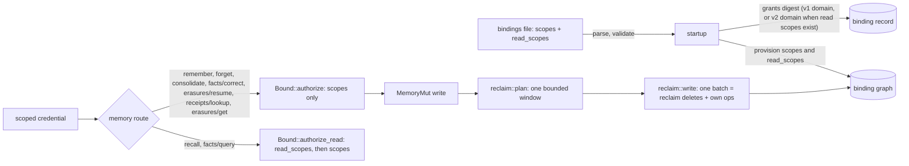
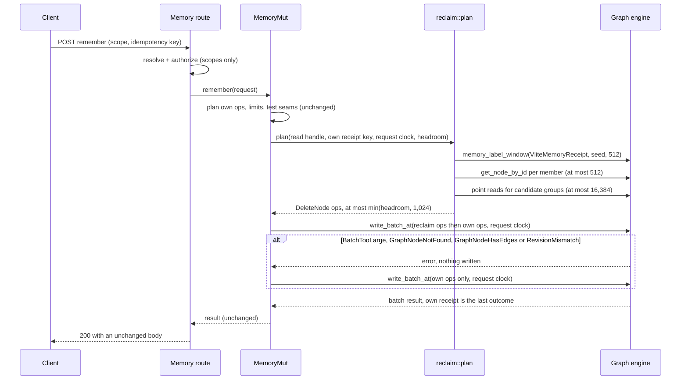

# Introduction

VLite agent memory (MemoryAI) serves the opt-in `/v1/memory/{binding}/...` REST routes. A restart-only bindings file declares each binding: its graph, an optional evidence collection, a receipt window and its grants. A grant maps a credential ID (`principal`) to exact scopes, with an optional `raw_access` flag. Today every granted scope is read-write. As a result, an agent session that must remember personal facts can also overwrite the reviewed, shared memory it should only read. In addition, every write stores a receipt and its outcome chunks so that retries are idempotent, and nothing ever deletes these nodes. Expired receipts therefore accumulate in the binding graph for as long as the binding exists.

This PRD plans exactly two hardening features and the documentation they need:

1. **Per-scope read/write grants.** A new optional `read_scopes` list on a grant lets a session credential write its personal scope while it only reads reviewed tenant or shared scopes. A separate publisher credential writes the shared scopes. Publisher setup is documented operator configuration, not a live settings change.
2. **Bounded reclamation of expired write receipts.** Successful memory writes delete, in the same atomic batch, a bounded number of receipt groups (a receipt plus its outcome chunks) that expired at least five minutes earlier. This includes receipts written by earlier releases. The configured retry window stays intact.

The key words "MUST", "MUST NOT", "REQUIRED", "SHALL", "SHALL NOT", "SHOULD", "SHOULD NOT", "RECOMMENDED", "MAY", and "OPTIONAL" in this document are to be interpreted as described in RFC 2119.

**Cross-reference conventions**: This document uses standardized prefixes for traceability — `FR-` (functional requirements), `NFR-` (non-functional requirements), `FM-` (failure modes), `AC-` (acceptance criteria), and `RD-` (resolved decisions). When a `.req.md` exists, identifiers from that document are referenced directly.

No `.req.md` exists, so this PRD has no `FR-` or `NFR-` items. Its requirements use the Section 4 prefixes `REQ-`, `SEC-`, `CON-`, `GUD-` and `PAT-`.

**Evidence base**
- Analysis used a local checkout of `main` at commit `5d0524abaf6633e9ab068d552396ee0d50e0c4c6` (crate `vlite` 0.7.2, edition 2024, MSRV 1.89). Every `file:line` reference below is at that commit.
- No `.req.md` exists. Requirements come from the owner's direction: "lets take the MemoryAI only shortlist features for next improvements". The owner chose the focused PRD for these two features and delegated the remaining decisions.
- Baseline test run at that commit: `cargo nextest run --locked --features server --lib -E 'test(memory::)'` passed all 455 selected tests (1,098 filtered out).
- Baseline mutation-ledger anchors at that commit. `python tests/mutant_replay.py plan --root . --ledger <ledger> --shards 1` reports `"stale":0` for each of the four replayable ledgers, with these counts:
  - `tests/memory_followup_mutants.json`: `"count":257`;
  - `tests/k71_mutants.json`: `"count":206`;
  - `tests/f3_mutants.json`: `"count":66`;
  - `tests/f2_mutants.json`: `"count":72`.

  `tests/reserved_resource_mutants.json` is a campaign record, and the replay tool refuses it by design (`test_the_reserved_resource_ledger_is_refused` in `tests/mutant_replay_selftest.py`).

## 1. Goals and Non-Goals

- **G1:** One binding serves two roles.
  - A session credential writes its personal scope and reads reviewed shared scopes, but cannot write, look up receipts in, replay into or query erasure status of a shared scope.
  - A publisher credential writes the shared scopes.
- **G2:** Later writes remove expired receipt groups from the current graph state, including groups written by 0.7.x releases. Each write does a bounded step, and no fixed set of ineligible receipts can block the rest. A receipt is never removed before its expiry plus a 5-minute grace.
- **G3:** The following stay unchanged, and existing files start without a new generation:
  - existing bindings files, stored binding records and grants digests;
  - wire formats, routes, error codes and limits;
  - gates and the restart/generation mechanism.

### In Scope
- The optional grant field `read_scopes`, with its validation, model, grants digest, rotation, provisioning and authorization (EPIC-001). This is the only new configuration surface; it is restart-only like every binding field.
- The `reclaim` module, its three write hooks (remember, forget, consolidate) and one crate-private read helper over the existing graph label index, with bounded reads, atomic batches and a single fallback (EPIC-002). These are the smallest write-path changes that satisfy G2. The helper changes no engine code, storage format or public API.
- Unit tests, in-crate REST pins, restart integration tests, the independent Python oracle and two golden records. Every requirement needs deterministic proof.
- Updates to `docs/MEMORY.md`, `docs/API.md`, `docs/SECURITY.md` and the nine memory-route Access cells in `site/api.html` (EPIC-003). Operators configure publishers from documentation only.

### Out of Scope (deferred)
- Hot onboarding or reload of bindings — the file, restart and generation mechanism stays.
- A self-service binding registry, and dashboard or admin aggregate changes — these are separate products.
- New routes, search APIs, maintenance routes or MCP tools — reclamation needs none, and every route would need new guard coverage.
- Git integration, F1 engine work and benchmarks — these are unrelated or separate efforts.
- Lowering a policy gate, editing `deploy/azure-container-apps`, live settings changes, release notes, version bumps, releases and deployments — the owner excluded them.
- An idle-time, startup or background sweep, or a persistent scan cursor — writes are the only bounded, already-locked mutation point (RD-011).
- Secure erasure, disk shrink and compaction scheduling — reclamation removes current graph state only. The existing compaction tool is the operator's choice.
- Receipts of retired or idle bindings — they receive no writes. Documented.
- Read-scope access to `receipts/lookup` and `erasures/get` — readers are not peers (RD-006).
- E1 (erasure) receipts and erasure job nodes — the erasure barrier is permanent by design (`src/memory/erasure.rs:1-6`).
- Graph-level TTL on receipt nodes (`SetNodeExpiry`) — rejected in Section 11.
- Additions to `scripts/memory_live_e2e.py` — a follow-up after release, not needed to prove behavior.
- The optional reliability assessment and its follow-ups — tracked separately and conditional on both features finishing.

## 2. Terminology

| Term | Definition |
|---|---|
| Binding | One entry of the bindings file: name, tenant, generation, state, graph, optional evidence collection, receipt window and grants (`src/memory/binding.rs:49-60`). |
| Grant | `src/memory/binding.rs:38-47`: `principal` (12-character credential ID), `scopes`, `raw_access`. This PRD adds `read_scopes`. It is different from the credential grant in `src/server/credentials.rs`. |
| Credential grant | A scoped credential's ordinary permissions, such as `graph_read`, `graph_write`, and `read`, `search` and `write` on collections. These are checked before any binding grant. |
| Exact scope | A `MemoryScope` tuple (tenant, agent, optional user, optional session), matched exactly, with no parent or child fallback (`routes.rs:271-278`). |
| Read-write scope | A scope listed in a grant's `scopes`. It allows every memory route. |
| Read scope | A scope listed in a grant's `read_scopes`. It allows only `recall` and `facts/query`. |
| Pure reader | A grant with `scopes: []` and a non-empty `read_scopes`. |
| Publisher | The operator's credential whose grant lists the reviewed shared scopes in `scopes`. |
| Session credential | An agent's credential: personal scopes in `scopes`, shared scopes in `read_scopes`. |
| Binding record | The node in the bound graph that stores a binding's identity, generation and grants digest (`src/memory/binding/record.rs`). |
| Grants digest | `v1:` followed by the lowercase hex SHA-256 of a framed encoding of the grants (`record.rs:63-77`). Startup compares it to detect a grant change (rule 2). |
| Receipt | A `VliteMemoryReceipt` node keyed `receipt:v1:{scope_key}:{64 hex}` that records a write's request digest and `expires_at_ms`. Retries are answered from it until it expires (`src/memory.rs:1607-1630`). |
| Outcome chunk | A `VliteMemoryReceiptOutcome` node keyed `receipt-outcome:v1:{sha256hex(receipt key)}:{index:04x}` that holds up to 4,096 bytes of the stored outcome (`memory.rs:1796-1800`, `1962-2000`). |
| Receipt group | One receipt plus chunks `0..N-1` (`N` = `outcome_chunks`), plus any surplus chunks `N..` left by an earlier, longer outcome under the same key. |
| A2, C1 and E1 receipts | The receipt shapes written by remember and forget (A2), consolidate (C1, `consolidate.rs:395-410`) and erasure (E1, `erasure.rs:75-96`). |
| Retry window | `receipt_window_ms` (1 ms to 30 days). A receipt's `expires_at_ms` is the request clock plus the window. |
| Grace | `RECEIPT_RECLAIM_GRACE_MS` = 300,000 ms. A group becomes eligible when the request clock is at least `expires_at_ms + grace`. |
| Request clock | `request.now_ms`, the clock the receipt lookup and replay decision already use. |
| Headroom | Batch entries a write leaves free: `MAX_OPS` (4,096) minus that write's own operation budget. |
| Window | The at most 512 `VliteMemoryReceipt` label members that one write examines: ascending node ID from the window start, then wrapping once to the lowest ID. |
| Window seed | The `view_sequence` of the planning read handle, multiplied (wrapping) by `0x9E37_79B9_7F4A_7C15`. The window start is `seed % next_node_id`, so seed 0 starts at the lowest ID (the scan front). |
| Receipt reused in place | A receipt that a retry after its expiry overwrites (`UpsertNode` with `Expected::Revision`: `memory.rs:509-515` and `804-810`, `consolidate.rs:484-500`). It keeps its node ID (`engine/mutate.rs:382-401`), so a receipt's position in the label index says nothing about its expiry. |

## 3. Solution Architecture

### 3.1 Overview





### 3.2 Feature 1: per-scope read grants

**File format.** `GrantEntry` (`binding.rs:411-418`, `deny_unknown_fields`) gains `#[serde(default)] read_scopes: Vec<ScopeEntry>`. `ScopeEntry` (`binding.rs:420-428`) is reused unchanged. `scopes` stays required.

```json
"grants": [
  {"principal": "abcdefghij27", "scopes": [{"agent": "assistant", "user": "ada"}], "read_scopes": [{"agent": "assistant"}]},
  {"principal": "uvwxyzabcd27", "scopes": [{"agent": "assistant"}]}
]
```

**Validation** (`Binding::validate`, `binding.rs:117-169`). The startup message for every refusal is the existing `memory bindings file is invalid`.

| Input | Result |
|---|---|
| `read_scopes` absent | `[]` |
| `read_scopes: []` | `[]`; digest and startup behavior identical to absent |
| `read_scopes: null`, a non-array, or an entry with `tenant` or another unknown key | `BindingError::Malformed` (serde) |
| `scopes: []` and `read_scopes` empty or absent | `InvalidGrant` |
| `scopes: []` and `read_scopes` non-empty | valid pure reader |
| a scope repeated within `read_scopes`, or present in both lists | `InvalidGrant` (one `BTreeSet` across `scopes.iter().chain(&read_scopes)`) |
| an invalid scope in `read_scopes` (same rules as `scopes`) | `InvalidGrant` |
| `raw_access: true` with a non-empty `read_scopes` | `InvalidGrant` |
| `scopes.len() + read_scopes.len() > 256` | `TooLarge` (check at `binding.rs:133-140`) |

**Model and parse.** `Grant` gains `pub read_scopes: Vec<MemoryScope>`. `parse` (Grant literal at `binding.rs:446-460`) maps `read_scopes` exactly like `scopes`, with `tenant: tenant.clone()`. Every other `Grant` literal gains `read_scopes: Vec::new()`; all of them are in test modules:
- `binding/tests.rs` lines 25, 184, 191, 197, 202, 208, 213, 218, 229, 521;
- `record/tests.rs` 45 and 264;
- `startup/tests.rs` near 33 and 498;
- `server/guard.rs` 504 and 509;
- `server/reserved.rs` 260 and 265.

The compiler reports any site this list misses.

**Grants digest** (`record.rs:63-77`). The digest is computed in two cases:

```text
read_scoped = any grant has a non-empty read_scopes
domain      = read_scoped ? b"vlite.memory.binding.grants.v2\0" (new GRANTS_DOMAIN_V2)
                          : b"vlite.memory.binding.grants.v1\0" (GRANTS_DOMAIN, record.rs:21)
bytes = domain || u32be(grants.len)
        || for each grant: u32be(principal.len) || principal || u8(raw_access)
                           || u32be(scopes.len) || for each scope: u32be(enc.len) || enc
                           || [only if read_scoped] u32be(read_scopes.len)
                                 || for each read scope: u32be(enc.len) || enc
digest = "v1:" + lowercase hex(sha256(bytes))
```

- With no read scopes, the bytes are identical to 5d0524ab, so the golden `grants-plain` digest `v1:f567d9dd44e7c3eb2027f756c63e94a174eddf15ad38822df9931d28f11e1ee7` and every stored record stay valid.
- The `v1:` prefix stays because the record decoder accepts only `v1:` followed by 64 hex characters. This keeps records readable by older binaries after a rollback (Section 9).
- New lines MUST use identifiers that do not exist in `record.rs`, for example `read_scope` and `framed`. This keeps every mutation-ledger anchor in `record.rs` (S2-B22..S2-B29) occurring exactly once.

**Rotation and revocation.** No change to `startup.rs` or `validate_against`:
- Rule 2 (`binding.rs`, anchors S2-B52..S2-B56) already treats a digest change as a grant change. Adding, removing or moving a read scope therefore needs a higher generation, otherwise startup exits with `a memory binding changed without a higher generation`.
- A generation change with no other change stays refused.
- Revocation is: edit the file, raise the generation, restart.

**Provisioning** (`src/server/memory.rs:147`). Startup provisions the union of both lists. Without this, `recall` on a read scope that no grant writes answers 409 `memory_not_configured`.

```rust
.flat_map(|grant| grant.scopes.iter().chain(&grant.read_scopes).map(scope_tuple))
```

**Authorization** (`src/server/memory/routes.rs`):
- `Bound` (lines 203-216) gains `read_scopes: Vec<MemoryScope>`, filled in `resolve`, and only for an operation that `accepts_read_scopes`.
- `authorize` (lines 272-278) stays unchanged. A new method follows it:
  ```rust
  fn authorize_read(&self, scope: &MemoryScope) -> Result<(), Fail> {
      if self.read_scopes.contains(scope) { return Ok(()); }
      self.authorize(scope)
  }
  ```
- `recall.rs:531-533` calls `authorize_read` for every requested scope (at most 16, `recall.rs:17`).
- `refused.rs` computes `let reader = operation.accepts_read_scopes();` before `resolve` consumes `operation`. It then calls `authorize_read` when `reader` is true and `authorize` otherwise, at `refused.rs:29-33`. Its signature is unchanged (RD-016). `WireOperation::accepts_read_scopes` (`src/memory/mapping.rs`) is an exhaustive match: only `Recall` and `FindFacts` accept read scopes, and a new operation does not compile until it is classified. `resolve` fills `Bound.read_scopes` only for those operations, so every other route authorizes against `scopes` alone.
- `write()` (`routes.rs:710`) and `receipt.rs:29` stay unchanged.

**Route matrix.** Credential permissions and evidence operations are unchanged. A 403 is `forbidden_scope`, byte-identical for a read scope, an ungranted scope and an unknown binding. The check order is unchanged.

| Route | Credential op | Evidence ops | Accepted scope lists |
|---|---|---|---|
| remember, forget, facts/correct, erasures/resume | `graph_write` | write | `scopes` |
| consolidate | `graph_write` | none | `scopes` |
| recall | `graph_read` | read, search | `read_scopes` or `scopes`, for every requested scope |
| facts/query | `graph_read` | read | `read_scopes` or `scopes`, then the binding's 409 `memory_capability_unavailable`, byte-identical to a writer's |
| receipts/lookup | `graph_read` | none | `scopes` (readers are not peers) |
| erasures/get | `graph_read` | none | `scopes` (readers are not peers) |

**Bypass analysis.**

| Path | Possible misuse by a reader | Why it is closed |
|---|---|---|
| Write routes | Write into a read scope | `authorize` checks `scopes` only; 403 comes before body semantics and before any receipt read |
| Idempotent replay and `receipts/lookup` | Read or replay a publisher's receipt | Lookup uses `authorize` (`receipt.rs:29`). Write routes authorize before the receipt read. Receipt keys embed the scope key. |
| consolidate and forget naming shared IDs | Read or delete shared memories by ID | Memory keys embed the request scope (`mem:v1:{scope}:…`, `memory.rs:1603`), so another scope's ID answers like a missing one |
| Evidence references | Attach or reach shared evidence | They need `raw_access` (`routes.rs`, anchor S6-A01), which `read_scopes` excludes |
| Raw graph, collection, record, search, export, feed and attachment routes; changes; webhooks | Read or write the bound graph directly | Reserved resources answer as missing without `raw_access` (`src/server/reserved.rs`); `raw_access` with `read_scopes` is invalid |
| `raw_access` on another binding | Reach this binding's graph | Raw access is checked against the grant of the binding that owns the resource (`src/server/reserved.rs:76-80`), and two bindings never share a graph or collection (`BindingError::SharedStorage`, `binding.rs:226-228`) |
| gRPC, MCP, admin token, read-only token, dashboard | Any | gRPC serves no memory routes. When it is built, it adopts the memory reservations the REST router published and applies them (`src/server.rs:193-205`), so reserved resources answer as missing there too unless the caller has `raw_access`. Building a reserving REST router after a gRPC router is refused (`src/server.rs:352-360`). A `read_scopes` grant cannot carry `raw_access`. MCP proxies REST with the caller's credential. The admin token, the read-only token and dashboard sessions hold no binding grant, and they never have raw access to a reserved resource (`src/server/reserved.rs:74-80`) |

### 3.3 Feature 2: bounded receipt reclamation

**Constants** (new, in `src/memory/reclaim.rs`):

| Constant | Value | Purpose |
|---|---|---|
| `RECEIPT_RECLAIM_GRACE_MS` | `300_000` | Minimum time after `expires_at_ms` before deletion (RD-010) |
| `RECLAIM_SCAN` | `512` | Label members visited per write (the window size) |
| `RECLAIM_SEED_MULTIPLIER` | `0x9E37_79B9_7F4A_7C15` | Spreads the window starts of successive commits over the node ID space (RD-011) |
| `RECLAIM_MAX_OPS` | `1_024` | Delete operations per write, except the first group (RD-012) |
| `RECLAIM_MAX_READS` | `16_384` | Point reads per write after discovery; covers the worst single group (12,292 reads) |

Existing limits are unchanged:
- `MAX_OPS` = `MAX_BATCH_ENTRIES` = 4,096 (`memory.rs:74`);
- the 16 MiB frame;
- 4,096-byte outcome chunks;
- at most `MAX_BODY_BYTES.div_ceil(MAX_STRING_VALUE_BYTES)` = 4,096 chunks per receipt, the bound `decode_outcome` enforces (`memory.rs:2002-2006`).

**Module and API.** Add `mod reclaim;` after `mod receipt;` (`memory.rs:31`). Tests go in `src/memory/reclaim/tests.rs`. These `src/memory/consolidate.rs` items become `pub(super)`:
- `SCHEMA` (line 21);
- `Field` (362) and `exact_node` (368);
- `text` (381) and `integer` (388);
- `RECEIPT_FIELDS` (395) and `OUTCOME_FIELDS` (405).

`digest_shaped` (306), `canonical_decimal` (315) and `erasure::barrier` (`erasure.rs:315`) are already `pub(super)`. Private items of `memory.rs` (labels, `receipt_outcome_key`, `MAX_OPS`) are visible to the child module.

```rust
pub(super) struct Limits { pub(super) scan: usize, pub(super) max_ops: usize, pub(super) max_reads: usize }
impl Limits {
    pub(super) const DEFAULT: Limits = Limits { scan: RECLAIM_SCAN, max_ops: RECLAIM_MAX_OPS, max_reads: RECLAIM_MAX_READS };
}
// plan: plan_with(.., read.view_sequence().wrapping_mul(RECLAIM_SEED_MULTIPLIER), Limits::DEFAULT)
pub(super) fn plan(read: &GraphRef<'_>, own_receipt_key: &str, now_ms: u64, headroom: usize) -> Vec<GraphOp>;
pub(super) fn plan_with(read: &GraphRef<'_>, own_receipt_key: &str, now_ms: u64, headroom: usize, seed: u64, limits: Limits) -> Vec<GraphOp>;
pub(super) fn write(db: &mut Database, graph: &str, reclaim: Vec<GraphOp>, ops: Vec<GraphOp>, now_ms: u64) -> crate::Result<GraphBatchResult>;
```

**Window helper** (`src/property_graph/mod.rs`). Add it after `memory_scan_bound` (line 197), next to the other crate-private `memory_*` read helpers:

```rust
/// At most `limit` IDs of the nodes labelled `label`: ascending from
/// `seed % next_node_id`, then wrapping once to the lowest ID. Every member
/// visited counts toward `limit`, hidden or not. For the memory receipt reclaimer.
pub(crate) fn memory_label_window(&self, label: &str, seed: u64, limit: usize) -> Vec<u64> {
    let next = self.graph.next_node_id();
    let start = if next == 0 { 0 } else { seed % next };
    let after = start.checked_sub(1).map(engine::NodeId);
    self.graph
        .label_scan(label, after)
        .chain(self.graph.label_scan(label, None).take_while(move |id| id.0 < start))
        .take(limit)
        .map(|id| id.0)
        .collect()
}
```

- It reads only the existing label index, through `Graph::label_scan` (a `BTreeSet` range, `engine/state.rs:296-307`), and `Graph::next_node_id` (`state.rs:254-256`).
- It costs one range seek per part plus at most `limit` steps.
- Every member ID is below `next_node_id`, so the two parts are disjoint and visit each member at most once.
- No engine code, storage format, cursor or public API changes. Existing lines of `mod.rs` stay unchanged.

**Discovery.** `plan_with` visits one window per write:

```rust
for id in read.memory_label_window(LABEL_RECEIPT, seed, limits.scan) {
    let Ok(found) = read.get_node_by_id(id) else { break }; // a read error stops planning
    let Some(receipt) = found.output else { continue };     // hidden at the request clock
    // rules 1-12, then the budgets and order below
}
```

- The window visits at most `scan` (512) members. Hidden members count toward it, so the cost never depends on what is hidden.
- These `get_node_by_id` reads are bounded by `scan` and are not charged to `max_reads`. A read error here stops planning like any other read error (see the budgets below).
- The seed changes with every commit, so successive writes examine different windows.
  - A member is in the window of any write whose start lies above the 512th member below it and at or below its own ID.
  - So no fixed set of receipts can hide an eligible group from every later write, whether they are live, reused in place, corrupt or barred (RD-011).
- Seed 0 gives the 512 lowest members, which is the scan front. Tests pass explicit seeds to `plan_with`.
- Erasure job nodes share the `receipt:v1:` key prefix but carry the label `VliteMemoryErasureJob`, so they are never in the window.

**Eligibility.** Every rule must hold, otherwise the group is skipped:

1. The receipt key differs from the writing request's own receipt key.
2. The receipt has no graph expiry (`expires_at_ms` of the node is `None`).
3. The shape is exact, through `exact_node`:
   - A2 is exactly one label `VliteMemoryReceipt` and exactly the properties `scope`, `digest` and `expires_at_ms` (strings) and `outcome_chunks` (integer);
   - C1 is `RECEIPT_FIELDS`, with `c1_schema` == `SCHEMA` and `outcome_chunks` == 1;
   - E1 and every other shape is skipped.
4. `scope` is `scope:v1:` followed by 64 lowercase hex characters.
5. The key equals `receipt:v1:` + `scope` + `:` + 64 lowercase hex characters.
6. `digest_shaped(digest)` holds.
7. `canonical_decimal(expires_at_ms, 20)` holds and the value parses as `u64`.
8. `1 <= N <= 4,096`, where `N` = `outcome_chunks`.
9. `now_ms >= expires_at_ms.checked_add(RECEIPT_RECLAIM_GRACE_MS)`. On overflow the receipt is never eligible.
10. `erasure::barrier(read, scope)` is `Ok(None)`. The result is cached per scope for the write.
11. Chunks:
    - for every `i` in `0..N`, `receipt_outcome_key(key, i)` exists, has the exact `OUTCOME_FIELDS` shape and one `VliteMemoryReceiptOutcome` label, and has `receipt_key` == key, `index` == i and no graph expiry;
    - surplus chunks are probed from `N` upward, while `i < 4,096`, up to the first missing index; each must satisfy the same rule;
    - any mismatch skips the whole group.
12. Every node of the group has no edges (`neighbors` with `NodeSelector::key`, `Direction::Both`, `types: None`, `limit: Some(1)` returns no edge with `complete == true`). `GraphRef::memory_node_attachments` (`src/property_graph/mod.rs:187`) is empty for every node of the group.

**Budgets and order.**
- The window is read only when `headroom > 0`; with headroom 0, planning reads nothing. Rules 1-9 need no reads beyond the member's own `get_node_by_id`.
- `cap(planned) = headroom` while no group is planned (the first-group exception), otherwise `min(headroom, max_ops)`.
- Before reading a group's chunks, skip it if `planned + 1 + N > cap(planned)`.
- After reading, accept it only if `planned + 1 + N + surplus <= cap(planned)`.
- Point reads are counted: chunk `get_node`, `neighbors`, attachments and uncached barriers.
- If the next read would exceed `max_reads`, or any read returns an error, planning stops. It returns only the groups completed so far and drops the partial group. The request never sees the error.
- Accepted groups become `GraphOp::DeleteNode { key, expected: Expected::Revision(revision) }`: the receipt first, then chunks in ascending index, then surplus chunks.
- Drain example: 1,500 eligible two-node groups clear in three remember writes, whatever the seeds, and no write deletes more than 1,024 nodes.
  - The first write deletes 512 groups.
  - The second deletes 511 or 512, depending on whether its window includes the first write's live receipt.
  - The third write's window holds every remaining member, so it deletes the rest.

**Combined write and fallback** (`reclaim::write`):
- An empty `reclaim` is exactly `db.graph_mut(graph)?.write_batch_at(&ops, now_ms)`, today's call.
- Otherwise the batch is `reclaim` followed by `ops`, so the request's own receipt stays the last outcome. Remember and forget read `outcomes.last()`; consolidate reads `revision` and `outcomes.last()`.
- If that attempt returns `Error::BatchTooLarge`, `Error::GraphNodeNotFound`, `Error::GraphNodeHasEdges { .. }` or `Error::RevisionMismatch { .. }` (all pre-frame, `src/property_graph/convert.rs:145-163`), the write is retried exactly once with `ops` alone. The own operations are recovered with `Vec::split_off`, never cloned.
- Every other error is returned unchanged.
- A `#[cfg(test)] thread_local! FAIL_RECLAIM_ATTEMPT: Cell<Option<fn() -> crate::Error>>` seam makes the first combined attempt return the given error without calling the engine.

**Hooks** (successful, non-replayed writes only):

| Path | Replace | Own key | Headroom |
|---|---|---|---|
| remember | `memory.rs:556-559`, after the `BUMP_BEFORE_WRITE_BATCH` and `FAIL_NEXT_WRITE_BATCH` seams | `receipt_key` | `MAX_OPS - max(ops.len(), planned.budget_operations + 1 + outcome_chunk_count)` |
| forget | `memory.rs:822-825` | `key` | `MAX_OPS - (ops.len() + guard_operations)` |
| consolidate | `consolidate.rs:767`, after `debug_assert_eq!(ops.len(), physical)` | `receipt_key`, cloned before the final `put_node` moves it | `MAX_OPS - logical` |

- Each hook calls `reclaim::commit` (RD-019), which plans with a read handle `with_clock(request clock)` and passes the request clock to `write`.
- Headroom uses `saturating_sub`, and it is computed after the existing `OperationLimit` checks, so the combined batch never exceeds `MAX_OPS`.
- These are never hooked: erasure, replays, refusals, failed requests, recall, lookups, startup, binding-record writes and read-only databases.
- The response, the `logical_operations` value, the audit events and the error mapping are unchanged.

**Guarantees and non-guarantees.**
- Deletion is atomic with the write. It is deterministic on replay, because the frame carries explicit deletes.
- It removes current graph state only. The log and backups keep the bytes until compaction, and nothing is wiped securely or swept while idle. No replica receives the deletes while a binding is configured: replication export answers 403.
- Receipt lookups answer the same before and after deletion: an expired receipt already answers like a missing one.
- Reclaim deletes are ordinary `DeleteNode` operations of the write's own batch.
  - Replicas and backups receive them like any other write.
  - The change feed, the gRPC change streams and webhooks show them exactly where they already show the binding graph's other writes: only to credentials with `raw_access` on the binding. The feed rule hides a reserved graph's events from every other caller, including the admin token (`src/server/guard.rs:217-235`, `src/server/reserved.rs:74-80`).

### 3.4 Implementation ownership

The two features touch disjoint files and can be built in parallel from `5d0524ab`. Shared integration and every documentation change are serialized after both merge. EPIC-001 is not split further, because every one of its items depends on the new `Grant` field compiling.

| Owner | Work | Start | Exclusive files |
|---|---|---|---|
| Owner A | EPIC-001 (ITEM-001..ITEM-006) | Immediately, from `5d0524ab` | FILE-001..FILE-015 |
| Owner B | EPIC-002 (ITEM-007..ITEM-013) | Immediately, from `5d0524ab` | FILE-016..FILE-021 |
| Integrator | EPIC-003 (ITEM-014..ITEM-020) | After both epics pass their gates | FILE-022..FILE-026; merges both branches in either order |

Neither owner edits another owner's files, `Cargo.toml`, `Cargo.lock`, the mutation ledgers or the docs. A needed change outside an owner's list goes to the Integrator.

### 3.5 Failure modes

| ID | Failure | Effect | Handling | Verified by |
|---|---|---|---|---|
| FM-001 | A binary without this feature starts with a file that uses `read_scopes` | Startup refuses: `memory bindings file is invalid` | Fails closed; rollback in Section 9 | Existing `deny_unknown_fields`; AC-002 |
| FM-002 | Read scopes change without a higher generation | Startup refuses: `a memory binding changed without a higher generation` | The operator raises the generation | AC-004 |
| FM-003 | `raw_access` combined with `read_scopes` | Startup refuses: `memory bindings file is invalid` | The publisher, not the reader, holds `raw_access` | AC-002, AC-010 |
| FM-004 | A reader calls a write route, `receipts/lookup` or `erasures/get` on a read scope | 403 `forbidden_scope`, byte-identical to an ungranted scope | None needed | AC-005, AC-006 |
| FM-005 | A reader calls raw graph or collection routes | Reserved resources answer as missing (unchanged) | `raw_access` with `read_scopes` is invalid | AC-010 |
| FM-006 | The combined batch fails with a planning error | Nothing is written | One retry with own ops; the outcome is identical to today | AC-015 |
| FM-007 | The combined frame exceeds 16 MiB | `BatchTooLarge`; nothing is written | Same single retry | AC-015 |
| FM-008 | The own ops fail (key conflict, I/O, any other error) | The request fails as today | The error is returned unchanged; nothing is reclaimed | AC-015, AC-016 |
| FM-009 | Crash during a reclaiming write | After reopen the frame is absent or complete | Existing frame atomicity | AC-016 |
| FM-010 | A read error or the read budget runs out while planning | Planning stops | Completed groups are kept; the error is not surfaced | AC-014 |
| FM-011 | The request clock steps forward by more than the grace | Receipts are deleted early by up to the step size; a retry after a later step back runs again instead of replaying | The grace absorbs normal steps; documented in the memory guide (Receipts and retries) and SECURITY.md (Known limits), which ask for a monotonic server clock | AC-011 |
| FM-012 | A corrupt or unexpected receipt-like node | Never reclaimed | A `raw_access` holder may delete reserved nodes by key (`src/memory/names/tests.rs:241-248`) | AC-013 |
| FM-013 | A window holds no eligible group: live receipts, receipts reused in place, corrupt receipts or barred scopes | That write reclaims nothing | The next commit moves the window start. No fixed set of receipts can block an eligible group from every later window (RD-011). Corrupt receipts also have the FM-012 remedy. Barred scopes and E1 receipts cannot come from served routes at 5d0524ab, because `begin_erasure` (`erasure.rs:364`) has only test callers | AC-020, AC-024 |
| FM-014 | A scope behind an erasure barrier | Its receipts are skipped | By design | AC-013 |
| FM-015 | Downgrade after reclamation | Deleted receipts answer 404, as an expired receipt does | No format change | AC-018 |

## 4. Requirements

**Summary**: The grant model gains `read_scopes`. Only `recall` and `facts/query` honor read scopes. The grants digest is unchanged for existing files. Writes reclaim bounded, exact, expired receipt groups atomically, and nothing else in the wire contract, limits or gates changes.

**Items**:
- **REQ-001**: A grant entry MUST accept an optional `read_scopes` array of scope entries with exactly the `scopes` entry fields. Absent MUST mean empty.
- **REQ-002**: Validation MUST return `InvalidGrant` for:
  - a grant whose two lists are both empty;
  - a scope repeated within or across the lists;
  - an invalid read scope;
  - `raw_access: true` with a non-empty `read_scopes`.

  It MUST accept `scopes: []` with a non-empty `read_scopes`.
- **REQ-003**: The per-grant cap of 256 MUST apply to `scopes.len() + read_scopes.len()` (`TooLarge`).
- **REQ-004**: The grants digest MUST be byte-identical to 5d0524ab for every binding whose grants have no read scopes. Otherwise it MUST use the v2 domain and per-grant read-scope framing of Section 3.2, and keep the `v1:` prefix.
- **REQ-005**: Any read-scope change MUST need a higher generation. A generation change with no other change MUST stay refused.
- **REQ-006**: Startup MUST provision every scope in `scopes` or `read_scopes` of an active binding.
- **REQ-007**: `recall` (every requested scope) and `facts/query` MUST accept a scope in `read_scopes` or `scopes`.
- **REQ-008**: `remember`, `forget`, `consolidate`, `facts/correct`, `erasures/resume`, `receipts/lookup` and `erasures/get` MUST accept only scopes in `scopes`.
- **REQ-009**: A read scope on a REQ-008 route MUST answer exactly as an ungranted scope does: same status, body and check order.
- **REQ-010**: After a read scope is removed (higher generation, restart), `recall` on it MUST answer 403 `forbidden_scope`.
- **REQ-011**: Reclamation MUST run only inside successful, non-replayed remember, forget and consolidate writes, in the same batch as the request's own operations.
- **REQ-012**: Reclamation MUST delete only complete receipt groups that satisfy every rule of Section 3.3.
- **REQ-013**: A group MUST NOT be deleted unless `request clock >= expires_at_ms + 300,000`.
- **REQ-014**: Per write, reclamation MUST be bounded:
  - at most one window of at most 512 label members, read with at most 512 `get_node_by_id` calls;
  - at most 16,384 further point reads;
  - at most `min(headroom, 1,024)` deletes, except one first group of at most `headroom`;
  - no reads when the headroom is 0.
- **REQ-015**: Reclaim deletes MUST precede the own operations in one batch. The response MUST be unchanged.
- **REQ-016**: The four errors of Section 3.3 from the combined attempt MUST cause exactly one retry with own operations. Other errors MUST be returned unchanged.
- **REQ-017**: Reads, lookups, replays, refusals, failed requests, erasure, startup and read-only databases MUST NOT reclaim.
- **REQ-018**: A2 and C1 receipts written by 0.7.0-0.7.2 MUST be reclaimable without migration or format change. E1 receipts MUST NOT be reclaimed.
- **REQ-019**: The docs MUST describe:
  - `read_scopes` and the publisher/session setup;
  - reader limits;
  - reclamation timing, bounds and idle bindings;
  - the not-erasure caveat;
  - where reclaim deletes are visible (feed and webhooks; no replica receives them while a binding is configured);
  - the monotonic-clock caution, the per-write cost and the missing switch (FM-011, RISK-005, RISK-012);
  - rollback.
- **REQ-020**: The window MUST start at `seed % next_node_id` and wrap once. The seed MUST derive from the planning handle's `view_sequence`, so no fixed set of ineligible receipts can keep an eligible group out of every later window. Seed 0 MUST give the 512 lowest members.
- **SEC-001**: A grant with read scopes MUST NOT hold `raw_access`.
- **SEC-002**: Readers are not peers. A read scope MUST NOT allow writes, receipt lookup, replay or erasure status.
- **SEC-003**: Errors MUST NOT reveal grants, scopes, bindings or receipt existence. Reclamation MUST NOT change any lookup status or body.
- **SEC-004**: Startup refusals MUST use only the existing fixed messages and never echo file content.
- **SEC-005**: Reclamation MUST touch only exact receipt groups in the graph of the binding being written. It MUST NOT touch memories, evidence, scope nodes, binding records, erasure jobs or E1 receipts.
- **SEC-006**: The docs MUST state that reclamation is not secure erasure.
- **CON-001**: The following MUST NOT change: routes, wire fields, error codes, OpenAPI operations, MCP tools and `data-api` entries.
- **CON-002**: Bindings MUST stay restart-only, with the existing generation rules.
- **CON-003**: The binding record schema and the `v1:` digest prefix MUST NOT change.
- **CON-004**: Existing limits MUST NOT change: `MAX_OPS`, the frame size, the window range, the 1 MiB file cap, and 256 bindings, 1,024 grants and 256 scopes.
- **CON-005**: No new dependencies are allowed, and `Cargo.toml` and `Cargo.lock` MUST NOT change. MSRV 1.89 and edition 2024 apply.
- **CON-006**: Mutation ledgers, gates and existing fixtures MUST NOT change, except for the two new golden records. Every anchor of the four replayable ledgers (`tests/memory_followup_mutants.json`, `tests/k71_mutants.json`, `tests/f3_mutants.json`, `tests/f2_mutants.json`) MUST keep occurring exactly once. This includes the f3 anchor `.all(|resource| self.owners.contains_key(resource))` at `src/server/reserved.rs:159`, in a file where only test literals change (FILE-014).
- **CON-007**: These are out of scope: `deploy/`, release notes, version bumps, releases, deployments and live settings changes.
- **CON-008**: Committed content MUST NOT contain private infrastructure names or links.
- **GUD-001**: Work test-first in each item: write the failing tests, implement, then run the item's commands.
- **GUD-002**: The Python oracle MUST stay independent of the Rust code. Golden expected values come only from the oracle.
- **GUD-003**: Never weaken an existing test. A test whose expectation legitimately changes is updated to assert the new behavior and listed in the pull request.
- **PAT-001**: `read_scopes` follows the `raw_access` optional-field pattern (`#[serde(default)]`, strict type, `raw_access_is_a_strict_optional_bool` tests).
- **PAT-002**: Route pins use the in-crate Rig of `pins_remember.rs` and `pins_receipts.rs`. Restart behavior uses `tests/server_memory_binding_record.rs`.
- **PAT-003**: Test seams are `#[cfg(test)] thread_local!` cells, like `BUMP_BEFORE_WRITE_BATCH` and `FAIL_NEXT_WRITE_BATCH`.

## 5. Risk Classification

**Risk**: 🟡 MEDIUM — the change touches authorization and the write path of a shipped feature. It is contained:
- additive configuration with fail-closed defaults;
- no format or wire change;
- deletes that are atomic and limited to already-invisible data;
- disjoint epics with targeted gates.

- **RISK-001** (Medium): An operator lists the shared scope in a session's `scopes` and so grants writes. Mitigation: a documented example, docs that call write scopes trusted, and the generation needed for every change.
- **RISK-002** (Low): Older binaries refuse files with `read_scopes`. Mitigation: documented rollback (Section 9).
- **RISK-003** (Low): Edits break mutation-ledger anchors. Mitigation: distinct identifiers, and `"stale":0` in all four ledger plans of every gate (AC-022).
- **RISK-004** (Medium): A receipt that is still needed is deleted. Mitigation:
  - the 5-minute grace on the request clock;
  - exact shapes;
  - the own-key exclusion;
  - edge, attachment and barrier checks;
  - AC-011 and AC-013.
- **RISK-005** (Medium): Write latency grows by one 512-member window (an index range plus at most 512 `get_node_by_id` calls) and by point reads for candidate groups. Mitigation: fixed caps, and point reads only after rules 1-9 pass. Benchmarks are out of scope for this release; measure the cost at the next major release's benchmark campaign and tune the constants then if needed (follow-up). The scan covers every scope of the binding and runs under the write lock that the whole database shares; the docs say so.
- **RISK-006** (Low): Clock steps larger than the grace (FM-011). Mitigation: documented in the memory guide and SECURITY.md (keep the server clock monotonic).
- **RISK-007** (Low): Reclamation is slow when eligible groups are rare among the label members (FM-013). This happens when most members are live or reused in place, or when receipt IDs cluster so that many starts wrap to the same members. Mitigation:
  - every write examines a fresh seeded window, and every member is reachable;
  - with evenly interleaved IDs, a write deletes on average 512 × (eligible share) groups and adds at most one receipt, so the expected backlog settles near 1/512 of all receipts;
  - AC-020 and AC-024 prove the mechanism.

  A persistent cursor is a follow-up only if measured progress is too slow.
- **RISK-008** (Low): Write latency reveals roughly how many expired receipts exist in other scopes of the same binding. Accepted: those receipts are already invisible, and the binding is the trust boundary.
- **RISK-009** (Low): Deleted receipts persist in logs and backups until compaction. No replica receives them while a binding is configured, because replication export answers 403. Mitigation: SEC-006 docs.
- **RISK-010** (Low): An existing test expects expired receipt nodes to persist. Mitigation: a scan at 5d0524ab found none, and GUD-003 applies.
- **RISK-011** (Low): A surplus chunk of a receipt (a chunk beyond `outcome_chunks`) is probed only up to the first missing index, up to 4,096 chunks, and only while it is visible at the request clock. A surplus chunk behind a gap, past that limit or hidden by its own expiry is never found and stays in the graph after its receipt is reclaimed. This costs storage only, and only a raw graph write can create such a chunk, because the served routes write contiguous chunks. Accepted; a comment in `Reader::group` records it.
- **RISK-012** (Low): Reclamation is silent: it has no counter or log line, a fallback to the write's own operations is not reported, and a binary downgrade is the only way back, which also drops `read_scopes` (Section 9). Accepted for this release (RD-018); audit counters are a follow-up.
- **ASSUMPTION-001**: Existing files hold only the A2, C1 and E1 receipt shapes that the 0.7.0-0.7.2 encoders write.
- **ASSUMPTION-002**: Shared memory is reviewed outside VLite before the publisher writes it.
- **ASSUMPTION-003**: Operators create the publisher credential with the existing credential API.
- **ASSUMPTION-004**: Memory writes run serialized under the database write lock, so planning and writing see the same state.
- **ASSUMPTION-005**: Steps between request clocks stay below 5 minutes in normal operation.

## 6. Dependencies

- **DEP-001**: Graph batch semantics:
  - one frame per `write_batch_at`;
  - pre-frame errors leave no state;
  - `Expected::Revision` on `DeleteNode`;
  - 4,096 entries and a 16 MiB frame (`src/property_graph/mod.rs:399`, `991`; `convert.rs:145-163`).
- **DEP-002**: The graph label index and read handle. The crate-private helper uses `Graph::label_scan` (ascending `BTreeSet` range, `engine/state.rs:296-307`) and `Graph::next_node_id` (`state.rs:254-256`). The planner uses the public `GraphRef::view_sequence` (`read.rs:765`) and `GraphRef::get_node_by_id` (`read.rs:960`), which honors the handle's clock.
- **DEP-003**: Binding record, rotation and startup (`record.rs`, `binding.rs` `validate_against`, `startup.rs`), unchanged.
- **DEP-004**: The Python 3 standard library for the oracle.
- **DEP-005**: `cargo-nextest`, already used by the baseline and CI.

## 7. Quality & Testing

- **TEST-001** (`src/memory/binding/tests.rs`): new `read_scopes_is_a_strict_optional_list`, plus extensions of three existing tests:
  - `field_rules_accept_their_boundaries`: a pure reader; 255 + 1 scopes;
  - `field_rules_reject_each_bad_field`: empty lists; a duplicate within or across the lists; an invalid read scope; `raw_access` with read scopes;
  - `caps_reject_the_whole_set`: 256 + 1 across the lists.
- **TEST-002** (`src/memory/binding/record/tests.rs`): new `read_scopes_change_the_digest_only_when_present`:
  - `[]` equals absent;
  - `[g1{a, read b}, g2{c}]` differs from `[g1{a}, g2{c, read b}]`;
  - `[g{a, read b}]` differs from `[g{a, b}]`.

  The existing digest test gains two variants: a read scope added, and a scope moved to `read_scopes`. `binding_of` reads `read_scopes`; `EMPTY_GRANTS_DIGEST` is unchanged.
- **TEST-003** (`tests/memory_binding_record_oracle.py`, golden):
  - add `DOMAIN_V2` and the read-scope frame;
  - add the mutant `digest_ignores_read_scopes` to the mutant loop;
  - check programmatically that a deep copy of `grants-plain` with `read_scopes: []` gives equal properties;
  - check that `grants-read-scope` differs from `grants-plain` and that `grants-read-only` differs from `grants-read-scope`;
  - add golden records `grants-read-scope` (`scopes [{agent:c}]`, `read_scopes [{agent:d}]`) and `grants-read-only` (`scopes []`, `read_scopes [{agent:d}]`). Their expected values come from `python tests/memory_binding_record_oracle.py < entry.json`.
- **TEST-004** (`src/memory/startup/tests.rs`): new `rule_two_covers_read_scopes`:
  - an added read scope at the same generation gives `Refusal::Rotation(BindingError::GenerationNotAdvanced)`;
  - an explicit `[]` gives a plan with empty `writes`;
  - a read scope at generation 2 gives a plan with `writes == vec![0]`.
- **TEST-005** (`src/server/memory/pins_access.rs`, new). The Rig follows `pins_remember.rs:93-190` but serves one `Service` through two routers that share one `Clock`. Each router carries its own `admin::Role::Scoped` credential from `credentials::Grant::for_user`, with the same five operations as `pins_remember.rs:147-153`. The binding `notes` (graph `notes_graph`, evidence `notes_ev`) has two grants:
  - session `abcdefghij27`: `scopes [{agent:assistant, user:ada}]`, `read_scopes [{agent:assistant}, {agent:archive}]`;
  - publisher `bcdefghij234`: `scopes [{agent:assistant}]`.

  Tests:
  - `each_route_checks_the_right_scope_list`;
  - `a_read_scope_refusal_is_byte_identical_to_an_ungranted_scope_and_an_unknown_binding`;
  - `a_provisioned_read_scope_nobody_wrote_recalls_empty`;
  - `a_publisher_writes_shared_memory_and_a_session_recalls_it_with_its_own`;
  - `facts_query_on_a_read_scope_answers_like_a_writer`;
  - `a_reader_cannot_look_up_or_replay_a_publishers_receipt`;
  - `naming_a_shared_memory_from_a_personal_scope_answers_like_a_missing_one` (consolidate and forget).
- **TEST-006** (`tests/server_memory_binding_record.rs`): a new helper `grant_bindings(generation, grants_json)` and two tests:
  - `a_read_only_scope_needs_a_higher_generation_and_then_refuses_writes`:
    1. Generation 1 has `scopes [{agent:a}]`; remember key `k1`.
    2. At the same generation with `read_scopes`, startup refuses with `NOT_ADVANCED`.
    3. Generation 2 has `scopes [{agent:b}]` and `read_scopes [{agent:a}]`. Remembering in `a` gives 403; recalling `a` finds `e1`; replaying `k1` gives 403.
    4. `GET /v1/graphs/notes_graph` and `GET /v1/collections/notes_ev` answer the same (status, `error.code`) at generations 1 and 2, and neither is 200.
    5. Generation 3 without `read_scopes`: recalling `a` gives 403.
    6. `raw_access` with `read_scopes`: startup refuses with `memory bindings file is invalid`.
  - `an_explicit_empty_read_scopes_keeps_the_digest_and_needs_no_new_generation`: startup succeeds at the same generation, and the record revision and generation are unchanged.
- **TEST-007** (`src/memory/reclaim/tests.rs`, new). A file database, `create_graph("memory")`, `MemoryMut::bind` and `provision_scope`, with requests modeled on the `memory.rs` and `consolidate/tests.rs` helpers. A `legacy_group` helper writes A2 or C1 groups directly. Tests:
  - `an_expired_receipt_is_kept_until_the_grace_ends`: `expires_at_ms` 110 is kept at 300,109 and deleted at 300,110;
  - `the_writing_requests_own_receipt_is_never_reclaimed`;
  - `live_erasure_and_unrelated_nodes_are_never_touched`;
  - `a_scope_behind_an_erasure_barrier_keeps_its_receipts`;
  - `malformed_partial_or_pinned_groups_are_skipped` (a table covering every rule of Section 3.3);
  - `surplus_chunks_go_with_their_receipt_and_a_bad_surplus_skips_the_group`;
  - `budgets_bound_each_write_and_one_large_first_group_fits_the_headroom`;
  - `the_read_budget_drops_a_partial_group`;
  - `a_failed_combined_attempt_falls_back_to_the_own_operations`;
  - `a_failing_own_batch_reclaims_nothing`;
  - `reclamation_survives_reopen`;
  - `a_backlog_drains_in_bounded_writes`;
  - `the_window_starts_at_the_seed_wraps_once_and_counts_hidden_members`. With 600 receipts `r0 < … < r599` (node IDs):
    - seed 0 returns `r0..r511`;
    - seed `r500` returns `r500..r599`, then `r0..r411`;
    - seed `r500 + next_node_id` returns the same;
    - `r0..r9` get a graph deadline one hour after the wall clock (`SetNodeExpiry`; a write's clock is at least the wall clock, `src/property_graph/mod.rs:1030-1036`, so an earlier deadline would let that write remove them). Read through `with_clock(deadline)`, they are hidden, yet seed 0 still returns `r0..r511`;
    - no ID repeats;
  - `receipts_reused_in_place_cannot_hide_eligible_groups`:
    1. Remember 512 keys at clock 1,000 with a 60,000 ms window.
    2. Re-send every key at 61,001. Each receipt keeps its `NodeView::id` and gets `expires_at_ms` 121,001.
    3. Write one eligible legacy group (`expires_at_ms` 110) behind them.
    4. At request clock 300,110: `plan_with` at seed 0 plans nothing, and at the eligible receipt's ID it plans exactly that group. For every seed in `0..next_node_id`, it plans nothing else.
  - `reclaim_deletes_are_ordinary_graph_deletes_in_the_feed`: `Database::changes_after(&FeedCursor::beginning(), ..)` shows the reclaiming write as one commit. Its `ChangeKind::GraphBatch` lists a `GraphChange::NodeDeleted` for each reclaimed key, before the own operations;
  - `the_request_clock_decides`;
  - `receipts_from_all_three_encoders_are_reclaimed` (including a remember outcome of at least 2 chunks);
  - `remember_forget_and_consolidate_each_reclaim`;
  - `reads_replays_refusals_errors_and_read_only_files_mutate_nothing`.
- **TEST-008** (`src/server/memory/pins_receipts.rs`): `an_expired_receipt_is_reclaimed_by_a_later_write_and_still_answers_404`, using `std_rig` and `WINDOW` 60,000:
  1. At 1,000, forget `k` and consolidate `c` in scope `a`.
  2. At 61,000, look up the forget receipt `k` and record the response as B1 (404).
  3. At 360,999, remember in scope `b`: every group still exists (checked with `node_exists`, `node_key` and a new `outcome_key` helper).
  4. At 361,000, remember in `b` with a new key: the groups of forget `k`, of `seed-k` and of consolidate `c` are gone.
  5. The lookup equals B1.
- **TEST-009**: The existing suites pass unchanged:
  - `memory::` and `server::memory::`;
  - `server_memory_*` integration tests;
  - `server_guard_differential`;
  - `server_memory_reserved_as_missing` and `server_memory_raw_names`;
  - `graph_server_surfaces`, `rest_graph` and `graph_surface_parity`.
- **TEST-010**: `mutant_replay.py plan` reports `"stale":0` for all four replayable ledgers, with counts 257 (`memory_followup`), 206 (`k71`), 66 (`f3`) and 72 (`f2`). `python tests/mutant_replay_selftest.py` passes.
- **TEST-011**: The doc checks of ITEM-019 pass.
- **TEST-012**: The full gates of ITEM-019 pass.

### Acceptance Criteria

| ID | Criterion | Verification | Traces To |
|---|---|---|---|
| AC-001 | A grant without `read_scopes` and the same grant with `"read_scopes": []` give the digest `v1:f567d9dd44e7c3eb2027f756c63e94a174eddf15ad38822df9931d28f11e1ee7` for `grants-plain`, and start at the recorded generation without a record write | TEST-002, TEST-003, TEST-004, TEST-006 | REQ-001, REQ-004, CON-003 |
| AC-002 | Every row of the validation table returns its listed result | TEST-001 | REQ-001, REQ-002, REQ-003, SEC-001 |
| AC-003 | Both oracle self-test commands exit 0; the mutant is detected; the Rust golden test accepts both new records | TEST-002, TEST-003 | REQ-004, GUD-002 |
| AC-004 | Adding, removing or moving a read scope needs a higher generation; with one it is accepted and the record is rewritten | TEST-004, TEST-006 | REQ-005 |
| AC-005 | For the session, each of the nine routes accepts exactly the scope lists of the route matrix | TEST-005 | REQ-007, REQ-008 |
| AC-006 | On each of the seven write-only routes, a read scope gives status 403 and a body byte-identical to an ungranted scope and to an unknown binding | TEST-005 | REQ-009, SEC-002, SEC-003 |
| AC-007 | Recall on the never-written read scope `{agent: archive}` answers 200 with an empty `memories` array, not 409 | TEST-005 | REQ-006 |
| AC-008 | The publisher writes `{agent: assistant}`; the session writes its personal scope; a session recall naming both returns both memories; a session remember into the shared scope answers 403 | TEST-005 | REQ-007, REQ-008, SEC-002 |
| AC-009 | After removing the read scope at a higher generation, recall on it answers 403 `forbidden_scope` | TEST-006 | REQ-010 |
| AC-010 | `raw_access` with `read_scopes` refuses startup; raw graph and collection answers for the reader are identical with and without read scopes; TEST-009 raw suites pass | TEST-006, TEST-009 | SEC-001, REQ-008 |
| AC-011 | A group with `expires_at_ms` 110 survives at request clock 300,109 and is deleted at 300,110; a later request with an earlier clock deletes nothing its own clock does not make eligible | TEST-007 | REQ-013, FM-011 |
| AC-012 | Groups written by the unchanged remember, forget and consolidate encoders, including a multi-chunk outcome, are deleted without migration | TEST-007 | REQ-018 |
| AC-013 | These keep their exact revisions: the own key; live receipts; E1 receipts; erasure jobs; memory, scope and record nodes; barred scopes; every malformed case. An own-key retry after expiry behaves as at 5d0524ab | TEST-007 | REQ-011, REQ-012, SEC-005 |
| AC-014 | `plan_with` never exceeds `min(headroom, max_ops)` deletes, except one first group of at most `headroom`. Headroom 0 reads nothing. Discovery reads never exceed `scan`, and later point reads never exceed `max_reads`. A partial group is dropped | TEST-007 | REQ-014, FM-010 |
| AC-015 | Each of the four fallback errors through `FAIL_RECLAIM_ATTEMPT` ends in a successful own write that leaves the targets present; `InvalidQuery` is returned with the sequence unchanged | TEST-007 | REQ-016, FM-006, FM-007, FM-008 |
| AC-016 | With `FAIL_NEXT_WRITE_BATCH`, the remember fails and no target or own node changes; after a reclaiming write, reopening the file shows the same state | TEST-007 | REQ-015, FM-009 |
| AC-017 | Recall, lookup, replays, refusals, failed requests and read-only files leave the database sequence and every eligible group unchanged | TEST-007 | REQ-017 |
| AC-018 | The lookup of an expired receipt is identical in status and body before and after its deletion | TEST-008 | SEC-003, FM-015 |
| AC-019 | Three remember writes delete all 1,500 eligible two-node groups, and no write deletes more than 1,024 nodes. `plan_with` at seed 0 plans exactly the groups of the 512 lowest-ID receipts | TEST-007 | REQ-014 |
| AC-020 | Setup: 512 receipts are reused in place within the grace at the lowest IDs, with one eligible group behind them. `plan_with` at seed 0 plans nothing. At the eligible receipt's node ID, it plans exactly that group. No seed in `0..next_node_id` plans any other node | TEST-007 | REQ-014, REQ-020, FM-013 |
| AC-021 | The docs carry the content of ITEM-015..ITEM-018 and every doc check passes | TEST-011 | REQ-019, SEC-006 |
| AC-022 | The full gates pass. All four ledger plans report `"stale":0`, with counts 257, 206, 66 and 72 | TEST-010, TEST-012 | CON-001, CON-005, CON-006, GUD-003 |
| AC-023 | A reclaiming write is one commit in `Database::changes_after`, whose graph batch lists `NodeDeleted` for each reclaimed key before the own operations | TEST-007 | REQ-015, REQ-019 |
| AC-024 | `memory_label_window` starts at `seed % next_node_id` and wraps once. It returns at most `limit` IDs, never repeats one, and counts hidden members | TEST-007 | REQ-014, REQ-020 |

## 8. Security Considerations

**Data handling**:
- No new data is stored. The audit event fields and log content are unchanged, and the credential IDs in the file are not secrets.
- Reclamation deletes only already-expired, already-invisible receipt groups (SEC-005).
- Bytes remain in log segments and backups until compaction (SEC-006).
- Reclaim deletes travel in the write's own frame. Backups, the change feed and webhooks carry them exactly like the binding's other writes, and the feed shows them only to `raw_access` holders of the binding (Section 3.3). No replica receives them while a binding is configured, because replication export answers 403 (`src/server/features.rs:801-803`).

**Input validation**:
- `read_scopes` uses the strict `serde` rules and `deny_unknown_fields`, plus the validation table.
- Receipt eligibility revalidates every node shape, key, digest, decimal and chunk relation before deletion. Anything unexpected is skipped, never deleted.

**Access control**:
- Write routes, lookups and erasure status keep exact read-write authorization. Only `recall` and `facts/query` also accept read scopes.
- `raw_access` and `read_scopes` are mutually exclusive.
- 403 bodies stay byte-identical, so grants, scopes and bindings are not revealed.
- The credential's permissions and tenant checks still apply first.
- Reclamation runs with the writing request's authority inside the binding's own graph. It never extends to other bindings.

**Secrets**: none are added. No tokens are logged, and no private infrastructure names or links appear (CON-008).

## 9. Deployment & Rollback

**Deployment.** The two features ship in the next regular release; this PRD makes no version, release or deployment change. Existing bindings files start unchanged, with the same digest and no new generation. Publisher setup:
1. Create the publisher credential with the existing credential API.
2. Grant the shared scopes to the publisher in `scopes`, and to sessions in `read_scopes`.
3. Raise the binding's `generation`.
4. Restart.

**Rollback of read scopes:**
1. Remove every `read_scopes` list and every pure-reader grant.
2. Raise the generation.
3. Restart, with either binary.

The stored digest keeps the `v1:` prefix, so an older binary decodes the record and treats the change like any grant change. Starting an older binary with `read_scopes` still in the file fails closed (FM-001).

**Rollback of reclamation:** downgrade the binary. The format is unchanged, deleted receipts answer like expired ones (404), and remaining receipts stay readable by every 0.7.x binary. There is deliberately no switch to disable reclamation (RD-018). A downgrade also drops `read_scopes`, so remove every `read_scopes` list first, as above. Reclamation is silent: no counter or log line reports it or its fallback (RISK-012).

## 10. Resolved Decisions

| ID | Decision | Rationale |
|---|---|---|
| RD-001 | A separate optional `read_scopes` list on the grant | It is additive, fails closed on old binaries and leaves `scopes` semantics unchanged |
| RD-002 | Pure readers (`scopes: []`) are allowed | A dashboard or review agent may only read |
| RD-003 | A scope appears in at most one list; a write scope implies read | There is one meaning per scope and no ambiguous precedence |
| RD-004 | `raw_access` with `read_scopes` is invalid | Raw access covers every scope of the binding and would bypass read-only scopes; no new raw ACL is needed |
| RD-005 | The v2 digest domain applies only when read scopes exist; the `v1:` prefix stays | Legacy digests stay byte-identical, the two encodings are domain-separated, and rollback can still decode records |
| RD-006 | Read routes are only `recall` and `facts/query` | Receipts and erasure status belong to writers ("readers are not peers") |
| RD-007 | Read scopes are provisioned at startup | Recall answers 200 empty instead of 409, matching writers |
| RD-008 | A read-scope refusal is the same 403 as an ungranted scope | Anti-enumeration; the check order is unchanged |
| RD-009 | Reclaim deletes are prepended to the request's own batch | Atomic with no new frame type; the own receipt stays the last outcome |
| RD-010 | The grace is 300,000 ms after `expires_at_ms` | It covers clock skew between request clocks |
| RD-011 | A stateless seeded window over the label index, with no cursor or stored position | It needs no persistent state or migration. Receipts reused in place keep their node IDs, so a fixed front scan could stall for good behind them. A start derived from the view sequence reaches every member without stored state. Engine cursors cannot carry over between writes, because a cursor goes stale after any commit (`engine/cursor.rs:1-16`) |
| RD-012 | Caps of 512 window members, 1,024 deletes and 16,384 point reads, with a first-group exception up to the headroom | Bounded latency per write. A group larger than 1,024 nodes is still reclaimed as the first group of a write whose headroom fits it; a write with less headroom skips it |
| RD-013 | Exact shape, chunk, edge, attachment and barrier checks | Never delete data the planner does not fully recognize |
| RD-014 | A single fallback retry with own ops | Today's outcome is guaranteed whatever the reclaim ops do |
| RD-015 | Eligibility uses the request clock | It matches the lookup and replay decision, so deletion never precedes "expired" |
| RD-016 | `refused()` and `resolve` derive the read-scope rule from `WireOperation::accepts_read_scopes`, an exhaustive match | No new parameter and no lint exception; a new operation does not compile until it is classified, so it never gets read scopes by default |
| RD-017 | Owners A and B work in parallel on disjoint files; integration and docs are serialized | Safe parallelism with no shared-file conflicts |
| RD-018 | Publisher configuration is documentation only, and there is no reclamation switch | No live settings change; the binary is the rollback unit |
| RD-019 | The three write routes call one function, `reclaim::commit`, which plans and writes the combined batch | One place owns the hook, so remember, forget and consolidate cannot drift apart |

## 11. Alternatives Considered

| Alternative | Pros | Cons | Decision |
|---|---|---|---|
| A per-scope `mode` in `ScopeEntry` | One list | Changes the meaning of every existing scope entry and its digest framing | Rejected — legacy digest identity is harder |
| A per-grant read-only flag | Small | Cannot mix a personal write scope and a shared read scope in one credential | Rejected — fails G1 |
| Credential-level `graph_read` only | No file change | The binding check cannot tell scopes apart | Rejected — fails G1 |
| A separate binding for shared memory | No model change | Recall cannot merge two graphs; duplicated configuration | Rejected — fails G1 |
| A new raw ACL per scope | Fine-grained | A new security surface on every raw route | Rejected — RD-004 is simpler |
| Separate `read_scopes` list | Additive, fails closed | Two lists to validate | Selected — RD-001 |
| Node TTL (`SetNodeExpiry`) on receipts | Engine-native | The pin at `pins_receipts.rs:854` requires no expiry; changes revisions; legacy data needs migration | Rejected |
| A background or idle sweep | Reclaims idle bindings | A new concurrency surface and locking | Rejected — out of scope |
| A maintenance route | Operator control | A new route, auth and guard rows | Rejected — not essential |
| A startup sweep | Simple trigger | Startup latency is unbounded with large backlogs | Rejected |
| A persistent scan cursor | Exact round-robin | New stored state and migration | Rejected — RD-011 |
| A fixed front scan (lowest IDs first) | Simplest; fully deterministic | Receipts reused in place keep their IDs, so 512 of them can block every later receipt forever | Rejected — RD-011 |
| An in-process scan position | No stored state | Plumbing through server state into every write path; lost on restart | Rejected |
| Engine read cursors, or a forged `find_nodes` cursor, carried between writes | Existing mechanism | A cursor goes stale after any commit, and forging one depends on its private layout and query fingerprint | Rejected |
| Delete and recreate a receipt when it is reused | Creation order then tracks expiry | Changes the receipt write of all three routes and their revisions | Rejected |
| A seeded window over the label index | Stateless, bounded, every member reachable | One crate-private read helper | Selected — RD-011 |
| Prepended in-batch deletes with a single fallback | Atomic, bounded, no format change | Write latency | Selected — RD-009, RD-014 |

## 12. Files

- **FILE-001**: `src/memory/binding.rs` — the `read_scopes` field, parse and validation.
- **FILE-002**: `src/memory/binding/tests.rs` — TEST-001 and `Grant` literals.
- **FILE-003**: `src/memory/binding/record.rs` — `GRANTS_DOMAIN_V2` and the read-scope frame.
- **FILE-004**: `src/memory/binding/record/tests.rs` — TEST-002, `binding_of` and literals.
- **FILE-005**: `src/memory/startup/tests.rs` — TEST-004 and literals.
- **FILE-006**: `tests/memory_binding_record_oracle.py` — TEST-003 oracle.
- **FILE-007**: `tests/fixtures/agent_memory/binding_record_golden.json` — two new records.
- **FILE-008**: `src/server/memory/routes.rs` — `Bound.read_scopes` (filled only for an operation that `accepts_read_scopes`) and `authorize_read`.
- **FILE-009**: `src/server/memory/routes/recall.rs` — `authorize_read` in the scope loop.
- **FILE-010**: `src/server/memory/routes/refused.rs` — the reader rule, derived from `accepts_read_scopes`.
- **FILE-011**: `src/server/memory.rs` — provisioning union, and `#[cfg(test)] mod pins_access;` before `pins_binding`.
- **FILE-012**: `src/server/memory/pins_access.rs` (new) — TEST-005. Each refusal and each allowed route is compared by status, headers and body.
- **FILE-013**: `src/server/guard.rs` — test literals only.
- **FILE-014**: `src/server/reserved.rs` — test literals only.
- **FILE-015**: `tests/server_memory_binding_record.rs` — TEST-006.
- **FILE-016**: `src/memory.rs` — `mod reclaim;` and the remember and forget calls to `reclaim::commit`.
- **FILE-017**: `src/memory/consolidate.rs` — `pub(super)` helpers and the consolidate call to `reclaim::commit`.
- **FILE-018**: `src/memory/reclaim.rs` (new) — constants, `Limits`, `plan`, `plan_with`, `write`, `commit` (RD-019) and the seam.
- **FILE-019**: `src/memory/reclaim/tests.rs` (new) — TEST-007.
- **FILE-020**: `src/server/memory/pins_receipts.rs` — TEST-008 and the `outcome_key` helper.
- **FILE-021**: `src/property_graph/mod.rs` — adds the crate-private `memory_label_window` read helper after `memory_scan_bound`; existing lines are unchanged, and the engine is not touched.
- **FILE-022**: `docs/MEMORY.md` — ITEM-015.
- **FILE-023**: `docs/API.md` — ITEM-016.
- **FILE-024**: `docs/SECURITY.md` — ITEM-017.
- **FILE-025**: `site/api.html` — ITEM-018 Access cells only.
- **FILE-026**: `docs/projects/feature-memory-hardening/feature-memory-hardening.prd.md` — status and change log.
- **FILE-027**: `src/memory/mapping.rs` — `WireOperation::accepts_read_scopes`, an exhaustive match (RD-016).
- **FILE-028**: `src/memory/mapping/tests.rs` — a test that pins exactly which operations accept read scopes.

These are not changed:
- `src/memory/startup.rs`, `src/memory/receipt.rs`, `src/memory/erasure.rs`;
- `src/server/memory/routes/receipt.rs`, `src/server/credentials.rs`;
- the OpenAPI document and other goldens;
- every mutation ledger: `tests/memory_followup_mutants.json`, `tests/k71_mutants.json`, `tests/f3_mutants.json`, `tests/f2_mutants.json` and `tests/reserved_resource_mutants.json`;
- `src/property_graph/engine/` and every other `src/property_graph/` file except FILE-021;
- `site/features.html`, roadmap and release notes, `docs/MCP.md`, skills, `README.md`, clients and bindings;
- `scripts/memory_live_e2e.py`, `deploy/`, `Cargo.toml`, `Cargo.lock`.

## 13. Simplicity Rationale

**Scope justification**: Each change maps to G1 or G2, or to the proof and documentation they need. There are no new routes, wire fields, stored state, settings or dependencies.

**Abstractions check**:
- One method (`authorize_read`), one module (`reclaim`) with three functions, and one crate-private read helper (`memory_label_window`) of about ten lines.
- `Limits`, the explicit `seed` of `plan_with` and the fallback seam exist only so tests can drive the bounds and the window.
- No traits, background tasks or new persistence.

**Configuration check**:
- One optional file field; the reclamation constants are fixed.
- Publisher setup is documentation. Rollback is a file edit or a binary downgrade.

**Could this be simpler?**
- Node TTL, a startup sweep or a maintenance route each looked simpler but needs migration, unbounded work or a new surface (Section 11).
- Skipping provisioning, the v2 domain or the fallback would break, respectively, recall parity, digest safety or today's write outcome.
- A fixed front scan through the public `find_nodes` needs no helper, but receipts reused in place can stall it for good. The seed costs one multiplication and one wrap-around, and needs no stored state.

## 14. Implementation Plan

**Ledger check** (used by ITEM-006, ITEM-013 and ITEM-019): run `python tests/mutant_replay.py plan --root . --ledger tests/<ledger> --shards 1` for each of `memory_followup_mutants.json`, `k71_mutants.json`, `f3_mutants.json` and `f2_mutants.json`. Each MUST report `"stale":0` and its baseline count: 257, 206, 66 and 72.

- EPIC-001: Per-scope read grants (Owner A; branch from `5d0524ab`). Item command, unless stated: `cargo nextest run --locked --features server --lib -E 'test(memory::binding::) | test(memory::startup::) | test(server::memory::)'`.

| Task | Description | Status | Relevant Files |
|---|---|---|---|
| ITEM-001 | 1. Tests first: TEST-001 fails. 2. Add `GrantEntry.read_scopes`, `Grant.read_scopes`, parse mapping and the validation rules. 3. Add `read_scopes: Vec::new()` at every literal. 4. Run `-E 'test(memory::binding::)'` | Done | FILE-001, FILE-002, FILE-004, FILE-005, FILE-013, FILE-014 |
| ITEM-002 | 1. Tests first: TEST-002 and the TEST-003 oracle self-test fail. 2. Implement the digest (Section 3.2) with fresh identifiers. 3. Add the golden records from the oracle's stdin mode. 4. Run `python tests/memory_binding_record_oracle.py --self-test`, `python -O tests/memory_binding_record_oracle.py --self-test` and `-E 'test(memory::binding::record::)'` | Done | FILE-003, FILE-004, FILE-006, FILE-007 |
| ITEM-003 | Add TEST-004; it passes with ITEM-002 and no `startup.rs` change. Run `-E 'test(memory::startup::)'` | Done | FILE-005 |
| ITEM-004 | 1. Tests first: TEST-005 fails. 2. Add `Bound.read_scopes`, `authorize_read`, the recall loop, the `refused.rs` reader rule, the provisioning union and the `mod` line. 3. Run `-E 'test(server::memory::)'` | Done | FILE-008, FILE-009, FILE-010, FILE-011, FILE-012 |
| ITEM-005 | Add TEST-006. Run `cargo test --locked --features server --test server_memory_binding_record` | Done | FILE-015 |
| ITEM-006 | EPIC-001 gate: the item command; `cargo test --locked --features server --test server_memory --test server_memory_recall --test server_memory_actor --test server_memory_binding_record --test server_memory_reserved_as_missing --test server_memory_raw_names --test server_memory_guards --test server_guard_differential`; both oracle self-tests; the ledger check; `cargo fmt --check`; `cargo clippy --locked --workspace --all-targets --all-features -- -D warnings` | Done | FILE-001..FILE-015 |

- EPIC-002: Bounded receipt reclamation (Owner B; branch from `5d0524ab`). Item command, unless stated: `cargo nextest run --locked --features server --lib -E 'test(memory::reclaim::)'`.

| Task | Description | Status | Relevant Files |
|---|---|---|---|
| ITEM-007 | 1. Make the `consolidate.rs` helpers `pub(super)` and add `mod reclaim;`. 2. Add constants, `Limits`, `plan` and `plan_with` (with `seed`) returning empty, and a pass-through `write`. 3. Add the test scaffold and `legacy_group`. 4. Run `cargo check --locked --features server --lib` and `cargo check --locked --no-default-features --lib` | Done | FILE-016, FILE-017, FILE-018, FILE-019 |
| ITEM-008 | 1. Tests first: the window (AC-024), grace boundary, own key, never touched, barrier, malformed table, surplus. 2. Add `memory_label_window`, then implement discovery and rules 1-12 | Done | FILE-018, FILE-019, FILE-021 |
| ITEM-009 | 1. Tests first: budgets, first group, headroom 0, read budget. 2. Implement caps, read counting and stop-on-error | Done | FILE-018, FILE-019 |
| ITEM-010 | 1. Tests first: the fallback seam with the four errors and `InvalidQuery`. 2. Implement `write`, the fallback and `FAIL_RECLAIM_ATTEMPT` | Done | FILE-018, FILE-019 |
| ITEM-011 | 1. Tests first: the three hooks, atomicity, reopen, no mutation, drain, reuse in place (AC-020), the feed (AC-023), clock, legacy encoders. 2. Wire the hooks of Section 3.3. 3. Run `cargo nextest run --locked --features server --lib -E 'test(memory::)'` | Done | FILE-016, FILE-017, FILE-019 |
| ITEM-012 | Add TEST-008 and the `outcome_key` helper. Run `-E 'test(server::memory::pins_receipts::)'` | Done | FILE-020 |
| ITEM-013 | EPIC-002 gate: `cargo nextest run --locked --features server --lib -E 'test(memory::)'` (the `test()` matcher matches substrings, so this includes `server::memory::`); `cargo test --locked --features server --test server_memory --test server_memory_receipts --test server_memory_remember --test server_memory_forget --test server_memory_consolidate`; the ledger check; `cargo fmt --check`; clippy as in ITEM-006 | Done | FILE-016..FILE-021 |

- EPIC-003: Integration and documentation (Integrator, after EPIC-001 and EPIC-002).

| Task | Description | Status | Relevant Files |
|---|---|---|---|
| ITEM-014 | Merge both branches in either order (the files are disjoint), then rerun the ITEM-006 and ITEM-013 commands on the merge | Done | FILE-001..FILE-021 |
| ITEM-015 | `docs/MEMORY.md`: 1. After the step-3 paragraph (line 84), add a `read_scopes` paragraph with the Section 3.2 snippet, its rules, the generation rule, review outside VLite, and that servers without support refuse the file. 2. Receipts (lines 262-270): "a read scope is not a peer", and a bullet **Expired receipts are removed.** (5-minute grace, bounded per write, 404 before and after, not secure erasure, idle bindings keep them, and the deletes show in backups, and in the change feed and webhooks only for `raw_access` holders of the binding; no replica receives them while a binding is configured). 3. The 403 row (line 412). 4. The security model (lines 448-460) | Done | FILE-022 |
| ITEM-016 | `docs/API.md`: scope grants (270-276; `read_scopes` for recall and facts/query only), peers and readers (281-284), one reclamation sentence (285-288), grant rules and the cap counting both lists (430-443) | Done | FILE-023 |
| ITEM-017 | `docs/SECURITY.md`: `raw_access` excludes `read_scopes` (68-71); peers versus readers, reclamation as not erasure, and reclaim deletes in the feed only for `raw_access` holders (159-162); why raw access forbids read scopes (194-195) | Done | FILE-024 |
| ITEM-018 | `site/api.html` lines 1396-1404, Access cells only: "exact write scope" on the seven write-only routes, "exact read or write scope" on recall and facts/query; `data-api` is unchanged | Done | FILE-025 |
| ITEM-019 | 1. Doc checks: `python tests/release_docs.py`, `python tests/agent_docs.py`, `python tests/content_budget.py`, `python tests/api_reference.py`, `python tests/compact_method_matrix.py`, `python tests/api_route_inventory.py`, `python tests/dashboard_feature_coverage.py`, `python scripts/api_surface.py check`. 2. Full gates: `cargo fmt --check`; clippy as in ITEM-006; `cargo check --locked --no-default-features --lib`; `cargo nextest run --locked --workspace --all-targets --all-features`; `cargo test --locked --workspace --all-features --doc`; `cargo test --locked --features server --test graph_server_surfaces --test rest_graph`; `cargo test --locked --features server,mcp --test graph_surface_parity`. 3. `python tests/mutant_replay_selftest.py` and the ledger check | Done | FILE-001..FILE-025 |
| ITEM-020 | Mark the items Done and add a Change Log entry with the merge commit | Done | FILE-026 |

## 15. Change Log

- 2026-11-07 — 1.0 — Initial PRD: per-scope read grants (`read_scopes`) and bounded reclamation of expired write receipts, with a parallel ownership split. Baseline `5d0524ab`. One independent review found no blockers, and its findings are applied:
  - a seeded window replaces the fixed front scan, so receipts reused in place cannot stall reclamation;
  - the gRPC row of the bypass analysis is corrected;
  - the change-feed visibility of reclaim deletes is stated;
  - the recall and actor suites are added to the EPIC-001 gate;
  - the f3 and f2 ledgers are added to every ledger check.
- 2026-11-07 — 1.1 — Implemented. Remote delegation was unavailable in the implementing session, so EPIC-001 and EPIC-002 were built in parallel by local subagents in two worktrees from `5d0524ab`: branch `mahpate-memory-epic001` (`1686dd69`, `aed354e2`, `0391d243`) and branch `mahpate-memory-epic002` (`68e09d58`, `461a1852`). Both were reviewed and merged into `mahpate-graph-store-continuation` (merge commits `dd19c38e` and `bf26a475`); EPIC-003 documentation is applied on top. Gates on the merge: `memory::` lib suite 487 passed; the ITEM-006 and ITEM-013 integration suites passed; both oracle self-tests, `mutant_replay_selftest.py` and all eight doc checks passed; ledger plans `"stale":0` with counts 257, 206, 66 and 72; `cargo fmt --check`, clippy `-D warnings` and `cargo check --no-default-features --lib` passed; workspace all-features nextest 4,095 passed; doc tests, `graph_server_surfaces`, `rest_graph` and `graph_surface_parity` passed. Deviations: TEST-005 and TEST-006 were written after their code rather than before; AC-008 is checked with two recalls, each naming both scopes, because recall seeds only its main scope; the reader receipt test uses a `forget` receipt because `remember` lookups answer 409.
- 2026-11-07 — 1.2 — Deep review fixes. Three independent reviewers (advocate, skeptic and architect) examined `5f0a519f`. None found a blocking defect, and their findings are applied on top of the merge `094bb5b0`:
  - code: `WireOperation::accepts_read_scopes`, an exhaustive match, decides which operations see `read_scopes`, so a new operation cannot get them by default (RD-016); `reclaim::commit` is the one place that plans and writes the combined batch for remember, forget and consolidate (RD-019); a comment in `Reader::group` records the chunk-probe edge (RISK-011);
  - tests: `pins_access.rs` compares status, headers and body of every refusal and every allowed route; the reclaim tests use `MAX_OPS` instead of the `4_096` literal, except the one test that pins the engine's own limit;
  - docs: the clock-step caution; "a later write that commits"; `raw_access` excludes only a non-empty `read_scopes`; no replica receives the deletes while a binding is configured, because replication export answers 403; the per-write cost across every scope of the binding; the silent fallback and the missing switch; and that recall's `meta.sequence` moves for hidden writes (SECURITY.md);
  - risks: RISK-011 and RISK-012 are added, and RISK-005, RISK-006 and RISK-009 are reworded;
  - kept as built: the `memory_label_window` name and the fixed 5-minute grace;
  - follow-ups, none blocking: audit counters for reclamation, one shared module for the receipt shape, measuring the reclaim cost at the next major release's benchmark campaign, and E1 erasure receipts, which are still never reclaimed (REQ-018).
