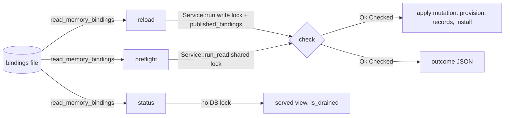
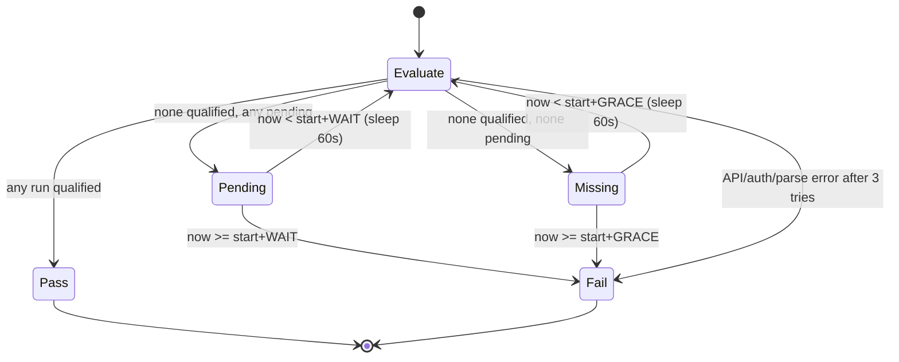

# Introduction

This PRD plans two independent capabilities that the owner approved together. The owner's estimate was 3–5 engineering days. The planned estimate is about 4–5.25 engineer-days, about 3.5 in the best case; Section 14.1 gives the breakdown.

1. **MemoryAI grant-change preflight and status.**
   - Today an operator edits the configured bindings file and sends `POST /v1/admin/memory/bindings/reload`. They learn whether the change is reloadable only by applying it.
   - **Preflight** runs the same checks as reload against the file as it is now. It changes nothing: no database write, no scope provisioning, no install of grants, no drain and no audit. It reports whether reload would apply the change, find it unchanged, or require a restart, and whether reload would refuse or be unavailable.
   - **Status** says whether the served grants agree with the configured file, and whether requests that consulted superseded grants have finished (drain).
2. **Release CI guard.**
   - `.github/workflows/release.yml` builds, tests and then publishes:
     1. GHCR images by digest;
     2. manifests;
     3. a GitHub release.
   - `pypi.yml` then uploads wheels.
   - Neither workflow requires the full CI workflow `ci.yml` ("VLite CI", aggregate job "CI required") to have passed on the published commit.
   - The guard blocks **every** publication step until a successful, full, trusted `ci.yml` run exists on the exact commit. The guard has bounded waits, fails closed, has a report-only dry-run mode, and cannot deadlock a tag-first release.

The key words "MUST", "MUST NOT", "REQUIRED", "SHALL", "SHALL NOT", "SHOULD", "SHOULD NOT", "RECOMMENDED", "MAY", and "OPTIONAL" in this document are to be interpreted as described in RFC 2119.

**Cross-reference conventions**: This document uses standardized prefixes for traceability — `FR-` (functional requirements), `NFR-` (non-functional requirements), `FM-` (failure modes), `AC-` (acceptance criteria), and `RD-` (resolved decisions). When a `.req.md` exists, identifiers from that document are referenced directly.

No `.req.md` exists, so this PRD has no `FR-` or `NFR-` items. Requirements use the Section 4 prefixes:
- `REQ-` for functional requirements;
- `SEC-` for security requirements;
- `CON-` for constraints;
- `GUD-` for guidelines;
- `PAT-` for patterns.

Part A (memory) and Part B (CI) are labelled throughout.

**Evidence base**
- **Code base.** Analysis used the local worktree at `HEAD` `12e4829c22c46e6ad7dbec117f06fd3ed71380be` ("Pin Playwright jobs to Ubuntu 24.04"). That commit is also `origin/main` and tag `v0.7.3`; the crate is `vlite` 0.7.3, edition 2024, MSRV 1.89, and the worktree was clean. Every `file:line` reference below is at that commit.
- **Owner direction.**
  - Verbatim: "I would say go ahead with above implementation, give me how much efforts it would take".
  - The owner chose "Preflight/status + CI release guard (Recommended; roughly 3–5 engineering days)".
  - This approves the PRD and the implementation of these two features only. It grants no release, version bump, deployment, PR, `main` push or tag push.
- **Baseline checks at that commit.**
  - `python tests/ci_workflows.py`: 52 tests, OK.
  - `python tests/content_budget.py`: all budgets pass. The tight budgets are:
    - `docs/CONSOLE-ADMIN.md`: 2,498 of 2,500 words;
    - `site/dashboard.html`: 395 of 400 visible words;
    - `site/features.html`: 2,789 of 2,800 visible words;
    - `README.md`: 250 of 250 lines;
    - `site/index.html`: 500 of 500 visible words;
    - `docs/CONSOLE.md`: 1,499 of 1,500 words;
    - `site/architecture.html`: 2,288 of 2,300 visible words.
- **Baseline mutation-ledger anchors.** `python tests/mutant_replay.py plan --root . --ledger <ledger> --shards 1` reports `"stale":0` for each of:
  - `tests/memory_followup_mutants.json`;
  - `tests/f3_mutants.json`;
  - `tests/f2_mutants.json`;
  - `tests/k71_mutants.json`.

  Direct occurrence counts of anchored files:

  | Ledger | `server/reserved.rs` | `server/admin.rs` | `server/memory.rs` |
  |---|---|---|---|
  | `memory_followup` | 4 | 4 | 13 |
  | `f3` | 1 | 4 | — |
  | `f2` | — | 1 | — |
  | `reserved_resource_mutants.json` (campaign record, not replayable) | 6 | 2 | 1 |

  `src/server/memory/reload.rs` holds no ledger anchors.
- **Predecessor.** `docs/projects/feature-memory-live-grants/feature-memory-live-grants.prd.md` (completed) delivered reload. That PRD is context only and is not re-implemented here.

## 1. Goals and Non-Goals

- **G1 (A):** Before sending reload, an admin learns what reload would do with the file as it is now: apply, unchanged, restart required, refused, unavailable, or invalid file. The answer carries the same error code and message reload would return, and nothing is changed.
- **G2 (A):** An admin learns at any time whether the served grants agree with the configured file, and whether requests that used superseded grants have drained.
- **G3 (A):** Both answers keep reload's confidentiality: counts, enums and fixed codes and messages only.
- **G4 (B):** No GHCR digest push, manifest, GitHub release or PyPI upload happens unless a successful full `ci.yml` run exists for the exact published commit. That run must be a trusted event in this repository, its latest attempt must have succeeded, and its jobs must include "CI required", Docker and the full native/Windows matrix.
- **G5 (B):** The guard is bounded and fails closed. It never deadlocks a tag-first release, and a branch dry run reports the guard's verdict without publishing.

### In Scope

- Part A: `POST /v1/admin/memory/bindings/preflight` and `GET /v1/admin/memory/bindings/status`.
- Part A: a shared check that both reload and preflight use.
- Part A: the capabilities route list; OpenAPI and its reviewed parity addition; `site/api.html` rows; dashboard controls; the admin-route inventory; the dashboard recapture; and documentation.
- Part B:
  - `scripts/ci_policy.py release-ci`;
  - a `ci-guard` job in `release.yml` that gates `image-build`, `image-publish`, `image-verify` and `release`;
  - a `ci-guard` job in `pypi.yml` that gates `publish`;
  - tests in `tests/ci_workflows.py`;
  - a maintainer note in `docs/INSTALL.md`.

### Out of Scope (deferred)

- Binding lifecycle APIs (add, remove, rename), file watchers, automatic reload, receipt changes, record cleanup, temporal facts and erasure.
- Any change to reload's wire format, error codes, messages, authorization, audit or log event.
- A reload-in-progress indicator in status (RD-007).
- Record agreement in status. Status does not read the database; preflight `records` reports pending record writes (RD-004).
- `deployment-image.yml`, which `ci_policy.py image-ci` already guards; `image_ci` and `trusted_run` stay byte-identical.
- `pages.yml` (a website deploy from `main`) and `dashboard-capture.yml` (artifact upload only).
- Branch protection, environment protection rules and repository settings.
- Release, version bump, deployment, PR, and `main` or tag pushes.

## 2. Terminology

| Term | Meaning |
|---|---|
| Reload | The existing `POST /v1/admin/memory/bindings/reload` (`src/server/memory/reload.rs:33-111`) |
| Check | The new shared, read-only evaluation extracted from reload's `apply` (§3.2). It covers the gRPC check, grants-only delta, changed count, graph enabled, resources, `plan`, and coverage both ways |
| Preflight | The new admin request that runs Check under the shared database read lock and reports the outcome |
| Status | The new admin request that compares the served view with the file and reports drain. It never takes a database lock |
| Served view | `service.memory_bindings.current()` (`src/server/reserved.rs:288-296`) |
| Drained | No pin on any superseded view remains alive (`reserved.rs:316-337`) |
| Qualifying CI run | A `ci.yml` run that meets every rule in §3.5.1 |
| Enforce / report mode | The guard's two modes. Enforce publishes only on a pass. Report evaluates once, writes a summary and never authorizes publication |
| Publication | Any step that makes bytes externally visible: GHCR digest push (`image-build`), manifest tags (`image-publish`), GitHub release (`release`), PyPI upload (`pypi.yml publish`) |

## 3. Solution Architecture

### 3.1 Current state (evidence)

**Part A — memory**

- `reload` (`reload.rs:41-69`) runs these steps:
  1. Requires a source and a configured view. Otherwise it answers 409 `memory_reload_unavailable` (UNCONFIGURED, `:27`).
  2. Takes the owned reload lock with `try_reload`. If another reload holds it, it answers 409 `memory_reload_in_progress`.
  3. Reads the file on a blocking task with `admin::read_memory_bindings` (`src/server/admin.rs:391-414`). Any failure is 422 `invalid_input` with one of three fixed, path-free messages.
  4. Spawns `complete`.
- `complete` (`:74-111`):
  1. Runs `apply` under `Service::run`, which holds the exclusive write lock (`src/server.rs:550`).
  2. Runs `drain(DRAIN_TIMEOUT=10s)`.
  3. Logs `{"event":"memory_bindings_reloaded",bindings,changed,drained}` and audits it with `outcome:"ok"`.
  4. Answers `{bindings,changed,drained}`.
- `apply` (`:117-175`) holds `published_bindings` and runs these steps:
  1. gRPC check: AFTER_GRPC → `memory_reload_unavailable`.
  2. `grants_only` → `memory_restart_required`.
  3. `changed` count.
  4. Graph enabled.
  5. For each binding, `db.graph` and `db.collection`.
  6. `plan(db,set,now_ms)` (`src/memory/startup.rs:79`, takes `&Database`).
  7. `with_orphans`, then `covers` both ways.
  8. Mutation:
     - unless read-only, `provision` and `write_binding_record` for `planned.writes`;
     - `install` if `changed > 0`.

  Every refusal before step 8 is a pure function of the database, the served view and the file.
- `Served` (`reserved.rs:264-362`):
  - `drained()` is private and prunes dead weak entries with `retain`.
  - `try_reload()` is a `try_lock_owned` on a tokio mutex. Any caller that takes it, however briefly, makes a concurrent reload fail with `memory_reload_in_progress`.
- Authorization:
  - `authorize` (`src/server.rs:1218`) sets `read_only_allowed = false` for every `/v1/admin/` path (`:1240`). `permission` falls back to `Need::Admin` (`:1197`).
  - Any new `/v1/admin/memory/bindings/*` route is therefore admin-only. Read-only tokens get 403 `read_only`; scoped credentials get 403 `forbidden_scope`.
  - `memory::read_route` and `write_route` (`src/server/memory.rs:184-200`) do not match admin paths.
- Capabilities (`admin.rs`):
  - The feature `memory_bindings_reload` is source && configured && !grpc_built (`:554-559`).
  - The route list includes reload (`:603`).
  - The route is registered at `:449`.
- `tests/server_name_lookup_scan.rs:132-149` allowlists `.collection(` and `.graph(` in `reload.rs` function `apply`, with a justification. The scan fails on stale entries.
- Dashboard (`src/dashboard/index.html:742-744` and `console-tools.js:1773-1777`):
  - The button is `data-admin data-feature="memory_bindings_reload"`.
  - `app.js:130-145` **disables** gated controls and keeps them visible; it does not hide them.
  - `tests/dashboard_tours.py:59-63` pins SHA-256 sums of `src/dashboard/index.html` and `console-tools.js` in `site/assets/dashboard/connected-captures.json`. Any change to those files requires a recapture through `dashboard-capture.yml`. The precedent is commit `14436ffb`: 30 PNGs, the manifest and `site/index.html` fingerprints.

**Part B — CI and release**

- `release.yml` ("VLite release"):
  - Triggers: tag push `v[0-9]*`, and `workflow_dispatch` with no inputs (`:3-6`).
  - `permissions: contents: read`; concurrency `release-${{ github.ref }}` without cancel.
  - Jobs:
    - `identity` (`:16-35`).
    - Build and test jobs `clients`, `native`, `linux-arm64`, `manylinux` and `image-test`, which publish nothing.
    - `image-build` (`:317-331`): `if: startsWith(github.ref,'refs/tags/v')`, `packages: write`. It pushes per-architecture images **by digest**, which is the first publication.
    - `image-publish` (`:426-432`): tag-only, `imagetools create`.
    - `image-verify` (`:489-495`): `packages: read`, no `if`. It is skipped transitively.
    - `release` (`:540-544`): `contents: write`; `gh release create --verify-tag --draft`, then undraft.
  - Nothing reads `ci.yml` results. `docs/projects/roadmap/handover-0.7.2.md:87` records the gap.
- `ci.yml` ("VLite CI"):
  - Triggers: `push` to `main`, `pull_request`, and `workflow_dispatch` with inputs `docker` (default true), `test_proof` and `debuginfo` (`:3-21`).
  - Concurrency `ci-<PR or ref>` with `cancel-in-progress: true` (`:26-28`).
  - Job `required` named "CI required" (`:592-614`) asserts that every applicable job succeeded. The routing in `ci_policy.route` skips the full matrix for docs-only diffs and skips Docker when no container file changed.
- `scripts/ci_policy.py`:
  - `trusted_run` (main-only), `all_succeeded`, `full_ci_jobs` (native 4×2, windows-tests 2×3, lint, docker, default-features), `gh_pages` (`gh api --paginate --slurp`), `image_ci` (main-only) and `route`.
  - Dispatch table at `:141`.
- `pypi.yml`:
  - Triggers: `workflow_run` on "VLite release" completed, or dispatch with a `tag` input.
  - `publish` holds `id-token: write`. It downloads the release wheels and uploads them through trusted publishing.
  - Nothing checks CI.
- Release order in practice is tag → release and PyPI → fast-forward `main`. The commit's `push`-to-`main` CI run therefore arrives **after** publication. The qualifying run must be a `workflow_dispatch` on the release branch or on the tag ref, at the same SHA. `docs/projects/roadmap/ci-speed.md:9-22` already recommends dispatching CI on the release branch. A full CI run takes about 43–86 minutes of wall time.

### 3.2 Target design — Part A



1. **Extract `check`** (`reload.rs`). It is a pure refactor and reload behaviour does not change:

   ```rust
   pub(super) struct Checked { new: reserved::Bindings, changed: usize, writes: Vec<usize> }
   /// Every check of a reload, in reload's order, against `&Database`: no write,
   /// no install, no lock beyond the caller's.
   pub(super) fn check(db: &Database, service: &Service, read: &reserved::Bindings, now_ms: u64)
       -> Result<Checked, ApiError>
   ```

   - It contains steps 1–7 of §3.1 verbatim, with the same codes, messages and order. It returns `Checked { new: read.with_orphans(&planned.orphans), changed, writes: planned.writes }`.
   - `apply` keeps its signature and its `published_bindings` lock. It calls `check(&*db, service, &read, now_ms)?` and then runs step 8 unchanged. It returns `(read.set().bindings.len(), changed)`.
   - The gRPC test stays inside `check`, so preflight reports it as well. Preflight does not take `published_bindings`. The atomic read is advisory, and apply rechecks under the lock.
2. **Shared comparison helper** `fn changed(old: &BindingSet, new: &BindingSet) -> usize`. It counts entries of `new` for which `old.find(tenant,binding) != Some(entry)`. Both `check` and status use it, so status agreement and reload `changed` cannot drift. `Grant` derives `PartialEq` over a `Vec`, so a reordered grant list counts as changed in both.
3. **Preflight handler** `preflight_bindings` (new, in `reload.rs`), for `POST /v1/admin/memory/bindings/preflight`. It ignores the body, as reload does.
   1. If there is no source or the view is unconfigured, answer 200 `outcome:"unavailable"` with the error `memory_reload_unavailable` / UNCONFIGURED.
   2. **Do not** call `try_reload`, and do not read or affect the reload lock.
   3. Read the file with `spawn_blocking(read_memory_bindings)`. On `Err`, answer 200 `outcome:"invalid"` with the error `invalid_input` and the fixed message. Never include the path.
   4. Run `service.run_read(move |db| check(db, &svc, &read, crate::current_time_ms()))`. The closure receives `&Database`, so the type system rules out mutation.
   5. Classify the result:
      - `Ok(c)` → `outcome` is `"reload"` if `c.changed > 0`, else `"unchanged"`. `records` is `0` if `db.is_read_only()`, else `c.writes.len()`; it is computed inside the closure.
      - `Err(e)` whose `e.code` is `memory_reload_unavailable` → `"unavailable"`; `memory_restart_required` → `"restart_required"`; `memory_bindings_conflict` → `"refused"`. `error` is `{code: e.code, message: e.message}`.
      - Any other `Err` propagates as the HTTP error. That covers 503 `busy` (worker admission) and 503 `unavailable` (database closed), both from `run_read` (`src/server.rs:600-614`), 500 `internal_error` (a poisoned lock or a join failure, `:612`, `:620`), and a storage error that `plan` surfaces.
   6. No `logs::stderr`, no audit append and no metrics beyond the router's generic request metrics.
4. **Status handler** `bindings_status` (new, in `reload.rs`), for `GET /v1/admin/memory/bindings/status`. It never touches the database lock or the reload lock.
   - `configured` = `served.is_configured()`.
   - `reloadable` uses exactly the capabilities expression `memory_bindings_reload`. Factor that expression into one `pub(super) fn reloadable(&Service) -> bool` in `admin.rs` and use it in both places.
   - `bindings` = `served.current().set().bindings.len()`.
   - `file`:
     - `"none"` iff `served.source()` is `None`;
     - otherwise read with `spawn_blocking(read_memory_bindings)`: `Err` → `"unreadable"`; `Ok(read)` → `"agrees"` iff the two sets have equal lengths and `changed(old,new)==0`; otherwise `"differs"`.
   - `drained` = `served.is_drained()`, a new non-mutating method that is true iff every `retired` weak entry has `strong_count()==0`. It does not `retain`.
   - Status adds no log or audit entry.

### 3.3 Interface contract — Part A

**`POST /v1/admin/memory/bindings/preflight`** takes no body; any body is ignored.

| HTTP | Body / code | When |
|---|---|---|
| 200 | `{"outcome","bindings","changed","records","error"}` (below) | The evaluation completed, whatever its verdict |
| 401 / 403 | `unauthorized` / `read_only` / `forbidden_scope` | Same as every admin route |
| 429 | `rate_limited` | Same as every route |
| 503 | `busy`, `unavailable` | Worker admission failed, or the database is closed (`run_read`, `src/server.rs:600-614`) |
| 500 | `internal_error` | A poisoned lock or a blocking task join failure (`src/server.rs:612`, `:620`) |
| 5xx | storage code | A storage error surfaced by `plan`, mapped as for any read (`ApiError::from`) |

| `outcome` | `bindings` | `changed` | `records` | `error` | Reload now would answer |
|---|---|---|---|---|---|
| `"reload"` | n ≥ 1 | ≥ 1 | ≥ 0 | `null` | 200, `changed` = this value |
| `"unchanged"` | n ≥ 1 | 0 | ≥ 0 | `null` | 200 `changed:0` (a recheck that may still write records) |
| `"restart_required"` | n | `null` | `null` | `{"code":"memory_restart_required","message":RESTART_REQUIRED}` | 409, same code and message |
| `"refused"` | n | `null` | `null` | `{"code":"memory_bindings_conflict","message":<fixed constant>}` | 409, same |
| `"unavailable"` | `null` | `null` | `null` | `{"code":"memory_reload_unavailable","message":UNCONFIGURED or AFTER_GRPC}` | 409, same |
| `"invalid"` | `null` | `null` | `null` | `{"code":"invalid_input","message":<one of three fixed messages>}` | 422, same |

- `bindings` is the number of bindings in the file for `reload`, `unchanged`, `restart_required` and `refused`. It is `null` for `unavailable` (both UNCONFIGURED and AFTER_GRPC, even though the file was parsed for AFTER_GRPC) and for `invalid`, exactly as the table above defines.
- `changed` is defined only for `reload` and `unchanged`, because reload computes it after `grants_only`.
- `records` is the number of binding records that this node's reload would write. It is `0` on a read-only database or replica, where reload writes nothing.
- Preflight cannot predict:
  - `memory_reload_in_progress`;
  - provisioning or record-write storage failures (`PROVISION_FAILED`, `RECORD_FAILED`, 5xx);
  - a file or database change between preflight and reload.

**`GET /v1/admin/memory/bindings/status`**

| HTTP | Body |
|---|---|
| 200 | `{"configured":bool,"reloadable":bool,"bindings":n,"file":"agrees"\|"differs"\|"unreadable"\|"none","drained":bool}` |
| 401 / 403 / 429 / 500 | As for every admin route. There is no 503, because status takes no database lock |

Neither route touches reload's request, response or errors (CON-001). The capabilities `routes` array lists both routes next to reload (`admin.rs:603`). No new feature flag is added: dashboard controls use `memory_bindings_reload`.

### 3.4 Race, non-mutation and confidentiality semantics — Part A

- **Advisory, apply revalidates.**
  - Preflight's verdict holds only for the instant of its read lock.
  - Reload re-reads the file and reruns `check` under the write lock and `published_bindings`.
  - A file edited between the two calls gets reload's own verdict. TEST-A05 pins this.
- **Linearizable against reload.**
  - `install` happens only inside `Service::run`, which holds the exclusive write lock.
  - Preflight's `check` runs under the shared lock and reads `served.current()` once inside it.
  - It therefore sees the served view either before or after a concurrent reload, never a mix.
- **Status is a snapshot without locks.**
  - It reads `current()` once and the file once, so `file` may lag a concurrent reload by one call.
  - `drained:true` may be reported before a concurrent reload installs; repeat after reload answers.
  - Status reports no in-progress state (RD-007).
- **No reload interference.**
  - Neither handler calls `try_reload`.
  - A reload concurrent with any number of preflights or status calls never gets `memory_reload_in_progress` because of them. Preflight only competes for the shared read lock, as any read request does.
- **Non-mutation.**
  - Preflight has `&Database` only, and it does not provision, write records, install, drain, prune `retired`, log or audit.
  - Status has no database access, and `is_drained` does not prune.
  - The cost of preflight equals reload's check phase, because `plan` scans every graph through `collect`. It holds the shared lock, so writers queue behind it as behind any long read. It is admin-only (RISK-A02).
- **Confidentiality.**
  - Bodies contain only booleans, integers, the fixed enums above, and codes and messages that are compile-time constants already returned by reload.
  - No binding, tenant, principal, scope, graph, collection or path appears in a body, a log or an audit entry, on any outcome.

### 3.5 Target design — Part B

#### 3.5.1 Qualification rules (`scripts/ci_policy.py release-ci`)

The target SHA `S` is resolved first:
- "Set" means present **and non-empty**. An empty string counts as unset, because `pypi.yml` binds `CI_SHA` to an expression that is empty on `workflow_dispatch`.
- If `CI_TAG` is set, it MUST match `^v[0-9][0-9A-Za-z.+-]*$`. `S` is then the commit from `GET repos/{repo}/commits/refs/tags/{CI_TAG}` (`.sha`, peeled; the fully qualified ref form cannot resolve a same-named branch). Verified live on 2026-11-09: `commits/tags/v0.7.3` answers HTTP 422 "No commit found for SHA", while `commits/refs/tags/v0.7.3` answers `12e4829c…`, peeled from the annotated tag object `bfb645e0…`. If `CI_SHA` is also set, it must equal `S`; otherwise the guard fails.
- Otherwise `S = CI_SHA` if set, else `GITHUB_SHA`.
- `S` MUST be 40 lowercase hex characters.

The workflow identity `W` is the `id` from `GET repos/{repo}/actions/workflows/ci.yml`.

Candidate runs come from `GET repos/{repo}/actions/workflows/ci.yml/runs?head_sha={S}&per_page=100`, fetched with `--paginate --slurp`. The collected count MUST equal the first page's `total_count`; a mismatch is an error. Each run is classified on the fields of its **latest attempt**, as the listing reports it:

| Order | Rule | Result if violated |
|---|---|---|
| 1 | `workflow_id == W` and `path == ".github/workflows/ci.yml"` | ignored ("other workflow") |
| 2 | `head_sha == S` | ignored |
| 3 | `event in {"push","workflow_dispatch"}` (`pull_request` tests a merge commit, so it is excluded) | rejected: `event <name>` |
| 4 | `repository.full_name == head_repository.full_name == GITHUB_REPOSITORY` | rejected: `foreign repository` |
| 5 | `status == "completed"` | **pending** (`queued`, `in_progress`, `waiting`, `requested`, `pending`, including a rerun attempt) |
| 6 | `conclusion == "success"` | rejected: `conclusion <value>` (failure, cancelled, skipped, timed_out, action_required, neutral, stale, startup_failure, null) |
| 7 | Jobs of `attempts/{run_attempt}` (paginated): one job named exactly `CI required` with conclusion `success`, **and** `full_ci_jobs(jobs)` | rejected: `partial CI (docs-only or Docker skipped)` |
| 8 | Re-fetch `GET runs/{id}`: same `run_attempt`, still `completed`/`success` | re-evaluate (a rerun started) |

- Any branch or tag ref is accepted. Push and dispatch runs execute the `ci.yml` committed at `head_sha`, so `S` pins both the code and the CI definition (RD-010).
- Any one qualifying run passes, even if other runs at `S` failed. This matches `image_ci` (RD-011).

#### 3.5.2 State machine and bounds



- `CI_WAIT_MINUTES` is an integer from 0 to 240 and defaults to 120. `CI_MISSING_GRACE_MINUTES` is an integer from 0 to `CI_WAIT_MINUTES` and defaults to 15. Any invalid value is an error. All deadlines count from the guard's start, so the total wait never exceeds `CI_WAIT_MINUTES` plus API time.
- Each `gh api` call is retried up to 3 times, with 5 s and 15 s backoff. Every `gh api` subprocess runs with a hard `timeout` of 60 s; a timed-out call counts as a failed try, so a hung RPC cannot hold the guard past its bounds. The guard therefore does not call the unbounded `gh_pages` (which stays byte-identical) but its own bounded, paginating equivalent. No sleep extends past the active deadline, and an evaluation that ends at or after the deadline without a Pass fails. The job `timeout-minutes` is the outer bound. After the retries, any non-zero exit, authentication error, 404, JSON or `KeyError`, missing field, or count mismatch is an **error**: enforce mode fails and nothing passes on an error.
- The fail message lists each candidate as `run URL, event, ref, attempt, reason`, followed by the remedy (§3.6).
- Testability: `release_ci(env, api, api_object, sleep, clock)` takes injected fakes. `main` wires in the bounded paginating call and a bounded single-object `gh api` call, both with retries. Outputs go to `GITHUB_OUTPUT` (`verified=true|false`) and `GITHUB_STEP_SUMMARY`.

#### 3.5.3 Modes

| `CI_GUARD_MODE` | Behaviour | Exit | `verified` |
|---|---|---|---|
| `enforce` (also when unset) | State machine with waits | 0 only on Pass | `true` only on Pass |
| `report` | One evaluation, no wait; writes the verdict (`qualified`, `pending`, `missing` or `rejected`) and reasons to the step summary | 0 for a verdict; 1, with an explicit `error` verdict in the summary and on stderr, when the evaluation itself fails (API, auth, parse, count mismatch, or an output file that cannot be written) | always `false` |
| anything else | error | 1 | `false` |

Mode safety:
- `report` with `GITHUB_REF` starting `refs/tags/` is an error (exit 1). A tag run can never be report-only.
- `release.yml` sets `CI_GUARD_MODE: ${{ startsWith(github.ref, 'refs/tags/v') && 'enforce' || 'report' }}`. There is no `workflow_dispatch` input (CON-B03).

#### 3.5.4 Workflow edits

`release.yml`:

```yaml
  ci-guard:
    needs: identity
    runs-on: ubuntu-latest
    timeout-minutes: 150
    permissions:
      contents: read
      actions: read
    outputs:
      verified: ${{ steps.guard.outputs.verified }}
    steps:
      - uses: actions/checkout@v5
      - id: guard
        env:
          GH_TOKEN: ${{ github.token }}
          CI_GUARD_MODE: ${{ startsWith(github.ref, 'refs/tags/v') && 'enforce' || 'report' }}
        run: python3 scripts/ci_policy.py release-ci
```

Changes to the publishing jobs (each `if` keeps the implicit `success()`):

| Job | `needs` gains | `if` becomes |
|---|---|---|
| `image-build` | `ci-guard` | `startsWith(github.ref, 'refs/tags/v') && needs.ci-guard.outputs.verified == 'true'` |
| `image-publish` | `ci-guard` | same |
| `image-verify` | `ci-guard` | same (new explicit `if`) |
| `release` | `ci-guard` | same (new explicit `if`) |

Behaviour of the edited workflow:
- `ci-guard` runs in parallel with the build and test jobs, so most of the CI wait overlaps the build.
- No `continue-on-error`.
- The `release-${{ github.ref }}` concurrency is unchanged.

`pypi.yml`:
- New job `ci-guard`:
  - `if`: the `publish` job's current condition, unchanged.
  - `permissions: {contents: read, actions: read}`, `timeout-minutes: 15`.
  - Steps: checkout, then `python3 scripts/ci_policy.py release-ci`.
  - Env:
    - `CI_GUARD_MODE: enforce`;
    - `CI_TAG: ${{ github.event.inputs.tag || github.event.workflow_run.head_branch }}`;
    - `CI_SHA: ${{ github.event.workflow_run.head_sha }}` (empty on dispatch). On `workflow_run` this binds the tag to the release run's commit and fails if the tag moved;
    - `CI_WAIT_MINUTES: 0` and `CI_MISSING_GRACE_MINUTES: 0`, because CI must already be complete.
  - The job has no `id-token` permission.
- `publish` gains `needs: ci-guard`. Its `if` becomes `(<current condition>) && needs.ci-guard.outputs.verified == 'true'`.

### 3.6 Operator flow and the tag-first deadlock

1. Recommended order (documented in `docs/INSTALL.md`):
   1. On the release branch at commit `S`, run `gh workflow run ci.yml --ref <branch> -f docker=true`.
   2. Optionally, dispatch `release.yml` on the branch. The guard reports the verdict and nothing publishes.
   3. Push tag `vX.Y.Z` at `S`.
   4. The guard finds the run, which is already green or waits up to 120 minutes for it, and publication proceeds. PyPI rechecks.
2. Tag pushed first with no CI run at `S`:
   - The guard waits 15 minutes for a run to appear. If CI is dispatched in that window, the guard waits for it, bounded at 120 minutes.
   - Otherwise the guard fails and every publishing job is skipped. Build jobs still finish and their artifacts stay in the run.
   - Remedy, with no re-tag and no deadlock:
     1. Run `gh workflow run ci.yml --ref vX.Y.Z -f docker=true`. A `ci.yml` dispatch on a tag ref is allowed, and the run has `head_sha = S`.
     2. When it is green, use **Re-run failed jobs** on the release run. `ci-guard` and its skipped dependents rerun against the same artifacts (ASSUMPTION-B01).
3. A CI run failed or was partial (docs-only, Docker off):
   - Same remedy: dispatch or re-run CI with Docker on, then re-run the failed release jobs.
   - A cancelled run never qualifies. Re-running it creates a new attempt, which then counts as pending.

### 3.7 Failure modes

| ID | Part | Trigger | Behaviour | Test |
|---|---|---|---|---|
| FM-A01 | A | No source / unconfigured | Preflight 200 `unavailable` + UNCONFIGURED; status `configured:false`, `reloadable:false`, `file:"none"` when there is no source | TEST-A03 |
| FM-A02 | A | gRPC router built | Preflight `unavailable` + AFTER_GRPC; status `reloadable:false` | TEST-A04 |
| FM-A03 | A | File missing, not regular, too large or invalid | Preflight `invalid` + fixed message; status `unreadable`; no path | TEST-A03 |
| FM-A04 | A | Non-grant change, or coverage change through orphans | `restart_required` | TEST-A02 |
| FM-A05 | A | Graph disabled or missing, evidence missing, `plan` refusal (for example same generation with changed grants) | `refused` + the constant reload uses | TEST-A02 |
| FM-A06 | A | A reload runs concurrently | Preflight waits for the shared lock and reports the before or after state; reload is never refused because of preflight or status | TEST-A06 |
| FM-A07 | A | Database queue full, database closed, or lock poisoned | Preflight 503 `busy` / 503 `unavailable` / 500 `internal_error`, as `run_read`; status unaffected | TEST-A07 |
| FM-A08 | A | File edited between preflight and reload | Reload's own verdict wins | TEST-A05 |
| FM-A09 | A | Pins on superseded views alive | Status `drained:false` until they drop | TEST-A08 |
| FM-B01 | B | No run at `S` | Enforce: wait for the grace period, then fail with the remedy; report: `missing` | TEST-B02 |
| FM-B02 | B | Run queued or in progress (including a rerun attempt) | Wait, bounded at 120 minutes, then fail | TEST-B03 |
| FM-B03 | B | Run failed, cancelled, skipped, timed out | Rejected, with the reason listed | TEST-B04 |
| FM-B04 | B | Run green but docs-only or Docker skipped | Rejected as partial | TEST-B04 |
| FM-B05 | B | `pull_request` event, fork, wrong workflow, wrong SHA | Rejected or ignored | TEST-B05 |
| FM-B06 | B | Latest attempt failed after an earlier attempt passed | Not qualified: only the latest attempt counts | TEST-B06 |
| FM-B07 | B | Rerun starts between the jobs fetch and the run re-fetch | Re-evaluate; counts as pending | TEST-B06 |
| FM-B08 | B | API 5xx, auth, 404, malformed JSON, truncated pagination | 3 tries, then fail closed | TEST-B07 |
| FM-B09 | B | Branch dispatch of `release.yml` | Report once, exit 0, `verified=false`; publishing jobs skipped | TEST-B08, TEST-B10 |
| FM-B10 | B | Tag moved after release (PyPI `workflow_run`) | `CI_SHA` differs from the tag commit, so fail | TEST-B09 |
| FM-B11 | B | `CI_GUARD_MODE` invalid, or `report` on a tag ref | Error, exit 1 | TEST-B08 |

## 4. Requirements

**Part A**

- **REQ-A01**: The admin router MUST register `POST /v1/admin/memory/bindings/preflight` and `GET /v1/admin/memory/bindings/status` literally in `src/server/admin.rs`, next to reload. The capabilities `routes` array MUST list them.
- **REQ-A02**: `check` MUST hold steps 1–7 of reload's current `apply` with byte-identical codes, messages and order. `apply` MUST call it and then perform step 8 unchanged.
- **REQ-A03**: Preflight MUST use `Service::run_read` and MUST NOT call `try_reload`, `install`, `provision`, `write_binding_record`, `drain`, `logs::stderr` or the audit log.
- **REQ-A04**: The preflight response MUST follow §3.3 exactly. `error` MUST equal the code and message reload would return for the same file and database state.
- **REQ-A05**: Status MUST NOT take the database lock or the reload lock. `reloadable` MUST come from the same function as the capabilities flag.
- **REQ-A06**: `Served::is_drained(&self) -> bool` MUST NOT mutate `retired`. `drain` and `drained` stay byte-identical.
- **REQ-A07**: Status `file` agreement MUST use the same `changed` helper as `check`.
- **REQ-A08**: Both routes MUST appear in `src/openapi.json`, with a reviewed verbatim `APPROVED_OPENAPI_ADDITIONS` entry in `tests/graph_surface_parity.rs`. `site/api.html` MUST have the rows `data-api="rest:POST /v1/admin/memory/bindings/preflight"` and `data-api="rest:GET /v1/admin/memory/bindings/status"`, with the Admin badge, after the reload row (`:1546`).
- **REQ-A09**: The dashboard MUST add the buttons `memory-bindings-preflight` ("Check memory grants file") and `memory-bindings-status` ("Memory grants status"), each with a `<pre id="…-result" aria-live="polite">`.
  - Both buttons are `data-admin data-feature="memory_bindings_reload"`, with no confirm dialog, because neither call changes anything.
  - Each handler MUST contain `ctx.api("POST", "/v1/admin/memory/bindings/preflight", {})` or `ctx.api("GET", "/v1/admin/memory/bindings/status")`.
  - `tests/admin_route_coverage.py` INVENTORY MUST map both routes to those controls.
- **REQ-A10**: The connected dashboard tour MUST be recaptured through `dashboard-capture.yml`, so that `tests/dashboard_tours.py` passes. The recapture covers `site/assets/dashboard/*.png`, `connected-captures.json` and the `site/index.html` fingerprints.
- **REQ-A11**: The `tests/server_name_lookup_scan.rs` entries for `reload.rs` `.graph(` and `.collection(` MUST move from function `apply` to `check`. Their justification MUST also cover the shared-lock preflight path; it stays an admin-only existence check of operator-configured names that returns no name. No new pattern is allowed.

**Part B**

- **REQ-B01**: `scripts/ci_policy.py` MUST gain the `release-ci` subcommand implementing §3.5.1–§3.5.3. `trusted_run`, `all_succeeded`, `full_ci_jobs`, `gh_pages`, `image_ci` and `route` MUST stay byte-identical.
- **REQ-B02**: `release.yml` MUST gain `ci-guard` as in §3.5.4. Every job that pushes to GHCR, creates manifests or creates or edits a release MUST list `ci-guard` in `needs` and carry `needs.ci-guard.outputs.verified == 'true'` in its `if`.
- **REQ-B03**: `pypi.yml` MUST gain `ci-guard` as in §3.5.4. `publish` MUST need it and check `verified`.
- **REQ-B04**: Existing release tests stay: `identity`, `tests/release_assets.py`, `tests/wheel_platform.py`, `image-test`, `image-verify`, and the release checksum step. The guard adds a requirement and replaces nothing.
- **REQ-B05**: `docs/INSTALL.md` ("PyPI publication details for maintainers") MUST document the recommended order, the remedy, and the bounds of §3.6.

**Security**

- **SEC-001** (A): Both routes are admin-only through the `/v1/admin/` rule. Read-only tokens and scoped credentials get 403 with the existing codes. Tests MUST pin this.
- **SEC-002** (A): No body, log line or audit entry from preflight or status may contain a binding, tenant, principal, scope, graph, collection or path. A sentinel sweep MUST pin this (TEST-A09).
- **SEC-003** (A): Preflight and status MUST NOT weaken read-only, replica or gRPC restrictions:
  - on a read-only database or replica, preflight reports `records:0` and writes nothing;
  - after gRPC, preflight reports `unavailable`.
- **SEC-004** (B): The guard MUST fail closed on every error. `verified=true` MUST come only from enforce mode after Pass. The job needs only `contents: read` and `actions: read`, and no secret beyond `github.token`.
- **SEC-005** (B): The guard's mode comes only from the event ref, never from a dispatch input.

**Constraints**

- **CON-001**: Reload's path, method, body handling, response `{bindings,changed,drained}`, error codes and messages, authorization, audit and log event MUST NOT change. The existing tests in `tests/server_memory_live_grants.rs` and `src/server/memory/pins_reload.rs` MUST pass unchanged.
- **CON-002**: Mutation-ledger anchors MUST stay `"stale":0` for the four replayable ledgers. Anchor texts in `reserved.rs`, `admin.rs` and `memory.rs` stay byte-identical. The `reserved_resource_mutants.json` anchors in those files each still occur exactly once.
- **CON-003**: Content budgets MUST NOT be raised.
  - `docs/CONSOLE-ADMIN.md` MUST stay ≤ 2,500 words. Fold the two routes into the reload row and trim words in that row.
  - `site/dashboard.html`, `site/features.html`, `site/architecture.html`, `docs/CONSOLE.md` and `README.md` are not edited.
  - The recapture changes only `?v=` fingerprint attributes in `site/index.html`, as in `14436ffb`, so its 500 visible words are unchanged.
- **CON-B01**: No gate is weakened: `ci.yml` jobs, `required`, routing, `deployment-image.yml` and existing tests stay unchanged.
- **CON-B02**: No release, version bump, tag, `main` push, PR or deployment is part of implementation. Verification uses branch dispatches only.
- **CON-B03**: `release.yml` `workflow_dispatch` keeps having no inputs.

**Guidelines and patterns**

- **GUD-001**: Prefer the fixed message constants of `reload.rs`. Add no new user-facing strings in Rust other than the enum values.
- **GUD-002**: Keep the policy code standard-library only, as `ci_policy.py` is today. The tests stay `unittest` with raw-text workflow checks and no YAML library.
- **PAT-001**: A read-only evaluation shared by the mutating path (`check` / `apply`) mirrors `plan` (`startup.rs:79`), which startup and reload share.
- **PAT-002**: The guard follows `image_ci`: exact SHA, the attempt's jobs, `full_ci_jobs`, and a step summary.

## 5. Risk Classification

| ID | Risk | Level | Mitigation |
|---|---|---|---|
| RISK-A01 | Extracting `check` changes reload behaviour | 🟡 | REQ-A02 and CON-001: existing reload suites unchanged; no ledger anchors in `reload.rs` |
| RISK-A02 | Preflight on a large database holds the read lock for a full `plan` scan | 🟡 | Same cost as reload's check; admin-only; worker admission bounds concurrency; documented |
| RISK-A03 | Operators treat preflight as a guarantee | 🟢 | `advisory` documented; apply revalidates (TEST-A05) |
| RISK-A04 | The recapture is not reproducible locally | 🟡 | Use `dashboard-capture.yml` on the feature branch (ubuntu-24.04), as for `14436ffb`; EPIC-003 owns it |
| RISK-A05 | The CONSOLE-ADMIN budget (2 words free) | 🟢 | One compact row; `content_budget.py` gate |
| RISK-B01 | The guard blocks a release whose CI ran only as `pull_request` | 🟡 | Documented order: dispatch CI on the branch first; the fail message gives the command |
| RISK-B02 | A long CI run makes the 120-minute wait time out | 🟢 | Rerun the failed release jobs; no re-tag |
| RISK-B03 | GitHub API rate limit or outage | 🟢 | Retries, then fail closed; rerun |
| RISK-B04 | A writer dispatches `pypi.yml` from a branch whose copy drops the guard | 🟡 | Residual: repository write access already allows workflow edits. Recommend the existing `pypi` and `pypi-embedded` environment protections (`docs/INSTALL.md:201-202`). Out of scope |
| RISK-B05 | Old tags lack a qualifying run, so a PyPI re-dispatch fails | 🟢 | Intended (fail closed); dispatch CI on the old tag if ever needed |
| ASSUMPTION-B01 | **Re-run failed jobs** reruns `ci-guard` and its skipped dependents, which can download the artifacts of earlier attempts in the same run | — | GitHub behaviour for `actions/download-artifact@v5` within a run. If it fails, rerunning all jobs is the fallback (no re-tag). Verify once on a branch dry run with a forced failure |
| ASSUMPTION-B02 | The `workflows/{id}/runs` listing reports the latest attempt's `status`, `conclusion` and `run_attempt` | — | Documented API behaviour; `image_ci` relies on it today |
| ASSUMPTION-B03 | `GET commits/refs/tags/{tag}` peels annotated tags to the commit | — | Verified live (v1.2): `commits/refs/tags/v0.7.3` returns the commit of the annotated tag; `commits/tags/v0.7.3` returns 422. Unit-tested with a fake |

## 6. Dependencies

- **DEP-001**: Base `12e4829c` (`origin/main`). Implementation branches from it.
- **DEP-002**: No new crate, Python package or action.
- **DEP-003**: EPIC-002 and EPIC-003 merge after EPIC-001, because they reference its routes. Both can be authored in parallel from §3.3.
- **DEP-004**: EPIC-003's recapture needs EPIC-001 merged into the branch it captures, and a dispatch of `dashboard-capture.yml` on a pushed feature branch, which is not `main`.
- **DEP-005**: EPIC-004 is independent of EPIC-001 to EPIC-003.
- **DEP-006**: CI gates touched:
  - `tests/admin_route_coverage.py` and `tests/dashboard_feature_coverage.py`;
  - `tests/api_reference.py` and `tests/openapi_contract.py`;
  - `tests/graph_surface_parity.rs`, `tests/server_name_lookup_scan.rs` and `tests/server_memory_reserved_as_missing.rs`;
  - `tests/dashboard_memory_mode.py` and `tests/dashboard_tours.py`;
  - `tests/content_budget.py` and `tests/ci_workflows.py`.

## 7. Quality & Testing

**Part A — in-crate (`src/server/memory/pins_reload.rs`, reusing its holder helpers)**

`admin_call` (`pins_reload.rs:539-540`) is gated on `#[cfg(feature = "grpc")]` today. ITEM-004 MUST move that `cfg` so the helper compiles under `--features server`; only the gRPC test at `:554` needs gRPC. The helper's body does not change. TEST-A04 alone stays `grpc`-gated.

- **TEST-A01**: Preflight then reload on a grants-only file:
  - preflight answers `reload`, with `changed` equal to reload's subsequent `changed` and `bindings` equal;
  - a second preflight answers `unchanged`, `changed:0`.
- **TEST-A02**: For each refusal, preflight `error` equals reload's 409 body `{code,message}` on the same state:
  - restart required: renamed binding, changed evidence, changed receipt window;
  - refused: same generation with changed grants, missing graph.

  After every preflight, the served view is `Arc::ptr_eq` to the one before, `records()` are unchanged, scopes are unprovisioned, and the audit length is unchanged.
- **TEST-A03**: Unconfigured (no source) gives `unavailable` + UNCONFIGURED. Missing, directory or invalid file gives `invalid`, whose message equals reload's 422 message, and status `unreadable`. No body contains the temp path.
- **TEST-A04** (`#[cfg(feature = "grpc")]`, beside the existing gRPC test at `pins_reload.rs:554`): after a gRPC router is built, preflight gives `unavailable` + AFTER_GRPC and status gives `reloadable:false`.
- **TEST-A05**: Preflight says `reload`. The file is then changed to a non-grant change, and reload answers 409 `memory_restart_required` and installs nothing.
- **TEST-A06**:
  - A held reload lock (`served.try_reload()` kept in the test) does not change preflight or status answers.
  - Conversely, a reload issued while a preflight is parked on the read lock by the holder-thread pattern completes with 200, not `memory_reload_in_progress`.
  - The preflight result is either the before verdict or the after verdict.
- **TEST-A07**: Preflight under a saturated worker queue answers 503 `busy`. Status still answers 200.
- **TEST-A08**: A pin taken before a reload with a short drain makes status report `drained:false`. After the pin drops, status reports `drained:true`. `is_drained` does not shrink `retired` (unit test in `reserved.rs`).

**Part A — integration (`tests/server_memory_live_grants.rs`)**

- **TEST-A09** (confidentiality sweep): the tenant, binding, principal, scope, graph, evidence and file path all carry unique sentinels. For every outcome of TEST-A01 to TEST-A03 and for status, assert:
  - the body contains no sentinel;
  - the audit (`GET /v1/admin/audit`) gains no entry from preflight or status;
  - captured server stderr gains no `memory_bindings_*` event.
- **TEST-A10**: Read-only token → 403 `read_only`; scoped credential → 403 `forbidden_scope`; no token → 401. Applies to both routes.
- **TEST-A11**: On a read-only database or replica, preflight reports `records:0` and status works. Reload behaviour is unchanged (existing tests).
- **TEST-A12**: Status:
  - is `agrees` after startup;
  - is `differs` after a grants edit;
  - is `agrees` after reload;
  - is `agrees` after reordering the bindings, but `differs` after reordering the grants of one binding (same rule as `changed`).
- **TEST-A13** (reserved-as-missing): `server_memory_reserved_as_missing::every_name_addressed_openapi_operation_has_a_differential_case` passes unchanged, and a new assertion in that file pins that the two new OpenAPI paths carry no `{collection}`/`{graph}` segment. On a server with reserved bindings, preflight and status answers name no reserved resource (covered by TEST-A09 sentinels).
- **TEST-A14**: `capabilities.routes` lists both routes. `features.memory_bindings_reload` equals status `reloadable` in every configuration exercised.

**Part A — dashboard**

- **TEST-A15**: `tests/dashboard_memory_mode.py` gains steps after TEST-015:
  - click `#memory-bindings-preflight` and expect `"outcome": "unchanged"`;
  - click `#memory-bindings-status` and expect `"file": "agrees"` and `"drained": true`.
- **TEST-A16**: Gates pass:
  - `admin_route_coverage.py`, `dashboard_feature_coverage.py`;
  - `api_reference.py`, `openapi_contract.py`, `graph_surface_parity`;
  - `server_name_lookup_scan`;
  - `dashboard_tours.py` after the recapture;
  - `content_budget.py`;
  - mutant replay `stale:0`.

**Part B — `tests/ci_workflows.py` (new `class ReleaseGuard`, fakes only, no network)**

- **TEST-B01**: Qualified (dispatch on a feature branch, or dispatch on a tag ref, at `S`, with full jobs) passes immediately with `verified=true`. A qualified `push`-to-`main` run also passes.
- **TEST-B02**: No runs:
  - enforce with grace 15 polls on a fake clock and fails after 15 minutes, and the message includes `gh workflow run ci.yml`;
  - grace 0 fails at once;
  - report mode answers `missing`, exit 0, `verified=false`.
- **TEST-B03**: Pending to pass (status sequence `queued → in_progress → completed/success`) passes, with the fake sleep called. Pending forever fails at `CI_WAIT_MINUTES`. Total fake time never exceeds the bound.
- **TEST-B04**: Failure, cancelled, skipped, timed_out and `null` conclusions are each rejected. A green run whose jobs lack `docker` (skipped) or lack the full matrix (docs-only) is rejected. A missing `CI required` job is rejected.
- **TEST-B05**:
  - rejected: a `pull_request` event; `head_repository` differs (fork);
  - ignored: `workflow_id` or `path` differs; `head_sha` differs.

  None of them passes.
- **TEST-B06**: The latest attempt is failed or in progress while an earlier attempt succeeded: not qualified (pending or rejected). The run re-fetch shows a newer `run_attempt`, so the run is re-evaluated and is not passed on stale jobs.
- **TEST-B07**: The API raises on the first two tries and succeeds on the third, which passes. It raises three times, which fails. Malformed JSON, a missing key, and `total_count` greater than the collected count each fail closed. A subprocess timeout counts as a failed try, and the real `gh` wrapper passes a `timeout`. Report mode on an API error exits 1 with an `error` verdict. No error path writes `verified=true`.
- **TEST-B08**: Invalid `CI_GUARD_MODE` → exit 1. `report` with `GITHUB_REF=refs/tags/v1.2.3` → exit 1. Unset mode → enforce. Invalid or out-of-range wait values → exit 1.
- **TEST-B09**: `CI_TAG` resolves through the fake `commits/refs/tags/<tag>` (the exact endpoint string is asserted).
  - `CI_SHA=""` with `CI_TAG` set (the pypi dispatch case) uses the tag commit.
  - A `CI_SHA` that differs fails.
  - A bad tag format fails.
  - A non-hex or short `S` fails.
- **TEST-B10** (static, raw text):
  - In `release.yml` and `pypi.yml`, every job whose block contains a publication marker lists `ci-guard` in `needs` and contains `needs.ci-guard.outputs.verified == 'true'` in `if`. The markers are `packages: write`, `contents: write`, `id-token: write`, `push: true`, `imagetools create`, `gh release`, `gh-action-pypi-publish`.
  - `ci-guard` has `actions: read`, `timeout-minutes`, no `continue-on-error`, and the exact `CI_GUARD_MODE` expression.
  - `release.yml` `workflow_dispatch:` has no `inputs:`.
  - The `pypi.yml` guard sets `CI_GUARD_MODE: enforce` and has no `id-token`.
  - `image-ci` and `route` stay in the dispatch table, and `test_only_exact_successful_main_ci_is_trusted` passes unchanged.
- **TEST-B11** (manual, recorded in the PR description by the coordinator): two dispatch dry runs of `release.yml` on the feature branch.
  - The two runs need different qualification states, so they do not both need a prior full CI run. At the integrated head `X`, dispatch `release.yml` **before** any `ci.yml` run exists at `X`: it reports `missing`. Then dispatch full `ci.yml` (Docker on) at `X`; once it is green, dispatch `release.yml` at `X` again: it reports `qualified`. One CI run serves both.
  - Record the run URLs and the guard step summaries.
  - Both exit 0, and every publishing job is skipped.
  - Enforce mode cannot be exercised live without publishing; TEST-B01 to TEST-B09 cover it.

### Acceptance Criteria

| ID | Criterion | Verified by |
|---|---|---|
| AC-001 | Preflight reports each of the six outcomes with reload's exact code and message and changes nothing | TEST-A01–A05, A09 |
| AC-002 | Status reports `configured`, `reloadable`, `bindings`, `file`, `drained` per §3.3, with no database or reload lock | TEST-A06–A08, A12, A14 |
| AC-003 | Neither route can make reload answer `in_progress`; preflight sees the before or after state | TEST-A06 |
| AC-004 | No sensitive string in any body, log line or audit entry; admin-only | TEST-A09, A10, A13 |
| AC-005 | Reload wire, errors, auth, read-only, replica and gRPC behaviour unchanged | CON-001 suites, TEST-A04, A11 |
| AC-006 | OpenAPI, parity, `api.html`, capabilities, admin inventory, dashboard and recapture all consistent | TEST-A14–A16 |
| AC-007 | No GHCR push, manifest, release or PyPI upload is reachable without enforce Pass at the exact SHA | TEST-B01–B10 |
| AC-008 | Guard waits are bounded; errors fail closed; no tag-first deadlock (remedy without re-tag) | TEST-B02, B03, B07; §3.6 |
| AC-009 | A branch dispatch reports without publishing | TEST-B08, B11 |
| AC-010 | Budgets unchanged and met; ledgers `stale:0`; `image_ci` and `ci.yml` unchanged | TEST-A16, B10 |

**Validation commands** (the implementer runs these; the coordinator runs full CI):

```text
cargo nextest run --locked --features server --lib -E 'test(memory::) | test(reserved::)'
cargo nextest run --locked --features server,grpc --lib -E 'test(pins_reload)'
cargo test --locked --features server --test server_memory_live_grants --test server_memory_reserved_as_missing --test server_name_lookup_scan
cargo test --locked --features server,mcp --test graph_surface_parity
python tests/admin_route_coverage.py; python tests/dashboard_feature_coverage.py; python tests/api_reference.py; python tests/openapi_contract.py
python tests/content_budget.py; python tests/ci_workflows.py
python tests/mutant_replay.py plan --root . --ledger tests/<ledger>.json --shards 1   # each of 4 ledgers: "stale":0
python tests/dashboard_memory_mode.py target/debug/vlite-server; python tests/dashboard_tours.py
```

## 8. Security Considerations

- **Authorization (A).** Both routes inherit the `/v1/admin/` rule: admins only. Read-only tokens and scoped credentials are refused before the handler runs (SEC-001).
- **Information exposure (A).** Preflight exposes no more than reload already does: the same codes, constant messages and counts. Status adds `file` agreement and `drained`, both enums or booleans. Neither route reveals which binding differs (SEC-002).
- **Non-mutation (A).** The type system enforces it for preflight (`&Database`). Status has no database access. TEST-A02 pins behavioural non-mutation: `ptr_eq` view, records, scopes and audit unchanged.
- **Denial of service (A).** Preflight costs as much as a reload check and is admin-only. It does not block reload through the reload lock.
- **Supply chain (B).** Publication now requires evidence that the exact bytes' source passed the full matrix, Docker included, under a trusted event in this repository.
  - The guard token is `github.token` with `actions: read`.
  - No secret or input can switch modes.
  - Report mode is refused on tag refs, and publishing jobs are additionally tag-gated.
  - RISK-B04 records the residual workflow-edit risk.

## 9. Deployment & Rollback

- **Part A** ships with the next release; no migration is needed. Rollback is a revert: the routes disappear, reload is unaffected, and there is no persisted state.
- **Part B** takes effect on the next tag after merge. Rollback is a revert of the workflow and policy changes. Until merge, releases behave as today.
- Neither part is released, versioned or deployed by this work (CON-B02).

## 10. Resolved Decisions

| ID | Decision | Rationale |
|---|---|---|
| RD-001 | Separate preflight route, not `?dry_run` on reload | Keeps reload's wire and errors unchanged (CON-001); different authority (no mutation) is clearer as a route |
| RD-002 | Preflight is `POST`, status is `GET` | Preflight is expensive (file I/O plus a full `plan` scan) and mirrors reload. Status is a cheap snapshot |
| RD-003 | Preflight answers 200 with `outcome` and `error` rather than replaying reload's 409/422 | The request succeeded; the verdict is data. HTTP errors are reserved for the preflight itself failing (503, 500) |
| RD-004 | Status does not read the database | Keeps status lock-free and cheap; preflight `records` covers record lag |
| RD-005 | No audit or log events for preflight and status | Read-only and admin-only, like other admin reads; avoids audit noise. The router's generic request metrics still count them |
| RD-006 | Dashboard controls reuse `data-feature="memory_bindings_reload"`; no new feature flag | Smallest surface. Controls are disabled exactly when reload is |
| RD-007 | No reload-in-progress field | Observing the tokio mutex without taking it is not possible. Taking it would break reload (AC-003) |
| RD-008 | Guard in `ci_policy.py`, not a third-party action | Reuses `full_ci_jobs` and `gh_pages`; standard library only; already unit-tested |
| RD-009 | PyPI guarded; `pages.yml` and `deployment-image.yml` excluded | PyPI is publication. Pages is a site deploy from `main`; deployment images are already guarded |
| RD-010 | Any ref at exact `S`; `push`/`workflow_dispatch` only | Release order puts CI on a branch or tag. The SHA pins code and `ci.yml`. `pull_request` runs test a merge commit |
| RD-011 | Any qualifying run passes; the latest attempt only | Flake tolerance consistent with `image_ci`. A later failing attempt supersedes |
| RD-012 | Waits of 120 minutes (pending) and 15 minutes (missing) | Covers the 43–86-minute CI plus queueing; a short grace avoids holding runners when CI was never started |
| RD-013 | The guard runs in parallel with the builds | No added wall time when CI is already green; most of the wait overlaps the builds |

**Material decisions for the owner.** These are defaults, and the coordinator may confirm them before implementation:
- **D1:** RD-012 bounds (120/15).
- **D2:** RD-010 excludes `pull_request` runs. Releases therefore need a dispatch CI run at the SHA.
- **D3:** RD-009 includes the PyPI guard.
- **D4:** RD-005, no audit for preflight.
- **D5:** The recapture of 30 screenshots (REQ-A10) is unavoidable once dashboard files change.

## 11. Alternatives Considered

| Alternative | Rejected because |
|---|---|
| `?dry_run=true` on reload | Changes reload's wire and authorization semantics; risk of an accidental apply |
| Status compares records too | Needs the database lock and a `plan` scan; duplicates preflight |
| Taking `try_reload` in preflight for exclusivity | Makes concurrent reloads fail `in_progress` |
| `workflow_run` trigger from CI to release | Inverts ownership, cannot cover tag pushes cleanly, and does not guard PyPI dispatch |
| Branch protection or required status checks on tags | Repository settings are out of scope; they do not cover `workflow_dispatch` publication |
| Running full CI inside `release.yml` | Duplicates `ci.yml` (about 1 hour), drifts from "CI required", and is not the approved design |
| Accept `pull_request` runs | Tests the merge commit, not `S`; fork code paths |
| Guard only `release` (the last job) | GHCR digest pushes in `image-build` are already publication |

## 12. Files

| ID | File | Change | Epic |
|---|---|---|---|
| FILE-001 | `src/server/memory/reload.rs` | Extract `check` and `changed`; `preflight_bindings` and `bindings_status` handlers | EPIC-001 |
| FILE-002 | `src/server/reserved.rs` | Add `Served::is_drained` and its unit test | EPIC-001 |
| FILE-003 | `src/server/memory.rs` | Re-export the handlers, if needed (visibility only) | EPIC-001 |
| FILE-004 | `src/server/admin.rs` | Two literal routes; `reloadable(&Service)` used by the capabilities flag; two entries in the route list | EPIC-001 |
| FILE-005 | `src/server/memory/pins_reload.rs` | TEST-A01–A08 | EPIC-001 |
| FILE-006 | `tests/server_memory_live_grants.rs` | TEST-A09–A12, A14 | EPIC-001 |
| FILE-007 | `tests/server_name_lookup_scan.rs` | Move the two `reload.rs` entries `apply` → `check`; update the justification | EPIC-001 |
| FILE-008 | `tests/server_memory_reserved_as_missing.rs` | TEST-A13 name-free assertion | EPIC-001 |
| FILE-009 | `src/openapi.json` | Two path entries | EPIC-002 |
| FILE-010 | `tests/graph_surface_parity.rs` | Verbatim `APPROVED_OPENAPI_ADDITIONS` entries | EPIC-002 |
| FILE-011 | `site/api.html` | Two `data-api` rows after `:1546` | EPIC-002 |
| FILE-012 | `docs/API.md` (`:392-432`), `docs/MEMORY.md` (`:106-132`), `docs/SECURITY.md` (`:117-135`) | Contract, procedure (edit, then preflight, then reload, then status), confidentiality | EPIC-002 |
| FILE-013 | `src/dashboard/index.html`, `src/dashboard/console-tools.js` | Two controls and handlers | EPIC-003 |
| FILE-014 | `tests/admin_route_coverage.py`, `tests/dashboard_memory_mode.py` | INVENTORY entries; TEST-A15 | EPIC-003 |
| FILE-015 | `docs/CONSOLE-ADMIN.md` (`:241`) | Folded row, ≤ 2,500 words | EPIC-003 |
| FILE-016 | `site/assets/dashboard/*.png`, `connected-captures.json`, `site/index.html` | Recapture output only | EPIC-003 |
| FILE-017 | `scripts/ci_policy.py` | `release-ci` and its helpers; one dispatch-table entry | EPIC-004 |
| FILE-018 | `.github/workflows/release.yml`, `.github/workflows/pypi.yml` | `ci-guard` jobs; `needs` and `if` edits | EPIC-004 |
| FILE-019 | `tests/ci_workflows.py` | `class ReleaseGuard`, TEST-B01–B10 | EPIC-004 |
| FILE-020 | `docs/INSTALL.md` (`:171-204`) | Release-guard maintainer note | EPIC-004 |

## 13. Simplicity Rationale

- **One shared `check`** rather than a parallel validator. Preflight cannot disagree with reload on any pure refusal, and the refactor is a cut-and-call within one file.
- **Two small routes** rather than a lifecycle API, watcher or job system. The handlers are about 60 lines each, with no new state beyond a read-only `is_drained`.
- **No new flag, no new error code, no new audit event.** The outcome enum reuses reload's codes as data.
- **Status without the database** avoids lock contention and a second scan.
- **A guard in the existing policy script** reuses `full_ci_jobs` and `gh_pages`. There is one job per workflow, gating is through `needs` plus one output, and no third-party action is added.
- **Mode from the ref**, not an input, removes a whole class of misuse with one expression.
- What would be simpler and is rejected:
  - Guarding only `release` misses GHCR.
  - An unbounded wait risks hung runners.
  - Accepting `pull_request` runs accepts untested commits.
  - Skipping the recapture would require weakening `dashboard_tours.py`, which is forbidden.

## 14. Implementation Plan

There are four epics with disjoint file ownership (Section 12). EPIC-001 and EPIC-004 start immediately and in parallel. EPIC-002 and EPIC-003 can be authored in parallel from §3.3 and merge after EPIC-001. EPIC-003's recapture runs last on the integrated branch.

### EPIC-001: Server — shared check, preflight and status (Part A)

| Task | Description | Status | Relevant Files |
|---|---|---|---|
| ITEM-001 | Extract `check` and `changed` from `apply` (REQ-A02, REQ-A07); keep `apply`'s signature, lock and step 8; update the name-scan entries (REQ-A11) | Not Started | `src/server/memory/reload.rs`, `tests/server_name_lookup_scan.rs` |
| ITEM-002 | `Served::is_drained` with its unit test (REQ-A06) | Not Started | `src/server/reserved.rs` |
| ITEM-003 | `preflight_bindings` and `bindings_status` (§3.2–§3.4); `reloadable(&Service)`; route registration; capabilities route list (REQ-A01, A03–A05) | Not Started | `src/server/memory/reload.rs`, `src/server/memory.rs`, `src/server/admin.rs` |
| ITEM-004 | TEST-A01–A08; move `admin_call`'s `#[cfg(feature = "grpc")]` so the helper builds under `server` (body unchanged) | Not Started | `src/server/memory/pins_reload.rs`, `src/server/reserved.rs` |
| ITEM-005 | TEST-A09–A14; run CON-001 suites and the ledger replay (CON-002) | Not Started | `tests/server_memory_live_grants.rs`, `tests/server_memory_reserved_as_missing.rs` |

### EPIC-002: Contract and documentation (Part A)

Depends on EPIC-001 for merge.

| Task | Description | Status | Relevant Files |
|---|---|---|---|
| ITEM-006 | OpenAPI paths for §3.3 (200 schema with the `outcome` enum, plus 403/429/503/500 for preflight; 200 plus 403/429/500 for status). The descriptions state advisory semantics and confidentiality. Add the verbatim parity additions | Not Started | `src/openapi.json`, `tests/graph_surface_parity.rs` |
| ITEM-007 | `site/api.html` rows (REQ-A08) | Not Started | `site/api.html` |
| ITEM-008 | Docs: API contract and outcome table; MEMORY procedure (edit, then preflight, then reload, then status until `drained:true`); SECURITY confidentiality and admin-only | Not Started | `docs/API.md`, `docs/MEMORY.md`, `docs/SECURITY.md` |

### EPIC-003: Dashboard and recapture (Part A)

Depends on EPIC-001 for merge; the recapture comes last.

| Task | Description | Status | Relevant Files |
|---|---|---|---|
| ITEM-009 | Two buttons, results and handlers (REQ-A09), with the literal `ctx.api("POST", "/v1/admin/memory/bindings/preflight"` and `ctx.api("GET", "/v1/admin/memory/bindings/status"` forms inside their `on("<control>",` scopes; INVENTORY entries. Validate with `tests/admin_route_coverage.py` and `tests/dashboard_feature_coverage.py` (unchanged; it derives the admin contracts from INVENTORY and requires `registered == classified`) | Not Started | `src/dashboard/index.html`, `src/dashboard/console-tools.js`, `tests/admin_route_coverage.py` |
| ITEM-010 | TEST-A15 Playwright steps; CONSOLE-ADMIN folded row within budget (CON-003) | Not Started | `tests/dashboard_memory_mode.py`, `docs/CONSOLE-ADMIN.md` |
| ITEM-011 | Dispatch `dashboard-capture.yml` on the integrated feature branch; commit the artifact output; `tests/dashboard_tours.py` passes (REQ-A10) | Not Started | `site/assets/dashboard/*`, `site/index.html` |

### EPIC-004: Release CI guard (Part B)

Independent of the other epics.

| Task | Description | Status | Relevant Files |
|---|---|---|---|
| ITEM-012 | `release-ci` per §3.5.1–§3.5.3 with injectable API, sleep and clock; existing functions byte-identical (REQ-B01) | Not Started | `scripts/ci_policy.py` |
| ITEM-013 | `ci-guard` jobs and the `needs`/`if` edits (REQ-B02, B03) | Not Started | `.github/workflows/release.yml`, `.github/workflows/pypi.yml` |
| ITEM-014 | TEST-B01–B10 | Not Started | `tests/ci_workflows.py` |
| ITEM-015 | Maintainer note (REQ-B05). The coordinator performs the TEST-B11 dry runs on the feature branch | Not Started | `docs/INSTALL.md` |

### 14.1 Effort estimate

| Epic | Engineering effort (experienced engineer, focused) | Agent elapsed (coding + local tests) | Wall-clock drivers |
|---|---|---|---|
| EPIC-001 | 1.5–2 days | 2–4 h | Rust builds; `grpc` feature test; ledger replay |
| EPIC-002 | 0.5 day | 1 h | Parity test build |
| EPIC-003 | 0.5–0.75 day | 1–2 h | Playwright run; recapture dispatch (about 30 min); review of 30 PNGs |
| EPIC-004 | 1–1.5 days | 2–3 h | Two dry runs need full CI on the branch (45–90 min each) |
| Integration and review | 0.5 day | 1–2 h | One full CI dispatch on the integrated branch (45–90 min) |
| **Total** | **4–5.25 engineer-days** (sum of the rows; within the owner's 3–5 estimate only at its top, because of the recapture and the dry runs; about 3.5 days if the dry runs reuse one CI dispatch and the recapture is clean first time) | **About 7–12 agent hours**, or about 4–6 h elapsed with EPIC-001 and EPIC-004 in parallel | **About 1–2 calendar days**, dominated by CI queues and full-matrix runs rather than coding |

Engineering effort is the human-equivalent design, coding, testing and review time. Agent elapsed time is shorter for coding, but CI, Playwright, the capture workflow and review gates do not compress. Those gates set the calendar time.

## 15. Change Log

| Version | Date | Change |
|---|---|---|
| 1.0 | 2026-11-09 | Initial PRD from local `HEAD` `12e4829c` (= `origin/main` = `v0.7.3`). Baselines recorded: `ci_workflows.py` 52 OK, content budgets pass, four ledgers `stale:0`. Gaps found during research and planned: the name-lookup scan allowlist (REQ-A11) and the mandatory dashboard recapture (REQ-A10). |
| 1.1 | 2026-11-09 | One read-only `code-review` pass against `12e4829c`. It found no blocker and confirmed the following: `check(&Database)` compiles because `graph`, `collection`, `is_read_only` and `is_graph_enabled` take `&self`; no name collisions; line references are accurate; the Actions semantics hold (`needs` outputs, implicit `success()`, skipped-needs propagation, `workflow_run` fields, `commits/tags/{tag}`); no ledger anchor covers the capabilities expression. Applied the six MINOR findings: (1) preflight errors corrected to 503 `busy`/`unavailable` and 500 `internal_error` per `run_read` (`src/server.rs:600-620`); (2) the `admin_call` `grpc` cfg moved in ITEM-004; (3) an empty `CI_SHA` counts as unset, with a TEST-B09 case for it; (4) `dashboard_feature_coverage.py` added to ITEM-009 validation; (5) the effort total is the sum of the rows, 4–5.25 days; (6) the full list of tight content budgets recorded in CON-003. |
| 1.2 | 2026-11-09 | Implementation clarifications by the coder before coding: (1) the tag endpoint is `commits/refs/tags/{tag}`, verified live (`commits/tags/{tag}` answers 422); (2) every `gh api` subprocess has a 60 s timeout that counts as a failed try, the guard uses its own bounded pagination instead of `gh_pages`, and no sleep passes the deadline (AC-008); (3) report mode exits 1 with an explicit `error` verdict when the evaluation itself fails, and still never sets `verified=true`; (4) preflight `bindings` is `null` for every `unavailable` outcome, matching the wire table; (5) TEST-B11 dry runs use different states at one head (`missing` before CI, `qualified` after). |
