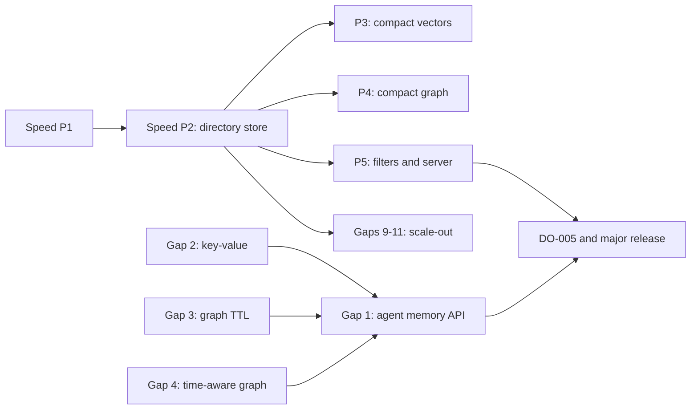

# Next major release: roadmap

| Field | Value |
|---|---|
| Status | All goals and work items approved 2026-10-30. Speed P1 and the key-value API start first |
| Sources | [`storage-goals.md`](../performance/storage-goals.md) (speed and size goals, decisions 1–5), [`product-gaps.md`](../product-gaps/product-gaps.md) (gaps 1–12), Option A of [`performance-proposal.md`](../performance/performance-proposal.md) |
| Benchmarks | DO-005 runs once, after the next store version lands, under the unchanged quiet gate. No campaign runs before then |

## Work items

| Item | Track | What it delivers | Goals or exit | Size | Needs first |
|---|---|---|---|---|---|
| Speed P1: quick wins | Speed | Remove the exact-search regression, background index rebuilds, compact in-memory graph | F2, F5, S4 | S–M | Ready (phase order approved) |
| Speed P2: directory store | Speed | WAL, immutable segments and an atomic manifest, background merges, converter | F4, S6, no regressions | L | P1 (format approved) |
| [Speed P3: compact vectors](p3-compact-vectors.md) | Speed | Opt-in float16 storage, quantized codes, saved ANN graph, SIMD | F1, F3, S1, S2 | L | P2; float32 default retained |
| [Speed P4: compact graph](p4-compact-graph.md) | Speed | CSR adjacency, encoded labels, parallel bulk load | S3, S4, F6 | M–L | P2 |
| [Speed P5: filters and server](p5-filters-and-serving.md) | Speed | Segment statistics and bitmaps, filter-aware ANN, Arrow or protobuf responses | F7, F8, S5 | M | P2; shared compact contract |
| Gap 2: key-value API | Agent memory | Namespaced string keys, vector-free values, expiry, conditional writes | Pool claims, framework stores | S–M | Ready: Rust API first; OpenAPI diff reviewed before merge |
| Gap 3: graph TTL | Agent memory | Expiring nodes and edges with no dangling edges | Replaces the pool's sweeper | M | Edge-expiry rule decided (cascade); lands with or after P2 |
| [Gap 4: time-aware graph](gap4-temporal-graph.md) | Agent memory | `valid_from`/`valid_to` and "as of" reads | Fact history | M | Shared format owner; preserves accepted TTL rules |
| [Gap 1: agent memory API](gap1-agent-memory.md) | Agent memory | remember, recall, consolidate, forget | Mem0/Zep-style layer | M | Gaps 2–4 |
| Gaps 5–7 | Graph depth | [Bounded algorithms](gap5-graph-algorithms.md), Cypher subset with writes, GraphRAG ingestion | Graph parity | L | Algorithms can start independently of CSR; later adapter parity required |
| [Gaps 8 and 12](serving-contract.md) | Serving | Managed embedding/custom-reranker providers, gRPC graph query/mutation parity | SDK reach | M | Wire/API approval; existing embedding, exact/MMR and graph feeds retained |
| [Gaps 9–11](scale-out.md) | Scale-out | Network replication, object storage tier, branching | Cost and availability | L | Speed P2 |

## Decided 2026-11-02

These owner decisions authorize work; none waives correctness qualification,
independent acceptance or the unchanged DO-005 quiet-host policy.

- **S1:** qualifies on the explicit float16 profile instead of default
  settings; float32 stays the default. Measured at the major release.
- **Parity:** F1–F3 and F7 are tracked goals that the release reports but
  does not wait for. Must-not-regress items still block.
- **Size targets:** S1–S6 are best-effort (decided 2026-11-03). The release
  reports their measured values; a miss does not block it. Correctness,
  durability and compatibility gates are unchanged.
- **Public APIs and wire:** approved as drafted: the
  [P3 precision API](p3-precision-api.md) (design A), the
  [serving contract](serving-contract.md) and the
  [P5 serving proposals](p5-filters-and-serving.md). Gap 4 slice E and Gap 1
  slice D follow them; each exact schema is written into its design and
  reviewed before code. `src/openapi.json` and the proto change only as
  these documents specify.
- **Gap 1:** the public Rust names and error taxonomy proceed through
  review in slice A, and every recommendation in
  [Gap 1 section 9](gap1-agent-memory.md#9-delivery-risks-and-open-decisions)
  is accepted.
- **Activation:** float16 per-collection precision, temporal copy-out and
  compact writers each become an explicit opt-in once that capability passes
  its own qualification. Defaults stay unchanged; nothing is qualified yet,
  so nothing is active.
- **Scale-out:** order decided as Gap 11 (local forks), then Gap 10 (object
  storage, Azure Blob first), then Gap 9 (asynchronous read followers, not
  zero-loss high availability). The track stays in the backlog, unscheduled,
  until the owner revisits it. Synchronous acknowledgement needs its own
  approval.

## Decided 2026-11-04

- **Size work parked:** size-driven work (P3b engine integration, P3c, P4, P5
  writers and compression) is parked for 0.7.0 as best effort. The release
  does not wait for it; the DO-005 run reports measured values only; the work
  is revisited if a size goal is required. Must-not-regress items still block
  ([storage goals](../performance/storage-goals.md#decisions), decision 7).
- **Memory track:** Key-value (Gap 2) and agent memory (Gap 1) are P0 for
  0.7.0: the release waits for their independent acceptance and green CI;
  leases stay design-only; publishing stays with the owner.

## Progress

Local numbers below show direction only (see rules).

- **Shared compact storage:** the [interface contract](compact-storage-contract.md)
  reserves one guarded envelope for P3/P4/P5. Its first implementation slice
  validates framing and capabilities without enabling production compact
  writers; source codecs follow separately. Unsupported source data fails
  closed. This is not completion of the size, residency or reopen targets.
- **Speed P1, exact search (F2):** the boxed iterator is gone. At 100k×384,
  k=10 and 16 threads, p50 went from 8.2–8.3 ms to 7.1–7.9 ms, with identical
  results. The exact SIMD kernels in 0.7.0 then took it to 4.8 ms, and 80,000
  × 768 exact search from 10.6 ms to 4.9 ms ([results](../../../benchmarks/RESULTS.md)).
- **Speed P1, background rebuilds (F5):** opt-in
  `set_background_hnsw_rebuild` keeps serving the ready index while a buffer
  overflow rebuilds in the background. Measured for 0.7.0 on 20,000 × 384
  vectors with 16 writes and 4 deletes before each query: a lazy rebuild
  blocks one query for about 1.65 s, twice per run. With the background
  rebuild, queries sent back to back stay under 5 ms but only 40% are served;
  paced at 250 ms every query is served and the worst request is 14.6 ms.
  F5's 10 ms target is not met.
- **Speed P1, compact graph (S4):** partly done. Sorted adjacency with shared
  relationship names cut adjacency from 146 to 54 B/edge. A compact sorted
  property map (a B-tree allocated a ~630 B node even for one property) cut
  edge records from 761 to 265 B/edge. Retained memory for the smoke graph
  (10k nodes, 100k edges) fell from 101.6 MB to 37.9 MB, about 379 B/edge
  against the ≤100 B/edge goal; the rest waits for CSR storage in P4.
- **Gap 2, key-value:** the embedded Rust API is done
  ([storage features](../../STORAGE-FEATURES.md#key-value-store)): namespaces,
  ordered prefix lists, expiry, compare-and-set and fencing tokens, with no
  format change. The REST routes (with `features.kv` in
  `GET /v1/capabilities`), the gRPC `vlite.v1.Kv` service, the local shell and
  MCP tools and the Python, JavaScript and .NET client methods are integrated
  in the 0.7.0 candidate, unreleased, and none of them offers leases. The
  [fenced-lease ledger design](gap2-lease-ledger.md) is a docs-only
  storage-format proposal for `gap2-rust-lease-ledger`, accepted 2026-11-02;
  it is not implemented or active, no existing file is opted in by default,
  and Phase 2 is gated behind separate approval.
- **Speed P2, directory store:** P2a done ([plan](p2-directory-store.md),
  [storage features](../../STORAGE-FEATURES.md#directory-store)). A database
  can be a directory of write-ahead logs and a checkpoint image listed by an
  atomic manifest. Background checkpoints bound reopen replay (S6) and keep
  every record's revision, so compare-and-set and fencing tokens survive.
  Cursors below the floor return `cursor_before_history`. Converters go both
  ways. P2b is implemented: the image and sealed logs are memory-mapped, and
  an image stores records as blocks and graphs as snapshots that load in
  parallel and in bulk instead of by replay. F4 is measured and not met:
  reopening 100,000 × 384 vectors takes 170 ms from a checkpointed directory
  against 238 ms from one file (0.7.0 supplemental run). Loading is still
  linear in the image size (see the plan's limits).
- **Gap 3, graph TTL:** the embedded Rust API is done
  ([property graphs](../../GRAPH.md#expiry-ttl)). Nodes and edges take
  deadlines; an expired node is hidden with all its edges (cascade), and an
  edge can also expire on its own. Graph writes, compaction and checkpoints
  remove expired entities as one computed entry, so the 4,096-operation
  limit is unaffected. Files that do not use expiry keep their encoding.
  REST, gRPC and MCP wait for the OpenAPI review. The
  [TTL-aware feed design](gap3-ttl-feed.md), an additive opt-in feed that
  reports deadlines and removals while the default feed bytes stay unchanged,
  was accepted on 2026-11-02. Its embedded Rust implementation
  (`Database::graph_changes_after`) is independently reviewed and integrated
  but unreleased; server, bindings and CLI exposure still wait for that review.
- **Gap 4, temporal graph:** private model and persistence slices A and B
  are implemented, independently reviewed and integrated, but unreleased
  ([plan](gap4-temporal-graph.md)). They preserve atomic writes, TTL and
  revisions across replay, feeds, export and maintenance. Explicit copy-out
  leaves the source untouched and creates a new lineage requiring replica
  reseeding. Private read slices C1 and C2 are implemented and independently
    reviewed: fixed validity/TTL selectors govern ID/key reads, node scans,
    neighbors, bounded timelines, traversal, retrieval expansion and paging.
    Public activation and production qualification remain outstanding;
    production builds still refuse the temporal capability.
- **Speed P3, compact vectors:** the [design](p3-compact-vectors.md) keeps
  float32 as the storage default and makes float16 explicit. It reuses the
  existing scalar-u8/reranking and ANN snapshot mechanisms, with columnar
  source access and compact persisted topology. A rotated one-bit codec is
  an opt-in candidate, not an unmeasured new default. The private binary16
  conversion and primary-dense codec are implemented and reviewed, behind
  a test-only activation gate. Private precision-descriptor publication and
  transport validation are also implemented and reviewed. Private commit-time
  canonicalization is now independently reviewed and integrated: complete
  batch validation precedes copying, and immediate and reopened values agree.
  Float32 remains unchanged. Private complete-record checkpoints are
  independently accepted: payload/metadata sit beside unchanged dense columns,
  with named/sparse histories and graph attachments preserved in the complete
  image. Item 4's storage-owned framing/writer, capability-table and
  replay/maintenance/backup wiring is test-gated and independently accepted,
  not production qualification. Item 5's private conversion is independently
  accepted and integrated, but unreleased: it copies selected precisions to
  absent file/directory stores, plain or same-key encrypted, preserving
  retained state and numeric revisions but resetting lineage/history;
  overflow, open imports and unsupported sources refuse before output.
  The private P3b column accessor is independently reviewed, mutation-checked
  and integrated, with no production caller. The
  [engine-integration design](p3-compact-vectors.md#p3b-engine-integration-design)
  (pinned generation plus overlay, five ordered code slices) is independently
  reviewed; its six owner decisions were approved individually on 2026-11-02,
  without activation or release authorization. Slice 0 (a test-gated pinned
  source with standalone point reads) and slice 1a (exhaustive private
  resident/compact record dispatch with fail-closed refusals) and slice 1b
  (private installation of a verified compact generation, refusing partial
  collection coverage, with real-open method-matrix coverage) are
  independently accepted and integrated, but unreleased. Slice 2 (a
  test-gated base-plus-overlay view that reconciles committed mutations over
  the captured compact image, keeping tombstones, expiry, revisions and
  snapshots) is accepted with notes and integrated on the same terms. Slice 3
  (a test-gated ordered browse and exact, filtered search over base plus
  overlay, identical to the resident path at the same clock) is accepted with
  notes and integrated on the same terms; hybrid, query-language, grouping and
  facet reads still refuse compact records. Slices 4–5 and all normal
  `Database` wiring remain; slice 4 is next.
  The [P3c compact-ANN design](p3c-compact-ann.md) (source-bound flat
  topology, persisted scalar-u8 codes, background rebuild and a separately
  opted-in rotated one-bit candidate) is independently reviewed; its nine
  owner decisions were approved individually on 2026-11-02. The owner accepted
  advisory private settings; durable public selection would still need a
  separate storage/API amendment. It proposes
  no public API or wire change and makes no recall, size or performance
  claim; its engine integration waits for the required P3b acceptance.
  Release rejection and S1/S2/DO-005 remain unchanged. The
  [API review](p3-precision-api.md) still holds public enablement pending
  complete read/write/maintenance integration. The first exact-SIMD slice
  is implemented, reviewed and integrated, but unreleased: portable and AVX2
  kernels preserve exact scoring, ordering and cutoff behavior. DiskANN
  neighbor scoring, MMR pairwise scoring and the GPU searcher's CPU
  re-score now use the same batched exact path, with unchanged results and
  cache statistics. The NEON kernel is implemented, independently reviewed
  and qualified by native ARM CI. The remaining P3d lifecycle and performance
  qualification are still outstanding. No
  production compact source writer is enabled; F1/F3/S1/S2 qualification
  remains outstanding.
- **Speed P4, compact graph:** the [design](p4-compact-graph.md) is ready:
  immutable CSR checkpoint blocks, a bounded update overlay, encoded labels
  and properties, and deterministic parallel import. The private, test-only
  source codec preserves IDs, keys, revisions, deadlines, ordinary typed
  node/edge properties, label postings with private scan and intersection
  checks, and per-node attachments with graph-local owner uniqueness; its CSR
  is checked against the accepted logical oracle. Reviewed schema declarations
  now round-trip losslessly, with engine snapshot loading checking conformance
  and rebuilding exact/range indexes. This does not persist or serve native
  compact indexes. The private codec now round-trips retained temporal edge
  series with 0–256 segments, signed/open bounds, typed segment properties and
  the edge's identity, revision and deadline, rebuilding the equivalent
  tag-65 snapshot entry. Temporal-section membership distinguishes an empty
  series from an ordinary edge. Ordinary edge records remain on the existing
  path apart from the payload version. Private decoded-CSR ID/key and adjacency
  reads are independently accepted, including TTL and selected temporal
  properties; production query execution is not wired to CSR. Private bounded
algorithm key/adjacency accessors over the pinned view are also independently
accepted and integrated, with no production caller. This decoded
  read model is a correctness oracle, not a resident-budget candidate: on x64
  its per-edge record alone exceeds the 100 B/edge target, so S4 depends on a
  later packed representation. Private parallel
    import staging is independently accepted and integrated but unreleased: logical
  nodes-before-edges admission, in-memory bounded sorting runs and disjoint
  encoding match retained goldens and sequential bytes. Schema/property
  admission, disk spilling and durable publication are not implemented.
  An unreleased private, test-only mutation overlay is independently accepted
  and integrated: chronological committed projections, retained
  tombstones/high-water marks, TTL-aware merged ID/key/adjacency/count reads
  and a physical VLGCSR06 fold. Its configurable cap counts touched node/edge
  IDs including tombstones, with typed atomic refusal at overflow; adjacency
  adds at most two memberships per live overlay edge. Admission/fold use full
  source/encoding scratch under the existing 64 MiB codec image bound, not a
  total-memory bound. Base schema/graph metadata is fixed, payloads are full
  records, and node removal requires explicit incident-edge removals even for
  retained expired edges. No ordered write planner, TTL reclamation, record
  existence/cross-graph owner validation or durable publication is included.
  Checkpoint/read integration, production mutation integration,
  full parallel import and S3/S4/F6
  qualification remain outstanding. Native schema enforcement, cross-graph
  owner validation and integrated columnar property storage also remain
  outstanding. The standalone private packed-fields core is independently
  accepted and integrated, including exact typed values, indexed keys/owners,
  temporal offsets and owned projections. It remains test-only, with explicit
  construction/projection scratch and fields-only informational accounting;
  no normal loader, query wiring or total-memory qualification is claimed.
  P4 slice 1b, a private, test-only, independently accepted and integrated
  `0x0300` checkpoint-block framing, uses unchanged `VLGCSR06` bodies, one
  block per graph, a 64 MiB block-body cap and no graph partitioning; it is
  unreleased and gated off, with no production activation.
  Independently reviewed logical references cover committed-overlay
  identity, non-reused IDs and expiry precedence, typed property snapshots
  with exact integer and float bits, label postings and scans, and
  node-to-record attachments. A reviewed schema reference covers declarations,
  snapshot conformance and single-condition exact/range lookups; these are
  logical test evidence, not an acceptance of the Rust candidate or a byte
  format. The byte budgets are estimates, not measured results.
- **Gap 5, bounded algorithms:** S1 and S2 are implemented and reviewed in
  the embedded Rust API, but unreleased ([plan](gap5-graph-algorithms.md)).
  They provide TTL-aware local scopes, degree counts and hop-constrained
  weighted paths under shared work and memory limits. For those algorithms,
  incomplete extraction or computation returns no analytic values. S3
  PageRank and deterministic label propagation are implemented and reviewed,
  also unreleased. Their incomplete results may retain the last full iteration
  or sweep, never a partial one. S4 sampled betweenness is implemented, reviewed
  and integrated with independent reference fixtures; interrupted computation
  retains only completed sources. S4 is also unreleased. CSR activation and serving
  exposure remain separate work; the private, unreleased [CSR adapter](gap5-csr-adapter.md) has an accepted design. Its resident seam, P4 view/accessors, test-only CSR source and parity evidence (390 result comparisons, 600 source executions) are independently accepted and integrated. This evidence is test-only; it is not qualification or activation.
- **Speed P5, filters:** safe in-memory summaries and visibility tracking,
  including exact-planner fallback, are implemented, independently reviewed
  and integrated, but unreleased ([plan](p5-filters-and-serving.md)).
  Exact results retain full predicate and expiry checks. The per-collection
  64 MiB limit covers retained allocator-requested summary heap, not RSS,
  peak or whole-query memory; exhaustion falls back to an exact scan.
  The explicit approximate filter-aware ANN slice is private and gated,
  independently accepted and integrated but unreleased: candidate-assisted
  eligibility, nonmatching traversal bridges and bounded ef widening retain
  predicate/visibility checks and exact fallback, without exact top-k recall
  guarantees. Released exact results and `auto` selection remain unchanged.
  Thresholds and work/memory budgets are provisional and open for release
  qualification. Persisted writer integration, public activation,
  compression, serving and F7/F8/S5 qualification remain outstanding; no
  performance claim or change to DO-005 is made.
- **Serving design:** [serving](serving-contract.md) has implementation
  boundaries and acceptance matrices, not shipped capabilities. Approximate
  search does not acquire an exact top-k guarantee. Its schemas were approved
  2026-11-02. Gap 8 step 2a, a private REST candidate for opt-in managed
  providers on the existing embed and search routes (with its OpenAPI parity
  allowlist and typed Python client shapes), is independently accepted and
  integrated, but unreleased and not active in production. gRPC step 2b
  (`EmbedText` and custom rerank) is independently accepted (2026-11-04) and
  integrated too, unreleased and inactive until a provider registry is
  configured; the startup flag names and the gRPC `ABORTED` mapping of
  `provider_snapshot_conflict` await ratification. Without a providers file,
  REST `embed` keeps its 0.6.1 behavior. The rest of the contract is not yet
  implemented. The
  [binary search results](serving-binary-results-contract.md) contract
  specifies an opt-in HTTP protobuf representation with its negotiation,
  bounds and independent oracle plan; it is a reviewed specification, not an
  implemented capability. The
  [graph algorithm serving](serving-graph-algorithms-contract.md) contract
  has resolved owner choices for five named read operations, including uniform
  `invalid_input` weight/numeric failures, no deadline partials and a 16 MiB
  operation-specific output cap. Exact-schema independent acceptance and
  implementation remain outstanding; it is not an implemented capability. The
  [agent memory serving](serving-memory-contract.md) and
  [graph gRPC](serving-graph-grpc-contract.md) contracts are likewise
  reviewed specifications awaiting owner decisions: the first aligns to the
  private memory core, A2 retention and accepted private B recall work, the second records today's
  gRPC behaviour apart from the proposed schema. Neither is implemented. The
  [KV and TTL serving](serving-kv-ttl-contract.md) contract specifies KV
  routes, fenced leases, and TTL and change-feed events. Its ordinary KV routes
  over REST and gRPC are integrated in the 0.7.0 candidate, unreleased; its
  lease ledger is a storage-format change that needs owner approval and P2, and
  the lease, graph TTL and change-feed serving remain a reviewed
  specification, not an implemented capability. The
  [precision serving](serving-precision-contract.md) contract specifies the
  per-collection float16 create and inspection surfaces on REST, gRPC, MCP and
  the offline CLI; every explicit-precision request is refused while the
  storage gate stays closed. It is a reviewed specification awaiting owner
  decisions, not an implemented capability. The
  [temporal graph serving](serving-temporal-contract.md) contract specifies
  fixed-time reads, six temporal write operations, an opt-in correction feed
  and copy-out activation across REST, gRPC, MCP, the graph CLI and HTTP
  clients; no temporal file is served until its own qualification passes. It
  is a reviewed specification awaiting owner decisions, not an implemented
  capability. The
  [serving wire conventions](serving-wire-conventions.md) note reconciles the
  proto tag bands, error registry, encodings, change-feed opt-in and shared-file
  order across these drafts. Its 23 shared choices are owner-approved
  (2026-11-02), including the explicitly retained GraphWriteOperation tags
  14-31: Gap 12 owns them for future core atomic graph-batch arms, with a
  separate exact-schema review before releasing a tag. Sibling-draft
  conformance work remains tracked in that note. These shared approvals do
  not approve every feature-specific endpoint, signature or field, accept
  implementations, activate gates or authorize the release.
- **Further design proposals:** [agent memory](gap1-agent-memory.md) defines
  the embedded operations and their prerequisites; [scale-out](scale-out.md)
  compares branching, object storage and replication. Both received source
  and first-party-reference review. Memory's private A1/A2/B slices and the
  crate-private C1 consolidation (exact golden replay, with its test-strength
  follow-up) are independently accepted and integrated, but remain unreleased
  and inactive. The Python, JavaScript and .NET `client.memory(binding)`
  facades and the `vlite-memory-cli` binary are integrated and tested against
  fake HTTP servers; the server-side REST adapter and the memory MCP tools are
  not merged, so no server answers them yet. The remainder of slice C is
  scoped in the
  [C2 remainder contract](gap1-c2-remainder-contract.md) as sub-slices S1-S2, X1,
  E1-E4 and F1-F6 with provisional coordinator rulings: the scoping is accepted,
  S1 is implemented, independently accepted and integrated (crate-private,
  inactive, unreleased), the E1 contract with its independent oracle is
  ratified provisionally and its Rust slice is authorized, the fact
  slices wait for the owner's slice D decisions, and public serving remains
  outstanding.
  Scale-out is not implemented. Its order 11 → 10 → 9 was decided 2026-11-02; the track is
  backlogged until the owner revisits it. The
  [Cypher-style subset](gap6-cypher-subset.md) has ten owner-approved
  private-implementation choices (2026-11-02): the explicitly non-conformant
  `vlite-cypher-1` dialect, bounded atomic writes and unchanged legacy queries.
  Its crate-private parser and planner, with their test-strength follow-up
  (pinned acceptance boundaries; consistent second-MATCH and reserved-function
  diagnostics), are independently accepted and integrated, but remain
  unreleased and inactive, with no executor, binding or public surface.
  The four owner-approved diagnostic rulings of 2026-11-03 (lexical,
  unsupported-kind, inward edge create and parameter errors) are applied by a
  crate-private parser fix, and an independent Python reference with a Rust
  differential runs in CI as a self-test; all are independently accepted and
  integrated, still unreleased and inactive. Two readings (the zero-minimum
  hop and the literal reading of rows f and i) stay provisional until the
  owner ratifies them. Exact public APIs, new errors and serving remain
  separately gated. The
  [GraphRAG ingestion](gap7-graphrag-ingestion.md) design is source-reviewed
  with thirteen embedded-design choices approved individually on 2026-11-02:
  atomic default, explicit incremental progress, deterministic local extraction
  and protected receipts. Its test-side preparation reference (a Python
  oracle with hand-authored goldens) and a crate-private, test-only Rust
  preparation foundation (bounded chunking, validation and deterministic
  dictionary extraction, checked against those goldens) are independently
  accepted and integrated but unwired; the typed prepare/commit core is not
  started. Its byte-level canonical schema
  ([appendix](gap7-canonical-schema-v1.md)) is ratified provisionally with an
  independent Python reference (233 vectors, 86 hand mutants) running in CI;
  its persisted bytes freeze at the release go/no-go. The 1 MiB decoded-output
  and 8 KiB attribute ceilings still need defined byte accounting. External
  extraction, purge mechanics and exact serving remain gated. Neither design
  is active.

## Rules for every item

- Existing `.vlite` files keep opening; format changes arrive only with P2 and
  its converter.
- `src/openapi.json` changes only as an approved contract specifies (see
  [Decided 2026-11-02](#decided-2026-11-02)); new features still land as
  embedded Rust APIs first.
- Exact search results stay identical; recall and latency are compared at equal
  settings.
- Local micro-benchmarks check direction only. Claimed gains come from the
  major-release DO-005 run.

## Why key-value leads the memory track

Independent research reviewed the storage interfaces of about 15 agent-memory,
GraphRAG and orchestration systems (LangGraph, LlamaIndex, Mem0, Zep/Graphiti,
Letta, Microsoft GraphRAG, LightRAG, Cognee, CrewAI, AutoGen, Semantic Kernel,
the OpenAI Agents SDK, the MCP memory server, Haystack and Temporal).

- A namespaced key-value store with expiry and conditional writes sits under
  most of them, and is the cheapest to build on VLite's existing records.
- An append-only log or queue overlaps VLite's change feed; task claims fit
  conditional key-value writes instead.
- A document store is mostly covered by typed metadata filters and can follow
  as vector-free collections.
- Conditional writes alone do not make leases safe; claims also need fencing
  tokens.
