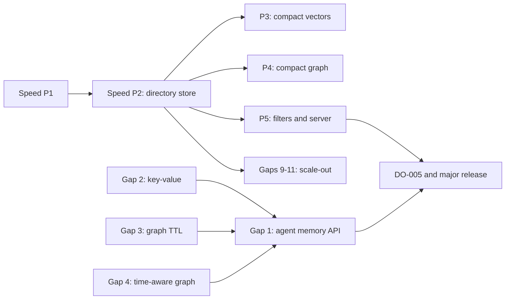

# Next major release: roadmap

| Field | Value |
|---|---|
| Status | All goals and work items approved 2026-10-30. Speed P1 and the key-value API start first |
| Sources | [`storage-goals.md`](../performance/storage-goals.md) (speed and size goals, decisions 1–5), [`product-gaps.md`](../product-gaps/product-gaps.md) (gaps 1–12), Option A of [`performance-proposal.md`](../performance/performance-proposal.md) |
| Benchmarks | DO-005 runs once, after the next store version lands, under the unchanged quiet gate. No campaign runs before then |

## Work items

| Item | Track | What it delivers | Goals or exit | Size | Needs first |
|---|---|---|---|---|---|
| Speed P1: quick wins | Speed | Remove the exact-search regression, background index rebuilds, compact in-memory graph | F2, F5, S4 | S–M | Ready (phase order approved) |
| Speed P2: directory store | Speed | WAL, immutable segments and an atomic manifest, background merges, converter | F4, S6, no regressions | L | P1 (format approved) |
| [Speed P3: compact vectors](p3-compact-vectors.md) | Speed | Opt-in float16 storage, quantized codes, saved ANN graph, SIMD | F1, F3, S1, S2 | L | P2; float32 default retained |
| [Speed P4: compact graph](p4-compact-graph.md) | Speed | CSR adjacency, encoded labels, parallel bulk load | S3, S4, F6 | M–L | P2 |
| [Speed P5: filters and server](p5-filters-and-serving.md) | Speed | Segment statistics and bitmaps, filter-aware ANN, Arrow or protobuf responses | F7, F8, S5 | M | P2; shared compact contract |
| Gap 2: key-value API | Agent memory | Namespaced string keys, vector-free values, expiry, conditional writes | Pool claims, framework stores | S–M | Ready: Rust API first; OpenAPI diff reviewed before merge |
| Gap 3: graph TTL | Agent memory | Expiring nodes and edges with no dangling edges | Replaces the pool's sweeper | M | Edge-expiry rule decided (cascade); lands with or after P2 |
| [Gap 4: time-aware graph](gap4-temporal-graph.md) | Agent memory | `valid_from`/`valid_to` and "as of" reads | Fact history | M | Shared format owner; preserves accepted TTL rules |
| Gap 1: agent memory API | Agent memory | remember, recall, consolidate, forget | Mem0/Zep-style layer | M | Gaps 2–4 |
| Gaps 5–7 | Graph depth | [Bounded algorithms](gap5-graph-algorithms.md), Cypher subset with writes, GraphRAG ingestion | Graph parity | L | Algorithms can start independently of CSR; later adapter parity required |
| [Gaps 8 and 12](serving-contract.md) | Serving | Managed embedding/custom-reranker providers, gRPC graph query/mutation parity | SDK reach | M | Wire/API approval; existing embedding, exact/MMR and graph feeds retained |
| Gaps 9–11 | Scale-out | Network replication, object storage tier, branching | Cost and availability | L | Speed P2 |

## Still open

- S1's default-settings size target conflicts with the chosen float32 default.
  Whether to qualify an explicit float16 profile instead remains a release
  decision; the original criterion is not waived.
- Whether parity targets F1–F3 and F7 block the release.
- Which scale-out item comes first after P2.

## Progress

Local numbers below show direction only (see rules).

- **Shared compact storage:** the [interface contract](compact-storage-contract.md)
  reserves one guarded envelope for P3/P4/P5. Its first implementation slice
  validates framing and capabilities without enabling production compact
  writers; source codecs follow separately. Unsupported source data fails
  closed. This is not completion of the size, residency or reopen targets.
- **Speed P1, exact search (F2):** the boxed iterator is gone. At 100k×384,
  k=10 and 16 threads, p50 went from 8.2–8.3 ms to 7.1–7.9 ms, with identical
  results.
- **Speed P1, background rebuilds (F5):** opt-in
  `set_background_hnsw_rebuild` keeps serving the ready index while a buffer
  overflow rebuilds in the background. The stall has not been measured yet.
- **Speed P1, compact graph (S4):** partly done. Sorted adjacency with shared
  relationship names cut adjacency from 146 to 54 B/edge. A compact sorted
  property map (a B-tree allocated a ~630 B node even for one property) cut
  edge records from 761 to 265 B/edge. Retained memory for the smoke graph
  (10k nodes, 100k edges) fell from 101.6 MB to 37.9 MB, about 379 B/edge
  against the ≤100 B/edge goal; the rest waits for CSR storage in P4.
- **Gap 2, key-value:** the embedded Rust API is done
  ([storage features](../../STORAGE-FEATURES.md#key-value-store)): namespaces,
  ordered prefix lists, expiry, compare-and-set and fencing tokens, with no
  format change. REST and gRPC wait for the OpenAPI review.
- **Speed P2, directory store:** P2a done ([plan](p2-directory-store.md),
  [storage features](../../STORAGE-FEATURES.md#directory-store)). A database
  can be a directory of write-ahead logs and a checkpoint image listed by an
  atomic manifest. Background checkpoints bound reopen replay (S6) and keep
  every record's revision, so compare-and-set and fencing tokens survive.
  Cursors below the floor return `cursor_before_history`. Converters go both
  ways. P2b is implemented: the image and sealed logs are memory-mapped, and
  an image stores records as blocks and graphs as snapshots that load in
  parallel and in bulk instead of by replay. F4 is not measured yet; the
  DO-005 run qualifies it. Loading is still linear in the image size (see
  the plan's limits).
- **Gap 3, graph TTL:** the embedded Rust API is done
  ([property graphs](../../GRAPH.md#expiry-ttl)). Nodes and edges take
  deadlines; an expired node is hidden with all its edges (cascade), and an
  edge can also expire on its own. Graph writes, compaction and checkpoints
  remove expired entities as one computed entry, so the 4,096-operation
  limit is unaffected. Files that do not use expiry keep their encoding.
  REST, gRPC and MCP wait for the OpenAPI review.
- **Speed P3, compact vectors:** the [design](p3-compact-vectors.md) keeps
  float32 as the storage default and makes float16 explicit. It reuses the
  existing scalar-u8/reranking and ANN snapshot mechanisms, with columnar
  source access and compact persisted topology. A rotated one-bit codec is
  an opt-in candidate, not an unmeasured new default. The private binary16
  conversion and primary-dense codec are implemented and reviewed, behind
  a test-only activation gate. The [API review](p3-precision-api.md) still
  holds public enablement pending atomic precision-descriptor publication
  and complete read/write/maintenance integration. No production compact
  source writer is enabled; F1/F3/S1/S2 qualification remains outstanding.
- **Speed P4, compact graph:** the [design](p4-compact-graph.md) is ready:
  immutable CSR checkpoint blocks, a bounded update overlay, encoded labels
  and properties, and deterministic parallel import. It preserves graph TTL
  and attachment rules. Implementation and S3/S4/F6 qualification remain
  outstanding; the byte budgets are estimates, not measured results.
- **Parallel designs:** [temporal graphs](gap4-temporal-graph.md),
  [bounded algorithms](gap5-graph-algorithms.md),
  [filters](p5-filters-and-serving.md) and
  [serving](serving-contract.md) now have implementation boundaries and
  acceptance matrices. They are plans, not shipped capabilities. Temporal
  validity retains closed intervals but does not restore TTL-deleted data;
  algorithms operate on bounded local projections. Exact filtered search
  keeps its oracle; approximate search does not acquire an exact top-k
  guarantee. Serving schemas remain proposals, not approved wire changes.

## Rules for every item

- Existing `.vlite` files keep opening; format changes arrive only with P2 and
  its converter.
- `src/openapi.json` stays frozen until an OpenAPI change is approved, so new
  features land as embedded Rust APIs first.
- Exact search results stay identical; recall and latency are compared at equal
  settings.
- Local micro-benchmarks check direction only. Claimed gains come from the
  major-release DO-005 run.

## Why key-value leads the memory track

Independent research reviewed the storage interfaces of about 15 agent-memory,
GraphRAG and orchestration systems (LangGraph, LlamaIndex, Mem0, Zep/Graphiti,
Letta, Microsoft GraphRAG, LightRAG, Cognee, CrewAI, AutoGen, Semantic Kernel,
the OpenAI Agents SDK, the MCP memory server, Haystack and Temporal).

- A namespaced key-value store with expiry and conditional writes sits under
  most of them, and is the cheapest to build on VLite's existing records.
- An append-only log or queue overlaps VLite's change feed; task claims fit
  conditional key-value writes instead.
- A document store is mostly covered by typed metadata filters and can follow
  as vector-free collections.
- Conditional writes alone do not make leases safe; claims also need fencing
  tokens.
