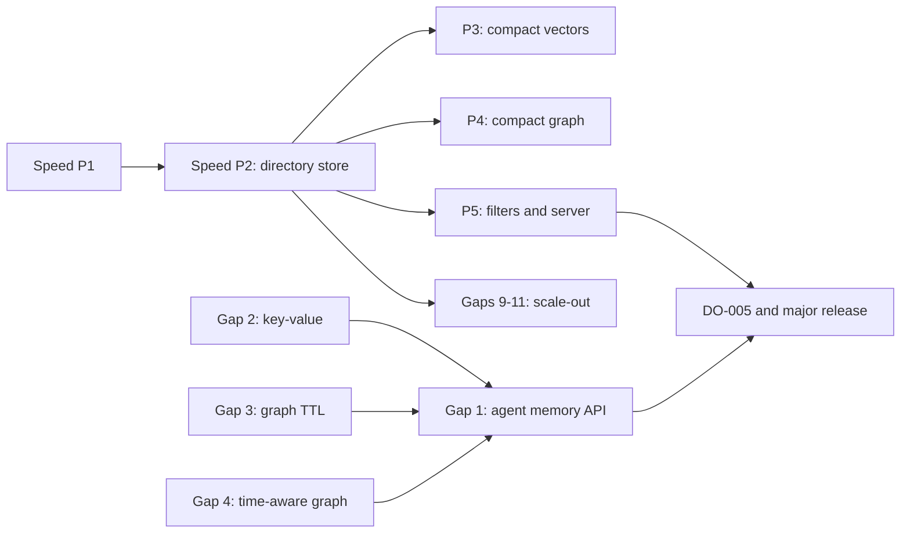

# Next major release: roadmap

| Field | Value |
|---|---|
| Status | Agreed scope 2026-10-30. Work starts with wave 1 below |
| Sources | [`storage-goals.md`](../performance/storage-goals.md) (speed and size goals, decisions 1–4), [`product-gaps.md`](../product-gaps/product-gaps.md) (gaps 1–12), Option A of [`performance-proposal.md`](../performance/performance-proposal.md) |
| Benchmarks | DO-005 runs once, after the next store version lands, under the unchanged quiet gate. No campaign runs before then |

## Work items

| Item | Track | What it delivers | Goals or exit | Size | Needs first |
|---|---|---|---|---|---|
| Speed P1: quick wins | Speed | Remove the exact-search regression, background index rebuilds, compact in-memory graph | F2, F5, S4 | S–M | Decision 4 (phase order) |
| Speed P2: directory store | Speed | WAL, immutable segments and an atomic manifest, background merges, converter | F4, S6, no regressions | L | Decision 1 (format) |
| Speed P3: compact vectors | Speed | float16 storage, quantized codes, saved ANN graph, SIMD | F1, F3, S1, S2 | L | P2; decision 2 (precision) |
| Speed P4: compact graph | Speed | CSR adjacency, encoded labels, parallel bulk load | S3, S4, F6 | M–L | P2 |
| Speed P5: filters and server | Speed | Segment statistics and bitmaps, filter-aware ANN, Arrow or protobuf responses | F7, F8, S5 | M | P2 |
| Gap 2: key-value API | Agent memory | Namespaced string keys, vector-free values, expiry, conditional writes | Pool claims, framework stores | S–M | OpenAPI approval |
| Gap 3: graph TTL | Agent memory | Expiring nodes and edges with no dangling edges | Replaces the pool's sweeper | M | Edge-expiry rule decision |
| Gap 4: time-aware graph | Agent memory | `valid_from`/`valid_to` and "as of" reads | Fact history | M | Revisit the PRD deferral |
| Gap 1: agent memory API | Agent memory | remember, recall, consolidate, forget | Mem0/Zep-style layer | M | Gaps 2–4 |
| Gaps 5–7 | Graph depth | Graph algorithms, Cypher subset with writes, GraphRAG ingestion | Graph parity | L | Scope decision 3 |
| Gaps 8 and 12 | Serving | Server-side reranking and embeddings, gRPC graph | SDK reach | M | None |
| Gaps 9–11 | Scale-out | Network replication, object storage tier, branching | Cost and availability | L | Speed P2 |

## Rules for every item

- Existing `.vlite` files keep opening; format changes arrive only with P2 and
  its converter.
- `src/openapi.json` stays frozen until an OpenAPI change is approved, so new
  features land as embedded Rust APIs first.
- Exact search results stay identical; recall and latency are compared at equal
  settings.
- Local micro-benchmarks check direction only. Claimed gains come from the
  major-release DO-005 run.

## Why key-value leads the memory track

Independent research reviewed the storage interfaces of about 15 agent-memory,
GraphRAG and orchestration systems (LangGraph, LlamaIndex, Mem0, Zep/Graphiti,
Letta, Microsoft GraphRAG, LightRAG, Cognee, CrewAI, AutoGen, Semantic Kernel,
the OpenAI Agents SDK, the MCP memory server, Haystack and Temporal).

- A namespaced key-value store with expiry and conditional writes sits under
  most of them, and is the cheapest to build on VLite's existing records.
- An append-only log or queue overlaps VLite's change feed; task claims fit
  conditional key-value writes instead.
- A document store is mostly covered by typed metadata filters and can follow
  as vector-free collections.
- Conditional writes alone do not make leases safe; claims also need fencing
  tokens.
